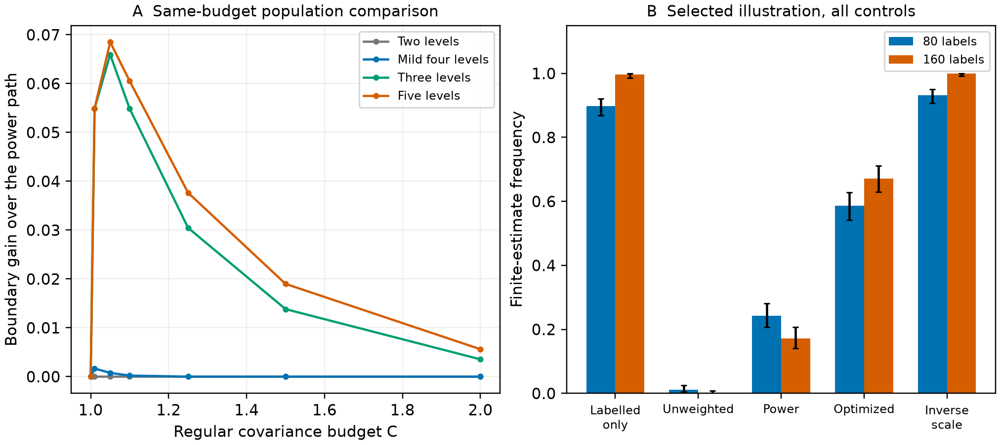

# Optimizing attainment at a specified regular covariance cost

The existing compensated scale profile gives an exact finite-support optimization problem: maximize its finite-estimation boundary while bounding full regular oracle covariance. The [derivation](theory.md) proves the convex reduction,positive unique optimizer,KKT conditions and a closed form after the iterated auxiliary-ratio limit. Classical conic optimization and Hilbert-space geometry supply the tools. This is a model-specific consequence of the same corrected loss.

The preceding [scale proof](scale_boundary_proof.md) defines the scalar profile, and the [row-weight derivation](row_weight_theory.md) states the objective and covariance conventions. All weights and scale laws in this follow-up are fixed. Estimated scales,learned weights,misspecified targets and proportional-dimensional error require separate analysis.

## Population calculation and independent checks

The plan retains195conditions: five scale laws,five auxiliary ratios,seven standard covariance budgets and each distinct inverse-scale endpoint. Every intermediate solution is compared with the best feasible exponent on the entire previous power-weight path. All210SLSQP returns and their tiny feasibility repairs remain available. Numerical differences near zero remain in the files; the smallest computed difference is−3.27e−11.

The independent verifier uses the original scalar profile,105separately solved KKT systems,390Gaussian profile integrals,39distinct unit-ball comparisons and20inverse-budget conditions. No condition is unresolved. The largest independent capacity difference is3.29e−11; the largest Gaussian-integral discrepancy is1.63e−12,and the largest reported quadrature error estimate is1.48e−6. Computed KKT bounds are floating-point diagnostics. The [full records](verification/verification.json) distinguish them from rigorous interval-arithmetic certificates.

At the selected five-level law,auxiliary ratio0.25and covariance budget1.05,the global boundary is0.431647and the power-path boundary0.363157. Their difference concerns critical noise-to-label ratios,not finite-sample success percentages. Constant and two-level equality controls are retained. The model-specific optimized weights improve the attainable boundary; the example below checks the practical size and its strong baseline.

## Transparent selected illustration and all controls

Before any new finite-sample computation,a second plan selected the largest population gap among scale laws with at least three levels,auxiliary ratio at most four,and cost at most two. It chose the five-level condition above. The noise-to-label ratio is0.4. This is a deliberately selected illustration; it estimates no prevalence of gains across choice studies.

The same1000previous simulated cohorts supply every binary choice,proxy and scale uniform. Independent Gaussian columns extend the attribute dimension,and the same uniforms generate the new five-level scale. Each label budget has500cohorts. Auxiliary rows are the first m/4of their old auxiliary sample. No questionnaire observations,human labels or LLM responses are added.

|Method|Finite,80labels|Finite,160labels|Regular covariance factor mV|
|---|---|---|---|
|Labelled only|449/500|498/500|4.000|
|Unweighted compensation|6/500|0/500|3.800|
|Power at budget|121/500|86/500|3.990|
|Optimized at budget|293/500|336/500|3.990|
|Inverse scale|466/500|500/500|12.881|

The optimized and power methods share correction power0.2and covariance budget1.05. At160labels,their paired finite-frequency increase is0.500with Monte Carlo standard error0.02238. The labelled-only comparison goes the other way:the optimized method loses162finite estimates and gains none,with paired difference−0.324and standard error0.02095. At80labels the labelled-only comparison retains six gains and162losses. The inverse-scale endpoint has a substantially larger regular covariance. All conditions and eight paired comparisons remain reported.

These results support the constrained optimization calculation. They give no broad estimator-superiority conclusion:the labelled-only benchmark is more available in this selected example,and the optimized regular covariance factor3.99is only slightly below its factor4. Actual proportional-dimensional MSE and interval effects are unmeasured here. The result is retained as a theoretical implication rather than promoted as a generally better fitting procedure.

PanelA shows all seven standard budgets at auxiliary ratio0.25for the indicated scale laws. All195conditions and inverse endpoints remain in the archive. PanelB shows every method and both label budgets with marginal95%Wilson Monte Carlo intervals. Paired standard errors are separately reported from the same cohort pairs.

## Numerical provenance and source scope

Every one of the5000actual weighted or ordinary objectives receives independent verification on the original scaled design. The final records retain2192negative recession directions,53ordinary strict separators,and zero unresolved states. All1000old and extended cohort hashes agree. The ordinary strict-margin routine initially returned19unknown states. Each is independently interior. The raw records and original source snapshots are preserved; final tables and all paired comparisons use the verified classifications.

The initial pairing check rejected provisional unknown-as-failure summaries. The active generator now leaves unresolved frequencies empty and reports provisional paired statistics only on explicitly resolved pairs. The active verifier resolves all rows and regenerates full summaries. Complete independent replay after the correction reproduces all four original classification outputs byte-for-byte. [Diagnostics](diagnostics/initial_pairing_failure.json) identify the bookkeeping correction; no choice,weight or support event was altered.

The [primary-source scope](closest_prior_scope.json) adds the9November2026PP-Rank preprint. Preference correction,variance-optimal action weights and variance-constrained sampling are established there. Its bounded approximate-root theorem concerns its ranking setup. The present constrained attainment calculation has a different target and sampling model; differences in assumptions alone do not establish originality. The current CC-PPI version remainsv2. No external research code is copied or executed.

The reviewed57-page manuscript and previous archives remain unchanged. Specific-result priority,sufficient choice-analysis value and current submission requirements remain under assessment. The research goal is active.

The [isolated workflow record](clean_validation.json) identifies the tested source closure and regeneration scope.
