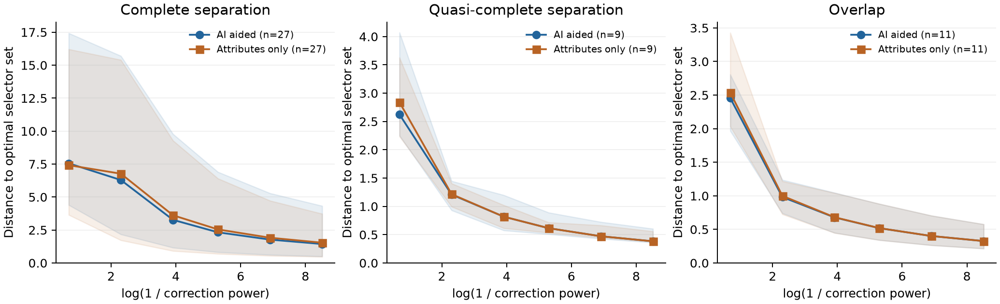

# 离散选择设计中的部分分离与系数路径

本轮补齐同一补偿 Logit 模型的一个应用缺口：属性取离散水平时，人工选择可能只有部分行可被分离。原有严格分离的极限公式需要改用实际的最大可分离行集。新结果已并入主稿第 3.6、5.5 节与附录 D3，未新增框架或估计器。

## 模型结果

[推导](theory.md)保留原目标、冻结预测和原样本数分母。令人工弱分离锥为 C，I+ 为在 C 内可取得正间隔的行，I0 为所有 C 中方向上都为零间隔的行。在辅助衰退函数 a 对 C 中非零方向严格为正、联合设计满列秩时，小正权重的有限唯一估计满足：系数除以 log(1/权重) 后，趋近于最小化 a 的解集，其约束为 I+ 上间隔至少一、I0 上间隔为零。

中性行的人类损失保留其原分母，不能把全部行强行设为严格正间隔。非唯一方向必须按整个最优解集比较。附带的精确例子说明，一个线性规划返回的顶点可以不同于实际路径的极限方向。证明还允许 a 在人类分离锥外为负，未把它假设成范数。

## 原有公开数据上的检验

沿用先前 60 次区组排列、每次 20 条已标注选择和 1180 条辅助属性、两类原预测及六个既有权重。预测与系数均来自原模型流程；本轮重新构造预测以核对输入哈希，没有重拟合选择系数。共保留 720 条既有路径记录，其中 574 条有数值有限根，146 条不可用。五行区组沿用源研究脚本约定，缺少已核实的受访者标识。

| 人类选择配置 | 分配数 | AI 程序符合正衰退条件 | 仅属性程序符合条件 |
|---|---:|---:|---:|
| 完全分离 | 39 | 29 | 27 |
| 准完全分离 | 10 | 9 | 9 |
| 重叠 | 11 | 11 | 11 |

准完全分离的十次分配中，可分离行数介于 3 与 19。把严格分离约束加在全部二十行上，会错误排除这类情况。符合条件的九次分配在两端均有有限系数，结果如下。

| 预测信息 | 共同分配 | 权重 0.5 距离中位数 | 权重 0.0002 距离中位数 | 距离减少／增加 |
|---|---:|---:|---:|---:|
| AI | 9 | 2.6244 | 0.3832 | 9／0 |
| 仅属性 | 9 | 2.8398 | 0.3832 | 9／0 |

距离是缩放系数到整个最优选择器集合的无穷范数距离，数值最优面容许目标值误差 1e−8。端点距离仍为正；六点网格没有建立收敛速率。完全分离组保留较慢的路径和较大的距离尾部，原始逐项结果均在[全部记录](results/path_records.csv)中。

图使用每种预测程序、每类配置在全部六个权重均有解的共同分配：完全分离各 27 次、准完全分离各 9 次、重叠各 11 次。线为中位数，阴影为四分位区间，均为重复分配的描述统计。它们不是人群或独立抽样置信区间。全部分配及不可用记录保留在汇总表中。

## 独立核查

[核查记录](verification/verification.json)包含 1200 个逐行可分离性程序、120 个原始目标支撑程序、96 个未压缩原始行的方向优化程序，以及全部 574 个保留系数的梯度和距离复核。压缩与未压缩目标最大差 7.82e−14，独立距离最大差 3.20e−9，最大梯度／权重为 9.75e−8。中性行另有非负零化向量，支持其无法获得正间隔的判断。

独立内点法对六个中性行返回求解错误。记录保留初始状态，再由对偶单纯形和非负零化向量确认不可行，最终未决数为零。初次主程序还遇到既有不可用记录没有 fit_status 字段的接口差异；修正为读取其原支撑状态，未修改旧系数或数据。两次初始程序与失败说明保留在[诊断目录](diagnostics)。

## 文献归属与正文位置

最大可分离子集已见于 [Ji 与 Telgarsky 第 2 节和定理 2.1](https://arxiv.org/html/1803.07300v3)；消失正则化的间隔极限已见于 [Rosset 等定理 2.1](https://proceedings.neurips.cc/paper_files/paper/2003/file/0fe473396242072e84af286632d3f0ff-Paper.pdf)。本轮将指定补偿目标的后果延伸到实际分类属性支撑，并把它接到既有公开选择路径。[逐项文献位置](closest_prior_scope.json)保留实际阅读范围和检索限制。

这项结果补足理论与离散选择应用的连接。它不承担独立新理论或模型全面优越性的主张。当前主线仍是：同一个补偿选择目标的局部信息可以一致，而全局有限估计结论不同。上一轮行权重优化中普通基准的优势继续保留，未据此改写为优越估计器。

公开数值列没有核实的货币编码，本轮没有报告支付意愿。原始问卷及其参与者信息不进入本研究。当前作者指南访问失败，Scopus／Scholar 系统检索也未完成；不能用本轮数值通过来宣布达到投稿门槛。完整稿件排版与独立目录复现的结果见[整合记录](integration.json)、[排版检查](visual_qa.json)和[独立复现记录](clean_validation.json)。
