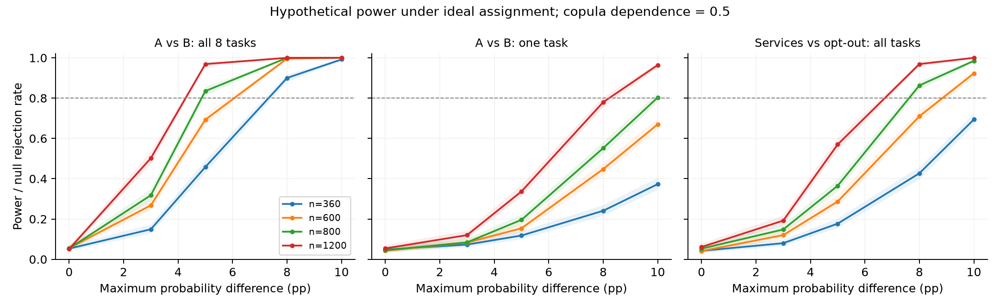

# 全量360条记录：理想分配假设下的模型与技术验证

日期：2026年11月9日。

**结论：360条足以运行本次模型并识别部分版本差异；结果不能证明“所有关键效应均有足够功效”，也不能确认论文创新点已经达到投稿门槛。** 总体随机化检验接近0.05；允许任意题间相关的有限样本精确边际检验及独立留出检验均未拒绝。数据来源与实际分配是证据问题；扩大样本不能自动修复这些问题。

## 分析口径

本次按要求将两版各180条、合计360条全部纳入，不按来源拆分模型，不加入渠道变量，不以速度或回答模式删样。把记录相互独立、个体层面180∶180完全随机分配、无干扰作为条件假设。原始导出文件未修改；原始来源标签未改写为已核实真人。实际招募核查见此前的《DH36模型与数据核查报告》。假设下的分析结果不能反向证明假设已在发放时实施。

8题选择编码逐项核对，完整选择数为2880，按A/B/弃选展开为8640行。统计和交叉验证均以整份答卷为单位。分析是在查看数据后形成，属于探索性分析，未声称预注册。

## 直接回答：数量够不够、质量有什么问题

“够不够”取决于需要发现多大的效应。在潜在相关系数0.5、各题基础概率按本次全量数据校准的假设情景中，360条对8题均出现5个百分点A/B概率差异的功效约为45.8%，8个百分点约为90.0%。如果差异只在一题出现，8个百分点的功效约为24.1%。这些是预设概率差异的模拟，不是从本次p值反推“事后功效”，也不是对新增样本的保证。

完成率和合法编码均通过；这证明记录可用于计算。真人来源、记录独立性、分配实施和理解程度需要不同证据。模型拟合、显著性和预测准确率均不能替代这类证据。不要把“记录完整”写成“已证明可靠真人样本”。

## 原假设和支撑证书

候选摘要对每项服务取(D+S,I+E)，同时保留价格、共享条件和弃选项。两版本的整张候选菜单在每题完全一致。八道任务对应八个二点纤维，总原始菜单数16；菜单对比算子秩8，三分类概率对比维度16。若每个菜单赋质量1/16、对比行归一化为单位长度，八个曝光特征值均为1/16。数值随归一化改变，不能和其他规范的特征值直接比较。

本次充分性原假设允许八道候选菜单各有任意A/B/弃选概率，即16个自由概率参数；完整版本×任务模型有32个自由概率参数。它比5参数共同MNL的原假设更宽。这里的有限支撑证书就是纤维内可用对比的秩，属于经典lack-of-fit对比维数，不能包装为新的统计检验。证书只覆盖这16个菜单。

## 整体检验和基线

| 检验 | 统计量 | 999,999次整份答卷置换p | Monte Carlo 95%区间 |
| --- | ---: | ---: | --- |
| 学生化聚类Wald | 28.0468 | 0.048687 | [0.048266, 0.049110] |
| 完整纤维score／广义CMH形式 | 26.0818 | 0.048687 | [0.048266, 0.049110] |
| 完整任务×版本复合LR | 28.0068 | 0.048172 | [0.047753, 0.048592] |

学生化Wald针对逐题边际概率相等。在记录独立、协方差非退化等正则条件下，置换校准对该弱原假设具有渐近有效性。有限样本精确性要求更强的整份回答向量可交换，或相应的尖锐随机化原假设。仅有逐题概率相等并不保证联合分布相同。LR使用重复题目的复合偏差，采用整份答卷置换，未使用独立选择行的普通χ²参考。

进一步对每道2×3列联表枚举全部可行表，按多元超几何概率精确计算LR尾概率，再对8题做Holm和Bonferroni校正。全局Bonferroni p=0.105614，未拒绝。该方法只要求每题边际原假设和记录间独立，允许同一记录8题任意相关；代价是多重比较导致功效损失。每题条件概率总质量、版本互换不变性和0.01／0.05／0.10水平的精确拒绝质量均已枚举核验。它和整体置换针对的有限样本条件不同，两者一起报告。

在本次平衡180∶180分配下，学生化Wald是固定总体协方差score的严格单调变换，两者所有置换排序相同。这解释了相同p值，也说明没有检验优势。该恒等关系已用100个随机划分与直接协方差计算核对，最大误差约1.4×10⁻¹³。完整LR得到相近结果。

随机森林在240条训练记录上学习方向，固定后在120条留出记录上检验。留出残差检验p=0.2022，对数预测分数平均改进为-0.00522，区间跨0。同样120条的score和LR也未拒绝。留出比较样本量更小，不能据此宣称ML不如全样本检验。

整体p接近0.05，只构成该假设情景下的边缘证据。没有通过后续换模型、换分组或反复选随机种子来争取显著结果。初始49,999次置换和500次校准仍保留，最终精度统一提高。所有模型、积分节点和留出方案的选择均公开。

## 参数模型与重复选择

共同MNL月费系数为-0.2115/10元，答卷聚类95%区间为[-0.2379, -0.1851]。5、7、10参数MNL均通过独立聚合似然复算、解析梯度、数值梯度、Hessian正定性和概率归一性核对；独立估计的最大系数差小于8×10⁻⁸。

面板模型让同一记录的8题共享一个正态服务参与截距，弃选效用取0；价格、共享系数固定。扩展模型曾加入负对数正态价格随机系数，其离散度命中下界。最终模型把该方差精确设为0，不将边界估计当作已发现的价格异质性。保留随机服务截距后模型无边界参数。

共同面板模型的服务截距标准差约为1.356。采用31、101、161点Gauss–Hermite积分核对，101→161点的最大系数变化小于3×10⁻⁸。每个模型用3个固定初值，得到相同目标值。

| 模型 | 新答卷8题联合负对数分数÷8，越低越好 |
| --- | ---: |
| 独立MNL乘积 | 1.041854 |
| 随机服务截距 | 0.983397 |
| 随机服务截距＋版本截距 | 0.981693 |

五折均整份留出；每个训练折独立使用固定的3个初值，未用留出答案或全样本估计初始化。随机截距改善的是完整8题向量的联合预测。版本项相对共同面板模型的平均额外改进为0.00170/题，描述性区间[-0.00150, 0.00491]，未形成稳定的额外预测提升。共同MNL的边际预测损失和面板联合分数是不同目标，报告没有把两者混作同一指标。

参数化版本截距检验p约0.0054，依赖正确的logit和随机截距设定。它不能替代允许任意候选响应面的整体充分性检验，也不能用更小p值证明更强创新。交叉验证区间仅是固定折预测差的描述性区间，训练集重叠使其不等同于独立外部验证。

## 零假设校准与功效

追加了3个场景，每场景5,000次独立模拟，每次999次整份答卷置换：题内独立、同等相关，以及两版边际概率相同但相关结构不同。前两项检查联合原假设下的尺寸；第三项只用于检查学生化弱原假设推断，LR不获得弱原假设精确性声明。

初始500次模拟中，独立题场景Wald置换拒绝率为0.072；此值没有删去。增加至5,000次后的同场景拒绝率为0.0530，95% Monte Carlo区间[0.0471, 0.0596]。完整12行校准结果见null_calibration_extended.csv，不能把有限个场景模拟称为普遍有效性证明。

在两版相关结构不同、边际仍相同的场景，学生化置换的拒绝率为0.0612（95% Monte Carlo区间约0.0549—0.0682），表明n=360时弱原假设尺寸仍有偏差。普通Wald χ²参考在三个场景约为0.078—0.086。故不能用“渐近稳健”给接近0.05的观测结果提供有限样本保证；逐题精确边际检验用于补足这一有效性缺口。

普通χ²参考在部分场景存在有限样本偏差。最终功效表使用独立的5,000次零假设模拟生成各样本量临界值，再对每格进行1,000次独立模拟，共60格。它是给定生成机制下校准后的情景功效，不是各数据集的精确置换功效，也未用观测效应估算功效。初始χ²功效表仅作数值对照。

## 对论文论点的审查

本次能够支持的论点是：完整候选菜单保持可计算验证；在该有限支撑上可以构建纤维内概率对比；理想分配加上联合可交换条件时全量数据存在接近0.05的总体差异信号。有限样本有效的逐题边际检验未拒绝，当前结果没有确认边际充分性失败。不同记录的稳定服务参与倾向能改善重复选择的联合预测。

仍有四个实质缺口。第一，D、S、I、E是研究者指定的等级编码，跨属性相加的等权压缩缺少独立的行为或应用依据。拒绝这个编码只能反驳这个具体摘要，不能推及所有低维效用表示。第二，四个原始属性随版本整组变化，13列模型只有秩7，无法区分哪一项导致差异，框架、复杂度和误差尺度解释也未被分离。第三，证书与经典lack-of-fit自由度相通，score、CMH和饱和LR没有显示独立方法优势。第四，统计模型不能核实招募和真人来源，理想分析无法补成已经实施的随机实验。

建议把本文贡献收窄为“候选摘要压缩下的设计支撑审计与修复”，以现实中有应用依据的广义成本或复合属性为主要案例。进一步贡献必须来自真实常用设计的结构盲区、可执行的修复准则和代价收益比较。当前健康管理例子可作为有限支撑的探索性演示，现有证据不支持将其写成独立原创理论或投稿就绪的确认性实证。此处是基于当前材料的判断，不冒充独立同行评审。

## 可复现材料和校验范围

公开包包含脚本、题目配置、聚合计数、聚类一二阶矩、模型参数、校准与功效表。聚合矩可独立复算观测Wald和协方差；准确的答卷置换、面板似然及个体分折仍需本地受控原始数据。公开包不含IP、提交时间、答卷级8题向量或原始工作簿，因此不能宣称匿名公开包可完全替代原始数据。

技术校验通过意味着实现满足列出的数值和代数检查；它不等于来源核实、原假设为真、模型全局正确、原创性成立或期刊接收。逐项完成状态见claim_and_completion_audit.csv。

## 方法来源

置换的联合原假设与参数弱原假设区分参照[Chung与Romano（2013）](https://arxiv.org/abs/1304.5939)。面板选择的混合积分采用[Train的Discrete Choice Methods with Simulation](https://emlab.berkeley.edu/books/choice2.html)中的标准建模思路。随机森林实现参照[scikit-learn文档](https://scikit-learn.org/stable/modules/generated/sklearn.ensemble.RandomForestClassifier.html)，扩展模型Sobol积分参照[SciPy文档](https://docs.scipy.org/doc/scipy/reference/generated/scipy.stats.qmc.Sobol.html)。这些引用说明方法来源，不构成本文优先权证据。
