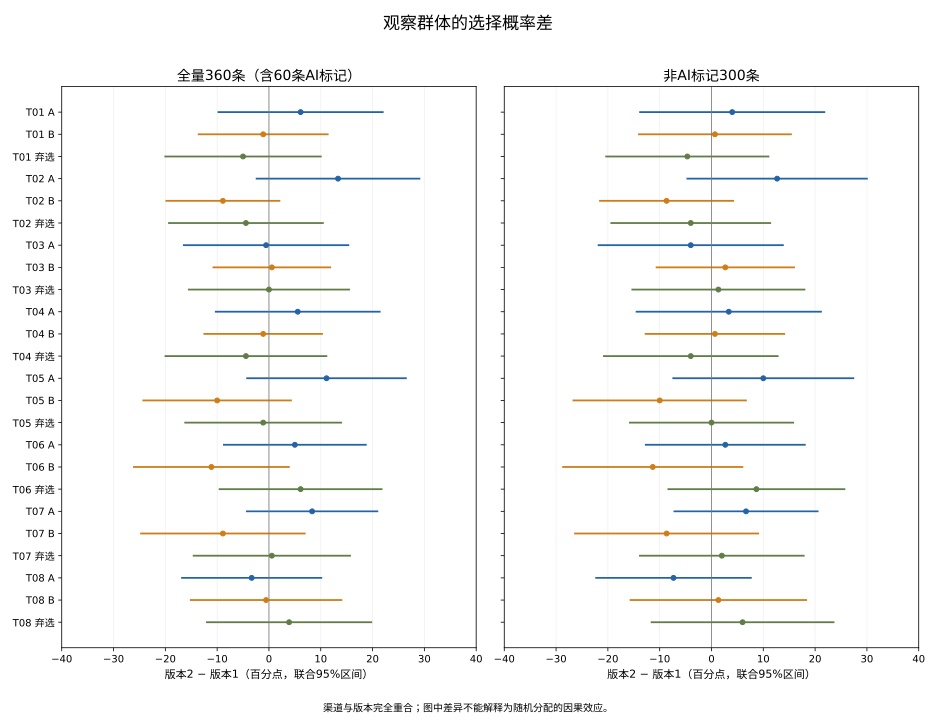

# DH36问卷数据核查与模型结果

日期：2026年11月8日。

已完成三种MNL参数模型、两个逐题概率基线、受访者分组5折验证和4,999次受访者层面bootstrap。全量360条包含60条AI标记记录。总体组间比较在全量数据中的bootstrap p约0.031，排除AI标记后约0.099，结论对来源处理敏感。渠道与版本完全重合，当前结果不能作为随机化充分性检验。

共同MNL的月费系数在全量数据中为-0.2115（每10元，95%区间-0.2379至-0.1851），在非AI标记样本中为-0.2337（95%区间-0.2622至-0.2053）。两种数据口径下，较低月费均与更高选择概率相关。加入版本／渠道交互在本次受访者分组验证中没有改善平均预测损失。

## 本次数据与结论范围

问卷星两版各180条，共360条。来源字段中两版各30条标为“AI样本”，合计60条。全量模型保留360条；另报告不含AI标记记录的300条，以及排除一份较早记录后的299条敏感性分析。来源标签保持原样，未将AI标记记录写成已核实的真人答卷。

研究者确认：不同招募渠道分别只填写一个版本；没有分配记录；发放期间未修改问卷。渠道与版本完全重合。任何版本差异同时包含招募群体、渠道、效用、尺度和其他未测因素。当前数据不能作为已实施的候选保持随机实验，也不能用拒绝版本不变来确认候选摘要不充分。标准误条件于这两个已观察渠道，不能估计跨渠道总体的不确定性。

以下均为观察性、探索性分析。分析方案未外部预注册；AI来源、速度和早期答卷标记在查看导出文件时发现。未以显著性、是否一直选同一项或是否选择弃选作为删样规则。

以答卷序号作为聚类标识。全量模型的标准误和bootstrap额外依赖不同记录之间相互独立；AI标记记录的生成机制尚未核实，这一条件也未得到验证。因此，全量p值仅作混合来源数据的数值敏感性结果。平台序号与IP也不能完全证实每条记录对应不同的真实参与者。

## 数据核查

| version | platform_source | records | duration_min | duration_median | duration_max | under_60_seconds |
| --- | --- | --- | --- | --- | --- | --- |
| V1 | AI样本 | 30 | 16 | 28.0 | 34 | 30 |
| V1 | 手机提交 | 150 | 102 | 233.5 | 395 | 0 |
| V2 | AI样本 | 30 | 22 | 30.0 | 34 | 30 |
| V2 | 企业微信 | 1 | 28 | 28.0 | 28 | 1 |
| V2 | 手机提交 | 149 | 103 | 255.0 | 417 | 0 |

不同来源的选择分布如下。分母为各来源记录数乘以8题，仅作描述，不将同一人的8题当成独立样本：

| version | platform_source | records | choice_rows | share_A | share_B | share_opt_out |
| --- | --- | --- | --- | --- | --- | --- |
| V1 | AI样本 | 30 | 240 | 16.7% | 10.0% | 73.3% |
| V1 | 手机提交 | 150 | 1200 | 38.2% | 31.2% | 30.7% |
| V2 | AI样本 | 30 | 240 | 33.3% | 0.0% | 66.7% |
| V2 | 企业微信 | 1 | 8 | 50.0% | 50.0% | 0.0% |
| V2 | 手机提交 | 149 | 1192 | 41.6% | 26.8% | 31.5% |

11题均有填写，八道选择题的合法编码为1=A、2=B、3=都不选择。原始文件未更改。平台IP仅用于本地重复标记，未进入公开结果或模型。

版本2有一条2026年11月3日提交、用时28秒的记录，其余记录为11月8日提交。研究者尚未确认它是否试填；全量与非AI模型保留该记录，299条敏感性模型按提交日期排除它，不能将这一步描述为事先规定的排除规则。

## 模型构造与识别

对每名受访者的8次回答共同保留。取弃选效用为0，服务效用模型为 $U_{itj}=\alpha_A1(j=A)+\alpha_B1(j=B)+\beta_p(p_{tj}-89)/10+\gamma_1 1(G_{tj}=G1)+\gamma_2 1(G_{tj}=G2)$。

边际选择概率为 $P(Y_{it}=j)=\exp(U_{itj})/\sum_{k\in\{A,B,0\}}\exp(U_{itk})$，尺度归一化。同一人的八次选择通过聚类稳健推断处理关联。

模型1共同估计上述5个参数。模型2增加两个版本／渠道截距，共7个参数。模型3允许5个参数均随版本／渠道变化，共10个参数。ASC吸收各版本固定服务组合与其他未观测组别差异；不得把某个ASC或版本交互解释为单独的数据保存、咨询、提醒或效果研究属性的效应。

完整原始属性模型共有13列，有效秩为7，缺少6个独立方向。将四项固定属性和版本特定服务常数同时放入模型，无法分别估计这些属性的参数。渠道与版本两列的秩为1，加入渠道控制变量无法分离两者影响。

MNL按每题的边际选择概率构造复合似然，以受访者汇总得分计算聚类稳健协方差。它没有为同一人的八次回答建立独立的联合似然，不报告将2,880次选择当独立受访者得到的LR显著性或AIC/BIC。

另用逐题共同概率模型与逐题分组概率模型作灵活基线。8题×A/B共16维概率差采用两组均值协方差与受访者层面bootstrap，24个类别差的区间使用联合max-t校正。单题检验的p值按8题Holm校正。它们检验观察群体的概率差，均不恢复随机化。

## 总体组间比较

**全量360条（包含AI标记记录）：** V1=180.0，V2=180.0；总体Wald=28.047，自由度16.0，渐近p=0.0312，受访者层面中心化bootstrap p=0.0312。

**非AI标记300条：** V1=150.0，V2=150.0；总体Wald=23.553，自由度16.0，渐近p=0.0997，受访者层面中心化bootstrap p=0.0988。

**非AI标记且11月8日提交299条：** V1=150.0，V2=149.0；总体Wald=23.784，自由度16.0，渐近p=0.0943，受访者层面中心化bootstrap p=0.0908。

这些p值描述当前两个样本的关联。在缺少渠道重叠与分配记录的情况下，p值大小不能识别被粗化丢弃的属性信息。

## 全量模型参数

| model | term | estimate | cluster_se | ci_low | ci_high |
| --- | --- | --- | --- | --- | --- |
| mnl_common | ASC_A | -0.0564 | 0.0789 | -0.2110 | 0.0983 |
| mnl_common | ASC_B | -0.4494 | 0.0816 | -0.6094 | -0.2894 |
| mnl_common | price_per_10_CNY | -0.2115 | 0.0135 | -0.2379 | -0.1851 |
| mnl_common | G1_vs_G0 | -0.2212 | 0.0654 | -0.3493 | -0.0931 |
| mnl_common | G2_vs_G0 | 0.0905 | 0.0669 | -0.0407 | 0.2217 |
| mnl_cohort_intercepts | ASC_A | -0.1509 | 0.1052 | -0.3571 | 0.0553 |
| mnl_cohort_intercepts | ASC_B | -0.3514 | 0.1087 | -0.5646 | -0.1383 |
| mnl_cohort_intercepts | price_per_10_CNY | -0.2126 | 0.0135 | -0.2391 | -0.1861 |
| mnl_cohort_intercepts | G1_vs_G0 | -0.2225 | 0.0657 | -0.3512 | -0.0938 |
| mnl_cohort_intercepts | G2_vs_G0 | 0.0908 | 0.0672 | -0.0410 | 0.2226 |
| mnl_cohort_intercepts | V2_x_ASC_A | 0.1825 | 0.1408 | -0.0934 | 0.4584 |
| mnl_cohort_intercepts | V2_x_ASC_B | -0.2076 | 0.1425 | -0.4868 | 0.0717 |
| mnl_cohort_all | ASC_A | -0.1576 | 0.1098 | -0.3729 | 0.0576 |
| mnl_cohort_all | ASC_B | -0.3685 | 0.1147 | -0.5934 | -0.1436 |
| mnl_cohort_all | price_per_10_CNY | -0.2123 | 0.0191 | -0.2497 | -0.1748 |
| mnl_cohort_all | G1_vs_G0 | -0.1841 | 0.0876 | -0.3558 | -0.0125 |
| mnl_cohort_all | G2_vs_G0 | 0.0851 | 0.0927 | -0.0966 | 0.2668 |
| mnl_cohort_all | V2_x_ASC_A | 0.1967 | 0.1578 | -0.1126 | 0.5060 |
| mnl_cohort_all | V2_x_ASC_B | -0.1730 | 0.1630 | -0.4924 | 0.1465 |
| mnl_cohort_all | V2_x_price_per_10_CNY | -0.0007 | 0.0271 | -0.0537 | 0.0523 |
| mnl_cohort_all | V2_x_G1_vs_G0 | -0.0789 | 0.1315 | -0.3366 | 0.1788 |
| mnl_cohort_all | V2_x_G2_vs_G0 | 0.0110 | 0.1346 | -0.2527 | 0.2748 |

价格系数对应每月费用增加10元。G1和G2以G0“不向外部机构共享”为参照。数据保存、咨询、提醒和效果研究的独立系数没有被估计。

## 受访者分组交叉验证

同一受访者的8题始终进入同一折。采用按版本分层的5折验证，预测目标仅限于这两个已观察渠道、这八个菜单下的新记录。逐题概率基线使用每格0.5平滑。数值为每道选择题平均负对数概率，越低表示预测更好。差值区间以受访者的配对损失计算，属于给定一次训练划分的近似描述，不包括重新训练模型的全部不确定性。

**全量360条：**

| label | cv_mean_log_loss | difference_vs_common_MNL | paired_ci_low | paired_ci_high |
| --- | --- | --- | --- | --- |
| 共同价格与共享参数 | 1.04176 | 0.00000 | 0.00000 | 0.00000 |
| 加入版本／渠道截距 | 1.04196 | 0.00020 | -0.00334 | 0.00373 |
| 两组分别估计参数 | 1.04306 | 0.00130 | -0.00233 | 0.00492 |
| 逐题共同概率 | 1.04559 | 0.00383 | 0.00161 | 0.00605 |
| 逐题分组概率 | 1.04762 | 0.00586 | 0.00114 | 0.01057 |

**非AI标记300条：**

| label | cv_mean_log_loss | difference_vs_common_MNL | paired_ci_low | paired_ci_high |
| --- | --- | --- | --- | --- |
| 共同价格与共享参数 | 1.03238 | 0.00000 | 0.00000 | 0.00000 |
| 加入版本／渠道截距 | 1.03311 | 0.00073 | -0.00152 | 0.00298 |
| 两组分别估计参数 | 1.03398 | 0.00160 | -0.00080 | 0.00399 |
| 逐题共同概率 | 1.03377 | 0.00139 | -0.00175 | 0.00454 |
| 逐题分组概率 | 1.03641 | 0.00403 | -0.00104 | 0.00909 |

## 逐题概率差

图中差值为版本2减版本1，单位为百分点。区间按同一人的8题重抽样，并对24个类别差同时校正。

## 样本描述与模型检验的边界

本次无需Cronbach α、因子分析或将选择题当成Likert量表求总分。各任务是不同菜单的选择观测。第11题是完成选择后的侧重自述，不作为主模型的混杂控制。过去一年应用使用和付费经历只作样本描述。

已对数据完整性、合法编码、菜单配对、设计秩、优化梯度、受访者切分和聚类协方差作检查。原始IP、时间戳、逐人答卷和逐人预测均仅在本地私有目录。

## 后续研究安排

若要完成充分性的随机化实证，需要在同一招募渠道内把新受访者随机分到两个版本，保存分配机制与匿名记录。采用多个渠道时，每个渠道都应包含两版，并按渠道内的实际随机化规则分析。继续在当前两类渠道分别只补各自版本，不能解除渠道与版本的混淆。

当前数据可作为观察性实施示例与模型诊断，论文的随机实验部分仍需新的可追溯分配证据。AI标记记录可以用于独立的合成数据对照，数量应单列。

## 方法参考

- ISPOR统计分析建议：https://www.valueinhealthjournal.com/article/S1098-3015%2816%2930291-1/fulltext

- ISPOR实验设计建议：https://www.valueinhealthjournal.com/article/S1098-3015%2812%2904162-9/fulltext

- 聚类稳健协方差参考：https://www.statsmodels.org/stable/generated/statsmodels.stats.sandwich_covariance.cov_cluster.html

## 来源校验

导出日期2026年11月8日；版本由问卷编号映射。来源文件逐字节校验值：

- V1，问卷390522225，180行，SHA256 `dbe667ecc7511b69fcb5c36147f986499dbbbf23ec1d7f638eb137cfbb080e13`。
- V2，问卷390535906，180行，SHA256 `40b3cc7daee37b5ad0e1060b77c12cdccc9c5dff9cff1a57a75e32b8d5b7ce01`。
