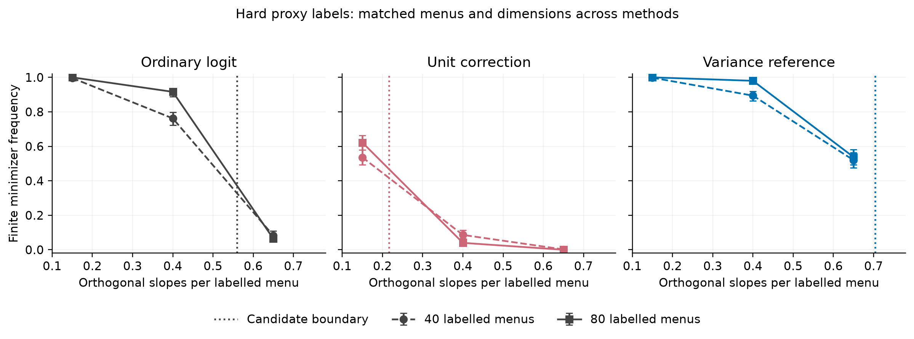

# 硬类别预测的模型边界与创新复核

2026年11月11日。本轮继续研究同一预测校正目标，把预测向量扩展到单纯形边界，包括直接输出一个类别的预测。当前32页主稿与原模拟保持原样；新的推导和完整记录保存在独立研究补充中。

## 已有研究与当前候选增量

多类别预测校正已经有multiPPI++，共同属性系数的选择logit也已进入已有调查方法。我们补读了Fan等（2024）的Section3.2与AppendixA.2–A.3，以及Ye和Yoganarasimhan（2026）的AppendixJ。模型与校正方程需要明确归于前人。当前候选贡献收敛为有限辅助样本下的存在性边界，以及该边界随菜单结构和校正权重变化的规律。

来源：[multiPPI++原文](https://soc.washington.edu/sites/soc/files/documents/research/ppi_colm.pdf)；[共同系数MNL及校正方程](https://arxiv.org/html/2604.17267v1)。近年JOCM的LLM辅助规格研究已有正文背景引用；它与用预测响应构造估计方程属于不同任务。

## 一个可核对的菜单差别

保持有限信号、高斯剖面、独立样本与固定预测条件。预测可以是任意概率单纯形向量。预测并非完全正确时，标记残差的平均平方范数为正，原边界推导的尺度控制仍成立。完全正确的硬预测则直接化为普通加权合并似然，另行处理。

在正权重趋零的候选边界中，二选项的严格扩张条件是预测给真实类别分配正概率的事件具有正概率。总是选错类别的二元硬预测恰好回到普通logit边界。三选项以上的切锥有至少两个未选类别；高斯投影在不同竞争类别之间变化，使相应导数对任意固定预测均为正。推导保留了完整的条件、投影区域与零误差端点。

下面是“每次预测都选错”的总体积分核对。它展示几何性质，不建议使用已知错误的预测，也不把有限解扩张当作精度改善。

|选项数|信号|辅助比|普通边界|正权重极限|差值|
|---|---|---|---|---|---|
|2|0|1|0.499962|0.499962|0.000000|
|2|0|4|0.499962|0.499962|0.000000|
|2|1.5|1|0.334899|0.334899|0.000000|
|2|1.5|4|0.334899|0.334899|0.000000|
|3|0|1|0.833448|0.846956|0.013508|
|3|0|4|0.833448|0.856080|0.022632|
|3|1.5|1|0.559383|0.565067|0.005684|
|3|1.5|4|0.559383|0.568725|0.009343|

全部320次积分覆盖80个事件条件、两档分辨率和两个扰动种子。全部分辨率/种子的最大范围为0.00143551，最高分辨率两种子的最大差为0.00056658。二元总错条件的极限差为零；三选项总错的差约0.006–0.023。这一数值幅度仍需放在实际方法价值中判断。积分差异不是严格误差界。

## 按实际预测计算已有方差参照

硬预测的参照权重需要使用它自身的得分协方差。三选项、信号1.5、错误率0.25、辅助比1时，已有控制变量准则对一个正交属性系数给出的总体权重约为0.219576。该标量准则属于PPI++已有方法，涉及固定维数方差；它没有给出所有系数或高维风险的最优性。

在这个设置下，普通、单位校正、方差参照的候选边界分别约0.5594、0.2164、0.7039。有限验证让所有方法共享同一菜单样本、选择、硬预测和属性维数。两个标记预算各500次独立抽样，共1000次模型样本、9000次支持判定。完整有限解频率如下。

|标记菜单数|噪声属性/菜单|普通logit|单位校正|方差参照|
|---|---|---|---|---|
|40|0.15|0.996|0.536|0.998|
|40|0.40|0.762|0.086|0.894|
|40|0.65|0.082|0.002|0.520|
|80|0.15|1.000|0.622|1.000|
|80|0.40|0.916|0.040|0.980|
|80|0.65|0.064|0.000|0.538|

误差条为500次重复的95% Wilson二项区间，在频率为零或一时也保留不确定范围。方差参照使用已知模拟总体量，不是本轮新提出的数据调参算法。普通logit的分离对应可行支撑边界；保存的1090个方向已逐一用原始模拟设计验证。没有把这些边界改记为校正矩的外部不可行。边界附近的有限预算偏移保留原值；这些点没有建立收敛速度或精确定位渐近边界。该实验只测可用性，系数误差、区间和训练成本结论继续使用此前各自的比较。完整配对差异与Monte Carlo标准误另存于CSV。

## 数值修正与剩余工作

80个硬预测有限设计提供240个原始矩/残差规划核对，另有240个独立NNLS投影导数核对。三个有限边界来自一次标记样本中预测恰好全对的设计；三个正分离间隔已单独确认。

有限模拟最初在第801个模型样本的一次独立残差规划中遇到HiGHS Unknown。原校正目标已有负衰退代价，独立平移变量后用内点法确认不可行。随后修复了诊断记录字段重名，并从已完成800个样本的检查点续跑。两次中断的源码、7200条检查点和具体模拟设计均保留；最终前7200条与检查点逐条完全一致。最终主分类与独立交叉核对均没有未解决状态。

Google Scholar本轮未能取回结果，Scopus返回403，不能称为已完成这两个库的系统检索。另有一条多项logit相变论文线索尚未取得官方正文。完整近邻重合审查、主稿整合与方法价值判断继续推进。300份真人问卷与60份AI预测试的来源分类保持不变；本轮没有增加真人或LLM答卷。
