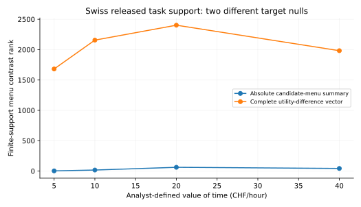
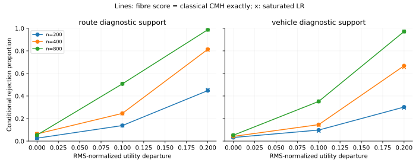

# 研究去留结论：停止当前新方法投稿主线，保留复现与设计审计成果

日期：2026年11月9日。

**最终决定：当前“有限纤维充分性新理论／新检验＋曝光证书＋修复算法”的独立方法增量未建立，不建议按这条主线向Journal of Choice Modelling投稿。现在不重发问卷，也不给出追加样本数。** 已按顺序完成探索资料封存、经典文献核对、真实公开设计支撑审计、固定预算修复比较和匹配模拟。新问卷与正式样本量设计的前置条件没有通过。

这个决定针对当前方法稿的贡献依据。它不表示选择实验设计审计没有实用价值，也不把不显著结果归因于收样者。

## 1. 现有360条资料已封存

两版原始工作簿和已有分析包在本地受控目录留存校验快照，原始文件未修改，公开材料只保留哈希与聚合结果。已有360条继续作为探索性和技术实现资料，来源与实际发放方式按原记录说明。理想分配情景的计算不能变成已核实的招募事实。

原分析及收尾核查固定在Git提交 `bbf3ceca96950c958ecb660b6a79a8497dfd71b8`。不显著结果、来源核查和模型识别限制均保留；本次没有重分组、换随机种子或替换主检验来争取显著性。

## 2. 当前核心对象可由经典模型完整表达

在声明的有限支撑上，任意φ响应面就是每个纤维任意一组分类概率。用纤维指示变量作饱和干扰参数后，经典加项模型的Fisher信息Schur补，逐项等于当前框架的纤维内信息。

\[
I_{\rm fibre}=\sum_z\sum_{i\in F_z}w_i(H_i-\bar H_z)^{\mathsf T}V_z(H_i-\bar H_z)
=I_{\rm classical}.
\]

相应rank是相同饱和原假设的失拟对比维数。相同方向集合和归一化下，最小特征值是经典最弱方向信息准则；剖面KL的二阶项也是同一个信息。详细推导见[classical_equivalence_proof.md](classical_equivalence_proof.md)。

这次比较保留了所有φ函数；没有把充分性原假设偷换为一个低维线性属性模型。分类响应、可行支撑和预先计算rank没有自动产生独立数学增量。连续情形中的条件方差表达也不能单靠标准干扰投影成为新理论。

文献核查使用了Goos等（2005）的模型敏感设计矩阵、Wiens（2010）的非线性响应KL与功效设计、Atkinson–Fedorov的模型判别先例，并核对了条件随机化、充分降维及近期JOCM邻近工作。阅读层级、差异和来源见[novelty_comparison.csv](novelty_comparison.csv)。这些邻近工作并非每一篇都与本文完全相同；本次否定新方法依据的关键证据是上面的同原假设等式及匹配计算。

## 3. 已审计两个真实公开SP档案，覆盖14种映射设置

瑞士公共交通路线档案来自388人的3,492次选择，包含3,417个不同的显示菜单。车辆档案来自Train作者软件包中的100人公开子集，共1,484次三选一任务，1,484个不同菜单。原始研究与官方字典均有来源；审计没有用他们的回答做新的行为拒绝检验。

候选映射由本次审计明确设定：路线采用每小时5、10、20、40 CHF的广义成本敏感性值；车辆采用48、60、84个月的未折现购置与运行总成本。这些值是可解释的分析设定，不宣称原作者使用了它们，也不宣称它们是真实偏好参数。

| 公开案例与映射 | 原始不同菜单 | 非平凡纤维 | 菜单对比rank |
| --- | ---: | ---: | ---: |
| 瑞士路线；10 CHF/小时；绝对摘要 | 3417 | 17 | 17 |
| 瑞士路线；10 CHF/小时；完整效用差向量 | 3417 | 612 | 2157 |
| 车辆；60个月总成本；绝对摘要 | 1484 | 0 | 0 |
| 车辆；60个月总成本；完整效用差向量 | 1484 | 0 | 0 |

“绝对菜单摘要”与“完整候选效用差向量”给出不同的非参数原假设。后一种要求共同平移不改变选择响应，通常更严格；前者允许响应随绝对摘要水平变化。不能在看过结果后更换二者以争取更好的rank。即使固定为绝对摘要，路线案例在10 CHF/小时下也有17个非零对比，因此不能声称常用设计普遍结构性盲。

车辆案例在这些映射下没有非平凡纤维。这说明该已发布支撑不能检验对应的任意摘要响应面；不表示原车辆研究无效，也不表示其参数化模型不能接受其他形式的检验。两个案例不是行业代表性抽样，本次没有据此估计“多少比例D-efficient设计有问题”。原始设计生成算法也未被完整复刻。

## 4. 修复有效，但经典准则给出同样结果

从每个公开案例构造16个二点诊断纤维，改变一个备选项的时间／费用分解或购置／运行成本分解。它们遵守明确的边际范围与数字步长，完整候选菜单保持不变。原研究的全部联合可行性约束和人类理解尚未复核，所以这些是计算探针，不是可以直接发布的问卷。

比较固定320次选择机会、每个纤维20次，不给修复方法额外预算。在七种分配比例下，候选模型原假设下的参数信息保持不变；当前纤维目标与经典残差信息一致。给定二点支持时，两者都在1∶1分配下得到最大局部信息。这是真实可执行的设计诊断，但在此条件下没有新的优化原则或方法优势。

14种公开支撑审计中，两个信息矩阵的最大元素差约为1.39e-15。另外40格剖面KL计算验证其二阶对应关系；这没有把局部近似当成有限幅度下的全局等式。

## 5. 强基线比较没有提供额外检验能力

在基于公开属性生成的诊断支撑上，采用18个数据生成设置，每格500次模拟、499次固定边际条件抽样，共9,000次模拟。每个模拟记录只有一次选择，避免把它冒充重复作答问卷的样本量规划。

比较完整纤维score、完整剖面CMH形式与饱和剖面LR。这里的CMH形式把各纤维分量堆叠，允许各纤维有不同关联方向；它不是只检验共同关联方向的低维CMH。三者使用相同响应信息、备择空间、选择预算和条件校准。score与完整剖面CMH形式在全部9,000次模拟中的p值逐次相同，统计量最大差约4.97e-14；LR的有限样本拒绝率接近。全部零假设行、非天花板功效和Monte Carlo区间见[matched_classical_test_benchmark.csv](matched_classical_test_benchmark.csv)。

η是按原假设响应度量归一化的效用偏离，不是百分点差异。这些曲线不能转换为新的人类DCE“需要收多少份”。机器学习和观测性模型的不同检验目标，也不能靠选择一个手写字典的失败来证明当前方法优势。

## 6. 权重、精度与有限支撑边界

严格等值纤维依赖声明的映射与记录精度。路线绝对摘要在10 CHF/小时下有17个菜单对比；把映射改为10.000001 CHF/小时后，本档案的3,417个菜单全部成为单点纤维。计算使用精确有理数，没有把四舍五入导致的近似相等当成精确相等。

这两种映射定义不同原假设。结果没有推翻原固定权重检验；它说明在应用中必须独立说明权重的含义与精度。若允许在一个权重区间任选映射、同时允许任意摘要响应面，固定有限目录往往可被某个一一映射索引，检验会失去内容。这个基本可识别性事实并非本次声称的新定理；它也不能被误用于否定连续总体中的单指标检验。

## 7. 已执行的改题处理

当前成果改为 **“离散选择实验设计可检验性审计：公开案例、经典等价关系与复现工具”**。输出改为可复现诊断资源，不再以新理论、新统计检验或新maximin原则组织论文。

已交付通用的菜单支撑审计入口 `design_support_audit.py`，允许输入任意声明的完整原始菜单、候选菜单、权重及等价表示，输出经典结构维数并明确区分结构可检验性、充分性与功效。随包给出合成教学例子和两个公开案例的复现脚本。具体技术说明稿见[design_audit_resource_note.md](design_audit_resource_note.md)。

这项改题已经落实为资源和说明稿；它目前不是另一个被证明达到JOCM创新门槛的新选题。若希望继续以独立方法论文投稿，需要新的实质问题或经过验证的独特操作，不能把本工具换个名称重新提出同样理论。

## 8. 新问卷和正式样本量的最终决定

按事先确定的顺序，新调查以方法增量成立为前置条件。本次该条件未通过，所以新问卷与新样本量步骤不启动。没有额外收样建议，没有复用旧设计的功效曲线，也没有发布计算探针。

未来重新进入人类研究，需要独立科学问题、有实质依据的预先固定摘要、多条独立原始变化方向、完整菜单保持、渠道内有日志的随机分配、研究负责人与联系安排、适用伦理程序和理解测试。届时再依据新设计及预定最小有意义效应进行受访者层面的功效计算。现在给出一个追加人数会绕过已经失败的贡献门槛。

## 9. 证据边界与历史材料

Scopus检索入口返回403，Google Scholar入口在本环境不可访问。本次已对可访问的一手论文、作者页面和官方数据进行定向核查，但不宣称数据库检索完备，也不保证全球优先权。

旧“第32轮达到投稿线”等文档是内部阶段判断，已被本次基于等价推导和真实支撑审计的决定覆盖；它们保留为历史记录，不作为独立同行评审。原360条分析保持探索性，不用其结果支持已完成真实随机实验的叙事。

## 主要一手来源

- [Goos等：模型稳健与模型敏感设计](https://webpages.math.luc.edu/~tobrien/research/GKOV.pdf)
- [Wiens：二元响应下的失拟检验与估计设计](https://sites.ualberta.ca/~dwiens/home%20page/pubs/binary%20lack%20of%20fit.pdf)
- [Apollo官方数据与字典](https://apollochoicemodelling.com/examples.html)
- [Axhausen等原研究](https://doi.org/10.1016/j.tranpol.2008.02.001)
- [Train官方代码与样本档案](https://eml.berkeley.edu/Software/abstracts/train1006mxlmsl.html)
- [Hoshino与Yanagi：暴露映射的条件随机化检验](https://doi.org/10.1002/jae.70076)

