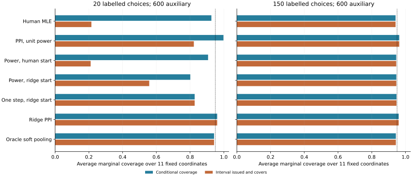
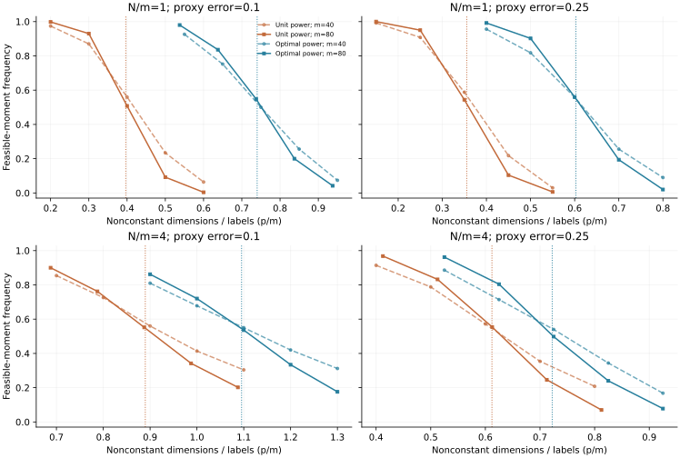

# 有限辅助样本、区间可靠性与理论扩展

2026年11月9日。当前完成了已知真值的有限样本验证和有限辅助比例的理论核对。投稿原创性与完整稿件仍需完成审视。

## 实验回答了什么

实验从公开疫苗数据的1200个属性组合中独立抽取选择行，固定此前收敛的11维参数作为模拟真值，重新生成选择和有信息的代理。它保留真实属性支撑，使用已知的数据生成过程检验方法。它没有增加真人样本，也不是原问卷的新增实证。标签预算20、50、150，辅助池150、600，代理翻转率0.1、0.25，共12个条件，每条件500次。所有方法使用相同随机样本。

七种方法包括真人MLE、固定权重PPI、两种初始化的调权根、一步估计、明确加惩罚的PPI，以及理想软标签合并。后者知道正确的条件均值，是强参照；其表现不能直接推广到未知或有偏的AI预测。

## 有限估计与区间覆盖要分别判断

下表固定辅助池600、代理错误率0.25。覆盖率是11个预先固定坐标的平均；“发出且覆盖”以全部500次重复为分母，缺失区间计为未完成覆盖任务。另一列只在已发出的区间中计算。两个分母同时保留，避免成功子集掩盖失败。

| 真人标签行 | 方法 | 有限估计 | 区间可用 | 条件覆盖率 | 发出且覆盖 | 参数MSE |
|---|---|---:|---:|---:|---:|---:|
| 20 | Human MLE | 116/500 | 116/500 | 0.926 | 0.215 | 8.5602 |
| 20 | PPI, unit power | 412/500 | 412/500 | 0.998 | 0.822 | 4.8362 |
| 20 | Power, human start | 116/500 | 116/500 | 0.907 | 0.210 | 6.0858 |
| 20 | Power, ridge start | 348/500 | 348/500 | 0.801 | 0.558 | 21.5408 |
| 20 | One step, ridge start | 500/500 | 500/500 | 0.827 | 0.827 | 1.5054 |
| 20 | Ridge PPI | 500/500 | 500/500 | 0.961 | 0.961 | 0.2193 |
| 20 | Oracle soft pooling | 500/500 | 500/500 | 0.942 | 0.942 | 0.0057 |
| 150 | Human MLE | 500/500 | 500/500 | 0.941 | 0.941 | 0.1076 |
| 150 | PPI, unit power | 500/500 | 500/500 | 0.963 | 0.963 | 0.0816 |
| 150 | Power, human start | 500/500 | 500/500 | 0.945 | 0.945 | 0.0806 |
| 150 | Power, ridge start | 500/500 | 500/500 | 0.946 | 0.946 | 0.0801 |
| 150 | One step, ridge start | 500/500 | 500/500 | 0.947 | 0.947 | 0.0786 |
| 150 | Ridge PPI | 500/500 | 500/500 | 0.960 | 0.960 | 0.0624 |
| 150 | Oracle soft pooling | 500/500 | 500/500 | 0.943 | 0.943 | 0.0069 |

这里的一步估计在低标签预算下能够给出有限点估计，其名义95%区间覆盖仍需单独检验。加惩罚方法优化的是明确改变后的目标；表中的Wald区间没有校正惩罚偏差。当前真值较接近零，该结果不证明惩罚方法具有普遍覆盖保证。理想软标签的优势依赖正确条件均值这一额外信息。

全部12条件、每个坐标、配对误差和Monte Carlo标准误已保存。低预算MLE和部分调权根的均方误差受极端值影响，另列中位数与90%分位数。条件均值、是否发出区间和数值失败都不作为独立创新。独立的截距闭式方差与一维惩罚根核对已完成；一维检查修复了协方差函数对标量数组的兼容性，11维原实验结果不受影响，原运行与修正版哈希分别保留。

## 更实质的理论候选：有限辅助比例与权重

原推导使用无限辅助样本。新推导同时保留τ=N/m和正的校正权重λ。在平衡零信号、高斯属性、固定零截距和冻结代理条件下，有限根事件可以改写为随机高斯线性映射在一组区间上的可行性。利用既有的随机子空间定理，可将边界化成一个可计算的一维凸最小化问题。

通用圆锥几何与随机子空间定理来自ALMT2014；本文候选增量是这一个校正选择估计器的显式τ、代理误差、权重联合边界。其推导和条件见[有限比例证明](finite_ratio_boundary_candidate.md)。新增80个条件，每条件500次直接生成高斯属性、选择和代理，并进行线性规划。100个独立样本同时用原始矩支撑与区间两种表达核对，43个内部、57个外部情形全部对应。该证据支持推导和实现，不能替代原创性核对。

图中的点是有限m的可行频率，虚竖线是候选渐近边界；它们不应被要求在有限样本中呈现完美阶跃。m=40和80分别显示，单位权重与总体方差最优权重分开比较。总体最优权重的公式属于现有PPI理论。当前80个条件没有数值未决情形。

一个可核对的例子：τ=1、代理错误率0.25时，单位权重的候选临界p/m约0.355；现有方差最优权重λ=0.5对应约0.603。无限辅助池下单位权重的值约0.849。辅助样本数量与权重对可计算条件有实质影响，这比指出某次优化失败更接近一个有内容的方法学结论。它仍限定于该高斯基准，不能直接充当实际离散问卷的样本量规则。

## 当前判断与下一步

有限辅助比例的显式边界扩大了理论内容；已知真值实验也补上了一步估计和区间覆盖对照。现有方法的成功与失败均进入结果，原始300份真人招募记录继续保留为应用实证，60份AI预测试单列。

接下来要完成近邻文献优先权核对、非零效用信号下有限比例边界的严格论证，并将正文、附录和复现入口整理为一份连贯的投稿稿。[信号扩展草案](finite_ratio_signal_candidate.md)目前是待证推导，尚不作为已完成定理。当前不宣称达到JOCM投稿门槛。
