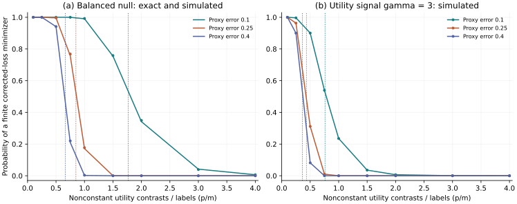

# 加入权重调节后的结果与创新定位

2026年11月9日。全部500次分配已经完成；本阶段推进了理论和对照证据，独立原创性与投稿完成条件仍待核实。

## 较强对照的实际结果

沿用固定1200行疫苗选择、标签预算、来源定义五行组和预测拟合。新增目标严格采用PPI的辅助集平均损失，加上真人集的校正；它与上一阶段使用全体协变量池的GAI目标有区别。权重按PPI++及固定版本公开实现计算，裁剪到[0,1]。真人根初始化与原实现使用的PPI根初始化分别报告，没有隐式替换失败初始化。

表中为固定1200行真人投影目标的稳定化参数误差：100×mean(|估计−目标|/(1+|目标|))。无有限解的情形保留在失败表，误差均值仅对有限子集计算。预算单位为选择行。

| 预测信息 | 方法 | 50行 | 100行 | 150行 | 200行 |
|---|---|---:|---:|---:|---:|
| AI | 真人充分收敛 | 57.547 | 29.695 | 22.045 | 18.203 |
| AI | PPI固定权重1 | 54.719 | 28.968 | 21.887 | 18.112 |
| AI | 权重调节，真人根初始化 | 56.046 | 29.232 | 21.746 | 17.996 |
| AI | 权重调节，PPI根初始化 | 51.996 | 29.023 | 21.691 | 17.960 |
| X_only | 真人充分收敛 | 57.547 | 29.695 | 22.045 | 18.203 |
| X_only | PPI固定权重1 | 53.904 | 28.584 | 21.592 | 17.871 |
| X_only | 权重调节，真人根初始化 | 56.198 | 29.302 | 21.793 | 18.031 |
| X_only | 权重调节，PPI根初始化 | 53.030 | 29.133 | 21.749 | 18.001 |

完整结果同时给出权重分布与配对Monte Carlo标准误。已计算的权重与公开实现的协方差规范一致，独立白化内积公式核对误差为2.33e-15。未执行下载的作者代码。

| 预测信息 | 方法 | 预算 | 有限根 | 其他状态 |
|---|---|---:|---:|---|
| AI | 权重调节，PPI根初始化 | 50 | 494/500 | initialization_unavailable:6 |
| AI | PPI固定权重1 | 50 | 494/500 | outside_mean_support:6 |
| X_only | 权重调节，PPI根初始化 | 50 | 498/500 | initialization_unavailable:2 |
| X_only | PPI固定权重1 | 50 | 498/500 | outside_mean_support:2 |

真人根初始化的权重方法在4000/4000个目标中得到有限根。这个已建立方法的表现必须保留。当前结果不支持把有限根问题写成现有方法无法处理的普遍缺陷。新贡献需要落在明确的定量存在条件与实际选择分析决策上。

## 理论候选已经扩大到有信息的代理

新增基准令代理Z以概率ε独立翻转真实二项选择Y，并使用冻结的条件均值预测g。它确实包含效用属性之外的选择信息。其总体最优PPI权重在辅助样本无限增大时趋于1，适用于固定0<ε<1/2。该结论直接使用现有方差最小化公式。

在高斯属性与平衡零效用信号下，校正损失的有限根边界为κ_c=1/[2π ε(1−ε)]，κ=p/m。精确有限标签概率通过三个二项分布和卡方分布的混合计算。对有信号的效用模型，边界由同一公式的信号项与代理Brier误差给出。它描述指定的无惩罚校正损失，不是所有估计方法的信息极限。

135组精确概率条件每组2000次直接生成X、Y、Z；ε=1/2退化到旧公式的最大误差低于2e-14。另完成162组非零信号条件，各2000次。理想预测与方差最优的极限权重不能自动保证比例增长维度下存在有限根。这是比错误常数预测更有意义的理论候选。

图中m=120。左图实线为精确有限样本概率，点为模拟频率；右图为非零信号的模拟频率。虚线为各代理误差率对应的比例维度极限。该图使用高斯二项模型和冻结的理想预测，不代表实际问卷的样本量要求。

有限辅助池、Gaussian支撑、冻结代理、独立标签、功效权重的极限均属于结果条件。这里没有证明高维插件权重必然趋于该总体最优值，也没有评估公开疫苗数据的区间覆盖率。真人问卷的300份招募记录继续作为独立应用实证；60份AI预测试不计入真人估计。

## 对投稿贡献的判断

本阶段给出了可复算的存在概率、更强的有信息代理情形，以及现有调权方法的完整对照。通用分离、Gaussian lift zonoid、PPI校正和方差最优调权继续明确归属于既有研究。当前的新候选是这些明确假设下的有限根分布与边界。短推论是否足以支撑JOCM方法论文，仍需要优先权核对与实用价值证据。

下一步应检验有限辅助池和实际DCE属性分布下的可迁移程度，比较现有一步估计与明确惩罚目标，补齐区间覆盖表现。投稿稿应围绕一个估计问题组织，不能把300份问卷、代理理论和代码审计并列当作三项创新。

对应证明见[第8节](existence_candidate_derivation.md)，预先写定的扩展方案见[权重对照计划](power_extension_plan.json)与[信号方案](surrogate_signal_plan.json)。主文献为[PPI++](https://arxiv.org/html/2311.01453v2)及[固定版本实现](https://github.com/aangelopoulos/ppi_py/blob/3d1f0c668444907b39bd045cb9dd38e479ce7dd6/ppi_py/ppi.py)。
