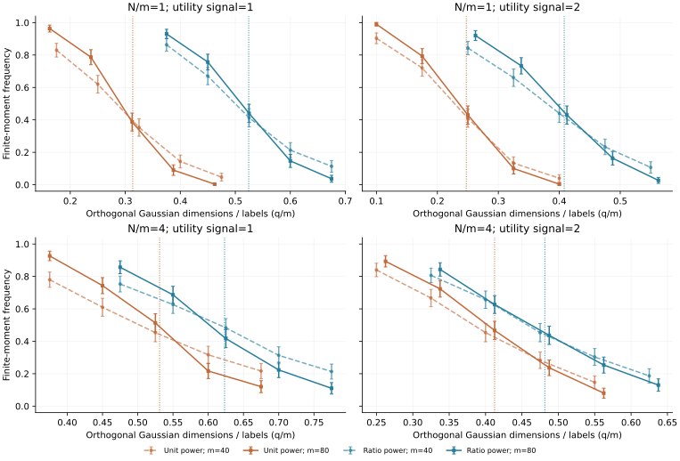

# 非零效用信号与有限辅助样本：推导及核对

2026年11月10日。本轮将同一个校正选择估计问题扩展到非零效用信号，并允许估计截距。完成了条件证明和预先规定的数值实验，独立证明审查、原创性优先权和投稿材料尚未完成。

## 解决的理论缺口

此前有限辅助比例的公式固定效用信号和截距为零。新推导将一个真实效用方向与其余高斯属性分开，保留有限的辅助样本/标签比例。有限根事件对应一个受信号和截距约束的随机圆锥。其渐近边界可以通过两个标量的凸—凹问题计算。

原草案缺少把随机极值换成总体极值的依据。本轮补上了两个控制：总体逻辑回归的重叠性使信号/截距乘子保持有界，正的校正残差使圆锥尺度保持有界。局部一致收敛与可积界再给出统计维数的极限。通用圆锥极性和随机子空间定理均是已有工具，候选增量是这一估计器在信号、代理误差、有限辅助比例和固定权重下的显式边界。完整条件见[推导](finite_ratio_signal_candidate.md)。

## 可核对的数值结果

下表固定代理错误率0.25。比例权重取λ=τ/(1+τ)，单位权重取λ=1。q/m表示与效用信号正交的高斯方向数除以标签行数；估计截距和信号斜率另占两个坐标，其有限差异在比例极限中消失。

| 辅助/标签比τ | 效用信号γ | 单位权重边界 | 比例权重边界 |
|---:|---:|---:|---:|
| 1 | 0 | 0.3554 | 0.6029 |
| 1 | 1 | 0.3135 | 0.5244 |
| 1 | 2 | 0.2474 | 0.4080 |
| 4 | 0 | 0.6120 | 0.7223 |
| 4 | 1 | 0.5310 | 0.6232 |
| 4 | 2 | 0.4124 | 0.4815 |

在该基准中，更强效用信号使有限根边界下降。以τ=1、γ=2为例，单位权重约为0.2474，比例权重约为0.4080。经典普通逻辑回归的对应边界约为0.3449。增加辅助预测并不自动让任意校正目标都更容易得到有限根；目标和权重需要一起判断。这是指定高斯模型的结论，不能当作原中文离散问卷的样本量规则。

图包含80个预先规定条件，每条件300次直接生成属性、选择和代理；没有新增真人或LLM答卷。m=40、80，τ=1、4，γ=1、2，使用两种固定权重。点为全部300次中的有限矩频率，误差棒是近似95% Monte Carlo误差，竖点线为候选渐近边界。有限m曲线存在偏移及平滑过渡，不能声称它们精确等于渐近阶跃。80个条件没有数值未决情形。

120组独立样本用原始矩支撑LP与新定向区间LP核对，42组内部、78组外部全部一致。12组圆锥投影比较独立的直接二次优化与极性表达，最大平方投影差小于3.8e-14。直接二次优化使用其自身活跃约束进行精化，没有借用极性解。

零信号公式与此前结果一致，最大差小于4.5e-16。100与200节点积分给出的边界最大差小于7.9e-13，鞍点导数最大差小于1.9e-12。零权重端点单独恢复经典普通逻辑回归边界；正权重下的区间LP不能用零可行性检验该端点。所有检查支持实现与推导的对应关系，不等同于独立证明审查或原创性证明。

## 与已有结果的边界

[ALMT2014](https://tropp.caltech.edu/papers/ALMT14-Living-Edge-preprint.pdf)已经给出统计维数和随机子空间相交的通用阈值；[Candès–Sur](https://arxiv.org/abs/1804.09753)已经研究普通逻辑回归的相变。本文不能把这些工具重新命名为创新。

[Mani等2026](https://arxiv.org/html/2505.20178v2)已研究PPI++在均值估计中的有限样本代价、调权误差与区间问题，并给出有限辅助样本的特例。有限样本下PPI未必改善表现这一总观点已有充分先例。这里待核对的独立命题是指定校正逻辑回归目标的有限根存在边界。[Gu等2026](https://arxiv.org/html/2604.27892v1)也已讨论宽区间与可能的近分离；这些现象继续作为验证内容。

本轮数值实验使用冻结的正确条件均值代理、独立高斯选择行和固定正权重。条件推导允许取值严格位于0和1之间的一般冻结低维预测；相应的非理想预测实验尚未完成。拟合预测器、数据依赖调权、多项选择和重复受访者结构未由本定理覆盖。已有300份真人招募问卷的探索性应用继续保留，其来源和版本限制保持明确。

下一步要检验该结果对实际选择分析决策的价值，并完成近邻优先权核对和连贯投稿稿。当前研究目标仍未完成。
