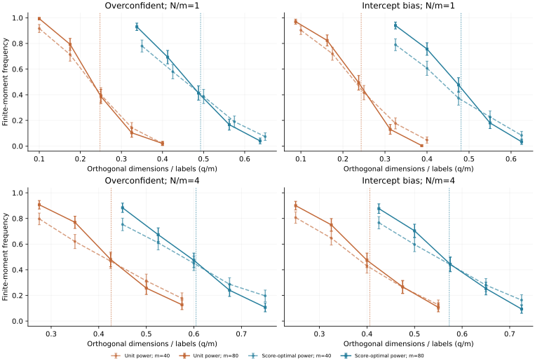
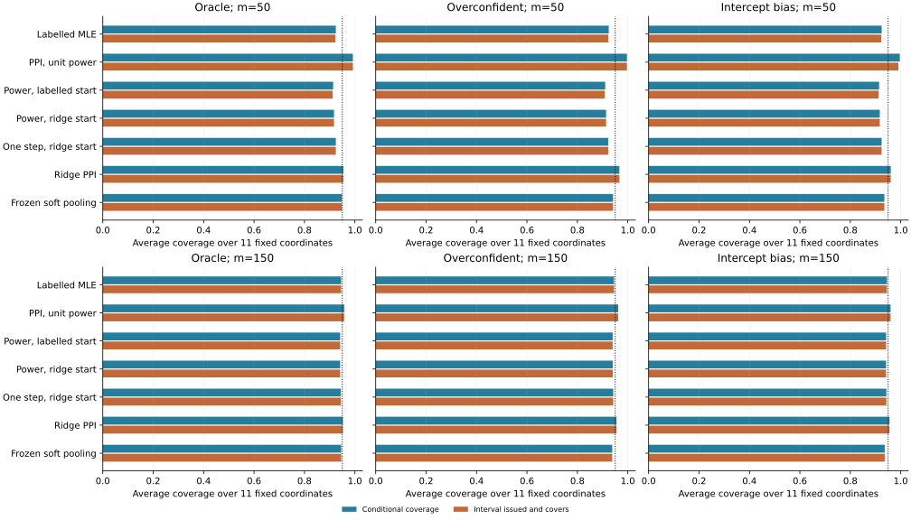
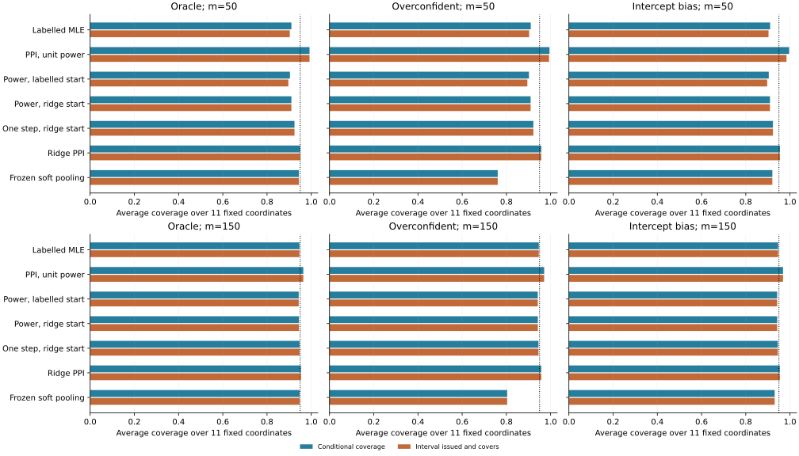

# 预测偏差、一般相变先例与实际属性支撑验证

2026年11月10日。本轮完成有偏冻结预测的理论核对，以及较弱、较强效用下的七方法对照。论文仍需完成优先权与独立证明审视、实际分析决策和投稿整合。

## 与最接近通用定理的关系

新找到的[Koriyama与Bellec2025](https://arxiv.org/html/2501.03163v3)已研究一般高斯单指标M估计器的存在相变。它的假设要求逐行损失的下确界具有有限绝对期望。当前校正目标的标签行损失为

(1−λ)log(1+exp(u))−(Y−λg)u。

当λ>0、g严格位于0和1之间时，Y=0的行在u趋向负无穷时趋向负无穷，Y=1的行在u趋向正无穷时趋向负无穷；λ=1时还成为线性函数。该定理不能直接覆盖这些行。总目标能否有有限根取决于行之间的补偿，具体审查见[近邻定理对照](general_M_estimator_prior_audit.md)。这说明一个明确的适用差别，其他等价先例仍需核对。

## 有偏预测的边界核对

固定真实效用信号γ=1.5、代理翻转率0.25，将正确条件对数几率乘以a、再加b得到冻结预测。过度自信取a=2,b=0；截距偏差取a=1,b=1。后者使用两个自由乘子求边界，检验了此前对称性简化以外的情形。

| 辅助/标签比 | 预测 | Brier误差 | 单位权重边界 | 既有协方差公式给出的权重 | 该权重下边界 |
|---:|---|---:|---:|---:|---:|
| 1 | Oracle | 0.1397 | 0.2795 | 0.5000 | 0.4637 |
| 1 | Overconfident | 0.1502 | 0.2478 | 0.3386 | 0.4927 |
| 1 | Intercept bias | 0.1644 | 0.2434 | 0.3078 | 0.4810 |
| 4 | Oracle | 0.1397 | 0.4690 | 0.8000 | 0.5487 |
| 4 | Overconfident | 0.1502 | 0.4261 | 0.5417 | 0.6046 |
| 4 | Intercept bias | 0.1644 | 0.4060 | 0.4925 | 0.5729 |

权重针对正交斜率的固定维度渐近方差，来自已有PPI协方差公式；它在实验前按总体分布固定。本文没有声称它在比例维度增长下同时最优，也没有将其等同于数据估计出来的权重。反向预测的该公式选择零权重，保留为单独的普通逻辑回归端点。

80个条件、每条件300次直接生成高斯选择行的实验已完成，没有数值未决情形。另有120组原始矩LP与定向区间LP一致，12组独立圆锥投影一致。100/200节点积分、完整乘子梯度和包络Hessian分别核对。所有图点和误差棒使用全部300次，有限m曲线不等于渐近阶跃。

## 更严格的理论结果及其量级

[匹配误差与协方差的命题](matched_moment_existence_proposition.md)构造了预测均值、Brier误差和整个固定维度渐近协方差都相同的两种预测。辅助置信度平方更分散时，单位权重的有限估计边界严格下降。其推导仍针对同一个校正目标，没有增加另一套框架。

独立有限状态求和核对的协方差差小于2.3e-16；直接正态积分与边界公式差小于1e-15。当前构造在N/m=0.05时边界相对差约5.98%，在N/m=1时约0.12%，N/m=4时更小。它说明既有误差和方差摘要不能完全确定有限估计条件，但当前量级尚不足以建立普遍的实际收益。

## 真实属性支撑上的模型对照

模拟保留公开疫苗数据1200个属性组合，独立抽取选择行，生成真实选择及代理。第一组固定此前收敛参数；第二组将该参数乘以3。两组都不是对真人结构参数的重新认定。每组m=50、150，辅助行600，三种冻结预测，每条件500次。七方法使用同一条件下相同的属性、选择和代理。

两个信号组共12个条件、每条件500次，共42000个方法—条件结果；它们不代表42000名受访者。软标签合并使用与其他方法相同的预测，只有理想预测组具有正确条件均值。

### 效用参数倍数 1

下表固定150个标签行。条件覆盖率在已发出区间中计算；“发出且覆盖”以全部500次为分母。参数MSE保留全部可用估计，失败数单列。

| 预测 | 方法 | 有限估计 | 条件覆盖率 | 发出且覆盖 | 参数MSE |
|---|---|---:|---:|---:|---:|
| Oracle | Labelled MLE | 500/500 | 0.945 | 0.945 | 0.1068 |
| Oracle | PPI, unit power | 500/500 | 0.958 | 0.958 | 0.0875 |
| Oracle | Power, labelled start | 500/500 | 0.942 | 0.942 | 0.0834 |
| Oracle | Power, ridge start | 500/500 | 0.942 | 0.942 | 0.0831 |
| Oracle | One step, ridge start | 500/500 | 0.944 | 0.944 | 0.0814 |
| Oracle | Ridge PPI | 500/500 | 0.952 | 0.952 | 0.0661 |
| Oracle | Frozen soft pooling | 500/500 | 0.946 | 0.946 | 0.0069 |
| Overconfident | Labelled MLE | 500/500 | 0.945 | 0.945 | 0.1068 |
| Overconfident | PPI, unit power | 500/500 | 0.962 | 0.962 | 0.1087 |
| Overconfident | Power, labelled start | 500/500 | 0.940 | 0.940 | 0.0819 |
| Overconfident | Power, ridge start | 500/500 | 0.940 | 0.940 | 0.0817 |
| Overconfident | One step, ridge start | 500/500 | 0.942 | 0.942 | 0.0798 |
| Overconfident | Ridge PPI | 500/500 | 0.955 | 0.955 | 0.0812 |
| Overconfident | Frozen soft pooling | 500/500 | 0.938 | 0.938 | 0.0129 |
| Intercept bias | Labelled MLE | 500/500 | 0.945 | 0.945 | 0.1068 |
| Intercept bias | PPI, unit power | 500/500 | 0.960 | 0.960 | 0.1072 |
| Intercept bias | Power, labelled start | 500/500 | 0.942 | 0.942 | 0.0914 |
| Intercept bias | Power, ridge start | 500/500 | 0.942 | 0.942 | 0.0913 |
| Intercept bias | One step, ridge start | 500/500 | 0.943 | 0.943 | 0.0899 |
| Intercept bias | Ridge PPI | 500/500 | 0.955 | 0.955 | 0.0800 |
| Intercept bias | Frozen soft pooling | 500/500 | 0.937 | 0.937 | 0.0082 |

### 效用参数倍数 3

下表固定150个标签行。条件覆盖率在已发出区间中计算；“发出且覆盖”以全部500次为分母。参数MSE保留全部可用估计，失败数单列。

| 预测 | 方法 | 有限估计 | 条件覆盖率 | 发出且覆盖 | 参数MSE |
|---|---|---:|---:|---:|---:|
| Oracle | Labelled MLE | 500/500 | 0.947 | 0.947 | 0.1353 |
| Oracle | PPI, unit power | 500/500 | 0.964 | 0.964 | 0.1127 |
| Oracle | Power, labelled start | 500/500 | 0.943 | 0.943 | 0.1061 |
| Oracle | Power, ridge start | 500/500 | 0.944 | 0.944 | 0.1053 |
| Oracle | One step, ridge start | 500/500 | 0.947 | 0.947 | 0.1004 |
| Oracle | Ridge PPI | 500/500 | 0.953 | 0.953 | 0.0740 |
| Oracle | Frozen soft pooling | 500/500 | 0.947 | 0.947 | 0.0078 |
| Overconfident | Labelled MLE | 500/500 | 0.947 | 0.947 | 0.1353 |
| Overconfident | PPI, unit power | 500/500 | 0.971 | 0.971 | 0.1326 |
| Overconfident | Power, labelled start | 500/500 | 0.942 | 0.942 | 0.1050 |
| Overconfident | Power, ridge start | 500/500 | 0.942 | 0.942 | 0.1042 |
| Overconfident | One step, ridge start | 500/500 | 0.945 | 0.945 | 0.0992 |
| Overconfident | Ridge PPI | 500/500 | 0.958 | 0.958 | 0.0860 |
| Overconfident | Frozen soft pooling | 500/500 | 0.804 | 0.804 | 0.0353 |
| Intercept bias | Labelled MLE | 500/500 | 0.947 | 0.947 | 0.1353 |
| Intercept bias | PPI, unit power | 500/500 | 0.969 | 0.969 | 0.1368 |
| Intercept bias | Power, labelled start | 500/500 | 0.942 | 0.942 | 0.1144 |
| Intercept bias | Power, ridge start | 500/500 | 0.942 | 0.942 | 0.1138 |
| Intercept bias | One step, ridge start | 500/500 | 0.945 | 0.945 | 0.1088 |
| Intercept bias | Ridge PPI | 500/500 | 0.954 | 0.954 | 0.0872 |
| Intercept bias | Frozen soft pooling | 500/500 | 0.931 | 0.931 | 0.0099 |

加惩罚方法优化了改变后的目标，区间没有校正惩罚偏差。一步估计可返回有限参数，但覆盖率仍由实验检验。完整结果保留50个标签行、11个预先固定坐标、尾部误差、每个失败状态及配对Monte Carlo误差。较弱效用下软标签合并的强表现保留在表中，不能据选择性的失败案例否定它。

### 总体目标的独立核对

在同一个有限属性分布上，精确对两个代理取值求期望，再拟合期望软标签目标。固定权重的校正总体得分在真实模拟参数处为零，这一校正恒等式属于已有PPI原理。数据依赖权重的有限样本无偏性没有由此得到证明。

| 效用倍数 | 预测 | 150标签/600辅助时软合并总体参数MSE | 总体额外选择损失 |
|---:|---|---:|---:|
| 1 | Oracle | 0.000000 | 0.000000 |
| 1 | Overconfident | 0.000600 | 0.000347 |
| 1 | Intercept bias | 0.000470 | 0.000255 |
| 3 | Oracle | 0.000000 | 0.000000 |
| 3 | Overconfident | 0.018138 | 0.005267 |
| 3 | Intercept bias | 0.001733 | 0.000712 |

有偏预测会改变软合并的总体目标。当前较弱效用下偏差较小，增加效用强度后过度自信预测的总体目标偏离更明显。表中同时给出偏差与实际有限样本表现；存在目标偏差不意味着它在每个有限样本条件下都比校正估计差。

## 期刊与进度判断

[Elsevier官方期刊说明](https://shop.elsevier.com/journals/journal-of-choice-modelling/1755-5345)确认JOCM接受选择建模的理论、方法贡献和创新应用。当前二元选择估计问题在主题范围内；稿件仍需证明方法增量和读者的实际分析收益。最新投稿指南入口本轮返回403。

本轮Scopus页面无法通过检索工具读取；Google Scholar浏览器重定向至Google访问检查地址，未读取检索结果。没有完成数据库系统综述。主要依据是直接核对的作者全文、正式论文记录和期刊官网。复现检查和自评不作为投稿达标证明。

下一步将理论候选、预测偏差实验和公开选择重分析收束到一条清楚的论证，核对近邻优先权，并检验一个可执行的实际分析决策。原300份真人招募问卷的探索性应用与60份AI预测试继续分列。当前目标仍未完成。
