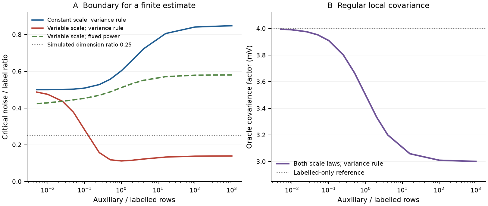

# Known utility scales and increasing auxiliary samples

The compensated logit objective can lose its finite minimizer as an established variance rule assigns greater power to a growing auxiliary sample. A specified positive utility scale controls this loss even when full regular covariance and the labelled-only separation event match. This follow-up develops that consequence within the same corrected objective. The simulation plan was frozen on12 November2026 after exploratory population calculations; verification finished on13 November. No external preregistration is claimed.

The [proof](proof.md) gives the bounded-positive-scale boundary, strict scale cost, exact opposite-boundary example and auxiliary-ratio limits. Its nuisance support condition includes the scale multiplier. Its argument treats relative interior, curvature rank and Gaussian transversality explicitly. These are internal mathematical checks, with no external referee or priority certificate implied.

## Simulation and paired comparison

The label budgets are80and160; each has500independent simulated cohorts. Every cohort reuses its labelled rows, outcomes, specified utility scales and oracle prediction rule across auxiliary sizes. Auxiliary samples of ratios0.025,1and4are nested prefixes. At the smallest ratio, the variance and held-power arms coincide; their duplicate criterion records supply no additional replication. The12000reported records represent10000distinct compensated support programs. No questionnaire or new human/LLM responses enter the experiment.

For160labelled rows,40Gaussian noise slopes and two fitted low-dimensional coefficients:

| Auxiliary rows | Established variance power | Constant-scale finite estimates | Variable-scale finite estimates | Variable-scale at held power1/41 | Regular covariance factor mV |
|---:|---:|---:|---:|---:|---:|
|4|1/41|500/500|500/500|500/500|3.975610|
|160|1/2|500/500|3/500|500/500|3.500000|
|640|4/5|500/500|15/500|500/500|3.200000|

The milder simulated scale is0.1with probability0.9and sqrt(9.91)with probability0.1. Its second moment is one. It differs from the stronger law used for the exact analytic bound. The binary outcome is fair; a proxy flips it with probability1/4, giving the oracle prediction0.25or0.75. All fitted utility terms, including the intercept, receive the known multiplier. Unknown scale identification is outside the model.

The complete [summary](results/nested_auxiliary_summary.csv) retains both label budgets and both scale laws. At80labels the variable-scale counts along the variance rule are496,17and47out of500. The later recovery is part of the result. The boundary is not globally decreasing in auxiliary size. The [paired transition file](verification/paired_auxiliary_transitions.csv) reports both transition directions and their Monte Carlo precision.

The figure uses all13planned population auxiliary ratios. PanelA shows the critical noise-to-label ratio for a finite estimate; points below a curve are on its existence side. PanelB shows the established fixed-dimensional oracle covariance factor, identical for both scale laws at each variance power. PanelB is a local calculation, with no proportional-dimensional risk guarantee. A held positive power has a nondecreasing balanced population boundary. The comparison concerns weight re-selection as the auxiliary budget grows.

## Verification and scope

[Verification](verification/verification.json) replays every distinct criterion using the original weighted objective instead of the experiment's residual-feasibility LP. Every reported state is covered. Negative recession directions are stored and checked. The2000ratio-one variance-rule states match the preceding independently verified radial study. All52population profile values receive separate Gaussian integration. The120scaled-interval checks include80nonzero-signal cases and12independent constrained projections. The [proof audit](proof_audit.json) records the exact scope.

The prospective contribution is the compensated boundary and its matched-information and auxiliary-budget consequences. Established conic tools, elliptical-logit separation, scale conventions and PPI variance rules retain their attribution. The [primary-prior record](closest_prior_scope.json) distinguishes sources inspected from equivalence or priority conclusions. Scopus/Google Scholar systematic review remains incomplete. The49-page delivered main manuscript is preserved; this proof and nested-budget evidence remain a separate supplement pending concise integration and contribution assessment.
