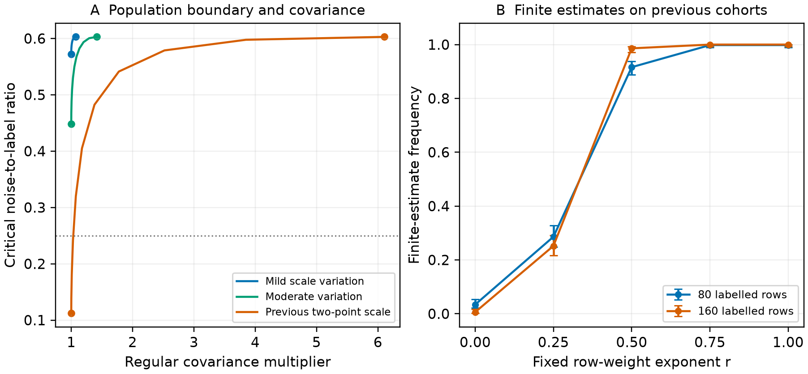

# Row weights separate finite attainment from regular variance

The preceding known-scale boundary yields a concrete trade-off within the same compensated logit objective. Constant row weights minimize its full regular oracle covariance. Inverse known utility-scale weights maximize its finite-estimation boundary. With nonconstant scale these two optima differ. A continuous fixed-weight path increases the boundary while increasing regular covariance; its initial boundary improvement is first order and its covariance cost is second order. The [derivation](theory.md) gives the assumptions, equality cases and proof. The [preceding scale proof](scale_boundary_proof.md) defines the scalar profile used here.

## Same simulated cohorts, explicit cost

Every comparison reuses the previous radial study's Gaussian base profiles, choices, proxy and known scale. The scale is0.1with probability0.9and the square root of9.91otherwise. Both sample sizes are equal; correction power remains the established oracle value1/2. The original fitted design includes40noise slopes and two fitted low-dimensional terms at160labels. The weights are w(D)=D^(−r), fixed before replay.

|Row exponent r|Finite, 80 labels|Finite, 160 labels|Regular covariance multiplier|
|---|---|---|---|
|0|17/500|3/500|1.0000|
|0.25|143/500|126/500|1.0163|
|0.50|458/500|493/500|1.1748|
|0.75|499/500|500/500|2.0922|
|1|499/500|500/500|6.1026|

The multiplier is the full fixed-dimensional oracle covariance relative to the unweighted objective on the SAME scaled model. It is not an observed proportional-dimensional error ratio. The inverse-scale endpoint restores the unscaled-design support event exactly; it generally produces different coefficients. The partial weight illustrates the distinction between finite recovery and efficiency cost. No MSE, interval or superiority conclusion follows from this table.

PanelA shows the planned population curves at auxiliary ratio one, including milder scale laws. The dotted line is noise-to-label ratio0.25. Endpoints mark unweighted and inverse-scale weights. PanelB uses500independent cohorts per label budget and marginal95%Wilson Monte Carlo intervals. The same cohorts are reused across weights. Paired changes and their standard errors are in [the complete transition table](results/paired_weight_transitions.csv). All eight adjacent comparisons are retained; no reverse finite-to-exterior transition occurs in these samples. The theorem asserts population monotonicity along this path, not general nesting of finite-sample events.

## Verification and contribution boundary

All5000weighted objectives are independently classified through the actual weighted logit loss. The verifier uses the original D-scaled design, reconstructs every source draw, and retains1762negative recession directions. None remains unresolved. The endpoints reproduce2000preceding support statuses. There are1000reused cohorts, not5000new independent samples.

Independent Gaussian integration checks all132population rows, four scale laws and three auxiliary ratios. Enumeration of binary outcomes and proxy flips checks the covariance and existing power rule. Further checks cover108arbitrary finite-design cases, the distinction between the two likelihoods, all eight paired transition rows and twelve local variance-cost calculations. The largest integral discrepancy is4.42e−15; the largest reported quadrature error estimate is5.55e−8. The discrepancy is not a quadrature accuracy guarantee. [Verification details](verification/verification.json) and [summary checks](summary/summary_checks.json) retain the exact values.

Weighted PPI, unbiased noisy-label losses and general Gaussian convex-loss analysis are prior methods. The [primary-source scope](closest_prior_scope.json) records the inspected equations and code units, including Song etal.2020, Taheri etal.2021 and Datta–Polson2025. The candidate increment is this objective's explicit incompatibility of the two row-weight optima and its quantitative path. The proof uses established support geometry and elementary differentiation; internal checks do not establish independent priority or sufficient journal value.

The known scale multiplies the entire utility including its intercept. Separately normalizing the labelled and auxiliary weight sums changes the finite objective; this calculation uses the original sample-count denominators and only a common global normalization. Unknown scales, learned weights and repeated respondent panels require additional work. Correct conditional logit specification preserves the population coefficient under the row-weight change; misspecification can change its projection target.

The reviewed57-page main manuscript and its archive remain unchanged while this follow-up is assessed. No questionnaire data or new human/LLM responses enter the calculation.

The [isolated validation](clean_validation.json) regenerates all5000primary programs and reproduces five scientific outputs byte-for-byte. Three summary outputs also match, with9identical source files. The separate original-loss verifier had already checked every criterion before packaging.
