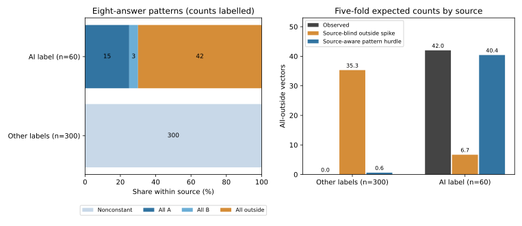

# 来源条件验证与固定选项模式

2026年11月9日。本轮完成9个固定比较模型、45次整条答卷留出拟合，以及预先固定的两种平滑强度比较。研究目标保持为建立符合JOCM要求的独立贡献；本轮补齐一个会改变模型解释的对照。

## 新核实的完整模式

60条原标签“AI样本”的记录全部在8题中选择同一选项：15条全选A、3条全选B、42条全部不购买。其余300条全部至少换过一次选项。这比“42条全程不购买集中于该来源”更完整。固定选择本身不能判定真人身份、生成来源、有效性或心理机制。

## 总数吻合掩盖了什么

不区分来源的“不购买点质量”模型，五折共预测42.000条全程不购买，与实际42条接近。分来源后，它给其余300条预测35.316条，实际为0；给60条来源组预测6.684条，实际为42。整体计数吻合不代表来源内分布得到正确预测。

来源和固定选项模式的简单对照，分别预测0.621和40.420条。两项合计41.040条；采用固定平滑会留下少量对未观察类别的概率。这些都是每折训练后对留出记录的预测，不使用留出答卷推断类别后验。

## 同一批记录与同一组折内的模型比较

下表为每次选择归一化的8题联合负对数分数，越小越好。不同来源的列是不同评分人群，不能把它们的绝对数值当作同一难度任务。价格采用线性表示，另报自由价格—规则单元的固定敏感性。

| model | all_360 | 300_other_labels | 60_AI_label |
| --- | --- | --- | --- |
| MNL_linear | 1.040306 | 1.042676 | 1.028456 |
| RI_linear | 0.981693 | 1.064631 | 0.567003 |
| spike_linear | 0.956676 | 1.049832 | 0.490894 |
| source_ASC_MNL_linear | 0.997330 | 1.032544 | 0.821260 |
| hurdle_blind_linear | 0.933728 | 1.055287 | 0.325935 |
| hurdle_source_linear | 0.877234 | 1.032465 | 0.101079 |

来源调整的普通模型与来源模式对照，在其余300条中的分数为1.032544和1.032465，差距约0.000080；描述性配对区间包含零。全样本的差距为0.120097，其中约99.94%的加权平均增益来自60条来源组。自由价格单元下，其余300条中来源模式对照的分数略差，差距同样接近零。此处不能把全样本排名解释成更准确地学习了属性权衡。

来源可见和来源不可见的模式对照使用同一条件选择部分；只有模式概率是否按来源估计发生改变。两者全样本联合分数相差0.056494。该匹配比较中，差距按构造完全来自来源信息，不能再作为属性效用模型提升的证据。线性与自由单元下差距相同也由这个构造解释。

## 对照的含义与计算检查

模式对照把完整答卷分为四种互斥结果：八题全A、全B、全不购买、以及至少改变一次选项。前3种采用固定向量概率；第4种采用以非固定向量为条件的MNL。训练折内按类别计数估计模式概率，主分析采用固定Dirichlet平滑0.5，1.0作为固定敏感性；没有按结果选择平滑参数。

类别在训练数据中是结果变量，预测阶段只输入菜单、拟合参数和已知来源标签。拟合非固定部分时使用其条件似然，而非直接删除固定选择后套用未经条件化的MNL。该模型用于诊断联合预测，参数不解释为总体人群的偏好或支付意愿。

对每种题目版本及每组模式权重，穷举3^8=6,561种回答，独立核对联合概率总和、边际概率及不购买次数分布。最大误差低于10^−10；有限差分与解析梯度一致。两份原始导出哈希与冻结记录一致。明细见`numerical_checks.json`；整条答卷的预测值和分折信息保留在私有目录。

这些折此前已用于本项目分析，属于探索性内部验证。配对区间是描述性结果，未覆盖重复使用折、模型选择或整个项目探索的影响。来源权重变化表是代数标准化，不代表真实人群构成或已识别的招募因果效应。

## 与最接近文献的实质关系

[Kazagli与de Lapparent（JOCM，2023）](https://doi.org/10.1016/j.jocm.2023.100413)已在有限混合框架中区分强偏好和固定选项规则，并考虑情境对规则采用概率的影响。已读该文模型部分及式(8)，本轮不把固定向量成分命名为新理论。

[Mariel与Artabe（2025）](https://doi.org/10.1016/j.reseneeco.2025.101496)已提出针对特定选择模式过度出现的模拟检验；已核对方法和结论，并阅读其[作者GitHub仓库](https://github.com/discretechoice/simulation-based-method)。本轮采用可复核的完整模式计数和来源内预测比较，没有声称复现其检验，也未将模式出现原因当作已识别。

[Alcorta与Mariel（JOCM，2026）](https://doi.org/10.1016/j.jocm.2026.100620)已讨论遗漏个体变量与方案截距交互的偏误。已核对出版方摘要。本轮加入来源与方案截距交互，是对照基线的补全，不承担方法创新。

## 投稿判断与下一项证据

[出版方的期刊介绍](https://shop.elsevier.com/journals/journal-of-choice-modelling/1755-5345)要求方法贡献或创新应用。来源条件验证和非交易选择属于该刊读者关心的问题，题目与方法标签本身尚不能建立独立增量。

当前已成立的具体发现是：这批记录中，整体“不购买”计数的准确预测伴随明显的来源内错配；固定选项模式与来源完全对应，简单来源模式对照解释了全样本的主要预测增益。这能支撑一份案例诊断研究稿。它仍不足以建立来源的因果作用、真人与AI选择差异、平台普遍质量结论或独立新理论。

来源服务说明仍是待核实事实：已读到两项各30份的AI样本任务和点数记录，研究者报告真人招募，但两者是否对应未确认。该事实影响案例的人群与应用解释；即使来源查明，也需证明这份案例相对已发非交易和模式诊断研究的独立实质价值。下一步随新增服务或招募证据修订案例主张，不按显著性继续增加背景交互或模型种类。
