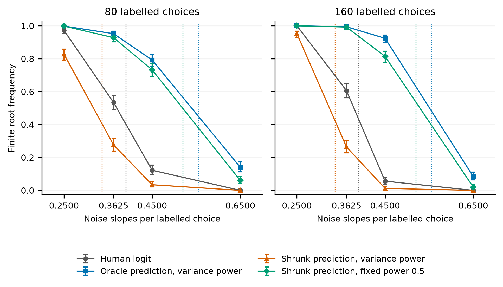

# 方差最优参考与有限解边界

2026年11月12日。本轮深化同一个修正Logit目标，形成了一个能区分局部方差与有限解存在性的具体结果。现有估计量、权重准则和通用锥几何继续归属于已有方法。

## 主要结果

把条件均值预测g0向真实的属性条件选择概率mu收缩，得到g_s=mu+s(g0-mu)，再按已有总体方差准则使用lambda_s=alpha/s，其中alpha=tau/(1+tau)、s介于alpha和1之间。这条路径上的修正目标在真实参数处具有逐样本完全相同的梯度，也具有相同的完整固定维度渐近协方差。

它们的有限解存在边界可以不同。代理翻转误差0.1、等量人工与辅助样本、零效用信号时，未收缩预测配权重0.5与半收缩预测配权重1具有相同协方差，均为人工基线的17/25。两者边界分别约为0.7401和0.4351，普通Logit为0.5。有理数区间计算进一步给出严格界：后者低于0.445257，前者高于0.728249。取维度比0.47即可根据正文定理得到相反的存在概率极限。

这个比较固定已知的总体最优权重，并保持真实参数处的梯度一致，隔离经验曲率的作用。它不需要把差异归于权重估计噪声。它也不提出新的估计或校准算法。构造使用未知的真实属性概率作为理论参照，不能直接当成实践中的预测处理步骤。

## 非零信号的配对模拟

效用信号1.5时，两个方差参考的计算边界为0.5554和0.3363；普通Logit为0.3903。模拟在总体计算之后选定该机制例子，并在抽样前固定[方案](phase_plan.json)。1,000次独立模型抽样产生16,000条分类记录，32个比较单元均保留500次重复。所有方法共享每次抽样的属性、选择和代理信息。

在160条人工选择、160条辅助属性及72个噪声斜率的条件下，未收缩方差参考的有限解比例为0.924，半收缩方差参考为0.012；配对差0.912，蒙特卡洛标准误0.01268。普通Logit为0.056。对半收缩预测固定采用0.5权重时，该比例为0.814。这些数值衡量有限解可得性，未比较估计误差或区间覆盖。



每点500次独立抽样，误差线为95% Wilson蒙特卡洛区间。竖虚线为理论边界；连线展示观察比例，不估计相变速度。[全部比较单元](results/phase/variance_reference_phase_summary.csv)、[完整配对比较](results/phase/variance_reference_phase_pairs.csv)和[紧凑表](results/figure/identical_score_phase_table.md)均保留。

## 证明和核对

[推导](score_identity_derivation.md)给出完整协方差、逐样本目标恒等式和严格边界不等式。完整矩阵检查覆盖24种情况；120个有限样本目标、梯度和Hessian恒等式检查通过。总体网格共40种条件、80次积分评估，其中16种条件下方差参考的存在边界低于普通Logit。全部条件的固定维度参考方差均改善。

[独立记录复核](results/phase/variance_reference_complete_verification.json)重建并检查2,355条普通Logit分离方向，以另一种内部点可行性程序验证24个相反结局的设计，并核对240次原目标与残差条件对照。分类及独立对照均无遗留未决状态。该复核未重新运行全部16,000个原始分类程序。

严格不等式使用[有理数区间记录](results/certified_bounds/rational_counterexample_certificate.json)。通用锥定理仍是正文定理的证明工具；该区间记录只认证具体反例中的数值不等式。

## 文献归属与当前边界

[PPI++第6.1节命题2](https://arxiv.org/html/2311.01453v2)已经给出方差最优权重；其固定维度正则性和一致性要求继续适用。[Mani等](https://arxiv.org/html/2505.20178v2)已经分析估计权重带来的均值估计有限样本代价。本例固定总体权重，研究增长维度下的Logit有限解事件。[CC-PPI](https://arxiv.org/html/2610.21837v2)等工作也已讨论相同一阶性质与不同有限样本表现；这种一般性观察不作为新贡献。

候选增量是正文补偿边界定理对上述精确梯度等价路径给出的相反存在结局。该结果加强了独立检查拟合目标的理由；广泛原创性和期刊贡献充分性仍需继续评估。[本轮来源阅读范围](source_scope.json)保留了未解决的多项Logit相变文献线索，未声称完成Scopus或Google Scholar系统检索。

38页[正文](../../submission/finite_choice_20261110/manuscript/paper.md)和原生Word在本轮保持不变，新结果尚待整合。原有成熟方法对照和训练成本结果继续保留。300份真人招募记录、60份AI预测试记录及其原始文件均未更改；本轮没有新增真人或语言模型答卷。

## 复核命令

从仓库根目录运行，依赖沿用`submission/finite_choice_20261110/requirements.txt`，作图另需matplotlib。入口及其本地依赖见[source_hashes.json](source_hashes.json)。输出使用新目录，避免覆盖保留结果。

```bash
python analysis/variance_reference_existence_audit.py --plan reports/variance_reference_audit_20261112/plan.json --out regenerated/variance_population
python analysis/verify_variance_score_identity.py --out regenerated/variance_identity
python analysis/certify_variance_reference_counterexample.py --out regenerated/variance_bounds
python analysis/variance_reference_matched_phase.py --plan reports/variance_reference_audit_20261112/phase_plan.json --out regenerated/variance_phase
python analysis/verify_variance_reference_phase.py --plan reports/variance_reference_audit_20261112/phase_plan.json --out regenerated/variance_phase --population regenerated/variance_population --certificate regenerated/variance_bounds/rational_counterexample_certificate.json
python analysis/plot_variance_reference_audit.py --phase regenerated/variance_phase --population regenerated/variance_population --out regenerated/variance_figure
```

完整模拟支持在同源、同方案下恢复。重新作图和记录复核也可使用保留结果的副本；不得把新的核对运行表述为所有原始模拟已重跑。
