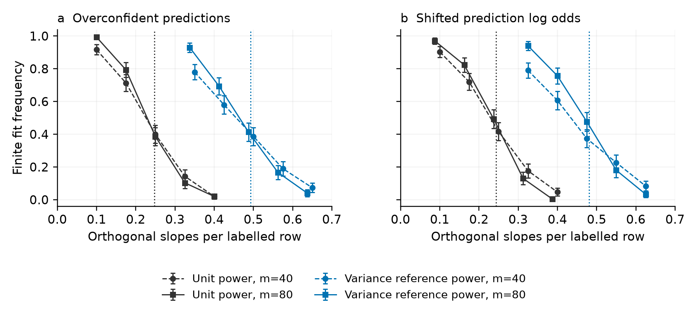
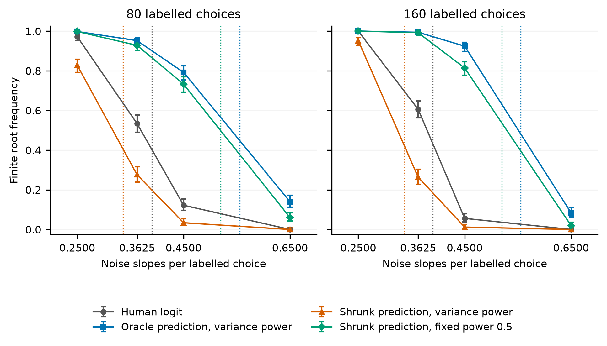
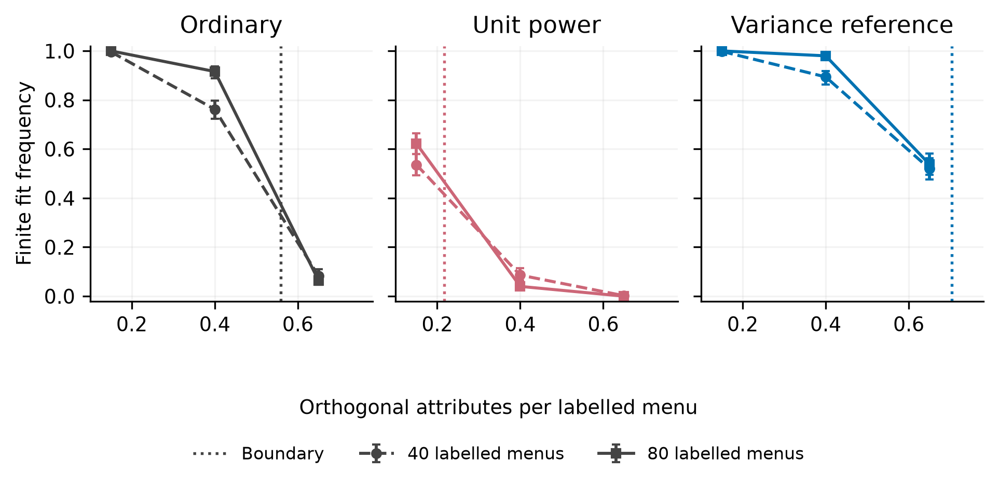
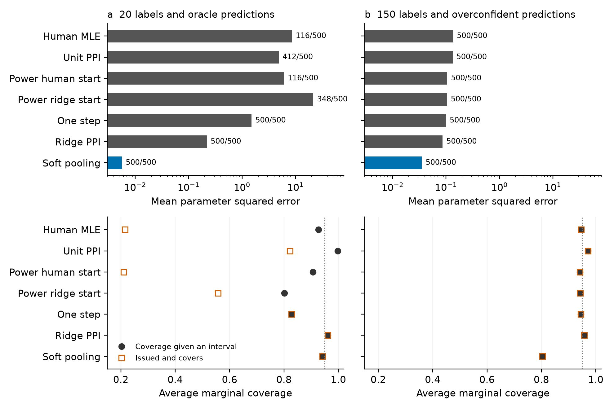
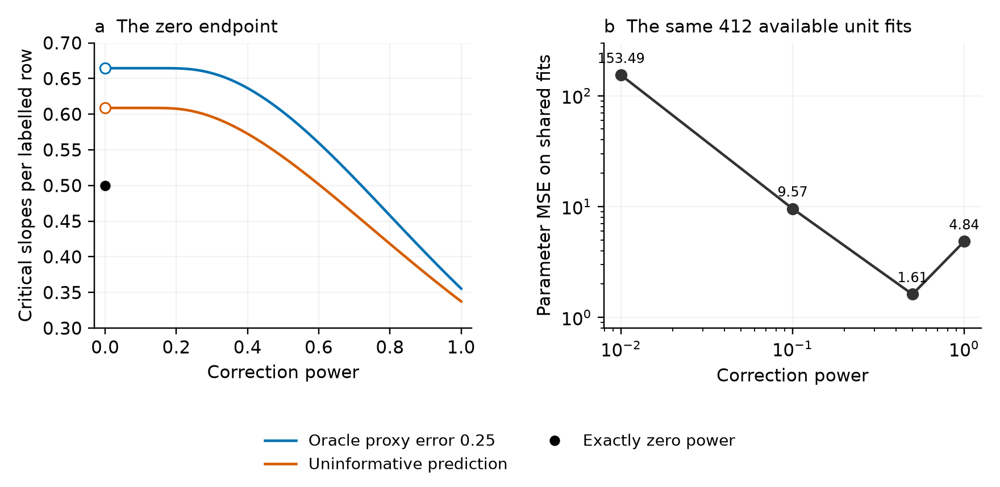
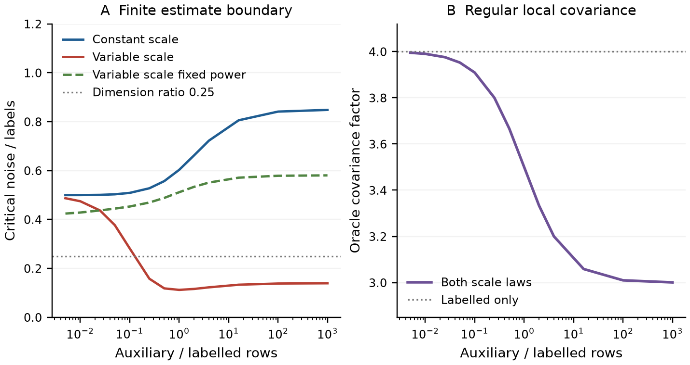

# When prediction assisted logit estimates exist

## Abstract

Prediction assisted logit can improve regular precision while its unpenalized empirical objective has no finite minimizer. We derive the existence boundary with finite auxiliary samples, Gaussian attributes, fitted choice constants and frozen predictions. An oracle comparison holds every realized truth score and the full fixed dimensional covariance equal while finite solution probabilities converge to opposite limits. A second comparison preserves human separation on each sample and shows that increasing auxiliary data along the established variance optimal power rule can reduce local covariance while removing the finite estimate. Small positive powers attain the largest existence region in the model. Above ordinary binary separation, powers tending to zero produce finite roots with diverging human probability log loss. Whole menu calculations retain common attribute coefficients and alternative constants. Released vaccine choices illustrate the finite design audit and held out prediction; known truth experiments distinguish availability, parameter error and coverage. The results identify a global estimation requirement that calibration and regular efficiency comparisons alone cannot determine.

Keywords: discrete choice; multinomial logit; prediction powered inference; logistic separation; finite auxiliary samples

## 1 Introduction

Machine predictions allow choice analysts to combine observed human choices with predicted responses on additional attribute profiles. Prediction powered inference corrects these responses to retain the human population score (Angelopoulos et al., 2023, 2026). Existing work covers categorical outcomes, conjoint partworths and adaptive preference ranking (Fan et al., 2024; Ye and Yoganarasimhan, 2026; Sargent et al., 2026). This use of predictions complements work in the Journal of Choice Modelling on machine learning and language models in utility specification (van Cranenburgh et al., 2022; Sfeir et al., 2026).

The corrected empirical objective must admit a finite estimate. When the human sample is small relative to the utility specification, the objective can decrease indefinitely along a coefficient direction. Further optimization then produces extreme coefficients without reaching a finite solution. Prediction information, correction power and auxiliary sample size all enter this event. A power change that restores a finite root can also change the resulting choice probabilities.

We characterize this event for the existing unpenalized compensated logit loss. The boundary retains the finite ratio of auxiliary to labelled observations, fitted choice constants and a frozen predictor. The binary model has a Gaussian utility signal and an increasing number of independent Gaussian attributes. A corresponding menu calculation retains common attribute coefficients. Classical logistic separation and Gaussian conic geometry provide the foundation (Candès and Sur, 2020; Amelunxen et al., 2014). The corrected labelled contributions can have negative infinite infima, and their compensation by auxiliary rows determines the explicit boundary. Section 3.2 relates this calculation to general M-estimator existence theory (Koriyama and Bellec, 2025).

The boundary gives a controlled comparison of local information and global estimation. An oracle prediction path holds every sample's truth score and the entire fixed dimensional covariance equal. Its two reference objectives have critical slope to label ratios 0.435 and 0.740 in a balanced example; ordinary logit has boundary 0.5. Any ratio strictly between 0.46 and 0.5 gives opposite corrected existence limits while the human likelihood has a finite estimate with probability tending to one. An observed reference version preserves complete empirical score rows at a supplied coefficient. Appendix B4 additionally constructs two conditionally calibrated predictors with equal Brier risk and complete regular covariance functions but distinct boundaries. A specified positive utility scale comparison keeps human separation identical on every sample and shows that more auxiliary data can improve regular precision while removing attainment along the existing variance optimal power rule.

Lowering positive correction power enlarges the existence region. We characterize its upper envelope and show that powers tending to zero attain it. In the binary interval above ordinary separation and below this envelope, the recovered coefficients diverge and expected log loss on a new human choice tends to infinity. The proof combines the corrected recession with established Gaussian margin theory (Montanari et al., 2025). A fixed design counterpart covers complete and quasi-complete separation. These results connect existence to the probability forecasts produced by the fitted utility model.

The evidence separates the population boundary, realized designs and statistical performance. Released vaccine choices supply exact support audits and comparisons at equal observed reference scores. A separate evaluation holds out 3405 released choice records from fitting and tuning. It compares probability forecasts with direct ridge, Firth and pooling; row disjointness does not establish independent respondents. Known truth simulations evaluate parameter error and coverage. A fixed total label experiment charges labels used to train the predictor; direct human ridge has lower prediction error than the examined fixed power corrections there. General finite sample differences in PPI and GMM, prediction filtering and online correction already have developed theories (Chen et al., 2026; Xu and Sun, 2026; Shoham et al., 2025). The contribution here is the compensated choice boundary and the matched information and probability loss consequences it establishes.

## 2 Prediction assisted choice logit

### 2.1 Choice target and correction

The correction combines a labelled choice loss with the difference between auxiliary and labelled prediction losses. It applies to binary contrasts and to a whole menu loss with a predicted probability vector. We first use binary logit to obtain explicit formulas, then retain the entire menu simplex in Section 3.9.

Let $X$ contain attribute contrasts and any estimated intercept. A binary choice $Y$ has logit probability $\sigma(X^T\beta)$, where $\sigma(u)=(1+e^{-u})^{-1}$. Write the negative log likelihood contribution as

$$\ell(u,y)=\log(1+e^u)-yu. \qquad (1)$$

There are $m$ labelled rows and $N$ independent auxiliary rows from the same distribution. A frozen prediction $g$ is available on both samples. Let $L_m(Y;\beta)$ denote the average labelled loss, and let $L_m(g;\beta)$ and $L_N(g;\beta)$ replace the response by its prediction. For fixed power $0<\lambda\leq1$, the PPI objective is

$$Q_\lambda(\beta)=L_m(Y;\beta)+\lambda\{L_N(g;\beta)-L_m(g;\beta)\}. \qquad (2)$$

The two prediction terms have equal expectations. The population score in (2) equals the human loss score, including when $g$ is imperfect. Under model misspecification its target is the human logistic projection. This identity uses a fixed predictor and power; it does not assert finite sample unbiasedness for a fitted predictor or estimated power.

For a stacked design with labelled rows first, define weights and a corrected moment by

$$w_i=(1-\lambda)/m\ \ (i\leq m),\qquad w_i=\lambda/N\ \ (i>m),$$

$$b_\lambda=m^{-1}X_L^T(Y_L-\lambda g_L)+\lambda N^{-1}X_U^Tg_U. \qquad (3)$$

Then $Q_\lambda(\beta)=\sum_i w_i\log(1+e^{X_i^T\beta})-b_\lambda^T\beta$. The Hessian is positive semidefinite. At unit power only auxiliary rows contribute curvature, while labelled rows still contribute to the corrected moment.

### 2.2 The finite design audit

Define the attainable moment set

$$\mathcal Z_w=\{\sum_i w_i X_i p_i:0\leq p_i\leq1\}. \qquad (4)$$

Proposition 1. Suppose the rows with positive weight span the parameter space. Objective (2) has a unique finite minimizer exactly when $b_\lambda$ is in the interior of $\mathcal Z_w$. If the moment is outside this set, the objective is unbounded below. A boundary moment has no finite stationary point. Without the rank condition, coefficients are not uniquely identified.

Convex support and recession criteria are established tools for likelihood existence (Geyer, 2009). Sablica et al. (2026, Theorems 1 and 4) give overlap and estimable-span uniqueness results for latent polyhedral categorical likelihoods, with LP detection in Section 4.1. Proposition 1 applies the support calculation to the corrected moment in (3). The gradient of the log partition function maps finite coefficients onto the interior of its attainable moments. Its recession function is

$$Q_\lambda^\infty(d)=\sum_iw_i(X_i^Td)_+-b_\lambda^Td. \qquad (5)$$

An exterior moment supplies a direction with a negative value in (5). An interior moment makes the recession function strictly positive on the unit sphere, establishing coercivity and, with full rank, strict convexity.

Our implementation maximizes a common slack in the constraints $b_\lambda=\sum_iw_iX_ip_i$, $s\leq p_i\leq1-s$. A separate linear program obtains an exterior separating direction and verifies the recession gap. It reports rank deficiency, numerical boundary proximity and unresolved cases separately. The interface preserves the specified objective; power changes, pooling and penalties are explicit subsequent decisions. This audit implements established support geometry and supplies the finite design counterpart to the probabilistic calculation below.

## 3 The existence boundary with finite auxiliary data

### 3.1 Model and main result

Let the contrast vector be $(S,W)$, where $S$ is standard normal and $W$ has $q$ independent standard normal coordinates. Assume

$$P(Y=1\mid S)=\sigma(\gamma S),\qquad |\gamma|<\infty. \qquad (6)$$

The vector $W$ is independent of a fixed dimensional tuple $(S,Y,Z,U)$. Here $Z$ is binary auxiliary information and $U$ is optional additional prediction information. Their conditional law given $(S,Y)$ is fixed. The predictor $g(S,Z,U)$ is measurable, frozen and strictly between zero and one almost surely. Both samples are independent draws from this joint law. The model estimates an intercept, the slope of $S$ and all $q$ remaining slopes. The true intercept and remaining slopes are zero.

Consider $N/m\to\tau>0$ and $q/m\to\kappa$, with a fixed power in $(0,1]$. Define $s_L=1-2Y$, $s_U=2Z-1$ and $r=|Y-g|$. The oriented row intervals are

$$I_L=[\lambda r,1-\lambda+\lambda r], \qquad (7)$$

$$I_U=(\lambda/\tau)[-g,1-g]\quad\text{when }Z=1,$$

$$I_U=(\lambda/\tau)[g-1,g]\quad\text{when }Z=0.$$

For standard normal $H$, write

$$f(a)=E(H-a)_+^2=(1+a^2)\Phi(-a)-a\varphi(a),$$

$$B(h,t,a,b)=1+h^2-f(-h-ta)-f(h+tb). \qquad (8)$$

When the last argument below is an interval, its endpoints enter the last two arguments of $B$. For $\eta=(\eta_0,\eta_1)$ define

$$\Psi(\eta,t)=E B(s_L(\eta_0+\eta_1S),t,I_L)$$

$$\hphantom{\Psi(\eta,t)}+\tau E B(s_U(\eta_0+\eta_1S),t,I_U). \qquad (9)$$

Theorem 1. Under the assumptions above, let

$$\kappa_c=\inf_{\eta\in\mathbb R^2}\ \sup_{t\geq0}\Psi(\eta,t). \qquad (10)$$

If $\kappa<\kappa_c$, the probability that (2) has a unique finite minimizer tends to one. If $\kappa>\kappa_c$, the probability of a finite minimizer tends to zero. The statement leaves the equality case unspecified.

The boundary combines the finite auxiliary ratio, utility signal, predictor distribution and power. Its fixed dimensional optimizations can be evaluated by quadrature and scalar scale maximization. Under joint sign symmetry of $(S,Y,Z,U)$ and $g(-S,1-Z,U)=1-g(S,Z,U)$, convexity and symmetry allow $\eta_0=0$. An asymmetric prediction retains both multiplier coordinates.

The theorem holds for independent Gaussian remaining attributes and a frozen low dimensional predictor. Section 3.8 retains prediction indices that are fitted attributes and gives a conditional result for independently trained linear scores. Section 3.9 treats independent Gaussian choice menus. Repeated choices from a respondent, arbitrary cross fitting and general categorical design distributions require separate arguments. For an observed categorical design, Proposition 1 directly checks the stated objective without invoking a Gaussian approximation.

### 3.2 Relation to existence theory

The labelled contribution in (2), up to its averaging factor, is

$$\ell_L(u)=(1-\lambda)\log(1+e^u)-(Y-\lambda g)u. \qquad (11)$$

For $Y=0$, this contribution tends to minus infinity as $u\to-\infty$; for $Y=1$, it does so as $u\to+\infty$. At unit power it is affine. Auxiliary rows can compensate these directions and make the full objective coercive. Koriyama and Bellec (2025; arXiv v3, Assumption 2.5) require finite rowwise infima and strict row convexity. The corrected rows in (11) require their joint two sample treatment. Fuh et al. (2026) study a positivity constrained multinomial likelihood, with a different coefficient domain and loss.

Gaussian conic projection and absorption are established (Amelunxen et al., 2014; Götze et al., 2020, Theorem 3.1; Han and Ren, 2026, Theorems 1.1, 1.3 and 2.1). Theorem 1 computes the statistical dimension limit for the particular corrected intervals (7), including the intercept, utility signal and finite auxiliary ratio. The controlled comparisons below use that calculation to separate regular score information from finite estimation.

Preference assistance already has existence results. Sargent et al. (2026, Theorem 1) prove a bounded approximate Bradley–Terry root sequence under their adaptive policy and sampling conditions. Cai et al. (2026, Lemma D.4) prove high probability finite global solutions for a calibrated human and LLM likelihood with fixed numbers of items, judges and latent directions. Their positive weighted likelihood differs from the subtracted prediction loss in (2). Here the utility dimension grows with the human label budget.

Complete GMM supplies another objective. Chen et al. (2026, Supplement S3.10) give observable sufficient conditions for its finite global solution, which also imply a finite human logit MLE through an outward score on a ball. Appendix B6 compares the complete moment and compensated criteria on the same separated human design: the former has a finite global minimum while the latter is unbounded at unit power. These objective specific results make the target of each existence statement explicit.

The proof conditions on $(S,Y,Z,U)$ and orients the remaining Gaussian rows by $s_L$ and $s_U$. The corrected moment becomes a Gaussian nullspace intersection with the interval cone, subject to intercept and signal constraints. Appendix A proves tightness of both optimization variables, evaluates the statistical dimension limit and connects feasibility to an interior moment.

### 3.3 Balanced oracle benchmark

Take $\gamma=0$, let $Z$ independently flip $Y$ with probability $\epsilon\in(0,1/2)$, and use $g=\epsilon+(1-2\epsilon)Z$. Symmetry and independence minimize both multiplier coordinates at zero. The finite ratio boundary simplifies to

$$\kappa_c=1+\tau-\min_{t\geq0}F(t), \qquad (12)$$

$$F(t)=(1-\epsilon)\{f(-\lambda\epsilon t)+f((1-\lambda+\lambda\epsilon)t)\}$$

$$\hphantom{F(t)}+\epsilon\{f(-\lambda(1-\epsilon)t)+f((1-\lambda\epsilon)t)\}$$

$$\hphantom{F(t)}+\tau\{f(\lambda(1-\epsilon)t/\tau)+f(\lambda\epsilon t/\tau)\}.$$

At unit power this is

$$\kappa_c=\tau[1-\min_{u\geq0}\{\tau\epsilon(1-\epsilon)u^2+f((1-\epsilon)u)+f(\epsilon u)\}]. \qquad (13)$$

For $\epsilon=0.25$ and $\tau=1$, unit power gives 0.3554. The established population variance reference power $\lambda=\tau/(1+\tau)=0.5$ gives 0.6029. At $\tau=4$ the corresponding boundaries are 0.6120 and 0.7223, with reference power 0.8. As $\tau$ tends to infinity, the unit power boundary tends to $1/[2\pi\epsilon(1-\epsilon)]$, equal to 0.8488 at this error rate. The finite auxiliary calculation materially changes the existence region even for an informative, correctly calibrated predictor.

Zero power uses ordinary logit separation and is handled separately. Its balanced null threshold is 0.5. The interval cone in (7) contains zero at that endpoint, so a zero feasibility check would be uninformative. Our code uses the ordinary separation condition when the established weight formula selects zero.

### 3.4 Utility signal and prediction calibration

For a binary proxy with independent error $\epsilon$, the oracle prediction is

$$g_0(S,Z)=\sigma(\gamma S+(2Z-1)\log((1-\epsilon)/\epsilon)). \qquad (14)$$

We evaluate both this predictor and frozen transformations $g=\sigma(a\log(g_0/(1-g_0))+b)$. The overconfident case has $(a,b)=(2,0)$; shifted log odds use $(1,1)$. Table 1 fixes $\gamma=1.5$ and $\epsilon=0.25$. The comparison power minimizes the existing fixed dimensional orthogonal score variance. It provides a common reference and is held fixed in the phase experiment.

Table 1  Theoretical boundaries with a utility signal and estimated intercept

| Auxiliary to label ratio | Prediction | Power | Critical slope to label ratio |
|---|---|---|---|
| 1 | Oracle | 1.0000 | 0.2795 |
| 1 | Oracle | 0.5000 | 0.4637 |
| 1 | Overconfident | 1.0000 | 0.2478 |
| 1 | Overconfident | 0.3386 | 0.4927 |
| 1 | Shifted log odds | 1.0000 | 0.2434 |
| 1 | Shifted log odds | 0.3078 | 0.4810 |
| 4 | Oracle | 1.0000 | 0.4690 |
| 4 | Oracle | 0.8000 | 0.5487 |
| 4 | Overconfident | 1.0000 | 0.4261 |
| 4 | Overconfident | 0.5417 | 0.6046 |
| 4 | Shifted log odds | 1.0000 | 0.4060 |
| 4 | Shifted log odds | 0.4925 | 0.5729 |

At equal sample sizes, overconfidence moves the unit power boundary from 0.2795 to 0.2478; shifting log odds gives 0.2434. The variance reference powers yield boundaries near 0.48 to 0.49. A changed prediction distribution affects the allowable dimension as well as the efficiency calculation. The two free multipliers in (10) account for the signal and the asymmetry of shifted predictions.

Figure 1 evaluates these boundaries using 300 independent draws at each displayed point. Both samples are generated anew on each draw, and the same draw supplies the compared dimensions within a condition. The smooth finite sample transitions sharpen as the labelled sample increases. The complete oracle and imperfect prediction grids include 80 conditions each, with no numerically unresolved feasibility classifications.

Figure 1  Finite fit frequencies at auxiliary to label ratio one and utility signal 1.5. Circles and dashed lines use 40 labels; squares and solid lines use 80. Dotted lines show asymptotic boundaries. Error bars give approximate 95% binomial Monte Carlo intervals from 300 draws per point. Both panels use Gaussian attributes.

### 3.5 Local score equivalence and finite estimation

Common first order limits can coexist with different finite sample risks in prediction assisted estimation (Chen et al., 2026). We examine finite estimation while holding the realized score at the true parameter exactly equal. An oracle variance calculation can favor correction while its empirical objective lacks a finite root. Known population predictions isolate the role of curvature. Let $\mu(X)=\sigma(X^T\beta_0)$ and let $g_0=E(Y\mid X,Z)$ be a frozen conditional mean based on additional information $Z$. Define

$$g_s=\mu+s(g_0-\mu),\qquad a_\tau=\tau/(1+\tau),\qquad \lambda_s=a_\tau/s,\qquad a_\tau\leq s\leq1. \qquad (15)$$

These powers lie in $[0,1]$. Write $H_0=E[XX^T\mu(1-\mu)]$ and $M=E[XX^T(\mu-g_0)^2]$, with $H_0$ nonsingular.

Proposition 2. Along (15), the gradient of (2) at $\beta_0$ is identical on every realization. For each fixed parameter dimension, the existing oracle variance criterion chooses $\lambda_s$ and gives the same first order covariance for every $s$:

$$V_s=H_0^{-1}(H_0-a_\tau M)H_0^{-1}/m. \qquad (16)$$

Under Theorem 1 with $\gamma=0$, proxy error $0.1$ and $\tau=1$, the half-shrunk reference $(s,\lambda)=(0.5,1)$ has boundary below $0.46$, while the unshrunk reference $(1,0.5)$ has boundary above $0.72$. At noise dimension ratio $0.47$, their finite solution probabilities tend to zero and one, respectively; ordinary logit also has probability tending to one. Both references have covariance $17/25$ of the human covariance.

Appendix B proves the identities and the strict boundary inequalities. The two objectives differ by a multiple of $L_N(\mu)-L_m(\mu)$. This term has exactly zero gradient at $\beta_0$ on every sample and changes their empirical Hessians. The construction fixes the variance optimal population weights, isolating curvature from weight estimation noise. The reference function $\mu$ uses the true parameter; the construction provides a theoretical comparison.

A finite design counterpart uses any observed reference coefficient $b$ and its probabilities $\mu_b=\sigma(X^Tb)$. For a fixed base power $a>0$, the path $g_\lambda=\mu_b+(a/\lambda)(g-\mu_b)$, $a\leq\lambda\leq1$, preserves every labelled and auxiliary score row at $b$. Its empirical score covariance middle is identical; its Hessian can change. When the existing variance rule selects $0<a<1$ at this reference, recomputing that rule returns the path powers. Appendix B5 gives the algebra and an exact scalar example. A fitted reference supplies an observable comparison point. The covariance at the unknown true parameter remains a separate property. Section 4.3 evaluates this construction on released choices.

With utility signal $1.5$, proxy error $0.1$ and equal sample sizes, the computed boundaries are $0.5554$ for the unshrunk reference and $0.3363$ for the half-shrunk reference; ordinary logit has boundary $0.3903$. Figure 2 evaluates this nonzero signal example on matched draws. At 160 labelled choices and 72 noise slopes, finite root frequencies are $0.924$ and $0.012$ for the two variance references. Their paired difference is $0.912$, with Monte Carlo standard error $0.01268$. A fixed power of $0.5$ on the half-shrunk prediction gives frequency $0.814$.

Figure 2  Finite root frequencies along an oracle local score equivalence path. The labelled and auxiliary samples each have 80 or 160 simulated attribute rows. The two variance references have exactly the same truth score and the same full fixed dimensional asymptotic covariance. Each point retains 500 independent Gaussian model draws; all methods and dimensions share each draw. Error bars are 95% Wilson binomial Monte Carlo intervals. Dotted lines show theoretical boundaries, and connecting lines display measured frequencies. The mechanism illustration was selected after the population calculation and specified before sampling. Table B1 retains every displayed frequency. Point error and interval coverage are evaluated separately in Section 5.

### 3.6 Positive powers and the zero endpoint

Holding the sample and predictor fixed reveals a simple ordering. Write $H=L_m(Y)$ and $A=Q_1$. For $0<\alpha<\lambda\leq1$,

$$Q_\alpha/\alpha=Q_\lambda/\lambda+(1/\alpha-1/\lambda)H. \qquad (17)$$

The human loss is nonnegative. A coercive objective at power $\lambda$ remains coercive at the smaller positive power $\alpha$. With the rank condition of Proposition 1 this gives nested finite solution events. Exactly zero power removes auxiliary curvature and requires its own separation check.

For the balanced oracle with fixed zero intercept, put

$$G(v)=(1-\epsilon)f(-\epsilon v)+\epsilon f(-(1-\epsilon)v)$$

$$\hphantom{G(v)}+\tau\{f((1-\epsilon)v/\tau)+f(\epsilon v/\tau)\}. \qquad (18)$$

Corollary 1. For $\tau>0$ and $0<\epsilon\leq1/2$, the boundary strictly decreases with positive power and has right limit

$$\kappa_c(0+)=1+\tau-\min_{v\geq0}G(v)>1/2=\kappa_c(0). \qquad (19)$$

At $\tau=1$ and $\epsilon=0.25$, the right limit is 0.664488. An uninformative prediction at $\epsilon=1/2$ also has a gap, with right limit 0.608737. This gap concerns existence and auxiliary stabilization; it does not measure additional choice information.

A fixed sample counterpart describes the coefficient cost on categorical designs. Suppose the unit power recession is positive on every nonzero human weak separator. Small positive powers then have finite roots. After division by $\log(1/\lambda)$, the coefficients approach the set minimizing corrected auxiliary recession, with human margins of at least one on maximally separable rows and zero on the remaining rows. Appendix D3 proves this result for complete and quasi-complete separation. Classical separation faces and margin arguments supply the foundation; the specified corrected loss determines the limiting cost.

### 3.7 A simultaneous boundary with utility signal and estimated intercept

Retain the model of Section 3.1. Write $h_L=s_L(\eta_0+\eta_1S)$, $h_U=s_U(\eta_0+\eta_1S)$ and $J_U=I_U/\lambda$. Dividing the positive power intervals by power leaves the auxiliary interval $J_U$ fixed. The labelled interval expands to $[r,r+1/\lambda-1]$. Its closed limit gives

$$\Psi_\infty(\eta,v)=E\{1+h_L^2-f(-h_L-vr)\}$$

$$\hphantom{\Psi_\infty(\eta,v)}+\tau E B(h_U,v,J_U),\qquad v\geq0. \qquad (20)$$

Define the limiting and ordinary logit boundaries by

$$\kappa_\infty=\inf_\eta\sup_{v\geq0}\Psi_\infty(\eta,v),\qquad \kappa_0=\inf_\eta E f(h_L). \qquad (21)$$

Theorem 2. Under the assumptions of Theorem 1, $\kappa_c(\lambda)\to\kappa_\infty>\kappa_0$ as positive $\lambda\to0$. For $\kappa<\kappa_\infty$, some fixed power in $(0,1)$ gives a unique finite root with probability tending to one. For $\kappa>\kappa_\infty$, the probability that any power in $[0,1]$ gives a finite root tends to zero. Every sequence of possibly data dependent powers satisfying $0<\lambda_m\leq1$ almost surely and $\lambda_m\to0$ in probability has the same strict two sided existence boundary $\kappa_\infty$. The equality case is unspecified.

The simultaneous upper bound follows from one closed cone containing all positive power cones and the ordinary logit feasibility face. The lower side combines fixed power thresholds with the nesting identity (17). Appendix D proves the required uniform controls without exchanging the infimum and supremum. No rate or independence condition is imposed on the selected positive powers. These assumptions keep the strictly interior predictor fixed across sample sizes. Section 3.8 states additional conditions for independently trained linear predictors.

For utility signal 1.5 and proxy error 0.25, the ordinary boundary is 0.3903. With equal sample sizes, the limiting boundaries are 0.5082 for the oracle, 0.5061 for overconfident predictions and 0.4918 for shifted log odds. At auxiliary ratio four they are 0.6263, 0.6249 and 0.5875. Constant and reversed predictions also give strict existence gains, of different sizes. The strict gain establishes finite estimation of this objective. In the interval $\kappa_0<\kappa<\kappa_\infty$, every strictly positive power sequence tending to zero also gives coefficient growth of at least logarithmic order and diverging expected new-row human log loss. Proposition 6 in Appendix D derives this consequence from a gradient-aware finite design bound and existing Gaussian margin theory. Section 5.5 evaluates probability losses on fixed prediction paths.

### 3.8 Prediction indices in the binary fitted design

A prediction may use attributes whose coefficients the choice model estimates. Conditioning on that prediction then conditions on part of the fitted design. Retaining its index among the multiplier constraints preserves the independent Gaussian structure of the remaining columns. This accounts explicitly for prediction–attribute dependence.

Proposition 3. Let $T$ have a fixed number $k$ of independent standard normal coordinates, independent of $S$, and let $Y$ given $(S,T)$ have probability (6). Include all coordinates of $T$ among the fitted contrasts, with true slopes zero. Suppose the remaining Gaussian vector $W$ is independent of $(S,T,Y,Z,U)$ and $g(S,T,Z,U)$ is frozen and strictly interior. Theorems 1 and 2 hold with the multiplier in $\mathbb R^{k+2}$ and

$$h_\eta(S,T)=\eta_0+\eta_1S+\eta_T^T T. \qquad (22)$$

In (9), (20) and (21), replace each signed affine multiplier by $s_Lh_\eta$ or $s_Uh_\eta$. The ordinary boundary is unchanged by the independent zero slope attributes $T$. Appendix E proves the extension. It uses the same compensated objective and conic calculation.

Prediction accuracy and calibration do not determine this boundary. An explicit construction in Appendix E keeps the complete law of $(Y,g)$ identical while placing the prediction index outside or inside the fitted design. Both predictions are calibrated, with Brier risk 0.09. At unit power and equal sample sizes, their boundaries are 0.396628 and 0.385935. Every limiting dimension ratio strictly between them gives opposite existence conclusions. The gap is about 0.011 in this construction. All population cases and paired finite size results are retained.

For a linear score trained independently of the audit rows, an orthogonal Gaussian rotation reduces its component outside the utility direction to one such index. Corollary 2 in Appendix E requires its signal overlap, orthogonal norm and intercept to converge to finite deterministic limits. These conditions give deterministic strict existence limits for the independently trained score. Cross prediction already provides fixed dimensional inference with learned predictors (Zrnic and Candès, 2024); the present conditional result concerns proportional dimensional existence. Correlated teacher and fitted feature spaces are established objects of high dimensional analysis (Loureiro et al., 2021). The additional calculation here concerns their role in the compensated choice loss. Training labels are additional to the $m$ audit labels. Section 5.4 counts both subsets in a fixed total budget comparison.

### 3.9 Whole choice menus

The same correction applies to a menu of $J$ alternatives with common attribute coefficients. Let $F_i$ be its matrix of alternative attributes and let $e_Y$ identify the chosen alternative. The menu loss is $\ell_J(F_i\beta,y)=\log\sum_j e^{F_{ij}^T\beta}-y^TF_i\beta$, for either the observed choice vector or a predicted probability vector. This prediction assisted MNL construction is established in Fan et al. (2024) and Ye and Yoganarasimhan (2026). We calculate its finite solution boundary while preserving the constraint that probabilities within each menu sum to one.

For independent Gaussian profiles and fixed menu size, estimate alternative constants, a common signal slope and increasing common noise slopes. Frozen predictions can occupy the whole probability simplex, including hard category predictions, with positive mean squared prediction error. Theorem 3 in Appendix F gives the explicit fixed power boundary from the joint menu residual sets. Corollary 3 gives a simultaneous upper envelope over all powers, attained by any strictly positive possibly data dependent power tending to zero. The strict gain over ordinary logit holds for every $J\geq3$; at $J=2$ it holds exactly when $P(g_Y>0)>0$. Appendix F states the model, formulas and perfect-prediction endpoint together.

The final condition distinguishes binary choice from larger menus. An always wrong binary hard predictor has the ordinary limiting boundary. With at least three alternatives, the Gaussian tangent projection can concentrate on different unchosen competitors, giving a positive derivative for every fixed prediction vector. Appendix F proves this condition and treats the perfect hard prediction endpoint separately. For two alternatives the formula reduces to Theorem 1 with binary signal coefficient $\sqrt2\gamma$; alternative profile differences have variance two. These results concern common coefficients on alternative profiles. Tan and Bellec (2023) study a class specific coefficient matrix on shared covariates and impose existence in Assumption 2.4.

Figure 3 shows a matched hard prediction illustration with three alternatives, signal 1.5, proxy error 0.25 and auxiliary ratio one. The established fixed dimensional variance criterion for one orthogonal common slope gives power 0.219576. The corresponding boundary is 0.7039, compared with 0.2164 at unit power and 0.5594 for ordinary logit. This reference uses the hard predictor's actual score covariance, derived in Appendix F. Its population value is available in the simulation; it is not a newly estimated tuning algorithm.

All methods share each Gaussian menu sample, observed choices, predictions and attribute dimensions. Each budget supplies 500 independent draws. At 80 labelled menus and 52 orthogonal attributes, finite fit frequencies are 0.538 for the variance reference, 0.064 for ordinary logit and zero at unit power. The paired reference minus ordinary difference is 0.474 with Monte Carlo standard error 0.02235. Boundary locations at these finite budgets remain shifted from the asymptotic limits. The complete 18 cells, 9000 classifications and 1090 independently checked ordinary boundary directions accompany the figure. Accuracy, interval performance and training costs retain their separate comparisons in Section 5.

Figure 3  Finite estimation with hard category predictions on identical menus and dimensions. Each point uses 500 draws; circles and dashed lines use 40 labelled menus, and squares and solid lines use 80. Dotted lines mark the corresponding boundaries. Error bars are 95% Wilson binomial intervals. The variance reference is the existing oracle criterion for one orthogonal slope, with power 0.219576. The experiment was selected after the population grid as a mechanism illustration. Lines connect the observed frequencies; they do not estimate a transition rate.

### 3.10 Known utility scales and increasing auxiliary samples

A known positive scale allows another assessment of local information. Let $X=D(1,S,W^T)^T$, where the fixed law of $D$ is independent of the Gaussian attributes and satisfies $0<d_l\leq D\leq d_u<\infty$. The multiplier applies to the complete utility, including its fitted intercept. This is a specified input; identification of unknown scale is a separate problem (Hess and Train, 2017). Let $P(Y=1\mid D,S)=\sigma(\gamma DS)$, with finite fixed signal. The frozen prediction is strictly interior and uses fixed dimensional information independent of the remaining Gaussian columns. Both samples draw independently from the same law.

Proposition 7. With the oriented intervals of (7), put $h_\eta(S)=\eta_0+\eta_1S$. The positive scale boundary is

$$\kappa_D=\inf_\eta\sup_{t\geq0}\{E B(s_Lh_\eta(S),t,DI_L)+\tau E B(s_Uh_\eta(S),t,DI_U)\}. \qquad (23)$$

For $q/m\to\kappa\in(0,\infty)$, a unique finite minimizer exists with probability tending to one below $\kappa_D$ and no finite minimizer exists with probability tending to one above it. Equality is unspecified. Appendix G proves the weighted support qualification, relative interior and rank conditions. Ordinary elliptical-logit existence and Gaussian absorption provide established inputs (Tang and Ye, 2020; Götze et al., 2020).

For balanced choices, let a proxy independently flip $Y$ with probability $e\in(0,1/2)$, use the oracle $g=e+(1-2e)Z$, and take $D$ independent of $(S,Y,Z)$. Define the scalar profile $J_{\lambda,\tau}$ in Appendix G5. Then

$$\kappa_D(\lambda,\tau)=\sup_{v\geq0}E J_{\lambda,\tau}(Dv). \qquad (24)$$

Every nonconstant positive scale law strictly reduces this boundary from the constant-scale value at the same power and auxiliary ratio. When $ED^2=1$, the entire population information and score covariance blocks equal those under constant scale. Positive row scaling also preserves the human separation event exactly. At $e=1/4$, $\tau=1$ and $\lambda=1/2$, exact bounds put one constant-scale boundary above $213/640$ and a specified two-point-scale boundary below $10201/140625$. Their existence conclusions are opposite at noise-to-label ratio $1/4$, although both regular covariances are $7I/(2m)$.

Along the established variance power $\lambda_\tau=\tau/(1+\tau)$, the regular covariance decreases with $\tau$. The boundary instead has limits

$$\lim_{\tau\downarrow0}\kappa_D(\lambda_\tau,\tau)=1/2,\qquad\lim_{\tau\to\infty}\kappa_D(\lambda_\tau,\tau)=\frac{(ED)^2}{2\pi e(1-e)ED^2}. \qquad (25)$$

Each ratio limit follows the proportional sample limit for its fixed scale law and fixed $\tau$. If $(ED)^2/ED^2<\pi e(1-e)$, increasing the auxiliary ratio can remove a finite minimizer at a dimension ratio between these two limits, while improving the full regular covariance. At a held positive power the balanced boundary is nondecreasing in $\tau$. Section 5.6 separates this weight-selection effect from increasing auxiliary size at fixed power.

## 4 Evidence from released vaccine choices

### 4.1 Data and the stated estimands

We use numeric files released with Generative Augmented Inference (Lu et al., 2026), pinned to repository commit d18717206867c7a12ff470879a0dd5d488b300c2. The file contains 4605 human binary choice rows with two 12 column vaccine profiles and 1200 aligned hard AI predictions. Differencing the profiles and removing a common first column yields 11 contrasts. The released study excludes respondents who never select a vaccine; these rows do not represent all originally recruited respondents. Code and data licenses are recorded in the reproduction package.

The reanalysis fixes the aligned 1200 row prefix and evaluates 500 allocations with labelled budgets of 50, 100, 150 and 200 rows. Allocations preserve the source implementation's five row blocks. The released numeric file does not establish participant identifiers, so the comparison is conditional on that block convention. The empirical target is the converged logistic projection on the fixed prefix. It is a reference estimate, distinct from a known population parameter.

Nuisance predictions use five row folds and ridge logistic fits, either within hard AI label strata or using attributes alone. Predictions are held fixed within each objective comparison. This fitted prediction reanalysis illustrates finite support geometry; its distribution is outside the frozen predictor theorem. Changing the source prefix pool convention yields a distinct reanalysis.

### 4.2 Finite solutions and explicit alternatives

In the auxiliary only objective (2), unit power has six exterior AI moments among 500 allocations at 50 labels; the attributes only comparator has two. Each exterior moment has a separately verified positive recession gap. Existing power tuning from a converged human estimate returns finite roots in all 500 allocations for both predictors. Initializing that same tuning procedure from a verified unit power root leaves six and two initializers unavailable, respectively. The method definition and its initialization both affect availability.

We apply the finite objective audit to all eight recorded exterior cases. Unit power remains exterior in every case; the smallest verified gap is 0.000388. Existing human initialized tuning solves its stated objective in all eight. Soft pooling also solves its own objective, with a corrected unit power score discrepancy of at least 0.1072 across these cases. These are the eight recorded failures of that experiment.

Component clipping explains the soft pooling alternative in the source style pooled imputation experiment. With inverse label probability weight greater than one, clipping corrected binary one hot targets to the unit interval and renormalizing returns observed choices on labelled rows and predictions on auxiliary rows. This identity holds for every prediction in the unit interval. It removes the original residual correction from the loss being optimized. In the separate pooled imputation comparison, exterior counts are five and two; these counts refer to a different objective and are retained separately.

The released reference vector also requires an explicit optimization convention. It agrees with a 200 step Adam reconstruction within $1.49\times10^{-7}$. A converged fit on all 4605 rows reduces total negative log likelihood by 7.014, with a maximum coefficient difference of 0.1855. Our point comparisons use converged projections and report fixed iteration outputs separately. This check concerns the released reference and the inspected implementation; it does not identify the source of every gain in the published study.

### 4.3 Equal observed reference scores and different finite targets

The same released choices allow the observable comparison of Section 3.5. For each original block permutation we retain the 1200 row prefix, the 11 attribute contrasts and the original AI aided or attributes only prediction routine. At 50 labelled choices, the reference coefficient and base power are the existing human initialized estimates of Section 4.2. Five path positions move the power from its base value to one and adjust the prediction to keep every reference score row fixed. The sampling plan precedes this calculation. All 5000 targets are finite across 500 allocations, two prediction routines and five positions.

After the first 260 higher budget allocations showed no availability difference, a separate follow-up plan fixed 20 labels and a finite ridge reference. It minimizes the labelled mean loss plus the squared coefficient norm divided by $2m$, using the same 20 labels. The prediction routine retains its specified constant fallback when a fold lacks both outcomes. All 500 original block permutations and five positions are retained. These calculations examine the observed categorical support through Proposition 1; they do not invoke the Gaussian probability boundary for fitted predictions.

Table B2 isolates base powers strictly between zero and one, where the existing variance rule remains defined along the path. The AI aided stratum has 80 allocations: 76 base targets and 79 unit power endpoints are finite. Four exterior base targets become finite, and one finite base target becomes exterior. The attributes only stratum has 65 allocations, with 62 finite base targets and 64 finite endpoints; three change from exterior to finite and one changes in reverse. The nine prediction by allocation comparisons involve six distinct block permutations. Every compared pair has identical reference score rows and empirical score covariance middle. An independent residual interior program and recession directions verify their different global conclusions.

Zero base powers give a separate degeneracy: transformed prediction-score variance vanishes, and the recomputed variance ratio can be undefined. Appendix B5 reports these strata and all 500 allocation denominators separately.

### 4.4 Prediction on held out released choices

We fit and tune only on the aligned 1200 row prefix and evaluate on the remaining 3405 human choice rows. Each of the same 500 block permutations supplies nested budgets of 50 and 150 labels. Seven established estimators use the conventions of Section 5.1: human MLE, direct ridge, Firth, unit power PPI, ridge initialized power tuning, ridge PPI and soft pooling. Both nuisance routines are retained. The local analysis plan preceded these fits. The evaluation uses no known coefficient and generates no new answers.

At 50 labels, AI aided unit power PPI is finite in 494/500 allocations and has mean held out log loss 0.887015 conditional on those fits. Direct ridge gives 0.762353 across all 500 allocations. Replacing each unavailable unit power fit with direct ridge gives all-allocation loss 0.885919; its paired excess over ridge is 0.123566 with allocation Monte Carlo standard error 0.010867. Ridge initialized power tuning is finite throughout but has loss 0.896512. At 150 labels the corresponding unit power versus ridge difference is 0.004612 with Monte Carlo standard error 0.000572. Table C1 retains Firth, attributes only predictions and soft pooling, which has lower loss on this fixed evaluation segment. These comparisons assess prediction under the stated fitting conventions; they do not establish a general ranking or isolate the value of AI information.

The numeric release contains no respondent identifiers. Nonoverlapping row positions and the source's five row convention do not certify independent people. The prefix and evaluation choice 1 frequencies are 0.415 and 0.469310. Allocation Monte Carlo errors condition on this fixed file and are not population uncertainty estimates. The realized design audit in Section 4.2, this held out prediction check and the known truth simulations in Section 5 address different properties.

## 5 Finite estimation and statistical performance

### 5.1 Known truth experiment

To evaluate error and coverage against a known parameter, we sample attribute rows independently with replacement from the fixed 1200 row support. The simulation parameter is its converged 11 coordinate logistic vector. A second signal group multiplies that vector by three. We generate choices from the stated logistic probabilities and binary proxies by independent flips. No new human respondents or language model answers are generated.

The oracle grid crosses $m=20,50,150$, $N=150,600$ and proxy error 0.1 or 0.25, with 500 repetitions per condition. Two additional signal groups use oracle, doubled log odds and shifted log odds predictions, $m=50,150$, $N=600$ and proxy error 0.25. Each of those groups has six conditions and 500 repetitions. Every method shares the attributes, choices and proxy draws within a condition. The full grids and their seeds accompany the aggregate tables.

We compare human maximum likelihood, unit power PPI, human initialized power tuning, ridge initialized power tuning, one step PPI from that ridge start, unit power ridge PPI and soft pooling. Ridge fits use penalty $\|\beta\|^2/(2m)$ on every coordinate. The two power methods use the established PPI++ covariance trace convention at their stated initializers. The one step update uses the same estimated power and initial ridge fit. Soft pooling combines observed labelled choices with frozen auxiliary predictions at equal row weights. Its oracle version has correct conditional mean information.

Two DY prior settings provide a labelled only comparator in the two conditions of Table 2. The estimator fits pseudo-responses $\alpha Y+(1-\alpha)/2$, using $\alpha=m/(m+11)$ and a fixed $\alpha=0.5$ sensitivity. The first follows the dimension based choice used in the authors' supplementary implementation. Both use the same human rows, a zero prior mode and zero initialization, with no auxiliary predictions. They replay the existing 500 draws in each condition; the original seven strategy grids remain unchanged.

Firth estimation is an established response to separation in small choice datasets (Kessels et al., 2019). We maximize the human log likelihood plus one half the log determinant of its expected information, using the same labelled rows and no auxiliary predictions. The three fixed starts are zero, a human ridge estimate and its negative. We select the smallest penalized negative log likelihood among verified roots with positive definite Hessians. This numerical selection does not certify global optimality. Its conventional Wald intervals use inverse expected information (Kosmidis and Firth, 2021).

For each method we record point availability and interval availability separately. Parameter MSE is the mean of squared coordinate errors, conditional on an available point. Coverage is the fraction of 11 marginal intervals covering their corresponding true coordinates, averaged over repetitions with intervals. Issued and covers assigns zero to a repetition without intervals before averaging over all 500 repetitions. Neither summary is simultaneous coverage. Monte Carlo errors use the repetition as the independent unit. Firth intervals use inverse expected information; the other methods use their documented score sandwiches. Ridge intervals do not adjust for shrinkage bias. Appendix C states the covariance formulas and tuning convention.

### 5.2 What a finite output establishes

Table 2 contrasts two prespecified mechanisms: scarcity of human labels with oracle predictions, and overconfidence under stronger utility at a larger label budget. All conditions and error tails remain in the reproduction tables. The selected columns show how availability, parameter error and coverage can lead to different assessments of the same estimator.

Table 2  Point availability and interval performance

| Condition | Estimator | Available | MSE | Coverage | Issued and covers |
|---|---|---|---|---|---|
| 20 labels oracle | Human MLE | 116/500 | 8.5602 | 0.926 | 0.215 |
| 20 labels oracle | Unit PPI | 412/500 | 4.8362 | 0.998 | 0.822 |
| 20 labels oracle | Power human start | 116/500 | 6.0858 | 0.907 | 0.210 |
| 20 labels oracle | Power ridge start | 348/500 | 21.5408 | 0.801 | 0.558 |
| 20 labels oracle | One step | 500/500 | 1.5054 | 0.827 | 0.827 |
| 20 labels oracle | Ridge PPI | 500/500 | 0.2193 | 0.961 | 0.961 |
| 20 labels oracle | Soft pooling | 500/500 | 0.0057 | 0.942 | 0.942 |
| 20 labels oracle | DY dimension rule | 500/500 | 0.9277 | 0.737 | 0.737 |
| 20 labels oracle | DY alpha 0.5 | 500/500 | 0.4397 | 0.740 | 0.740 |
| 20 labels oracle | Human Firth | 500/500 | 1.9494 | 0.999 | 0.999 |
| 150 labels overconfident | Human MLE | 500/500 | 0.1353 | 0.947 | 0.947 |
| 150 labels overconfident | Unit PPI | 500/500 | 0.1326 | 0.971 | 0.971 |
| 150 labels overconfident | Power human start | 500/500 | 0.1050 | 0.942 | 0.942 |
| 150 labels overconfident | Power ridge start | 500/500 | 0.1042 | 0.942 | 0.942 |
| 150 labels overconfident | One step | 500/500 | 0.0992 | 0.945 | 0.945 |
| 150 labels overconfident | Ridge PPI | 500/500 | 0.0860 | 0.958 | 0.958 |
| 150 labels overconfident | Soft pooling | 500/500 | 0.0353 | 0.804 | 0.804 |
| 150 labels overconfident | DY dimension rule | 500/500 | 0.1011 | 0.945 | 0.945 |
| 150 labels overconfident | DY alpha 0.5 | 500/500 | 0.1035 | 0.625 | 0.625 |
| 150 labels overconfident | Human Firth | 500/500 | 0.1088 | 0.963 | 0.963 |

With 20 labels and oracle predictions, the human MLE is available in 116 of 500 repetitions. Unit power PPI returns 412 points. Its conditional coverage is 0.998, while issued and covers is 0.822. One step PPI returns 500 points and has coverage 0.827. Ridge PPI and oracle pooling also return every point and have coverage near 0.95 in this condition. The oracle pooling MSE advantage is substantial and is preserved in the comparison.

Under stronger utility, 150 labels and overconfident predictions, all seven original estimators return 500 points and intervals. Soft pooling has MSE 0.0353 and coverage 0.8036. Ridge initialized power tuning has MSE 0.1042 and coverage 0.9424; one step PPI has MSE 0.0992 and coverage 0.9451. Exact finite support expectations give a soft pooling population parameter MSE of 0.0181 in this condition. The fixed power corrected population score still vanishes at the true parameter. This comparison isolates the difference between a changed target and corrected estimation uncertainty.

Both DY settings return 500 estimates and intervals in each condition. With 20 labels, dimension based shrinkage gives MSE 0.9277 and diagnostic coverage 0.7369; half power gives 0.4397 and 0.7398. With 150 labels, dimension based DY gives MSE 0.1011 and coverage 0.9451 using labelled data alone. Its paired MSE difference from one step PPI is 0.001935 with Monte Carlo standard error 0.001399 on the same 500 fits. Half power DY has MSE 0.1035 and coverage 0.6249; its exact support population target has parameter MSE 0.0874. These intervals use the ordinary sandwich described in Appendix C. The Gaussian high dimensional corrections of the cited DY papers are not applied to this discrete support.

Human-only Firth returns finite fits in all 500 repetitions of both displayed settings. With 20 labels its MSE is 1.9494 and its mean marginal interval width is 5.9394. Coverage of 0.9995 accompanies these wide intervals. With 150 labels its MSE is 0.1088 and coverage is 0.9631. On the same 500 samples, its MSE exceeds the dimension-rule DY value by 0.007746, with Monte Carlo standard error 0.000581. These results retain a mature finite-estimate alternative and do not establish a general estimator ranking.

Soft pooling retains the smallest displayed point errors under the original, weaker signal, including the imperfect predictions. Its coverage in the 150 label cases remains around 0.94. The complete results support distinct choices for distinct objectives: an analyst focused on prediction or parameter error may favor pooling in these conditions, while inference on the human logistic target requires its target discrepancy and coverage to be assessed. Existing ridge and one step procedures also handle many finite computation cases.

Figure 4  Error and coverage answer different questions. The left column uses 20 labels, oracle predictions and the original signal. The right column uses 150 labels, overconfident predictions and threefold utility. The PPI and pooling methods use 600 auxiliary rows and proxy error 0.25; both DY settings and Firth use labelled rows alone. Firth uses information-Wald intervals; the other methods retain their documented sandwich conventions. MSE axes are logarithmic; annotations show available points out of 500. Coverage is averaged across 11 marginal intervals, with the reference line at 0.95. Underlying aggregate tables retain interval counts, Monte Carlo errors and all remaining conditions.

### 5.3 Power changes availability and error

We replay all 500 draws of the original oracle condition with 20 labels, 600 auxiliary rows and proxy error 0.25. The covariates, generated choices, proxy draws and truth vector are unchanged. All 1000 stored human and unit power support statuses match the replay. On available estimates, the largest relative MSE discrepancy from the original fits is below $4.8\times10^{-8}$. Positive power roots use a scaled score equation, avoiding an absolute stopping tolerance that becomes permissive as power decreases.

Table 3  The same 500 support samples fitted at different powers

| Power | Available | Mean MSE | Median MSE | 90th percentile MSE |
|---|---|---|---|---|
| 0 human | 116/500 | 8.560 | 4.191 | 22.106 |
| 0.01 | 474/500 | 196.879 | 104.474 | 439.843 |
| 0.1 | 474/500 | 14.630 | 7.147 | 27.851 |
| 0.5 | 467/500 | 3.912 | 1.157 | 4.342 |
| 1 | 412/500 | 4.836 | 1.030 | 7.819 |

MSE and its quantiles in Table 3 condition on each method's available estimates. The human MLE is available in 116 repetitions. Powers 0.1 and 0.01 each admit 474 finite roots; the other 26 corrected objectives fail the limiting positive power feasibility check. The 0.01 fits have a median MSE of 104.474 and a 90th percentile of 439.843. Their larger mean error is accompanied by a substantial shift in the typical available fit.

The shared samples isolate the weight comparison from availability selection. Among the same 412 repetitions with an available unit power estimate, mean MSE is 4.836 at unit power, 1.615 at power 0.5, 9.571 at power 0.1 and 153.487 at power 0.01. The paired mean difference between powers 0.01 and one is 148.650, with Monte Carlo standard error 10.180; 94.66% of these samples have greater MSE at the smaller power. Among the 116 samples where the human MLE exists, power 0.01 instead reduces mean MSE from 8.560 to 4.899. The human separation stratum materially changes the comparison.

The choice probabilities also change materially on those same 412 repetitions. Mean expected excess log loss is 0.715 nats per choice at unit power, 0.434 at power 0.5, 1.475 at power 0.1 and 6.866 at power 0.01. This quantity is the Bernoulli Kullback–Leibler divergence from the known choice probabilities, averaged over the fixed 1200 row support. It evaluates the generated choice population exactly; it supplies no additional human validation sample.

Figure 5  Existence and error respond differently to power. The left panel gives the balanced Gaussian boundary at auxiliary to label ratio one. Open markers at zero give positive power right limits; the filled black marker gives exactly zero power. The right panel compares positive powers on the same 412 replayed samples with available unit power fits, using the original 11 contrast support and 20 labels. Both right panel axes are logarithmic.

The existence ordering supports a diagnostic interpretation of power. Lower positive power can restore a finite root while allowing coefficients to move farther along a human separating direction. Existing penalization, one step estimation and pooling remain relevant alternatives, with their full results in Table 2 and the aggregate grids. Availability alone cannot choose among their estimation targets or establish reliable intervals.

### 5.4 Counting prediction training labels

An independently trained prediction uses labels before the correction sample is collected. We compare that allocation with fitting ordinary or ridge logit directly to all available human labels. Total budget $B$ is 80 or 160; the slope dimension is $0.3B$ or $0.45B$. Independent training uses $t=0.25B$ or $0.5B$ labels, leaving $m=B-t$ labels for correction and $N=4m$ auxiliary attribute rows. The true logit has one Gaussian signal with slope 1.5 and independent Gaussian zero slope attributes. Each of the eight conditions has 100 simulated draws. Appendix C4 specifies the common training rule, integration design and solver checks.

Every draw compares fixed powers 0.1, 0.5 and 1 with direct human maximum likelihood, a direct human ridge fit and the training predictor alone. The two direct comparators use the same union of training and correction labels. They receive no auxiliary choice labels. Table 4 reports availability for the smallest examined positive power and both direct comparators. Across all conditions, the three positive powers return 223, 169 and 28 finite roots. All 397 unavailable ordinary logit fits have separately verified strict separating directions. No numerical case remains unresolved.

Table 4  Verified finite estimates with predictor training charged to the total label budget

|Total labels|Slopes|Training labels|Human MLE|PPI $\lambda=0.1$|Human ridge|
|---|---|---|---|---|---|
|80|24|20|89/100|75/100|100/100|
|80|24|40|92/100|24/100|100/100|
|80|36|20|9/100|20/100|100/100|
|80|36|40|5/100|0/100|100/100|
|160|48|40|98/100|81/100|100/100|
|160|48|80|95/100|17/100|100/100|
|160|72|40|5/100|6/100|100/100|
|160|72|80|10/100|0/100|100/100|

All cells use 100 draws. Training and correction labels are disjoint. Other fixed powers and all failures remain in the complete aggregate results.

In every nonempty cell comparing a fixed power with direct human ridge, the corrected estimator has larger mean excess prediction loss on their explicitly counted shared finite fits. At $B=160$, 48 slopes and 40 training labels, power 0.1 returns 81 finite roots with conditional mean excess loss 1.4655. Human ridge returns all 100 fits with mean 0.0934. On the 81 common fits, corrected minus ridge loss is 1.3720 with Monte Carlo standard error 0.1180. Availability uses every planned repetition; loss comparisons condition on the counted shared fits. Some cells have few finite fits and cannot support precise rankings.

This experiment establishes no label efficiency or prediction error advantage for the examined independent training allocation and fixed powers. The predictor uses only project labels; externally trained predictions have a different information and cost structure. The existence theorem does not evaluate that cost structure or provide an efficiency guarantee.

### 5.5 Choice probability loss as power decreases

To evaluate probability quality along the positive power path, fix predictions within each allocation and compare six powers: 0.5, 0.1, 0.02, 0.005, 0.001 and 0.0002. The follow-up plan selects the first 60 of the existing public block permutations, with 20 labelled and 1180 auxiliary rows. Each original nuisance routine is fitted once per allocation, including its category-missing fallbacks. The 3405 released rows outside the 1200-row prefix provide the common evaluation set; their labels enter none of these fits. Source blocks lack verified participant identifiers, so the comparison describes these released rows without population uncertainty claims.

Table 5 uses the 47 allocations with numerical finite fits at both displayed powers for each prediction routine. AI aided mean log loss increases from 1.5729 to 28.9954; attributes only loss increases from 1.4884 to 29.3629. Each routine has 46 increases and one decrease. The corresponding same-label ridge reference means are 0.7908 and 0.7898. AI aided availability is 47/60 at power 0.5 and 49/60 at the smaller powers; attributes only availability is 47/60 throughout. Complete tables retain all 720 planned records and distinguish these denominators.

Table 5  Public evaluation log loss on the same finite-fit allocations

|Prediction|Shared fits|Mean at 0.5|Mean at 0.0002|Median at 0.5|Median at 0.0002|
|---|---|---|---|---|---|
|AI aided|47/60|1.5729|28.9954|1.1959|18.5551|
|Attributes only|47/60|1.4884|29.3629|1.2752|18.5726|

Means and medians use the common 47/60 denominator. The six powers share each allocation's prediction and 3405 evaluation rows. Repeated allocations overlap; no participant-level uncertainty is inferred.

The same 60 categorical allocations have 39 completely separated human designs, ten quasi-completely separated designs and eleven with overlap. Nine of the ten quasi-separated designs satisfy the corrected recession condition for each prediction routine. On those same nine allocations, the median infinity distance from the scaled coefficient to the entire limiting selector set decreases from 2.6244 to 0.3832 for AI aided predictions and from 2.8398 to 0.3832 for attributes only predictions. Each paired endpoint distance decreases. The numerical selector set permits objective slack $10^{-8}$; positive endpoint distances remain. Complete paths preserve all 720 planned records, including 574 retained finite roots. Appendix D3 supplies the categorical face calculation; the Gaussian probability-loss statement has its separate assumptions.

A known-truth Gaussian diagnostic illustrates Proposition 6 at zero utility signal. Each label budget of 80 and 160 supplies 100 independent model draws, with equal auxiliary size, noise slope ratio 0.6 and a calibrated proxy with flip probability 0.25. We compute new-row expected loss by one-dimensional normal integration, without generating test choices. At power 0.0002 the conditional median log losses are 34.4706 and 35.4378, with 67 and 82 finite fits out of 100. Classification error remains one half. Appendix D6 reports every denominator, paired comparison and the nonmonotone finite-power mean changes. Independent replay verifies all 1401 numerical finite fits across both diagnostics and 389 support endpoint programs. The raw support flags and integral repairs remain in the archive.

### 5.6 Auxiliary size and an existing variance rule

Keep each simulated human sample fixed and append independent auxiliary rows. Both label budgets, 80 and 160, use 500 independent cohorts and noise slope ratio 0.25. The scale is 0.1 with probability 0.9 and the square root of 9.91 otherwise; its second moment is one. Balanced choices and the proxy error 0.25 give the same oracle predictor throughout. Auxiliary samples with ratios 0.025, 1 and 4 are exact nested prefixes. The variance rule selects powers 1/41, 1/2 and 4/5; the control holds power at 1/41. Table 6 reports both scale laws on the same draws.

Table 6  Finite estimates on nested auxiliary samples

|Labels|Auxiliary rows|Variance power|Constant scale|Variable scale|Variable held power|
|---|---|---|---|---|---|
|80|2|1/41|500/500|496/500|496/500|
|80|80|1/2|499/500|17/500|500/500|
|80|320|4/5|500/500|47/500|500/500|
|160|4|1/41|500/500|500/500|500/500|
|160|160|1/2|500/500|3/500|500/500|
|160|640|4/5|500/500|15/500|500/500|

Every cell uses 500 draws. The last column holds power at 1/41. Its smallest-ratio criterion duplicates the variable-scale variance-rule criterion. The constant-scale held-power control has 500 finite estimates in every cell. The scale law here is milder than the exact analytic counterexample in Appendix G6.

With 160 labels, the variance-rule finite frequency falls from 1 to 0.006 as auxiliary rows increase from 4 to 160. The paired change is -0.994 with Monte Carlo standard error 0.00346. Regular covariance factors decrease from 3.975610 to 3.500000 and then 3.200000 at 640 auxiliary rows. The later finite frequency recovers to 0.03: 13 draws gain a finite minimizer and 1 loses it, giving a paired change 0.024 with standard error 0.00741. All conditions and reverse transitions remain reported. The profile is not globally decreasing in auxiliary size.

Figure 6  Finite-estimation boundary and regular covariance along the existing variance rule. All 13 planned auxiliary ratios enter the population calculation. Both scale laws have identical regular covariance at each ratio. The dotted dimension ratio 0.25 lies below the constant-scale boundary and crosses the variable-scale curve. The held-power curve uses 1/41. Covariance is the fixed dimensional oracle calculation; it supplies no proportional-dimensional risk guarantee.

Every one of the 10000 distinct corrected objectives receives an independent original-loss support check. The 12000 reported criterion records include 2000 explicit low-ratio duplicates. All 1923 negative recession directions and 52 independent population integrals are retained, with no unresolved state. At ratio one, 2000 states reproduce the preceding radial study. These are generated model data, separate from the released-choice application and the private questionnaire.

## 6 Implications for choice analysis

Prediction assistance introduces a sample allocation decision alongside the utility specification. Theorem 1 shows how a finite auxiliary budget changes the existence region at a given power. Even a correctly calibrated informative predictor can produce a smaller unit power existence region than ordinary logit when the two samples have equal size. An efficiency reference can improve that region, as the displayed balanced example demonstrates. The positive power ordering and Proposition 6 show the cost of pursuing the largest existence region: in the binary dimension interval above ordinary separation, vanishing powers give finite roots with diverging probability log loss. The known scale comparison adds a warning for auxiliary-sample planning: improving the regular variance criterion can coincide with loss of empirical attainment. A support check remains relevant as both the auxiliary budget and selected power change. Data selected power rules require their own distributional analysis. When a predictor is trained from project labels, the allocation must also count those labels. The fixed budget comparison shows why an existence gain cannot serve as a sample saving recommendation.

For a concrete dataset, the support audit answers whether the stated unpenalized objective can have a finite root. Exterior moments identify an optimization problem that additional iterations cannot solve. Boundary proximity and small curvature identify a different numerical situation and remain separately reported. An analyst can then choose an existing alternative with its objective and initializer documented. Complete GMM, pooling, a penalty and a one step update each define a specific estimation operation. Appendix B6 shows why finite existence must be assessed for that actual objective, including when the human likelihood is separated.

The released record check shows another distinction. At 50 labels, power tuning returns finite estimates in every examined allocation and still has higher held out log loss than direct ridge. Soft pooling has lower loss there while targeting a different objective. Reporting the fitted criterion, availability and human prediction risk together exposes the decision each comparison supports.

Reliable intervals add another requirement. The known truth experiments show both high conditional coverage with unavailable estimates and finite point outputs with lower coverage. Reporting availability, conditional coverage and issued and covers makes those differences visible. Hess et al. (2026) distinguish parameter uncertainty, preference heterogeneity and repeated choice dependence; our reported coverage uses independently generated rows under its stated model. This complements work on the sequential decisions of choice modellers (Nova et al., 2025): the fitted objective and convergence criterion belong in the reproducible specification alongside the utility function.

The Gaussian boundaries describe controlled increasing dimension models. Actual DCE attributes are often discrete and choices repeat within people. The finite support condition applies to the supplied binary or menu logit objective; the probability calculation requires its independent Gaussian profile assumptions. Balanced fixed tasks provide another check: if both samples have identical menu frequencies and predictions depend only on those menus, their prediction loss averages are identical for every coefficient. The correction then vanishes at every power. This identity can be checked before fitting and keeps the model's information source explicit.

## 7 Conclusion

Prediction assisted choice logit has an explicit finite-estimation boundary determined by human labels, auxiliary data, utility signal, prediction information and correction power. The boundary applies to the stated compensated objective and extends to common coefficient choice menus. Equal realized truth scores and equal fixed dimensional oracle covariance can coexist with opposite finite-existence limits. An observable reference comparison exposes the same global distinction on released choices. A known positive scale comparison also fixes ordinary human separation. Along an established variance rule, more auxiliary rows can lower regular covariance while removing the finite estimate.

The positive power envelope gives the largest existence region. In the binary interval above ordinary separation, attaining it with vanishing powers also produces diverging new-row probability log loss. The released-data audit, held out record evaluation and known-truth simulations keep finite availability, probability quality, parameter error and uncertainty separate. Training labels enter the resource budget explicitly, and the examined independent training allocation gives no prediction error advantage over direct human ridge. These results support assessing the actual fitted objective and its statistical output together.

## Data availability

Section 4 identifies the public vaccine repository. The reproduction package provides source hashes, download instructions, code and aggregate outputs. Reported estimates use released choices and simulations; questionnaire responses are excluded.

## Declaration of generative AI assistance

During preparation of this work, ChatGPT and Codex were used to assist with literature searches, development and checking of mathematical arguments, programming, numerical analysis, manuscript drafting and editing.

## References

Albert, A., Anderson, J. A. (1984). On the existence of maximum likelihood estimates in logistic regression models. Biometrika 71(1), 1–10. https://doi.org/10.1093/biomet/71.1.1

Amelunxen, D., Lotz, M., McCoy, M.B., Tropp, J.A. (2014). Living on the edge: Phase transitions in convex programs with random data. Information and Inference 3, 224–294. https://doi.org/10.1093/imaiai/iau005

Angelopoulos, A.N., Bates, S., Fannjiang, C., Jordan, M.I., Zrnic, T. (2023). Prediction-powered inference. Science 382, 669–674. Preprint: https://arxiv.org/abs/2301.09633

Angelopoulos, A.N., Duchi, J.C., Zrnic, T. (2026). PPI++: Efficient prediction-powered inference. Annals of Applied Statistics 20(3), 2235–2252. https://doi.org/10.1214/26-AOAS2215

Cai, Z., Fan, Y., Chen, S., Du, J.H. (2026). DIAL: Position-Debiased LLM Judges with Adaptive Human Preference Calibration. Preprint, arXiv:2609.31215v1. https://arxiv.org/abs/2609.31215v1

Candès, E.J., Sur, P. (2020). The phase transition for the existence of the maximum likelihood estimate in high-dimensional logistic regression. Annals of Statistics 48, 27–42. https://arxiv.org/abs/1804.09753

Chen, S., Bai, Y., Zhu, H. (2026). Covariance-Calibrated Prediction-Powered Inference. Preprint, arXiv:2610.21837v2. https://arxiv.org/abs/2610.21837v2

Fan, S., Visokay, A., Hoffman, K., Salerno, S., Liu, L., Leek, J.T., McCormick, T.H. (2024). From Narratives to Numbers: Valid Inference Using Language Model Predictions from Verbal Autopsy Narratives. Conference on Language Modeling. https://soc.washington.edu/sites/soc/files/documents/research/ppi_colm.pdf

Fuh, C.D., Kao, C.L.M., Pang, T. (2026). On the existence of maximum likelihood estimators in a multinomial choice model under positivity constraints. Statistical Papers 67, 120. https://doi.org/10.1007/s00362-026-01902-2

Geyer, C.J. (2009). Likelihood inference in exponential families and directions of recession. Electronic Journal of Statistics 3, 259–289. https://www.stat.umn.edu/geyer/gdor/

Götze, F., Kabluchko, Z., Zaporozhets, D. (2020). Grassmann angles and absorption probabilities of Gaussian convex hulls. Inspected preprint version2. https://arxiv.org/abs/1911.04184v2

Han, Q., Ren, H. (2026). Gaussian random projections of convex cones: approximate kinematic formulae and applications. Information and Inference 15(1), iaag006. https://doi.org/10.1093/imaiai/iaag006. Inspected preprint: https://arxiv.org/html/2212.05545v2

Hess, S., Daly, A., Bliemer, M., Guevara, A., Daziano, R., Dekker, T. (2026). Statistical significance in choice modelling: computation, usage and reporting. Journal of Choice Modelling 60, 100611. https://doi.org/10.1016/j.jocm.2026.100611

Hess, S., Train, K. (2017). Correlation and scale in mixed logit models. Journal of Choice Modelling 23, 1–8. https://doi.org/10.1016/j.jocm.2017.03.001

Ji, Z., Telgarsky, M. (2019). Risk and parameter convergence of logistic regression. arXiv:1803.07300v3. https://arxiv.org/abs/1803.07300

Kabluchko, Z., Seidel, H. (2020). Convex cones spanned by regular polytopes. arXiv:2006.09492, version 2. https://arxiv.org/abs/2006.09492v2

Kessels, R., Jones, B., Goos, P. (2019). Using Firth's method for model estimation and market segmentation based on choice data. Journal of Choice Modelling 31, 1–21. https://doi.org/10.1016/j.jocm.2018.12.002

Kiryo, R., Niu, G., du Plessis, M.C., Sugiyama, M. (2017). Positive-Unlabeled Learning with Non-Negative Risk Estimator. NIPS 2017 camera ready preprint, arXiv:1703.00593v2. https://arxiv.org/abs/1703.00593v2

Koriyama, T., Bellec, P.C. (2025). Phase transitions for the existence of unregularized M-estimators in single index models. Proceedings of Machine Learning Research 267, 31519–31540. https://proceedings.mlr.press/v267/koriyama25a.html. Inspected assumption numbering: https://arxiv.org/html/2501.03163v3

Kosmidis, I., Firth, D. (2021). Jeffreys-prior penalty, finiteness and shrinkage in binomial-response generalized linear models. Biometrika 108(1), 71–82. https://doi.org/10.1093/biomet/asaa052

Li, W., Huang, D. (2026). Regularization Using Synthetic Data for High-Dimensional Inference. arXiv:2407.04194, version 5. https://arxiv.org/abs/2407.04194v5

Loureiro, B., Gerbelot, C., Cui, H., Goldt, S., Krzakala, F., Mézard, M., Zdeborová, L. (2021). Learning curves of generic features maps for realistic datasets with a teacher-student model. Advances in Neural Information Processing Systems 34. https://proceedings.neurips.cc/paper/2021/hash/9704a4fc48ae88598dcbdcdf57f3fdef-Abstract.html

Lu, C., Wang, M., Zhang, D., Zhang, H. (2026). Generative Augmented Inference. Proceedings of Machine Learning Research 306, 81730–81751. https://proceedings.mlr.press/v306/lu26am.html

Mani, P., Xu, P., Lipton, Z.C., Oberst, M. (2026). No Free Lunch: Non-Asymptotic Analysis of Prediction-Powered Inference. arXiv:2505.20178, version 2. https://arxiv.org/abs/2505.20178v2

Montanari, A., Ruan, F., Sohn, Y., Yan, J. (2025). The generalization error of max-margin linear classifiers: Benign overfitting and high-dimensional asymptotics in the overparametrized regime. Annals of Statistics 53(2), 822–853. https://doi.org/10.1214/25-AOS2489. Inspected preprint: https://arxiv.org/html/1911.01544v3

Natarajan, N., Dhillon, I.S., Ravikumar, P.K., Tewari, A. (2013). Learning with Noisy Labels. Advances in Neural Information Processing Systems 26, 1196–1204. https://papers.nips.cc/paper_files/paper/2013/hash/3871bd64012152bfb53fdf04b401193f-Abstract.html

Nova, G., van Cranenburgh, S., Hess, S. (2025). Understanding the decision-making process of choice modellers. Journal of Choice Modelling 56, 100562. https://doi.org/10.1016/j.jocm.2025.100562

Rosset, S., Zhu, J., Hastie, T. (2003). Margin Maximizing Loss Functions. Advances in Neural Information Processing Systems 16. https://proceedings.neurips.cc/paper_files/paper/2003/hash/0fe473396242072e84af286632d3f0ff-Abstract.html

Rosset, S., Zhu, J., Hastie, T. (2004). Boosting as a Regularized Path to a Maximum Margin Classifier. Journal of Machine Learning Research 5, 941–973. https://www.jmlr.org/papers/v5/rosset04a.html

Sablica, L., Hornik, K., Rusch, T. (2026). The Geometry of Existence and Uniqueness of Maximum Likelihood Estimation in Categorical Response Models. Preprint, arXiv:2610.08100v1. https://arxiv.org/abs/2610.08100v1

Sargent, G., Sun, W.W., Zhang, Z., Liu, Y. (2026). Prediction-Powered LLM Ranking with Adaptively Collected Human Feedback. Preprint, arXiv:2611.13186v1. https://arxiv.org/abs/2611.13186v1

Sfeir, G., Nova, G., Hess, S., van Cranenburgh, S. (2026). Can large language models assist choice modelling? Insights into prompting strategies and current models’ capabilities. Journal of Choice Modelling 60, 100623. https://doi.org/10.1016/j.jocm.2026.100623

Shoham, N., Dorfman, R., Shaer, S., Levy, K.Y., Romano, Y. (2025). Prediction-Powered Semi-Supervised Learning with Online Power Tuning. Inspected preprint version1. https://arxiv.org/abs/2510.22586v1

Sterzinger, P. (2026). Proportional-limit asymptotics for Diaconis–Ylvisaker-penalised logistic regression with fitted intercept. arXiv:2609.09831, version 1. https://arxiv.org/abs/2609.09831v1

Sterzinger, P., Kosmidis, I. (2026). Diaconis–Ylvisaker prior penalized likelihood for p/n → κ ∈ (0,1) logistic regression. Biometrika 113(2), asag014. https://doi.org/10.1093/biomet/asag014

Tan, K., Bellec, P.C. (2023). Multinomial Logistic Regression: Asymptotic Normality on Null Covariates in High-Dimensions. Advances in Neural Information Processing Systems 36. https://proceedings.neurips.cc/paper_files/paper/2023/file/e0ac27bf3327c9cb99cc5f548db4f73a-Paper-Conference.pdf

Tang, W., Ye, Y. (2020). The existence of maximum likelihood estimate in high-dimensional binary response generalized linear models. Inspected preprint version2. https://arxiv.org/abs/1908.06208v2

van Cranenburgh, S., Wang, S., Vij, A., Pereira, F., Walker, J. (2022). Choice modelling in the age of machine learning—Discussion paper. Journal of Choice Modelling 42, 100340. https://doi.org/10.1016/j.jocm.2021.100340

van der Laan, L., van der Laan, M. (2026). Calibeating Prediction-Powered Inference. Preprint, arXiv:2604.21260. https://arxiv.org/abs/2604.21260

Xu, S., Sun, W.W. (2026). Do More Predictions Improve Statistical Inference? Filtered Prediction-Powered Inference. Preprint version1. https://arxiv.org/abs/2602.10464v1

Ye, Z., Yoganarasimhan, H. (2026). Rectification Difficulty and Optimal Sample Allocation in LLM-Augmented Surveys. Preprint, arXiv:2604.17267v2. https://arxiv.org/abs/2604.17267v2

Zrnic, T., Candès, E.J. (2024). Cross-prediction-powered inference. Proceedings of the National Academy of Sciences 121(17), e2322083121. https://doi.org/10.1073/pnas.2322083121
