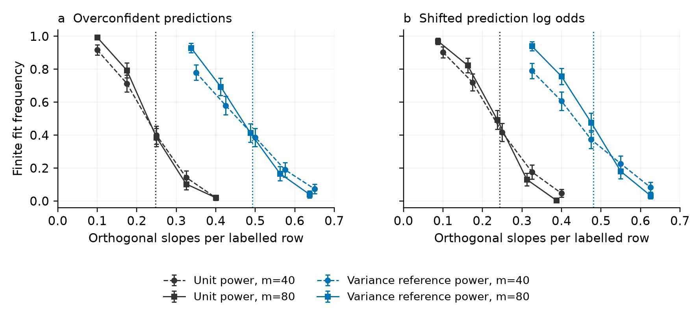
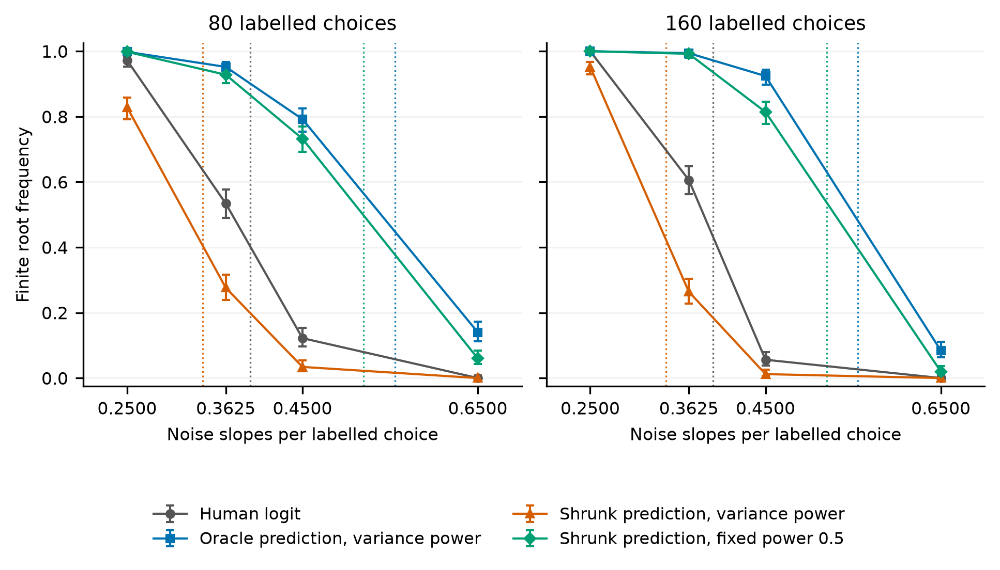
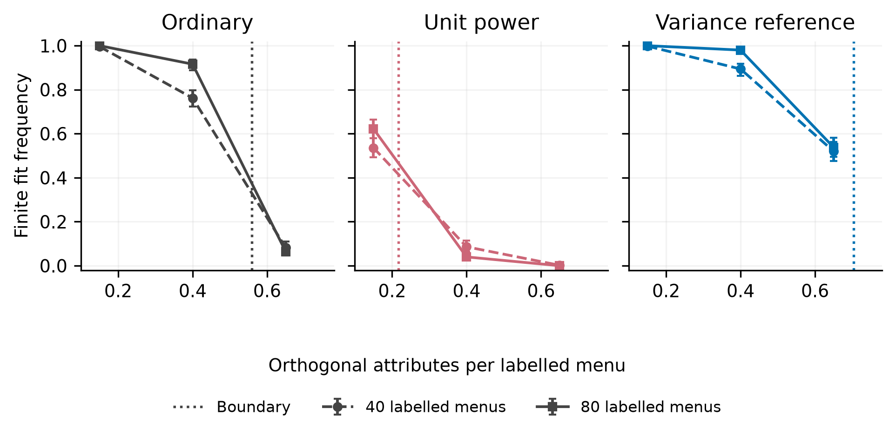
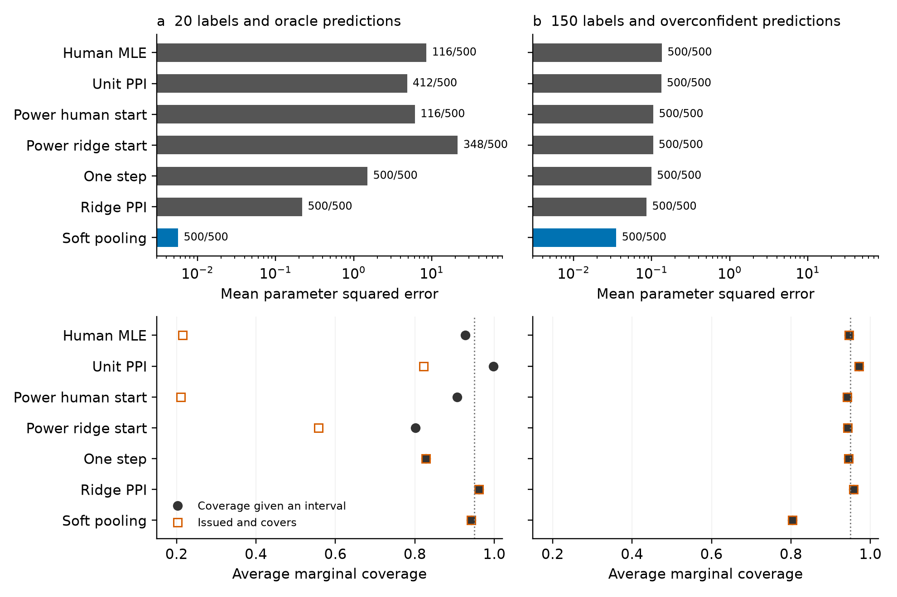
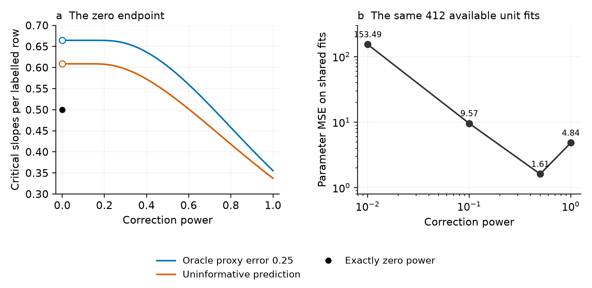
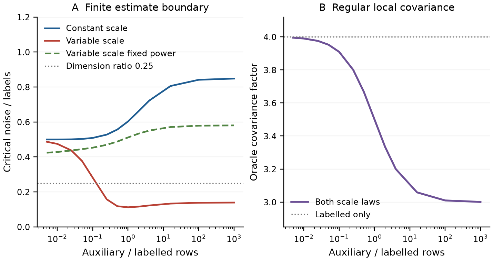

# When prediction assisted logit estimates exist

## Abstract

Prediction assisted choice logit combines human choices and machine predictions through an existing compensated loss. We derive an explicit finite-estimation boundary when the utility dimension grows with the human label budget, retaining finite auxiliary samples, Gaussian attributes, fitted constants and frozen predictions. The boundary separates regular information from global estimation. An oracle path preserves every realized truth score and the full fixed dimensional covariance while finite-solution probabilities converge to opposite limits. Known positive utility scales preserve human separation samplewise; increasing auxiliary data along an established variance power rule can remove attainment as regular covariance falls. In the binary Gaussian model, strictly positive powers tending to zero reach the limiting existence envelope. Above ordinary binary separation, their finite roots have diverging new-row human log loss. Common-coefficient choice menus retain the whole probability simplex. Released vaccine choices and a respondent-separated food DCE assess the realized objective and forecasts. In 500 ten-person food-DCE allocations, unit correction has 21 exterior targets, including 18 with an interior ordinary MNL target. Twenty- and forty-person budgets have none. Counting predictor training labels favors direct human MNL. These results distinguish finite estimation, regular efficiency and useful choice probabilities.

Keywords: discrete choice; multinomial logit; prediction powered inference; logistic separation; finite auxiliary samples

## 1 Introduction

Machine predictions let choice analysts supplement observed human choices on additional attribute profiles. Prediction powered inference corrects the predicted responses to retain the human population score (Angelopoulos et al., 2023, 2026). Applications include categorical outcomes, conjoint partworths and adaptive preference ranking (Fan et al., 2024; Ye and Yoganarasimhan, 2026; Sargent et al., 2026). The question complements work on machine learning and language models in utility specification (van Cranenburgh et al., 2022; Sfeir et al., 2026): when does the corrected empirical objective admit finite preference coefficients?

This question can arise while ordinary human logit remains estimable. In our reanalysis of a released food DCE, unit-power correction has 21 exterior targets in 500 allocations of ten labelled respondents, including 18 whose ordinary MNL target is interior. Twenty- and forty-person label budgets have no such failures. Predictions, correction power and auxiliary profiles jointly change the global shape of the objective. A numerical coefficient or a small score residual does not establish that the specified objective has a finite minimizer.

We calculate the boundary for the existing unpenalized compensated logit loss as utility dimension grows with the human label budget. The result retains the finite auxiliary ratio, utility signal, fitted constants and frozen predictor distribution. Fixed-dimensional PPI++ consistency already implies high-probability attainment for this continuous convex loss through its convex-shell argument. The proportional-dimensional boundary quantifies a different regime. Classical separation, convex support and Gaussian conic geometry supply the tools (Candès and Sur, 2020; Geyer, 2009; Amelunxen et al., 2014).

The boundary yields controlled comparisons of regular information and finite estimation. An oracle path fixes every realized truth score and the full fixed dimensional covariance, with opposite existence limits. A known positive utility-scale construction also fixes human separation samplewise; along an established variance power rule, more auxiliary data can lower regular covariance and remove a finite estimate. Under the binary model, strictly positive powers tending to zero reach the largest limiting region. Above ordinary binary separation, the resulting human probability log loss diverges. Each comparison uses the same compensated objective.

Released-choice audits and known-truth experiments distinguish these properties in practice. The food DCE keeps each person's repeated choices together across predictor training, correction and evaluation. Training costs and established ridge, Firth, pooling and one-step alternatives enter the comparisons explicitly. The experiments retain settings in which direct human fitting has lower loss, including the food DCE when training labels are charged. The empirical contribution is a documented finite-estimation mechanism and its limits. The main theoretical contribution is the explicit compensated-choice boundary and its matched-information and probability-loss consequences.

## 2 Prediction assisted choice logit

### 2.1 Choice target and correction

The correction combines a labelled choice loss with the difference between auxiliary and labelled prediction losses. It applies to binary contrasts and to a whole menu loss with a predicted probability vector. We first use binary logit to obtain explicit formulas, then retain the entire menu simplex in Section 3.9.

Let $X$ contain attribute contrasts and any estimated intercept. A binary choice $Y$ has logit probability $\sigma(X^T\beta)$, where $\sigma(u)=(1+e^{-u})^{-1}$. Write the negative log likelihood contribution as

$$\ell(u,y)=\log(1+e^u)-yu. \qquad (1)$$

There are $m$ labelled rows and $N$ independent auxiliary rows from the same distribution. A frozen prediction $g$ is available on both samples. Let $L_m(Y;\beta)$ denote the average labelled loss, and let $L_m(g;\beta)$ and $L_N(g;\beta)$ replace the response by its prediction. For fixed power $0<\lambda\leq1$, the PPI objective is

$$Q_\lambda(\beta)=L_m(Y;\beta)+\lambda\{L_N(g;\beta)-L_m(g;\beta)\}. \qquad (2)$$

The two prediction terms have equal expectations. The population score in (2) equals the human loss score, including when $g$ is imperfect. Under model misspecification its target is the human logistic projection. This identity uses a fixed predictor and power; it does not assert finite sample unbiasedness for a fitted predictor or estimated power.

For a stacked design with labelled rows first, define weights and a corrected moment by

$$w_i=(1-\lambda)/m\ \ (i\leq m),\qquad w_i=\lambda/N\ \ (i>m),$$

$$b_\lambda=m^{-1}X_L^T(Y_L-\lambda g_L)+\lambda N^{-1}X_U^Tg_U. \qquad (3)$$

Then $Q_\lambda(\beta)=\sum_i w_i\log(1+e^{X_i^T\beta})-b_\lambda^T\beta$. The Hessian is positive semidefinite. At unit power only auxiliary rows contribute curvature, while labelled rows still contribute to the corrected moment.

### 2.2 The finite design audit

Define the attainable moment set

$$\mathcal Z_w=\{\sum_i w_i X_i p_i:0\leq p_i\leq1\}. \qquad (4)$$

Proposition 1. Suppose the rows with positive weight span the parameter space. Objective (2) has a unique finite minimizer exactly when $b_\lambda$ is in the interior of $\mathcal Z_w$. If the moment is outside this set, the objective is unbounded below. A boundary moment has no finite stationary point. Without the rank condition, coefficients are not uniquely identified.

Convex support and recession criteria are established tools for likelihood existence (Geyer, 2009). Sablica et al. (2026, Theorems 1 and 4) give overlap and estimable-span uniqueness results for latent polyhedral categorical likelihoods, with LP detection in Section 4.1. Proposition 1 applies the support calculation to the corrected moment in (3). The gradient of the log partition function maps finite coefficients onto the interior of its attainable moments. Its recession function is

$$Q_\lambda^\infty(d)=\sum_iw_i(X_i^Td)_+-b_\lambda^Td. \qquad (5)$$

An exterior moment supplies a direction with a negative value in (5). An interior moment makes the recession function strictly positive on the unit sphere, establishing coercivity and, with full rank, strict convexity.

Our implementation maximizes a common slack in the constraints $b_\lambda=\sum_iw_iX_ip_i$, $s\leq p_i\leq1-s$. A separate linear program obtains an exterior separating direction and verifies the recession gap. It reports rank deficiency, numerical boundary proximity and unresolved cases separately. The interface preserves the specified objective; power changes, pooling and penalties are explicit subsequent decisions. This audit implements established support geometry and supplies the finite design counterpart to the probabilistic calculation below.

## 3 The existence boundary with finite auxiliary data

### 3.1 Model and main result

Let the contrast vector be $(S,W)$, where $S$ is standard normal and $W$ has $q$ independent standard normal coordinates. Assume

$$P(Y=1\mid S)=\sigma(\gamma S),\qquad |\gamma|<\infty. \qquad (6)$$

The vector $W$ is independent of a fixed dimensional tuple $(S,Y,Z,U)$. Here $Z$ is binary auxiliary information and $U$ is optional additional prediction information. Their conditional law given $(S,Y)$ is fixed. The predictor $g(S,Z,U)$ is measurable, frozen and strictly between zero and one almost surely. Both samples are independent draws from this joint law. The model estimates an intercept, the slope of $S$ and all $q$ remaining slopes. The true intercept and remaining slopes are zero.

Consider $N/m\to\tau>0$ and $q/m\to\kappa$, with a fixed power in $(0,1]$. Define $s_L=1-2Y$, $s_U=2Z-1$ and $r=|Y-g|$. The oriented row intervals are

$$I_L=[\lambda r,1-\lambda+\lambda r], \qquad (7)$$

$$I_U=(\lambda/\tau)[-g,1-g]\quad\text{when }Z=1,$$

$$I_U=(\lambda/\tau)[g-1,g]\quad\text{when }Z=0.$$

For standard normal $H$, write

$$f(a)=E(H-a)_+^2=(1+a^2)\Phi(-a)-a\varphi(a),$$

$$B(h,t,a,b)=1+h^2-f(-h-ta)-f(h+tb). \qquad (8)$$

When the last argument below is an interval, its endpoints enter the last two arguments of $B$. For $\eta=(\eta_0,\eta_1)$ define

$$\Psi(\eta,t)=E B(s_L(\eta_0+\eta_1S),t,I_L)$$

$$\hphantom{\Psi(\eta,t)}+\tau E B(s_U(\eta_0+\eta_1S),t,I_U). \qquad (9)$$

Theorem 1. Under the assumptions above, let

$$\kappa_c=\inf_{\eta\in\mathbb R^2}\ \sup_{t\geq0}\Psi(\eta,t). \qquad (10)$$

If $\kappa<\kappa_c$, the probability that (2) has a unique finite minimizer tends to one. If $\kappa>\kappa_c$, the probability of a finite minimizer tends to zero. The statement leaves the equality case unspecified.

The boundary combines the finite auxiliary ratio, utility signal, predictor distribution and power. Its fixed dimensional optimizations can be evaluated by quadrature and scalar scale maximization. Under joint sign symmetry of $(S,Y,Z,U)$ and $g(-S,1-Z,U)=1-g(S,Z,U)$, convexity and symmetry allow $\eta_0=0$. An asymmetric prediction retains both multiplier coordinates.

The theorem holds for independent Gaussian remaining attributes and a frozen low dimensional predictor. Section 3.8 retains prediction indices that are fitted attributes and gives a conditional result for independently trained linear scores. Section 3.9 treats independent Gaussian choice menus. Repeated choices from a respondent, arbitrary cross fitting and general categorical design distributions require separate arguments. For an observed categorical design, Proposition 1 directly checks the stated objective without invoking a Gaussian approximation.

### 3.2 Relation to existence theory

The labelled contribution in (2), up to its averaging factor, is

$$\ell_L(u)=(1-\lambda)\log(1+e^u)-(Y-\lambda g)u. \qquad (11)$$

At positive power the labelled loss has a negative recession rate in the human-favourable direction. Auxiliary rows compensate it through their nonnegative rates. For $0<\lambda<1$, labelled rows are strictly increasing or decreasing according to the choice, and auxiliary rows are coercive. The categories persist as power changes, while their recession magnitudes and the existence boundary change. Koriyama and Bellec (2025, Assumption 2.5 and Lemma A.2) require finite rowwise infima for their category-based result. The labelled infima here are minus infinity; at unit power the rows are affine. Appendix A7 gives a fixed-predictor comparison at two strictly convex powers. Fuh et al. (2026) study a positivity constrained multinomial likelihood with a different coefficient domain and loss.

Fixed-dimensional PPI++ consistency is established (Angelopoulos et al., 2026; preprint v2, Proposition 1 and Appendix A.2). For a continuous convex logit objective, its positive empirical gap on a sphere extends along every outward ray and implies high-probability coercivity and attainment. This implication follows from that proof's convex shell bound. Theorem 1 calculates the transition when the number of fitted slopes grows with the label budget. PPI++ Algorithms 1 and 2 already retain the finite auxiliary-sample covariance term.

General Gaussian kinematics and absorption determine the conditional transition once the cone's statistical dimension is known (Amelunxen et al., 2014; Götze et al., 2020; Han and Ren, 2026). Theorem 1 calculates that dimension's limit for the corrected intervals (7). The calculation keeps the fitted intercept and signal constraints, finite auxiliary ratio and shared interval scale. Appendix A establishes uniform multiplier and scale bounds before passing the ordered extrema and conditional expectation to the population limit.

### 3.3 Balanced oracle benchmark

Take $\gamma=0$, let $Z$ independently flip $Y$ with probability $\epsilon\in(0,1/2)$, and use $g=\epsilon+(1-2\epsilon)Z$. Symmetry and independence minimize both multiplier coordinates at zero. The finite ratio boundary simplifies to

$$\kappa_c=1+\tau-\min_{t\geq0}F(t), \qquad (12)$$

$$F(t)=(1-\epsilon)\{f(-\lambda\epsilon t)+f((1-\lambda+\lambda\epsilon)t)\}$$

$$\hphantom{F(t)}+\epsilon\{f(-\lambda(1-\epsilon)t)+f((1-\lambda\epsilon)t)\}$$

$$\hphantom{F(t)}+\tau\{f(\lambda(1-\epsilon)t/\tau)+f(\lambda\epsilon t/\tau)\}.$$

At unit power this is

$$\kappa_c=\tau[1-\min_{u\geq0}\{\tau\epsilon(1-\epsilon)u^2+f((1-\epsilon)u)+f(\epsilon u)\}]. \qquad (13)$$

For $\epsilon=0.25$ and $\tau=1$, unit power gives 0.3554. The established population variance reference power $\lambda=\tau/(1+\tau)=0.5$ gives 0.6029. At $\tau=4$ the corresponding boundaries are 0.6120 and 0.7223, with reference power 0.8. As $\tau$ tends to infinity, the unit power boundary tends to $1/[2\pi\epsilon(1-\epsilon)]$, equal to 0.8488 at this error rate. The finite auxiliary calculation materially changes the existence region even for an informative, correctly calibrated predictor.

Zero power uses ordinary logit separation and is handled separately. Its balanced null threshold is 0.5. The interval cone in (7) contains zero at that endpoint, so a zero feasibility check would be uninformative. Our code uses the ordinary separation condition when the established weight formula selects zero.

### 3.4 Utility signal and prediction calibration

For a binary proxy with independent error $\epsilon$, the oracle prediction is

$$g_0(S,Z)=\sigma(\gamma S+(2Z-1)\log((1-\epsilon)/\epsilon)). \qquad (14)$$

We evaluate both this predictor and frozen transformations $g=\sigma(a\log(g_0/(1-g_0))+b)$. The overconfident case has $(a,b)=(2,0)$; shifted log odds use $(1,1)$. Table 1 fixes $\gamma=1.5$ and $\epsilon=0.25$. The comparison power minimizes the existing fixed dimensional orthogonal score variance. It provides a common reference and is held fixed in the phase experiment.

Table 1  Theoretical boundaries with a utility signal and estimated intercept

| Auxiliary to label ratio | Prediction | Power | Critical slope to label ratio |
|---|---|---|---|
| 1 | Oracle | 1.0000 | 0.2795 |
| 1 | Oracle | 0.5000 | 0.4637 |
| 1 | Overconfident | 1.0000 | 0.2478 |
| 1 | Overconfident | 0.3386 | 0.4927 |
| 1 | Shifted log odds | 1.0000 | 0.2434 |
| 1 | Shifted log odds | 0.3078 | 0.4810 |
| 4 | Oracle | 1.0000 | 0.4690 |
| 4 | Oracle | 0.8000 | 0.5487 |
| 4 | Overconfident | 1.0000 | 0.4261 |
| 4 | Overconfident | 0.5417 | 0.6046 |
| 4 | Shifted log odds | 1.0000 | 0.4060 |
| 4 | Shifted log odds | 0.4925 | 0.5729 |

At equal sample sizes, overconfidence moves the unit power boundary from 0.2795 to 0.2478; shifting log odds gives 0.2434. The variance reference powers yield boundaries near 0.48 to 0.49. A changed prediction distribution affects the allowable dimension as well as the efficiency calculation. The two free multipliers in (10) account for the signal and the asymmetry of shifted predictions.

Figure 1 evaluates these boundaries using 300 independent draws at each displayed point. Both samples are generated anew on each draw, and the same draw supplies the compared dimensions within a condition. The smooth finite sample transitions sharpen as the labelled sample increases. The complete oracle and imperfect prediction grids include 80 conditions each, with no numerically unresolved feasibility classifications.

Figure 1  Finite fit frequencies at auxiliary to label ratio one and utility signal 1.5. Circles and dashed lines use 40 labels; squares and solid lines use 80. Dotted lines show asymptotic boundaries. Error bars give approximate 95% binomial Monte Carlo intervals from 300 draws per point. Both panels use Gaussian attributes.

### 3.5 Local score equivalence and finite estimation

We compare objectives with exactly the same score at the true parameter. Existing work distinguishes first order limits from finite sample risk (Chen et al., 2026) and raw prediction errors from downstream learning (Li and Cai, 2026). Here the object is finite estimation of the compensated loss. Let $\mu(X)=\sigma(X^T\beta_0)$ and let $g_0=E(Y\mid X,Z)$ be a frozen conditional mean based on additional information $Z$. Define

$$g_s=\mu+s(g_0-\mu),\qquad a_\tau=\tau/(1+\tau),\qquad \lambda_s=a_\tau/s,\qquad a_\tau\leq s\leq1. \qquad (15)$$

These powers lie in $[0,1]$. Write $H_0=E[XX^T\mu(1-\mu)]$ and $M=E[XX^T(\mu-g_0)^2]$, with $H_0$ nonsingular.

Proposition 2. Along (15), the gradient of (2) at $\beta_0$ is identical on every realization. For each fixed parameter dimension, the existing oracle variance criterion chooses $\lambda_s$ and gives the same first order covariance for every $s$:

$$V_s=H_0^{-1}(H_0-a_\tau M)H_0^{-1}/m. \qquad (16)$$

Under Theorem 1 with $\gamma=0$, proxy error $0.1$ and $\tau=1$, the half-shrunk reference $(s,\lambda)=(0.5,1)$ has boundary below $0.46$, while the unshrunk reference $(1,0.5)$ has boundary above $0.72$. At noise dimension ratio $0.47$, their finite solution probabilities tend to zero and one, respectively; ordinary logit also has probability tending to one. Both references have covariance $17/25$ of the human covariance.

The objectives differ by a multiple of $L_N(\mu)-L_m(\mu)$, whose gradient at $\beta_0$ is zero on every sample. It changes their Hessians. The population weights are the existing variance-optimal choices, and $\mu$ uses the true parameter. Appendix B proves the identities and strict boundary inequalities.

For an observed reference $b$, put $\mu_b=\sigma(X^Tb)$. At fixed base power $a>0$, the path $g_\lambda=\mu_b+(a/\lambda)(g-\mu_b)$, $a\leq\lambda\leq1$, preserves every labelled and auxiliary score row at $b$ and its empirical covariance middle. The existing variance rule returns the path powers when it selects $0<a<1$ at the reference. Appendix B5 gives the algebra. Another exact construction, with an estimated intercept, also fixes the observed Hessian, sandwich and Newton update while attainment changes. Section 4.3 evaluates the score identity on released choices.

With utility signal $1.5$, proxy error $0.1$ and equal sample sizes, the computed boundaries are $0.5554$ for the unshrunk reference and $0.3363$ for the half-shrunk reference; ordinary logit has boundary $0.3903$. Figure 2 evaluates this nonzero signal example on matched draws. At 160 labelled choices and 72 noise slopes, finite root frequencies are $0.924$ and $0.012$ for the two variance references. Their paired difference is $0.912$, with Monte Carlo standard error $0.01268$. A fixed power of $0.5$ on the half-shrunk prediction gives frequency $0.814$.

Figure 2  Finite root frequencies along an oracle local score equivalence path. The labelled and auxiliary samples each have 80 or 160 simulated attribute rows. The two variance references have exactly the same truth score and the same full fixed dimensional asymptotic covariance. Each point retains 500 independent Gaussian model draws; all methods and dimensions share each draw. Error bars are 95% Wilson binomial Monte Carlo intervals. Dotted lines show theoretical boundaries, and connecting lines display measured frequencies. The mechanism illustration was selected after the population calculation and specified before sampling. Table B1 retains every displayed frequency. Point error and interval coverage are evaluated separately in Section 5.

### 3.6 Positive powers and the zero endpoint

Holding the sample and predictor fixed reveals a simple ordering. Write $H=L_m(Y)$ and $A=Q_1$. For $0<\alpha<\lambda\leq1$,

$$Q_\alpha/\alpha=Q_\lambda/\lambda+(1/\alpha-1/\lambda)H. \qquad (17)$$

The human loss is nonnegative. A coercive objective at power $\lambda$ remains coercive at the smaller positive power $\alpha$. With the rank condition of Proposition 1 this gives nested finite solution events. Exactly zero power removes auxiliary curvature and requires its own separation check.

For the balanced oracle with fixed zero intercept, put

$$G(v)=(1-\epsilon)f(-\epsilon v)+\epsilon f(-(1-\epsilon)v)$$

$$\hphantom{G(v)}+\tau\{f((1-\epsilon)v/\tau)+f(\epsilon v/\tau)\}. \qquad (18)$$

Corollary 1. For $\tau>0$ and $0<\epsilon\leq1/2$, the boundary strictly decreases with positive power and has right limit

$$\kappa_c(0+)=1+\tau-\min_{v\geq0}G(v)>1/2=\kappa_c(0). \qquad (19)$$

At $\tau=1$ and $\epsilon=0.25$, the right limit is 0.664488. An uninformative prediction at $\epsilon=1/2$ also has a gap, with right limit 0.608737. This gap concerns existence and auxiliary stabilization; it does not measure additional choice information.

A fixed sample counterpart describes the coefficient cost on categorical designs. Suppose the unit power recession is positive on every nonzero human weak separator. Small positive powers then have finite roots. After division by $\log(1/\lambda)$, the coefficients approach the set minimizing corrected auxiliary recession, with human margins of at least one on maximally separable rows and zero on the remaining rows. Appendix D3 proves this result for complete and quasi-complete separation. Classical separation faces and margin arguments supply the foundation; the specified corrected loss determines the limiting cost.

### 3.7 A simultaneous boundary with utility signal and estimated intercept

Retain the model of Section 3.1. Write $h_L=s_L(\eta_0+\eta_1S)$, $h_U=s_U(\eta_0+\eta_1S)$ and $J_U=I_U/\lambda$. Dividing the positive power intervals by power leaves the auxiliary interval $J_U$ fixed. The labelled interval expands to $[r,r+1/\lambda-1]$. Its closed limit gives

$$\Psi_\infty(\eta,v)=E\{1+h_L^2-f(-h_L-vr)\}$$

$$\hphantom{\Psi_\infty(\eta,v)}+\tau E B(h_U,v,J_U),\qquad v\geq0. \qquad (20)$$

Define the limiting and ordinary logit boundaries by

$$\kappa_\infty=\inf_\eta\sup_{v\geq0}\Psi_\infty(\eta,v),\qquad \kappa_0=\inf_\eta E f(h_L). \qquad (21)$$

Theorem 2. Under the assumptions of Theorem 1, $\kappa_c(\lambda)\to\kappa_\infty>\kappa_0$ as positive $\lambda\to0$. For $\kappa<\kappa_\infty$, some fixed power in $(0,1)$ gives a unique finite root with probability tending to one. For $\kappa>\kappa_\infty$, the probability that any power in $[0,1]$ gives a finite root tends to zero. Every sequence of possibly data dependent powers satisfying $0<\lambda_m\leq1$ almost surely and $\lambda_m\to0$ in probability has the same strict two sided existence boundary $\kappa_\infty$. The equality case is unspecified.

The simultaneous upper bound follows from one closed cone containing all positive power cones and the ordinary logit feasibility face. The lower side combines fixed power thresholds with the nesting identity (17). Appendix D proves the required uniform controls without exchanging the infimum and supremum. No rate or independence condition is imposed on the selected positive powers. These assumptions keep the strictly interior predictor fixed across sample sizes. Section 3.8 states additional conditions for independently trained linear predictors.

For utility signal 1.5 and proxy error 0.25, the ordinary boundary is 0.3903. With equal sample sizes, the limiting boundaries are 0.5082 for the oracle, 0.5061 for overconfident predictions and 0.4918 for shifted log odds. At auxiliary ratio four they are 0.6263, 0.6249 and 0.5875. Constant and reversed predictions also give strict existence gains, of different sizes. The strict gain establishes finite estimation of this objective. In the interval $\kappa_0<\kappa<\kappa_\infty$, every strictly positive power sequence tending to zero also gives coefficient growth of at least logarithmic order and diverging expected new-row human log loss. Proposition 6 in Appendix D derives this consequence from a gradient-aware finite design bound and existing Gaussian margin theory. Section 5.5 evaluates probability losses on fixed prediction paths.

### 3.8 Prediction indices in the binary fitted design

A predictor can use attributes whose coefficients the choice model estimates. Keeping its indices among the multiplier constraints accounts for this dependence while preserving independent remaining Gaussian columns.

Proposition 3. Let $T$ have a fixed number $k$ of independent standard normal coordinates, independent of $S$, and let $Y$ given $(S,T)$ have probability (6). Include all coordinates of $T$ among the fitted contrasts, with true slopes zero. Suppose the remaining Gaussian vector $W$ is independent of $(S,T,Y,Z,U)$ and $g(S,T,Z,U)$ is frozen and strictly interior. Theorems 1 and 2 hold with the multiplier in $\mathbb R^{k+2}$ and

$$h_\eta(S,T)=\eta_0+\eta_1S+\eta_T^T T. \qquad (22)$$

In (9), (20) and (21), replace each signed affine multiplier by $s_Lh_\eta$ or $s_Uh_\eta$. The ordinary boundary is unchanged by the independent zero slope attributes $T$. Appendix E proves the extension. It uses the same compensated objective and conic calculation.

Appendix E holds the complete law of $(Y,g)$ fixed while placing a prediction index outside or inside the fitted design. Both predictions are calibrated, with Brier risk 0.09, yet their unit-power boundaries at equal sample sizes are 0.396628 and 0.385935. Ratios strictly between them give opposite existence limits.

For an independently trained linear score, a Gaussian rotation retains its component outside the utility direction as one fitted index. Corollary 2 in Appendix E assumes convergence of its signal overlap, orthogonal norm and intercept to finite deterministic limits. The resulting strict existence limits supplement established fixed-dimensional cross-prediction inference (Zrnic and Candès, 2024) and teacher–student feature analysis (Loureiro et al., 2021). Training labels enter the total resource budget. Appendix E5 gives a convergent training rule; Section 5.4 evaluates its allocation cost.

### 3.9 Whole choice menus

The same correction applies to a menu of $J$ alternatives with common attribute coefficients. Let $F_i$ be its matrix of alternative attributes and let $e_Y$ identify the chosen alternative. The menu loss is $\ell_J(F_i\beta,y)=\log\sum_j e^{F_{ij}^T\beta}-y^TF_i\beta$, for either the observed choice vector or a predicted probability vector. This prediction assisted MNL construction is established in Fan et al. (2024) and Ye and Yoganarasimhan (2026). We calculate its finite solution boundary while preserving the constraint that probabilities within each menu sum to one.

For independent Gaussian profiles and fixed menu size, estimate alternative constants, a common signal slope and increasing common noise slopes. Frozen predictions can occupy the whole probability simplex, including hard category predictions, with positive mean squared prediction error. Theorem 3 in Appendix F gives the explicit fixed power boundary from the joint menu residual sets. Corollary 3 gives a simultaneous upper envelope over all powers, attained by any strictly positive possibly data dependent power tending to zero. The strict gain over ordinary logit holds for every $J\geq3$; at $J=2$ it holds exactly when $P(g_Y>0)>0$. Appendix F states the model, formulas and perfect-prediction endpoint together.

An always wrong binary hard predictor has the ordinary limiting boundary. With at least three alternatives, different unchosen competitors can contribute to the Gaussian tangent projection, giving a positive scale derivative. Appendix F proves the condition and handles perfect prediction. The binary reduction uses signal $\sqrt2\gamma$ because profile differences have variance two. The class-specific coefficient model of Tan and Bellec (2023), with existence imposed in Assumption 2.4, is a different specification.

Figure 3 shows a matched hard prediction illustration with three alternatives, signal 1.5, proxy error 0.25 and auxiliary ratio one. The established fixed dimensional variance criterion for one orthogonal common slope gives power 0.219576. The corresponding boundary is 0.7039, compared with 0.2164 at unit power and 0.5594 for ordinary logit. This reference uses the hard predictor's actual score covariance, derived in Appendix F. Its population value is available in the simulation; it is not a newly estimated tuning algorithm.

All methods and dimensions share each Gaussian menu draw, with 500 independent draws per budget. At 80 labelled menus and 52 orthogonal attributes, finite-fit frequencies are 0.538 for the variance reference, 0.064 for ordinary logit and zero at unit power. The paired reference minus ordinary difference is 0.474, with Monte Carlo standard error 0.02235. Finite-budget transitions remain shifted from the asymptotic limits. Section 5.7 evaluates probability quality on these same menus.

Figure 3  Finite estimation with hard category predictions on identical menus and dimensions. Each point uses 500 draws; circles and dashed lines use 40 labelled menus, and squares and solid lines use 80. Dotted lines mark the corresponding boundaries. Error bars are 95% Wilson binomial intervals. The variance reference is the existing oracle criterion for one orthogonal slope, with power 0.219576. The experiment was selected after the population grid as a mechanism illustration. Lines connect the observed frequencies; they do not estimate a transition rate.

### 3.10 Known utility scales and increasing auxiliary samples

A known positive scale allows another assessment of local information. Let $X=D(1,S,W^T)^T$, where the fixed law of $D$ is independent of the Gaussian attributes and satisfies $0<d_l\leq D\leq d_u<\infty$. The multiplier applies to the complete utility, including its fitted intercept. This is a specified input; identification of unknown scale is a separate problem (Hess and Train, 2017). Let $P(Y=1\mid D,S)=\sigma(\gamma DS)$, with finite fixed signal. The frozen prediction is strictly interior and uses fixed dimensional information independent of the remaining Gaussian columns. Both samples draw independently from the same law.

Proposition 7. With the oriented intervals of (7), put $h_\eta(S)=\eta_0+\eta_1S$. The positive scale boundary is

$$\kappa_D=\inf_\eta\sup_{t\geq0}\{E B(s_Lh_\eta(S),t,DI_L)+\tau E B(s_Uh_\eta(S),t,DI_U)\}. \qquad (23)$$

For $q/m\to\kappa\in(0,\infty)$, a unique finite minimizer exists with probability tending to one below $\kappa_D$ and no finite minimizer exists with probability tending to one above it. Equality is unspecified. Appendix G proves the weighted support qualification, relative interior and rank conditions. Ordinary elliptical-logit existence and Gaussian absorption provide established inputs (Tang and Ye, 2020; Götze et al., 2020).

For balanced choices, let a proxy independently flip $Y$ with probability $e\in(0,1/2)$, use the oracle $g=e+(1-2e)Z$, and take $D$ independent of $(S,Y,Z)$. Define the scalar profile $J_{\lambda,\tau}$ in Appendix G5. Then

$$\kappa_D(\lambda,\tau)=\sup_{v\geq0}E J_{\lambda,\tau}(Dv). \qquad (24)$$

Every nonconstant positive scale law strictly reduces this boundary from the constant-scale value at the same power and auxiliary ratio. When $ED^2=1$, the entire population information and score covariance blocks equal those under constant scale. Positive row scaling also preserves the human separation event exactly. At $e=1/4$, $\tau=1$ and $\lambda=1/2$, exact bounds put one constant-scale boundary above $213/640$ and a specified two-point-scale boundary below $10201/140625$. Their existence conclusions are opposite at noise-to-label ratio $1/4$, although both regular covariances are $7I/(2m)$.

Along the established variance power $\lambda_\tau=\tau/(1+\tau)$, the regular covariance decreases with $\tau$. The boundary instead has limits

$$\lim_{\tau\downarrow0}\kappa_D(\lambda_\tau,\tau)=1/2,\qquad\lim_{\tau\to\infty}\kappa_D(\lambda_\tau,\tau)=\frac{(ED)^2}{2\pi e(1-e)ED^2}. \qquad (25)$$

Each ratio limit follows the proportional sample limit for its fixed scale law and fixed $\tau$. If $(ED)^2/ED^2<\pi e(1-e)$, increasing the auxiliary ratio can remove a finite minimizer at a dimension ratio between these two limits, while improving the full regular covariance. At a held positive power the balanced boundary is nondecreasing in $\tau$. Section 5.6 separates this weight-selection effect from increasing auxiliary size at fixed power.

## 4 Evidence from released choice experiments

### 4.1 Data and the stated estimands

We use numeric files released with Generative Augmented Inference (Lu et al., 2026). They contain 4605 human binary choice rows with two 12-column vaccine profiles and 1200 aligned hard AI predictions. Profile differences, after removal of a common first column, give 11 contrasts. The source excludes respondents who never select a vaccine. Appendix C3 fixes the source version and download checks.

The reanalysis fixes the aligned 1200 row prefix and evaluates 500 allocations with labelled budgets of 50, 100, 150 and 200 rows. Allocations preserve the source implementation's five row blocks. The released numeric file does not establish participant identifiers, so the comparison is conditional on that block convention. The empirical target is the converged logistic projection on the fixed prefix. It is a reference estimate, distinct from a known population parameter.

Nuisance predictions use five row folds and ridge logistic fits, either within hard AI label strata or using attributes alone. Predictions are held fixed within each objective comparison. This fitted prediction reanalysis illustrates finite support geometry; its distribution is outside the frozen predictor theorem. Changing the source prefix pool convention yields a distinct reanalysis.

### 4.2 Finite solutions and explicit alternatives

At 50 labels, unit-power objective (2) has six exterior AI moments among 500 allocations; the attributes-only comparator has two. Separate recession directions verify all eight, with minimum gap 0.000388. Existing tuning initialized from the converged human estimate yields finite roots in every allocation. Initializing it from the unit-power root leaves those six and two initializers unavailable. The fitting convention therefore includes both the objective and its initializer. The official logistic point-estimation interface returns numerical coefficient arrays in these eight unit-power exterior cases after unsuccessful optimization. Automatic power selection stops at a singular initial Hessian. Appendix C10 retains interior controls, the recorded optimization settings and an unattained-boundary example.

Soft pooling solves its own objective in all eight exterior cases. Its corrected unit-power score discrepancy is at least 0.1072. In the source-style pooled imputation experiment, clipping corrected binary one-hot targets and renormalizing yields observed choices on labelled rows and predictions on auxiliary rows whenever the inverse label-probability weight exceeds one. This removes the original residual correction. That pooled-imputation objective has five AI and two attributes-only exterior cases; its counts remain separate from (2).

### 4.3 Equal observed reference scores and different finite targets

For each of the 500 block permutations, we hold the 1200-row prefix, 11 contrasts and nuisance routine fixed. At 50 labels, the observed reference and base power are the human-initialized estimates of Section 4.2. Five path positions increase power to one and adjust predictions to preserve every reference score row. All 5000 targets are finite. A separately planned 20-label comparison uses a finite ridge reference and the nuisance routine's constant fallback for folds lacking both outcomes. Both plans and all allocation denominators accompany the results.

Table B2 isolates base powers strictly between zero and one, where the variance rule is defined along the path. The AI-aided stratum has 80 allocations: four exterior base targets become finite and one finite target becomes exterior. The attributes-only stratum has 65 allocations, with three changes to finite and one in reverse. These nine predictor-by-allocation comparisons involve six distinct block permutations. Compared pairs preserve complete reference score rows and empirical score covariance middles; independent interior programs and recession directions verify the different existence states. Zero base powers give a separate degeneracy, reported in Appendix B5. The comparison applies Proposition 1 directly to the observed categorical design.

### 4.4 Prediction on held out released choices

Fitting and tuning use the aligned 1200-row prefix; evaluation uses the remaining 3405 human choice rows. The same 500 block permutations supply nested budgets of 50 and 150 labels. Seven established estimators follow Section 5.1, with both nuisance routines retained. Table C1 reports every method and availability denominator.

At 50 labels, AI-aided unit correction is finite in 494/500 allocations, with conditional mean log loss 0.887015. Its all-allocation ridge-fallback loss is 0.885919, compared with direct ridge at 0.762353. The paired excess is 0.123566, with allocation Monte Carlo standard error 0.010867. Power tuning is finite throughout and has loss 0.896512. At 150 labels, the unit-versus-ridge difference is 0.004612, with standard error 0.000572. These are forecasts on a fixed evaluation segment; they do not isolate the value of AI information.

The numeric release contains no respondent identifiers. Nonoverlapping row positions and the source's five row convention do not certify independent people. The prefix and evaluation choice 1 frequencies are 0.415 and 0.469310. Allocation Monte Carlo errors condition on this fixed file and are not population uncertainty estimates. The realized design audit in Section 4.2, this held out prediction check and the known truth simulations in Section 5 address different properties.

### 4.5 Nested auxiliary budgets on the released design

We reuse all 500 block permutations at 20 and 50 labels. Each allocation fixes human choices, a finite human ridge pilot and both nuisance predictors while the auxiliary pool grows through 50, 100, 200, 400, 800 and all remaining prefix rows. Auxiliary human outcomes are hidden before fitting and tuning. Three paths use the existing pooled-information power rule at each budget, hold its first-budget power, or use unit power. All 36000 method records are retained.

At 50 labels, both paths are finite in every allocation and budget. At 20 labels, retuned finite counts rise from 156 to 161 for AI-aided predictions and from 142 to 150 for attributes alone. Four AI-aided and three attributes-only records lose a finite estimate between endpoint pools, involving six distinct allocations. One shared allocation becomes exterior under both predictors; five other records select zero power on separated human designs. Appendix C7 verifies the all-positive-power obstruction for the enlarged-pool case, selected retrospectively for mechanism analysis. Table C2 retains all denominators. Section 5.6 isolates the population mechanism in a Gaussian model.

### 4.6 Respondent separated food choice experiment

We also use a released Scottish consumer DCE on shortbread products (Chen et al., 2025). Of 299 respondent records, 298 have six complete menus and one has two. We retain the complete records, giving 1788 choices among two products and a neither option. A fixed respondent split assigns 100 people to predictor training, 60 to evaluation and 138 to the correction pool. Each person's choices remain together. The eleven-parameter marginal conditional logit includes two option constants, categorical ingredient, nutrition, quality-label, access and origin effects, and linear price. A separate ridge logit adds age and education interactions to produce frozen probabilities. Appendix C9 gives the coding and training conventions.

The plan precedes fitting. Each of 500 pool permutations supplies nested labelled groups of 5, 10, 20 and 40 respondents, with the remaining people's choices withheld. The finite-design audit retains each menu simplex and permits the observed discrete attributes and within-person dependence. The Gaussian phase law is a separate model result.

Table C4 gives finite-fit counts. At five labelled respondents, ordinary MNL has 319 finite fits and unit-power correction has 356, with 144 exterior targets. Forty exterior cases have an interior ordinary target in the same allocation. At ten respondents, unit correction has 479 finite fits and 21 exterior targets, including 18 with an interior ordinary target. All methods have finite fits at twenty and forty respondents. Thus the observed failure is confined to the smallest label budgets. Every interior fit passes an original-score check and every exterior case has a verified negative recession direction.

Table C4 also includes the existing cluster-score trace criterion (Broska and Howes, 2026), using a common labelled-ridge pilot and power clipped to $[0,1]$. It has 352 and 495 finite fits at five and ten respondents. The pilot differs from the cited unit-power start; Appendix C9 records zero-power selections and numerical boundary cases. No interval-coverage claim is made.

Table C5 retains all eight methods, unavailable fits and common-fit denominators. At five labelled respondents, unit correction with labelled-ridge fallback has mean evaluation loss 1.0787, compared with labelled ridge at 0.9081; the paired excess is 0.1706 with allocation Monte Carlo standard error 0.0414. Direct MNL using the predictor's 100 training labels and the correction labels has lower loss than the corrected fits at all four budgets. These errors concern random label allocation on a fixed file and sixty-person evaluation group.

The saved fits give descriptive Bere price equivalents in GBP per 250 g package. Of 15418 available fits, 15417 have negative price slopes and one has a positive slope. At twenty labelled respondents, median unit-correction and ordinary-MNL equivalents are GBP1.244 and GBP1.307, with 5th–95th allocation ranges of −0.410 to 3.213 and −0.436 to 3.142. At forty respondents the medians are GBP1.332 and GBP1.343. Five-person distributions are wider, including direct-ridge extremes. Appendix C9 retains coding and conditional-fit denominators; these allocation summaries are descriptive coefficient ratios.

### 4.7 Fixed predictions from an independent choice study

Alves (2026) studies large language model (LLM) predictions for an underrepresented age segment in released RADIANT experiments. The study also explores prediction-powered estimates of choice-logit coefficients. Its public outputs permit an additional finite-design check. We reconstruct 24 released fits across four contexts, preserving the utility specifications, respondent splits, frozen probabilities and published powers. Appendix C11 gives the reconstruction and required inputs.

All 24 targets are interior at their published powers; nine powers equal zero. A separately specified unit-power sensitivity has one exterior target among 24 cells. All eight distinct ordinary MNL designs are interior. In the exterior cell, the published power is approximately 0.11684 and retains a finite estimate. The unit-power objective decreases without bound along a verified direction. These results locate the issue in a particular choice of correction power. They describe realized categorical designs; the Gaussian proportional-dimensional law remains a separate result.

## 5 Finite estimation and statistical performance

### 5.1 Known truth experiment

To evaluate error and coverage against a known parameter, we sample attribute rows independently with replacement from the fixed 1200 row support. The simulation parameter is its converged 11 coordinate logistic vector. We generate choices from the stated logistic probabilities and binary proxies by independent flips. No new human respondents or language model answers are generated.

The oracle grid crosses $m=20,50,150$, $N=150,600$ and proxy error 0.1 or 0.25, with 500 repetitions per condition. Two further grids retain the original signal or multiply it by three. They use oracle, doubled log odds and shifted log odds predictions, $m=50,150$, $N=600$ and proxy error 0.25. Each of those groups has six conditions and 500 repetitions. Every method shares the attributes, choices and proxy draws within a condition. The full grids and their seeds accompany the aggregate tables.

We compare human maximum likelihood, unit power PPI, human initialized power tuning, ridge initialized power tuning, a clipped one-step update from that ridge start, unit power ridge PPI and soft pooling. Ridge fits use penalty $\|\beta\|^2/(2m)$ on every coordinate. The two power methods use the established PPI++ covariance trace convention at their stated initializers. The one-step comparator uses the same estimated power clipped to [0,1] and the same initial ridge fit. Soft pooling combines observed labelled choices with frozen auxiliary predictions at equal row weights. Its oracle version has correct conditional mean information.

PPI++ also permits unrestricted power in its one-step formula (Angelopoulos et al., 2026; preprint v2, Section 6.2). Appendix C8 repeats all 24 original conditions with clipped and unrestricted powers and with pooled or labelled information for tuning. Each comparison holds the ridge pilot fixed.

Two DY prior settings provide a labelled only comparator in the two conditions of Table 2. The estimator fits pseudo-responses $\alpha Y+(1-\alpha)/2$, using $\alpha=m/(m+11)$ and a fixed $\alpha=0.5$ sensitivity. The first follows the dimension based choice used in the authors' supplementary implementation. Both use the same human rows, a zero prior mode and zero initialization, with no auxiliary predictions. They replay the existing 500 draws in each condition; the original seven strategy grids remain unchanged.

Firth estimation is an established response to separation in small choice datasets (Kessels et al., 2019). We maximize the human log likelihood plus one half the log determinant of its expected information, using the same labelled rows and no auxiliary predictions. The three fixed starts are zero, a human ridge estimate and its negative. We select the smallest penalized negative log likelihood among verified roots with positive definite Hessians. This numerical selection does not certify global optimality. Its conventional Wald intervals use inverse expected information (Kosmidis and Firth, 2021).

For each method we record point availability and interval availability separately. Parameter MSE is the mean of squared coordinate errors, conditional on an available point. Coverage is the fraction of 11 marginal intervals covering their corresponding true coordinates, averaged over repetitions with intervals. Issued and covers assigns zero to a repetition without intervals before averaging over all 500 repetitions. Neither summary is simultaneous coverage. Monte Carlo errors use the repetition as the independent unit. Firth intervals use inverse expected information; the other methods use their documented score sandwiches. Ridge intervals do not adjust for shrinkage bias. Appendix C states the covariance formulas and tuning convention.

### 5.2 What a finite output establishes

Table 2 contrasts two prespecified mechanisms: scarcity of human labels with oracle predictions, and overconfidence under stronger utility at a larger label budget. All conditions and error tails remain in the reproduction tables. The selected columns show how availability, parameter error and coverage can lead to different assessments of the same estimator.

Table 2  Point availability and interval performance. One step uses the ridge pilot and a power clipped to [0,1].

| Condition | Estimator | Available | MSE | Coverage | Issued and covers |
|---|---|---|---|---|---|
| 20 labels oracle | Human MLE | 116/500 | 8.5602 | 0.926 | 0.215 |
| 20 labels oracle | Unit PPI | 412/500 | 4.8362 | 0.998 | 0.822 |
| 20 labels oracle | Power human start | 116/500 | 6.0858 | 0.907 | 0.210 |
| 20 labels oracle | Power ridge start | 348/500 | 21.5408 | 0.801 | 0.558 |
| 20 labels oracle | One step | 500/500 | 1.5054 | 0.827 | 0.827 |
| 20 labels oracle | Ridge PPI | 500/500 | 0.2193 | 0.961 | 0.961 |
| 20 labels oracle | Soft pooling | 500/500 | 0.0057 | 0.942 | 0.942 |
| 20 labels oracle | DY dimension rule | 500/500 | 0.9277 | 0.737 | 0.737 |
| 20 labels oracle | DY alpha 0.5 | 500/500 | 0.4397 | 0.740 | 0.740 |
| 20 labels oracle | Human Firth | 500/500 | 1.9494 | 0.999 | 0.999 |
| 150 labels overconfident | Human MLE | 500/500 | 0.1353 | 0.947 | 0.947 |
| 150 labels overconfident | Unit PPI | 500/500 | 0.1326 | 0.971 | 0.971 |
| 150 labels overconfident | Power human start | 500/500 | 0.1050 | 0.942 | 0.942 |
| 150 labels overconfident | Power ridge start | 500/500 | 0.1042 | 0.942 | 0.942 |
| 150 labels overconfident | One step | 500/500 | 0.0992 | 0.945 | 0.945 |
| 150 labels overconfident | Ridge PPI | 500/500 | 0.0860 | 0.958 | 0.958 |
| 150 labels overconfident | Soft pooling | 500/500 | 0.0353 | 0.804 | 0.804 |
| 150 labels overconfident | DY dimension rule | 500/500 | 0.1011 | 0.945 | 0.945 |
| 150 labels overconfident | DY alpha 0.5 | 500/500 | 0.1035 | 0.625 | 0.625 |
| 150 labels overconfident | Human Firth | 500/500 | 0.1088 | 0.963 | 0.963 |

With 20 labels and oracle predictions, human MLE supplies 116 points and unit correction 412. The latter's conditional coverage is 0.998, while issued-and-covers is 0.822. The one-step method supplies all 500 points with coverage 0.827. Ridge correction and oracle pooling also return every point, with coverage near 0.95. Finite output, target error and interval coverage thus answer separate questions.

With 150 labels, stronger utility and overconfident predictions, all original estimators return 500 points and intervals. Soft pooling has MSE 0.0353 and coverage 0.8036; its exact population target MSE is 0.0181. Ridge-initialized tuning has MSE 0.1042 and coverage 0.9424, and one-step PPI has MSE 0.0992 and coverage 0.9451. The corrected population score vanishes at the true parameter. The comparison separates a changed target from estimation uncertainty.

Both labelled-only DY settings and Firth return every displayed estimate. The dimension-rule DY setting has coverage 0.9451 at 150 labels. At twenty labels, Firth's coverage of 0.9995 accompanies mean marginal width 5.9394. Appendix C2 retains the remaining diagnostic comparisons and their covariance conventions.

Pooling has the smallest displayed point errors, with its target and coverage evaluated explicitly. Table 2 keeps the labelled-only finite-estimate alternatives alongside correction, ridge and one-step methods. Their comparisons are specific to the stated information and tuning conventions.

Removing power clipping gives equal or higher observed mean new-row human loss within each information convention across the retained 24 conditions. This sensitivity concerns the one-step update, with its power domain and initial point held explicit. Table C3 reports every paired change and Monte Carlo standard error. Direct human ridge has lower observed mean loss in some conditions and higher loss in others.

Figure 4  Error and coverage answer different questions. The left column uses 20 labels, oracle predictions and the original signal. The right column uses 150 labels, overconfident predictions and threefold utility. The PPI and pooling methods use 600 auxiliary rows and proxy error 0.25; both DY settings and Firth use labelled rows alone. Firth uses information-Wald intervals; the other methods retain their documented sandwich conventions. MSE axes are logarithmic; annotations show available points out of 500. Coverage is averaged across 11 marginal intervals, with the reference line at 0.95. Underlying aggregate tables retain interval counts, Monte Carlo errors and all remaining conditions.

### 5.3 Power changes availability and error

The power comparison uses the same 500 oracle draws with 20 labels, 600 auxiliary rows and proxy error 0.25. Attributes, choices, predictions and truth remain fixed across powers. Positive-power roots use a scaled score equation so that the stopping criterion retains its meaning near zero.

Table 3  The same 500 support samples fitted at different powers

| Power | Available | Mean MSE | Median MSE | 90th percentile MSE |
|---|---|---|---|---|
| 0 human | 116/500 | 8.560 | 4.191 | 22.106 |
| 0.01 | 474/500 | 196.879 | 104.474 | 439.843 |
| 0.1 | 474/500 | 14.630 | 7.147 | 27.851 |
| 0.5 | 467/500 | 3.912 | 1.157 | 4.342 |
| 1 | 412/500 | 4.836 | 1.030 | 7.819 |

Table 3 conditions each error summary on that method's available fits. Powers 0.1 and 0.01 each have 474 finite roots, compared with 116 human MLEs. The remaining 26 corrected targets fail the limiting positive-power feasibility check. At power 0.01, median MSE is 104.474 and the 90th percentile is 439.843.

On the same 412 draws with a finite unit-power fit, mean MSE is 4.836 at unit power, 1.615 at power 0.5, 9.571 at 0.1 and 153.487 at 0.01. The paired 0.01-minus-unit difference is 148.650 with Monte Carlo standard error 10.180; 94.66% of these draws have larger error at smaller power. Among the 116 overlapping human designs, power 0.01 instead reduces MSE from 8.560 to 4.899. The separation stratum changes the comparison.

The choice probabilities also change materially on those same 412 repetitions. Mean expected excess log loss is 0.715 nats per choice at unit power, 0.434 at power 0.5, 1.475 at power 0.1 and 6.866 at power 0.01. This quantity is the Bernoulli Kullback–Leibler divergence from the known choice probabilities, averaged over the fixed 1200 row support. It evaluates the generated choice population exactly; it supplies no additional human validation sample.

Figure 5  Existence and error respond differently to power. The left panel gives the balanced Gaussian boundary at auxiliary to label ratio one. Open markers at zero give positive power right limits; the filled black marker gives exactly zero power. The right panel compares positive powers on the same 412 replayed samples with available unit power fits, using the original 11 contrast support and 20 labels. Both right panel axes are logarithmic.

The existence ordering supports a diagnostic interpretation of power. Lower positive power can restore a finite root while allowing coefficients to move farther along a human separating direction. Existing penalization, one step estimation and pooling remain relevant alternatives, with their full results in Table 2 and the aggregate grids. Availability alone cannot choose among their estimation targets or establish reliable intervals.

### 5.4 Counting prediction training labels

An independently trained prediction uses labels before the correction sample is collected. We compare that allocation with fitting ordinary or ridge logit directly to all available human labels. Total budget $B$ is 80 or 160; the slope dimension is $0.3B$ or $0.45B$. Independent training uses $t=0.25B$ or $0.5B$ labels, leaving $m=B-t$ labels for correction and $N=4m$ auxiliary attribute rows. The true logit has one Gaussian signal with slope 1.5 and independent Gaussian zero slope attributes. Each of the eight conditions has 100 simulated draws. Appendix C4 specifies the common training rule, integration design and solver checks.

Each draw compares powers 0.1, 0.5 and 1, the training predictor, and direct human MLE and ridge fits. The direct fits use the union of training and correction labels, with no auxiliary outcomes. Table 4 reports the smallest positive power and both direct comparators; complete grids retain all powers.

Table 4  Verified finite estimates with predictor training charged to the total label budget

|Total labels|Slopes|Training labels|Human MLE|PPI $\lambda=0.1$|Human ridge|
|---|---|---|---|---|---|
|80|24|20|89/100|75/100|100/100|
|80|24|40|92/100|24/100|100/100|
|80|36|20|9/100|20/100|100/100|
|80|36|40|5/100|0/100|100/100|
|160|48|40|98/100|81/100|100/100|
|160|48|80|95/100|17/100|100/100|
|160|72|40|5/100|6/100|100/100|
|160|72|80|10/100|0/100|100/100|

All cells use 100 draws. Training and correction labels are disjoint. Other fixed powers and all failures remain in the complete aggregate results.

In every nonempty cell comparing a fixed power with direct human ridge, the corrected estimator has larger mean excess prediction loss on their explicitly counted shared finite fits. At $B=160$, 48 slopes and 40 training labels, power 0.1 returns 81 finite roots with conditional mean excess loss 1.4655. Human ridge returns all 100 fits with mean 0.0934. On the 81 common fits, corrected minus ridge loss is 1.3720 with Monte Carlo standard error 0.1180. Availability uses every planned repetition; loss comparisons condition on the counted shared fits. Some cells have few finite fits and cannot support precise rankings.

Charging training labels favors direct ridge in the examined allocation and fixed-power comparisons. Externally trained predictions have a different information and cost structure. The existence theorem evaluates the compensated objective at its stated label budget.

A second experiment fixes both total labels and auxiliary profiles, with $N=B$. It uses a classical signed-label feature mean and an observed binary proxy that flips the human choice with probability 0.25. Appendix E5 derives its training limit. At 48 slopes and 160 total labels, increasing training from 40 to 80 labels reduces the limiting predictor classification error from 0.334517 to 0.292939. Some positive correction power has a finite estimate in 419/500 and 90/500 simulated cohorts, respectively. Direct human logit uses all 160 labels and is finite in 485/500 and 480/500 cohorts. Separate allocation conditions use independent draws. Table E2 retains every condition; the accompanying audit checks existence over all positive powers. These events evaluate finite estimation, with final forecast loss and interval coverage left unevaluated in this experiment.

### 5.5 Choice probability loss as power decreases

To evaluate probability quality along the positive power path, fix predictions within each allocation and compare six powers: 0.5, 0.1, 0.02, 0.005, 0.001 and 0.0002. The follow-up plan selects the first 60 of the existing public block permutations, with 20 labelled and 1180 auxiliary rows. Each original nuisance routine is fitted once per allocation, including its category-missing fallbacks. The 3405 released rows outside the 1200-row prefix provide the common evaluation set; their labels enter none of these fits. Source blocks lack verified participant identifiers, so the comparison describes these released rows without population uncertainty claims.

Table 5 uses the 47 allocations with numerical finite fits at both displayed powers for each prediction routine. AI aided mean log loss increases from 1.5729 to 28.9954; attributes only loss increases from 1.4884 to 29.3629. Each routine has 46 increases and one decrease. The corresponding same-label ridge reference means are 0.7908 and 0.7898. AI aided availability is 47/60 at power 0.5 and 49/60 at the smaller powers; attributes only availability is 47/60 throughout. Complete tables retain all 720 planned records and distinguish these denominators.

Table 5  Public evaluation log loss on the same finite-fit allocations

|Prediction|Shared fits|Mean at 0.5|Mean at 0.0002|Median at 0.5|Median at 0.0002|
|---|---|---|---|---|---|
|AI aided|47/60|1.5729|28.9954|1.1959|18.5551|
|Attributes only|47/60|1.4884|29.3629|1.2752|18.5726|

Means and medians use the common 47/60 denominator. The six powers share each allocation's prediction and 3405 evaluation rows. Repeated allocations overlap; no participant-level uncertainty is inferred.

The same 60 categorical allocations have 39 completely separated human designs, ten quasi-completely separated designs and eleven with overlap. Nine of the ten quasi-separated designs satisfy the corrected recession condition for each prediction routine. On those same nine allocations, the median infinity distance from the scaled coefficient to the entire limiting selector set decreases from 2.6244 to 0.3832 for AI aided predictions and from 2.8398 to 0.3832 for attributes only predictions. Each paired endpoint distance decreases. The numerical selector set permits objective slack $10^{-8}$; positive endpoint distances remain. Complete paths preserve all 720 planned records, including 574 retained finite roots. Appendix D3 supplies the categorical face calculation; the Gaussian probability-loss statement has its separate assumptions.

A null Gaussian diagnostic evaluates Proposition 6 with 100 independent draws at each label budget of 80 and 160, equal auxiliary size, noise ratio 0.6 and proxy error 0.25. One-dimensional integration gives new-row expected loss. At power 0.0002 the conditional median losses are 34.4706 and 35.4378, with 67 and 82 finite fits; classification error stays one half. Appendix D6 retains every denominator, paired change and nonmonotone finite-power result.

### 5.6 Auxiliary size and an existing variance rule

Keep each simulated human sample fixed and append independent auxiliary rows. Both label budgets, 80 and 160, use 500 independent cohorts and noise slope ratio 0.25. The scale is 0.1 with probability 0.9 and the square root of 9.91 otherwise; its second moment is one. Balanced choices and the proxy error 0.25 give the same oracle predictor throughout. Auxiliary samples with ratios 0.025, 1 and 4 are exact nested prefixes. The variance rule selects powers 1/41, 1/2 and 4/5; the control holds power at 1/41. Table 6 reports both scale laws on the same draws.

Table 6  Finite estimates on nested auxiliary samples

|Labels|Auxiliary rows|Variance power|Constant scale|Variable scale|Variable held power|
|---|---|---|---|---|---|
|80|2|1/41|500/500|496/500|496/500|
|80|80|1/2|499/500|17/500|500/500|
|80|320|4/5|500/500|47/500|500/500|
|160|4|1/41|500/500|500/500|500/500|
|160|160|1/2|500/500|3/500|500/500|
|160|640|4/5|500/500|15/500|500/500|

Every cell uses 500 draws. The last column holds power at 1/41. Its smallest-ratio criterion duplicates the variable-scale variance-rule criterion. The constant-scale held-power control has 500 finite estimates in every cell. The scale law here is milder than the exact analytic counterexample in Appendix G6.

With 160 labels, the variance-rule finite frequency falls from 1 to 0.006 as auxiliary rows increase from 4 to 160. The paired change is -0.994 with Monte Carlo standard error 0.00346. Regular covariance factors decrease from 3.975610 to 3.500000 and then 3.200000 at 640 auxiliary rows. The later finite frequency recovers to 0.03: 13 draws gain a finite minimizer and 1 loses it, giving a paired change 0.024 with standard error 0.00741. All conditions and reverse transitions remain reported. The profile is not globally decreasing in auxiliary size.

Figure 6  Finite-estimation boundary and regular covariance along the existing variance rule. All 13 planned auxiliary ratios enter the population calculation. Both scale laws have identical regular covariance at each ratio. The dotted dimension ratio 0.25 lies below the constant-scale boundary and crosses the variable-scale curve. The held-power curve uses 1/41. Covariance is the fixed dimensional oracle calculation; it supplies no proportional-dimensional risk guarantee.

Appendix G retains the independent support checks, negative recession directions and population integrals for all conditions. The generated Gaussian comparisons and released-choice audits address their respective sampling laws.

### 5.7 Probability quality on the same choice menus

We refit all 1000 Gaussian cohorts and all three nested dimensions from Section 3.9. The original human choices, predictions and fixed powers remain unchanged. Human ridge and equal-menu-weight pooling add explicit comparators. All 15000 records are retained. Ridge penalizes every fitted coefficient by its squared norm divided by twice the label budget. Pooling uses observed human categories and hard auxiliary predictions. Its target differs from the compensated loss. Neither comparator is tuned against the evaluation risk.

At 80 labelled menus and 52 orthogonal attributes, the variance-reference correction yields 269 finite estimates and ordinary logit yields 32. On the same 269 draws, median new-menu human log loss is 1.8524 for correction, 1.6837 for ridge and 1.0207 for pooling. With ridge substituted in the 231 unavailable correction cases, all-allocation mean loss is 2.264907, compared with 1.696402 for direct ridge; the paired excess is 0.568505 with Monte Carlo standard error 0.128705. Appendix F5 retains every condition and separates conditional fits from this explicit fallback rule. Greater availability in this experiment does not establish a prediction advantage.

## 6 Implications for choice analysis

The utility specification and human label budget jointly determine finite estimation of the compensated objective. The boundary depends on auxiliary size, prediction information and correction power. A calibrated predictor and favorable regular covariance can coexist with an exterior empirical target. A realized support audit answers the finite-design question. In the binary Gaussian model, positive powers tending to zero enlarge the limiting region while human probability loss diverges above ordinary separation. These are distinct properties of the same fitted objective.

Auxiliary profiles and predictor training both enter sample planning. The known-scale construction preserves human separation samplewise and locates lost attainment along an established variance-power rule. The released vaccine audit records individual losses despite an aggregate availability increase. The respondent-separated food DCE locates failures at very small label budgets and none at twenty or forty people. Charging its training respondents favors direct human MNL. The recorded conditions and denominators define the empirical reach of these findings.

The fitting operation determines the target and its existence event. Complete GMM, pooling, penalties and one-step updates each require their own interpretation. Prediction loss, parameter error and interval coverage measure different outcomes; the reported comparisons retain all of them. Repeated choices also require dependence modelling (Hess et al., 2026). The food-DCE support audit permits dependence within people and uses cluster score summaries; the Gaussian probability boundary retains its independent-menu assumptions.

The theoretical scope remains explicit. Proposition 8 extends fixed positive-power existence to independent symmetric discrete noise under its moment conditions, retaining Gaussian signal. Dependent effect coding and fixed arrays use the exact support condition. For balanced fixed menus with menu-only predictions, the labelled and auxiliary prediction-loss averages can cancel identically; checking that identity establishes what correction changes. Utility terms, data splitting, prediction information and the fitted objective belong together in a reproducible model specification (Nova et al., 2025).

## 7 Conclusion

Prediction assisted choice logit has a finite-estimation boundary determined by the human label budget, auxiliary ratio, utility signal, prediction distribution and correction power. Its Gaussian binary and common-coefficient menu forms support controlled comparisons: equal truth scores and complete regular covariance can give opposite existence limits, and known positive scales preserve human separation while auxiliary-budget changes remove attainment along a variance rule.

The positive-power envelope identifies a cost of recovering finite roots. Above ordinary binary separation, vanishing powers produce diverging new-row human log loss. Released-choice audits and known-truth experiments assess finite estimation, prediction quality, parameter error and coverage separately. The respondent-separated food DCE supplies small-label failure cases and their larger-label limits, with training costs retained in the prediction comparisons.

## Data availability

Section 4 identifies the public vaccine repository and the RADIANT food DCE (Chen et al., 2025; https://doi.org/10.5281/zenodo.15420092). The reproduction package provides pinned source hashes, download instructions, code and derived results. Raw respondent records are downloaded separately. Reported estimates use these released choices and simulations; the author's separate private questionnaire supplies no observations to this paper.

## Declaration of generative AI assistance

During preparation of this work, ChatGPT and Codex were used to assist with literature searches, development and checking of mathematical arguments, programming, numerical analysis, manuscript drafting and editing.

## References

Albert, A., Anderson, J. A. (1984). On the existence of maximum likelihood estimates in logistic regression models. Biometrika 71(1), 1–10. https://doi.org/10.1093/biomet/71.1.1

Alves, J.N. (2026). Estimand-specific authorization of synthetic survey responses: preregistered protocol, code and pilot outputs (Study 2). Software, protocol and outputs deposited 4 October 2026. Zenodo. https://doi.org/10.5281/zenodo.23140919

Amelunxen, D., Lotz, M., McCoy, M.B., Tropp, J.A. (2014). Living on the edge: Phase transitions in convex programs with random data. Information and Inference 3, 224–294. https://doi.org/10.1093/imaiai/iau005

Angelopoulos, A.N., Bates, S., Fannjiang, C., Jordan, M.I., Zrnic, T. (2023). Prediction-powered inference. Science 382, 669–674. Preprint: https://arxiv.org/abs/2301.09633

Angelopoulos, A.N., Duchi, J.C., Zrnic, T. (2026). PPI++: Efficient prediction-powered inference. Annals of Applied Statistics 20(3), 2235–2252. https://doi.org/10.1214/26-AOAS2215

Bhatia, R., Davis, C. (2000). A better bound on the variance. American Mathematical Monthly 107(4), 353–357. https://doi.org/10.1080/00029890.2000.12005203

Broska, D., Howes, M. (2026). Cluster-Robust Prediction-Powered Inference. Preprint, arXiv:2610.09601v1. https://arxiv.org/abs/2610.09601v1

Cai, Z., Fan, Y., Chen, S., Du, J.H. (2026). DIAL: Position-Debiased LLM Judges with Adaptive Human Preference Calibration. Preprint, arXiv:2609.31215v1. https://arxiv.org/abs/2609.31215v1

Candès, E.J., Sur, P. (2020). The phase transition for the existence of the maximum likelihood estimate in high-dimensional logistic regression. Annals of Statistics 48, 27–42. https://arxiv.org/abs/1804.09753

Chen, J., Mzek, T., Piras, S. (2025). Dataset of choice experiment surveys assessing consumers' and farmers' preferences for five underutilised crops in different European countries. Version V1. Zenodo. https://doi.org/10.5281/zenodo.15420092

Chen, S., Bai, Y., Zhu, H. (2026). Covariance-Calibrated Prediction-Powered Inference. Preprint, arXiv:2610.21837v2. https://arxiv.org/abs/2610.21837v2

Fan, S., Visokay, A., Hoffman, K., Salerno, S., Liu, L., Leek, J.T., McCormick, T.H. (2024). From Narratives to Numbers: Valid Inference Using Language Model Predictions from Verbal Autopsy Narratives. Conference on Language Modeling. https://soc.washington.edu/sites/soc/files/documents/research/ppi_colm.pdf

Fuh, C.D., Kao, C.L.M., Pang, T. (2026). On the existence of maximum likelihood estimators in a multinomial choice model under positivity constraints. Statistical Papers 67, 120. https://doi.org/10.1007/s00362-026-01902-2

Geyer, C.J. (2009). Likelihood inference in exponential families and directions of recession. Electronic Journal of Statistics 3, 259–289. https://www.stat.umn.edu/geyer/gdor/

Götze, F., Kabluchko, Z., Zaporozhets, D. (2020). Grassmann angles and absorption probabilities of Gaussian convex hulls. Preprint version 2. https://arxiv.org/abs/1911.04184v2

Han, Q., Ren, H. (2026). Gaussian random projections of convex cones: approximate kinematic formulae and applications. Information and Inference 15(1), iaag006. https://doi.org/10.1093/imaiai/iaag006. Preprint: https://arxiv.org/html/2212.05545v2

Hess, S., Daly, A., Bliemer, M., Guevara, A., Daziano, R., Dekker, T. (2026). Statistical significance in choice modelling: computation, usage and reporting. Journal of Choice Modelling 60, 100611. https://doi.org/10.1016/j.jocm.2026.100611

Hess, S., Train, K. (2017). Correlation and scale in mixed logit models. Journal of Choice Modelling 23, 1–8. https://doi.org/10.1016/j.jocm.2017.03.001

Ji, Z., Telgarsky, M. (2019). Risk and parameter convergence of logistic regression. arXiv:1803.07300v3. https://arxiv.org/abs/1803.07300

Kabluchko, Z., Seidel, H. (2020). Convex cones spanned by regular polytopes. arXiv:2006.09492, version 2. https://arxiv.org/abs/2006.09492v2

Kessels, R., Jones, B., Goos, P. (2019). Using Firth's method for model estimation and market segmentation based on choice data. Journal of Choice Modelling 31, 1–21. https://doi.org/10.1016/j.jocm.2018.12.002

Kiryo, R., Niu, G., du Plessis, M.C., Sugiyama, M. (2017). Positive-Unlabeled Learning with Non-Negative Risk Estimator. NIPS 2017 camera ready preprint, arXiv:1703.00593v2. https://arxiv.org/abs/1703.00593v2

Koriyama, T., Bellec, P.C. (2025). Phase transitions for the existence of unregularized M-estimators in single index models. Proceedings of Machine Learning Research 267, 31519–31540. https://proceedings.mlr.press/v267/koriyama25a.html

Kosmidis, I., Firth, D. (2021). Jeffreys-prior penalty, finiteness and shrinkage in binomial-response generalized linear models. Biometrika 108(1), 71–82. https://doi.org/10.1093/biomet/asaa052

Lee, S.Y., Kim, J.K. (2026). Statistical Optimality of Prediction-Powered Inference. Preprint, arXiv:2606.08730v1. https://arxiv.org/abs/2606.08730v1

Li, R., Cai, X. (2026). Accuracy Is Not Value: Choosing Weak Supervisors by What the Student Inherits. Preprint, arXiv:2611.08959v1. https://arxiv.org/abs/2611.08959v1

Li, W., Huang, D. (2026). Regularization Using Synthetic Data for High-Dimensional Inference. arXiv:2407.04194, version 5. https://arxiv.org/abs/2407.04194v5

Loureiro, B., Gerbelot, C., Cui, H., Goldt, S., Krzakala, F., Mézard, M., Zdeborová, L. (2021). Learning curves of generic features maps for realistic datasets with a teacher-student model. Advances in Neural Information Processing Systems 34. https://proceedings.neurips.cc/paper/2021/hash/9704a4fc48ae88598dcbdcdf57f3fdef-Abstract.html

Lu, C., Wang, M., Zhang, D., Zhang, H. (2026). Generative Augmented Inference. Proceedings of Machine Learning Research 306, 81730–81751. https://proceedings.mlr.press/v306/lu26am.html

Mani, P., Xu, P., Lipton, Z.C., Oberst, M. (2026). No Free Lunch: Non-Asymptotic Analysis of Prediction-Powered Inference. arXiv:2505.20178, version 2. https://arxiv.org/abs/2505.20178v2

Montanari, A., Ruan, F., Sohn, Y., Yan, J. (2025). The generalization error of max-margin linear classifiers: Benign overfitting and high-dimensional asymptotics in the overparametrized regime. Annals of Statistics 53(2), 822–853. https://doi.org/10.1214/25-AOS2489. Preprint: https://arxiv.org/html/1911.01544v3

Natarajan, N., Dhillon, I.S., Ravikumar, P.K., Tewari, A. (2013). Learning with Noisy Labels. Advances in Neural Information Processing Systems 26, 1196–1204. https://papers.nips.cc/paper_files/paper/2013/hash/3871bd64012152bfb53fdf04b401193f-Abstract.html

Nova, G., van Cranenburgh, S., Hess, S. (2025). Understanding the decision-making process of choice modellers. Journal of Choice Modelling 56, 100562. https://doi.org/10.1016/j.jocm.2025.100562

Odlyzko, A.M. (1988). On subspaces spanned by random selections of ±1 vectors. Journal of Combinatorial Theory, Series A 47, 124–133. https://doi.org/10.1016/0097-3165(88)90046-5

Oymak, S., Tropp, J.A. (2018). Universality laws for randomized dimension reduction, with applications. Information and Inference 7, 337–446. https://doi.org/10.1093/imaiai/iax011

Piras, S., Mzek, T., Chen, J. (2025). D5.3. Farmers’ and consumers’ preferences and behavioural economics underpinning underutilised crop choices. Version V1. Zenodo. https://doi.org/10.5281/zenodo.15574862

Rosset, S., Zhu, J., Hastie, T. (2003). Margin Maximizing Loss Functions. Advances in Neural Information Processing Systems 16. https://proceedings.neurips.cc/paper_files/paper/2003/hash/0fe473396242072e84af286632d3f0ff-Abstract.html

Rosset, S., Zhu, J., Hastie, T. (2004). Boosting as a Regularized Path to a Maximum Margin Classifier. Journal of Machine Learning Research 5, 941–973. https://www.jmlr.org/papers/v5/rosset04a.html

Sablica, L., Hornik, K., Rusch, T. (2026). The Geometry of Existence and Uniqueness of Maximum Likelihood Estimation in Categorical Response Models. Preprint, arXiv:2610.08100v1. https://arxiv.org/abs/2610.08100v1

Saglietti, L., Zdeborova, L. (2022). Solvable Model for Inheriting the Regularization through Knowledge Distillation. Proceedings of Machine Learning Research 145, 809–846. https://proceedings.mlr.press/v145/saglietti22a.html

Sargent, G., Sun, W.W., Zhang, Z., Liu, Y. (2026). Prediction-Powered LLM Ranking with Adaptively Collected Human Feedback. Preprint, arXiv:2611.13186v1. https://arxiv.org/abs/2611.13186v1

Sfeir, G., Nova, G., Hess, S., van Cranenburgh, S. (2026). Can large language models assist choice modelling? Insights into prompting strategies and current models’ capabilities. Journal of Choice Modelling 60, 100623. https://doi.org/10.1016/j.jocm.2026.100623

Shoham, N., Dorfman, R., Shaer, S., Levy, K.Y., Romano, Y. (2025). Prediction-Powered Semi-Supervised Learning with Online Power Tuning. Preprint version 1. https://arxiv.org/abs/2510.22586v1

Sterzinger, P. (2026). Proportional-limit asymptotics for Diaconis–Ylvisaker-penalised logistic regression with fitted intercept. arXiv:2609.09831, version 1. https://arxiv.org/abs/2609.09831v1

Sterzinger, P., Kosmidis, I. (2026). Diaconis–Ylvisaker prior penalized likelihood for p/n → κ ∈ (0,1) logistic regression. Biometrika 113(2), asag014. https://doi.org/10.1093/biomet/asag014

Tan, K., Bellec, P.C. (2023). Multinomial Logistic Regression: Asymptotic Normality on Null Covariates in High-Dimensions. Advances in Neural Information Processing Systems 36. https://proceedings.neurips.cc/paper_files/paper/2023/file/e0ac27bf3327c9cb99cc5f548db4f73a-Paper-Conference.pdf

Tang, W., Ye, Y. (2020). The existence of maximum likelihood estimate in high-dimensional binary response generalized linear models. Preprint version 2. https://arxiv.org/abs/1908.06208v2

van Cranenburgh, S., Wang, S., Vij, A., Pereira, F., Walker, J. (2022). Choice modelling in the age of machine learning—Discussion paper. Journal of Choice Modelling 42, 100340. https://doi.org/10.1016/j.jocm.2021.100340

van der Laan, L., van der Laan, M. (2026). Calibeating Prediction-Powered Inference. Preprint, arXiv:2604.21260. https://arxiv.org/abs/2604.21260

Wang, G., Wen, M., Zou, C. (2025). Empirical Likelihood Meets Prediction-Powered Inference. Preprint, arXiv:2512.16363v1. https://arxiv.org/abs/2512.16363v1

Xu, S., Sun, W.W. (2026). Do More Predictions Improve Statistical Inference? Filtered Prediction-Powered Inference. Preprint version1. https://arxiv.org/abs/2602.10464v1

Ye, Z., Yoganarasimhan, H. (2026). Rectification Difficulty and Optimal Sample Allocation in LLM-Augmented Surveys. Preprint, arXiv:2604.17267v2. https://arxiv.org/abs/2604.17267v2

Yoshida, S.M., Takenouchi, T., Sugiyama, M. (2021). Lower-bounded proper losses for weakly supervised classification. Proceedings of Machine Learning Research 139, 12110–12120. https://proceedings.mlr.press/v139/yoshida21a.html

Zrnic, T., Candès, E.J. (2024). Cross-prediction-powered inference. Proceedings of the National Academy of Sciences 121(17), e2322083121. https://doi.org/10.1073/pnas.2322083121
