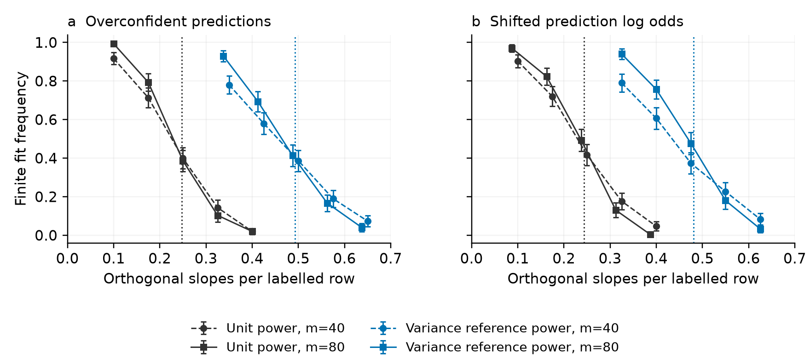
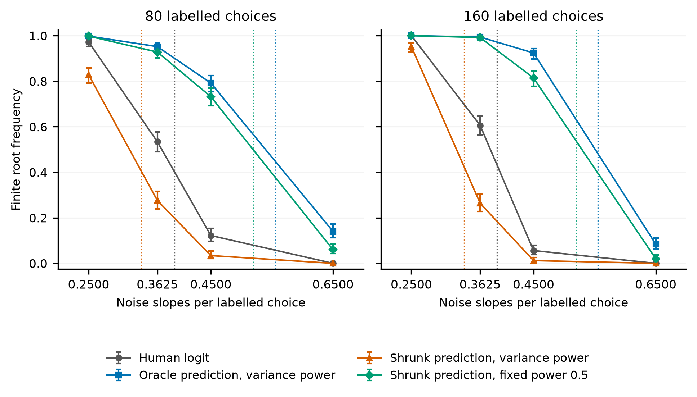
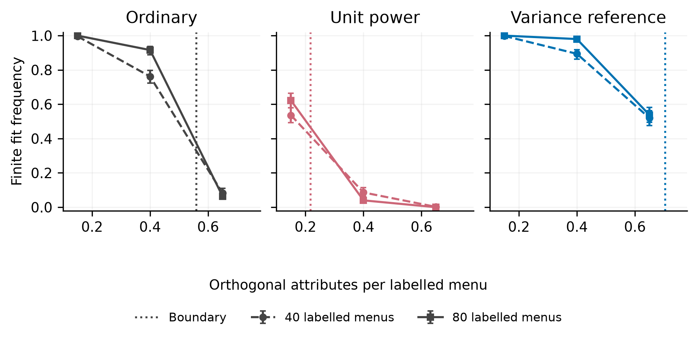
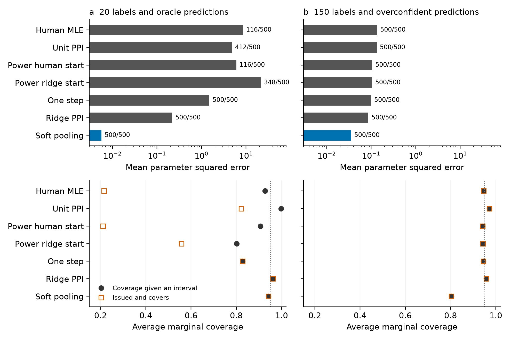
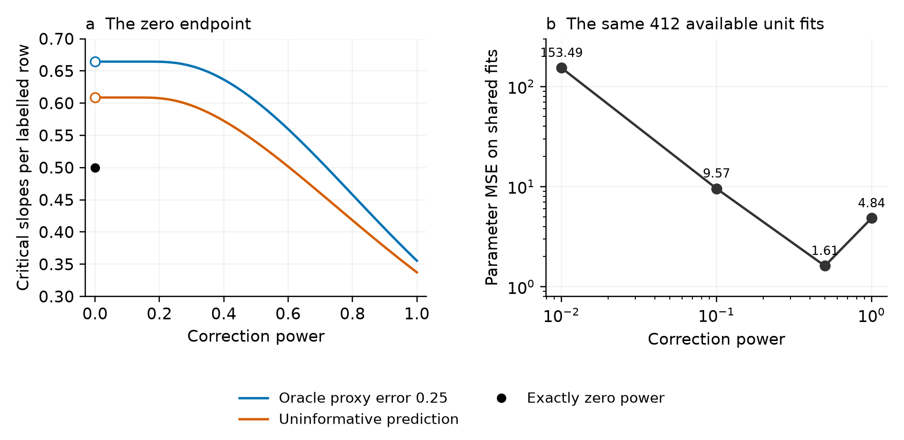

# When prediction assisted logit estimates exist

## Abstract

Prediction assisted logit corrects machine predicted choices while retaining the human population score. Its empirical objective can lack a finite minimizer at an oracle variance optimal correction power. We derive existence boundaries for binary and common coefficient multinomial logit with Gaussian attributes, fitted choice constants, a utility signal and frozen predictions. Two oracle reference objectives can have exactly the same gradient at the true parameter and the same full fixed dimensional asymptotic covariance, while their finite solution probabilities converge to opposite limits. A strict scalar example and matched simulations isolate the role of empirical curvature. With nonzero utility signal, two such references return finite fits in 92.4% and 1.2% of 500 matched draws at 160 labelled choices and 72 noise slopes. The whole menu calculation preserves joint probability constraints and permits hard category predictions. A positive power upper envelope bounds every power selection and governs strictly positive data dependent powers tending to zero. Its strict gain condition differs between binary and larger menus. A fixed sample result describes coefficient growth as power decreases. Released vaccine choices and matched support simulations separate estimate availability, point error and interval coverage. A fixed total label comparison counts independently trained predictors and finds no prediction error advantage over direct human ridge in its examined grid.

Keywords: discrete choice; multinomial logit; prediction powered inference; logistic separation; finite auxiliary samples

## 1 Introduction

Choice analysts increasingly use machine predictions in model development and estimation. Recent work in the Journal of Choice Modelling examines both machine learning in choice analysis and language models as assistants for utility specification (van Cranenburgh et al., 2022; Sfeir et al., 2026). A related use supplies predicted responses for observations without human choice labels. Prediction powered inference corrects these responses using a labelled sample, allowing the population estimating equation to retain its human choice target (Angelopoulos et al., 2023, 2024). Fan et al. (2024) derive categorical prediction correction, and Ye and Yoganarasimhan (2026) include common coefficient choice logit in survey allocation. These constructions specify the estimator analysed here.

An analyst must also be able to solve the empirical estimating equation. A corrected logit objective can decrease indefinitely along a coefficient direction. Continued optimization then produces increasingly extreme coefficients without reaching a finite optimum. This event is consequential when the human label budget is small relative to the utility specification. Prediction quality, correction power and the number of auxiliary observations all enter the event.

We characterize finite estimation of this unpenalized corrected logit objective. The binary calculation treats an estimated intercept, one Gaussian utility signal and increasing independent Gaussian attributes. Its explicit benchmark shows how finite auxiliary budgets change the boundary. The same calculation extends to whole choice menus with common attribute slopes and fitted alternative constants. It retains the probability simplex and isolates how competing alternatives change the positive power limit. Both models condition on fixed dimensional prediction information and keep the remaining Gaussian attributes independent of it.

Local variance calculations and finite estimation answer separate questions. We construct two oracle corrected objectives with exactly the same gradient at the true parameter on every sample and the same full fixed dimensional asymptotic covariance. Their critical ratios of noise slopes to labelled choices are 0.435 and 0.740 in a balanced example; ordinary logit has boundary 0.5. Every ratio in a nonempty interval gives opposite existence conclusions. The construction uses known population predictions and weights to isolate empirical curvature. It shows why an oracle variance calculation still needs a finite solution check.

The boundary also gives an upper envelope over all correction powers. Above it, power selection cannot restore a finite unpenalized root. Strictly positive powers tending to zero attain this existence region. With strictly interior binary predictions, its boundary strictly exceeds ordinary logit even for uninformative or reversed predictions. Hard predictions expose a menu size condition: an always wrong binary classifier loses that strict gap, while three or more alternatives retain it. A fixed sample limit describes coefficient growth as power decreases. The finite design support audit uses the actual attributes and also accommodates categorical designs.

Logistic separation and ordinary logit existence thresholds are established (Candès and Sur, 2020). Statistical dimension locates transitions in random convex feasibility problems (Amelunxen et al., 2014). Recent categorical response theory also unifies finite likelihood existence and separation diagnostics (Sablica et al., 2026). The unit power uninformative benchmark is a classical Gaussian zonotope absorption event (Kabluchko and Seidel, 2020). Koriyama and Bellec (2025) give general existence results for convex M estimators with finite rowwise loss infima. Positive power correction creates labelled row losses with infimum minus infinity; finite estimability depends on compensation by other rows. We derive the explicit finite auxiliary boundary for that corrected objective. Power tuning and one step estimation come from PPI++ and remain comparison methods throughout the paper.

Empirical analyses connect the boundary to choice analysis. First, a pinned public vaccine choice dataset provides corrected objectives whose moments are demonstrably outside their attainable support. The audit also verifies finite solutions from existing power tuning in those same cases. Second, known truth simulations on the released attribute support compare seven strategies under oracle and biased predictions. They separate availability from coverage and retain the strong point performance of soft pooling and penalized alternatives. A separate independent training experiment charges predictor training labels to the same total budget as direct human logit fitting. In its examined grid, fixed power correction gives no prediction error advantage over the ridge baseline. This reporting supports an analysis decision: specify the target objective, check its finite solution, and evaluate error and uncertainty for the estimator actually returned.

## 2 Prediction assisted choice logit

### 2.1 Choice target and correction

The correction combines a labelled choice loss with the difference between auxiliary and labelled prediction losses. It applies to binary contrasts and to a whole menu loss with a predicted probability vector. We first use binary logit to obtain explicit formulas, then retain the entire menu simplex in Section 3.9.

Let $X$ contain attribute contrasts and any estimated intercept. A binary choice $Y$ has logit probability $\sigma(X^T\beta)$, where $\sigma(u)=(1+e^{-u})^{-1}$. Write the negative log likelihood contribution as

$$\ell(u,y)=\log(1+e^u)-yu. \qquad (1)$$

There are $m$ labelled rows and $N$ independent auxiliary rows from the same distribution. A frozen prediction $g$ is available on both samples. Let $L_m(Y;\beta)$ denote the average labelled loss, and let $L_m(g;\beta)$ and $L_N(g;\beta)$ replace the response by its prediction. For fixed power $0<\lambda\leq1$, the PPI objective is

$$Q_\lambda(\beta)=L_m(Y;\beta)+\lambda\{L_N(g;\beta)-L_m(g;\beta)\}. \qquad (2)$$

The two prediction terms have equal expectations. The population score in (2) equals the human loss score, including when $g$ is imperfect. Under model misspecification its target is the human logistic projection. This identity uses a fixed predictor and power; it does not assert finite sample unbiasedness for a fitted predictor or estimated power.

For a stacked design with labelled rows first, define weights and a corrected moment by

$$w_i=(1-\lambda)/m\ \ (i\leq m),\qquad w_i=\lambda/N\ \ (i>m),$$

$$b_\lambda=m^{-1}X_L^T(Y_L-\lambda g_L)+\lambda N^{-1}X_U^Tg_U. \qquad (3)$$

Then $Q_\lambda(\beta)=\sum_i w_i\log(1+e^{X_i^T\beta})-b_\lambda^T\beta$. The Hessian is positive semidefinite. At unit power only auxiliary rows contribute curvature, while labelled rows still contribute to the corrected moment.

### 2.2 The finite design audit

Define the attainable moment set

$$\mathcal Z_w=\{\sum_i w_i X_i p_i:0\leq p_i\leq1\}. \qquad (4)$$

Proposition 1. Suppose the rows with positive weight span the parameter space. Objective (2) has a unique finite minimizer exactly when $b_\lambda$ is in the interior of $\mathcal Z_w$. If the moment is outside this set, the objective is unbounded below. A boundary moment has no finite stationary point. Without the rank condition, coefficients are not uniquely identified.

This is a classical convex support condition. The gradient of the log partition function maps finite coefficients onto the interior of its attainable moments. Its recession function is

$$Q_\lambda^\infty(d)=\sum_iw_i(X_i^Td)_+-b_\lambda^Td. \qquad (5)$$

An exterior moment supplies a direction with a negative value in (5). An interior moment makes the recession function strictly positive on the unit sphere, establishing coercivity and, with full rank, strict convexity.

Our implementation maximizes a common slack in the constraints $b_\lambda=\sum_iw_iX_ip_i$, $s\leq p_i\leq1-s$. A separate linear program obtains an exterior separating direction and verifies the recession gap. It reports rank deficiency, numerical boundary proximity and unresolved cases separately. The interface preserves the specified objective; power changes, pooling and penalties are explicit subsequent decisions. This audit implements established support geometry and supplies the finite design counterpart to the probabilistic calculation below.

## 3 The existence boundary with finite auxiliary data

### 3.1 Model and main result

Let the contrast vector be $(S,W)$, where $S$ is standard normal and $W$ has $q$ independent standard normal coordinates. Assume

$$P(Y=1\mid S)=\sigma(\gamma S),\qquad |\gamma|<\infty. \qquad (6)$$

The vector $W$ is independent of a fixed dimensional tuple $(S,Y,Z,U)$. Here $Z$ is binary auxiliary information and $U$ is optional additional prediction information. Their conditional law given $(S,Y)$ is fixed. The predictor $g(S,Z,U)$ is measurable, frozen and strictly between zero and one almost surely. Both samples are independent draws from this joint law. The model estimates an intercept, the slope of $S$ and all $q$ remaining slopes. The true intercept and remaining slopes are zero.

Consider $N/m\to\tau>0$ and $q/m\to\kappa$, with a fixed power in $(0,1]$. Define $s_L=1-2Y$, $s_U=2Z-1$ and $r=|Y-g|$. The oriented row intervals are

$$I_L=[\lambda r,1-\lambda+\lambda r], \qquad (7)$$

$$I_U=(\lambda/\tau)[-g,1-g]\quad\text{when }Z=1,$$

$$I_U=(\lambda/\tau)[g-1,g]\quad\text{when }Z=0.$$

For standard normal $H$, write

$$f(a)=E(H-a)_+^2=(1+a^2)\Phi(-a)-a\varphi(a),$$

$$B(h,t,a,b)=1+h^2-f(-h-ta)-f(h+tb). \qquad (8)$$

When the last argument below is an interval, its endpoints enter the last two arguments of $B$. For $\eta=(\eta_0,\eta_1)$ define

$$\Psi(\eta,t)=E B(s_L(\eta_0+\eta_1S),t,I_L)$$

$$\hphantom{\Psi(\eta,t)}+\tau E B(s_U(\eta_0+\eta_1S),t,I_U). \qquad (9)$$

Theorem 1. Under the assumptions above, let

$$\kappa_c=\inf_{\eta\in\mathbb R^2}\ \sup_{t\geq0}\Psi(\eta,t). \qquad (10)$$

If $\kappa<\kappa_c$, the probability that (2) has a unique finite minimizer tends to one. If $\kappa>\kappa_c$, the probability of a finite minimizer tends to zero. The statement leaves the equality case unspecified.

The boundary combines the finite auxiliary ratio, utility signal, predictor distribution and power. Its fixed dimensional optimizations can be evaluated by quadrature and scalar scale maximization. Under joint sign symmetry of $(S,Y,Z,U)$ and $g(-S,1-Z,U)=1-g(S,Z,U)$, convexity and symmetry allow $\eta_0=0$. An asymmetric prediction retains both multiplier coordinates.

The theorem holds for independent Gaussian remaining attributes and a frozen low dimensional predictor. Section 3.8 retains prediction indices that are fitted attributes and gives a conditional result for independently trained linear scores. Section 3.9 treats independent Gaussian choice menus. Repeated choices from a respondent, arbitrary cross fitting and general categorical design distributions require separate arguments. For an observed categorical design, Proposition 1 directly checks the stated objective without invoking a Gaussian approximation.

### 3.2 Why the corrected loss requires a separate calculation

The labelled contribution in (2), up to its averaging factor, is

$$\ell_L(u)=(1-\lambda)\log(1+e^u)-(Y-\lambda g)u. \qquad (11)$$

For $Y=0$, taking $u\to-\infty$ sends this contribution to minus infinity. For $Y=1$, taking $u\to+\infty$ has the same effect. At unit power it is affine. The complete objective can still be coercive because auxiliary rows offset those directions. The finite rowwise infimum assumption in Koriyama and Bellec (2025, Assumption 2.5) excludes these labelled losses. Theorem 1 evaluates the compensation using the actual two sample loss structure.

Unbiased noisy label correction and preservation of convexity are established (Natarajan et al., 2013); corrected empirical risk can become negative in positive unlabelled learning (Kiryo et al., 2017). Finite sample estimation costs of PPI++ are established for mean estimation (Mani et al., 2026), and synthetic likelihood regularization has a developed high dimensional theory (Li and Huang, 2026). DY prior penalized logit guarantees finite estimates for full rank designs and has proportional dimensional theory, including a recent fitted intercept treatment (Sterzinger and Kosmidis, 2026; Sterzinger, 2026). Proper pseudo-label augmentation has nonnegative row recession costs and an existence event invariant to every positive auxiliary weight. The corrected choice loss has negative labelled recession costs whose compensation changes with power. The two sample geometry gives the probability boundary for this event. Generic vanishing regularization and margin limits are established (Rosset et al., 2004); the corrected auxiliary recession function determines the limit studied here.

The proof conditions on $(S,Y,Z,U)$ and orients the remaining Gaussian rows by $s_L$ and $s_U$. A finite corrected moment becomes a Gaussian nullspace intersection with the cone generated by the product of (7), subject to the intercept and signal constraints. Classical random subspace theory locates the transition at the statistical dimension of that constrained cone. The new calculation is its limit (10) for the specified corrected logit objective. Appendix A gives the derivation, including tightness of both optimization variables and the connection from feasibility to an interior moment.

### 3.3 Balanced oracle benchmark

Take $\gamma=0$, let $Z$ independently flip $Y$ with probability $\epsilon\in(0,1/2)$, and use $g=\epsilon+(1-2\epsilon)Z$. Symmetry and independence minimize both multiplier coordinates at zero. The finite ratio boundary simplifies to

$$\kappa_c=1+\tau-\min_{t\geq0}F(t), \qquad (12)$$

$$F(t)=(1-\epsilon)\{f(-\lambda\epsilon t)+f((1-\lambda+\lambda\epsilon)t)\}$$

$$\hphantom{F(t)}+\epsilon\{f(-\lambda(1-\epsilon)t)+f((1-\lambda\epsilon)t)\}$$

$$\hphantom{F(t)}+\tau\{f(\lambda(1-\epsilon)t/\tau)+f(\lambda\epsilon t/\tau)\}.$$

At unit power this is

$$\kappa_c=\tau[1-\min_{u\geq0}\{\tau\epsilon(1-\epsilon)u^2+f((1-\epsilon)u)+f(\epsilon u)\}]. \qquad (13)$$

For $\epsilon=0.25$ and $\tau=1$, unit power gives 0.3554. The established population variance reference power $\lambda=\tau/(1+\tau)=0.5$ gives 0.6029. At $\tau=4$ the corresponding boundaries are 0.6120 and 0.7223, with reference power 0.8. As $\tau$ tends to infinity, the unit power boundary tends to $1/[2\pi\epsilon(1-\epsilon)]$, equal to 0.8488 at this error rate. The finite auxiliary calculation materially changes the existence region even for an informative, correctly calibrated predictor.

Zero power uses ordinary logit separation and is handled separately. Its balanced null threshold is 0.5. The interval cone in (7) contains zero at that endpoint, so a zero feasibility check would be uninformative. Our code uses the ordinary separation condition when the established weight formula selects zero.

### 3.4 Utility signal and prediction calibration

For a binary proxy with independent error $\epsilon$, the oracle prediction is

$$g_0(S,Z)=\sigma(\gamma S+(2Z-1)\log((1-\epsilon)/\epsilon)). \qquad (14)$$

We evaluate both this predictor and frozen transformations $g=\sigma(a\log(g_0/(1-g_0))+b)$. The overconfident case has $(a,b)=(2,0)$; shifted log odds use $(1,1)$. Table 1 fixes $\gamma=1.5$ and $\epsilon=0.25$. The comparison power minimizes the existing fixed dimensional orthogonal score variance. It provides a common reference and is held fixed in the phase experiment.

Table 1  Theoretical boundaries with a utility signal and estimated intercept

| Auxiliary to label ratio | Prediction | Power | Critical slope to label ratio |
|---|---|---|---|
| 1 | Oracle | 1.0000 | 0.2795 |
| 1 | Oracle | 0.5000 | 0.4637 |
| 1 | Overconfident | 1.0000 | 0.2478 |
| 1 | Overconfident | 0.3386 | 0.4927 |
| 1 | Shifted log odds | 1.0000 | 0.2434 |
| 1 | Shifted log odds | 0.3078 | 0.4810 |
| 4 | Oracle | 1.0000 | 0.4690 |
| 4 | Oracle | 0.8000 | 0.5487 |
| 4 | Overconfident | 1.0000 | 0.4261 |
| 4 | Overconfident | 0.5417 | 0.6046 |
| 4 | Shifted log odds | 1.0000 | 0.4060 |
| 4 | Shifted log odds | 0.4925 | 0.5729 |

At equal sample sizes, overconfidence moves the unit power boundary from 0.2795 to 0.2478; shifting log odds gives 0.2434. The variance reference powers yield boundaries near 0.48 to 0.49. A changed prediction distribution affects the allowable dimension as well as the efficiency calculation. The two free multipliers in (10) account for the signal and the asymmetry of shifted predictions.

Figure 1 evaluates these boundaries using 300 independent draws at each displayed point. Both samples are generated anew on each draw, and the same draw supplies the compared dimensions within a condition. The smooth finite sample transitions sharpen as the labelled sample increases. The complete oracle and imperfect prediction grids include 80 conditions each, with no numerically unresolved feasibility classifications.

Figure 1  Finite fit frequencies at auxiliary to label ratio one and utility signal 1.5. Circles and dashed lines use 40 labels; squares and solid lines use 80. Dotted lines show asymptotic boundaries. Error bars give approximate 95% binomial Monte Carlo intervals from 300 draws per point. Both panels use Gaussian attributes.

### 3.5 Local score equivalence and finite estimation

An oracle variance calculation can favor correction while its empirical objective lacks a finite root. We isolate the role of curvature using known population predictions. Let $\mu(X)=\sigma(X^T\beta_0)$ and let $g_0=E(Y\mid X,Z)$ be a frozen conditional mean based on additional information $Z$. Define

$$g_s=\mu+s(g_0-\mu),\qquad a_\tau=\tau/(1+\tau),\qquad \lambda_s=a_\tau/s,\qquad a_\tau\leq s\leq1. \qquad (15)$$

These powers lie in $[0,1]$. Write $H_0=E[XX^T\mu(1-\mu)]$ and $M=E[XX^T(\mu-g_0)^2]$, with $H_0$ nonsingular.

Proposition 2. Along (15), the gradient of (2) at $\beta_0$ is identical on every realization. For each fixed parameter dimension, the existing oracle variance criterion chooses $\lambda_s$ and gives the same first order covariance for every $s$:

$$V_s=H_0^{-1}(H_0-a_\tau M)H_0^{-1}/m. \qquad (16)$$

Under Theorem 1 with $\gamma=0$, proxy error $0.1$ and $\tau=1$, the half-shrunk reference $(s,\lambda)=(0.5,1)$ has boundary below $0.46$, while the unshrunk reference $(1,0.5)$ has boundary above $0.72$. At noise dimension ratio $0.47$, their finite solution probabilities tend to zero and one, respectively; ordinary logit also has probability tending to one. Both references have covariance $17/25$ of the human covariance.

Appendix B proves the identities and the strict boundary inequalities. The two objectives differ by a multiple of $L_N(\mu)-L_m(\mu)$. This term has exactly zero gradient at $\beta_0$ on every sample and changes their empirical Hessians. The construction fixes the variance optimal population weights, isolating curvature from weight estimation noise. The reference function $\mu$ uses the true parameter; the construction provides a theoretical comparison.

With utility signal $1.5$, proxy error $0.1$ and equal sample sizes, the computed boundaries are $0.5554$ for the unshrunk reference and $0.3363$ for the half-shrunk reference; ordinary logit has boundary $0.3903$. Figure 2 evaluates this nonzero signal example on matched draws. At 160 labelled choices and 72 noise slopes, finite root frequencies are $0.924$ and $0.012$ for the two variance references. Their paired difference is $0.912$, with Monte Carlo standard error $0.01268$. A fixed power of $0.5$ on the half-shrunk prediction gives frequency $0.814$.

Figure 2  Finite root frequencies along an oracle local score equivalence path. The labelled and auxiliary samples each have 80 or 160 simulated attribute rows. The two variance references have exactly the same truth score and the same full fixed dimensional asymptotic covariance. Each point retains 500 independent Gaussian model draws; all methods and dimensions share each draw. Error bars are 95% Wilson binomial Monte Carlo intervals. Dotted lines show theoretical boundaries, and connecting lines display measured frequencies. The mechanism illustration was selected after the population calculation and specified before sampling. Table B1 retains every displayed frequency. Point error and interval coverage are evaluated separately in Section 5.

### 3.6 Positive powers and the zero endpoint

Holding the sample and predictor fixed reveals a simple ordering. Write $H=L_m(Y)$ and $A=Q_1$. For $0<\alpha<\lambda\leq1$,

$$Q_\alpha/\alpha=Q_\lambda/\lambda+(1/\alpha-1/\lambda)H. \qquad (17)$$

The human loss is nonnegative. A coercive objective at power $\lambda$ remains coercive at the smaller positive power $\alpha$. With the rank condition of Proposition 1 this gives nested finite solution events. Exactly zero power removes auxiliary curvature and requires its own separation check.

For the balanced oracle with fixed zero intercept, put

$$G(v)=(1-\epsilon)f(-\epsilon v)+\epsilon f(-(1-\epsilon)v)$$

$$\hphantom{G(v)}+\tau\{f((1-\epsilon)v/\tau)+f(\epsilon v/\tau)\}. \qquad (18)$$

Corollary 1. For $\tau>0$ and $0<\epsilon\leq1/2$, the boundary strictly decreases with positive power and has right limit

$$\kappa_c(0+)=1+\tau-\min_{v\geq0}G(v)>1/2=\kappa_c(0). \qquad (19)$$

At $\tau=1$ and $\epsilon=0.25$, the right limit is 0.664488. An uninformative prediction at $\epsilon=1/2$ also has a gap, with right limit 0.608737. This gap concerns existence and auxiliary stabilization; it does not measure additional choice information.

A fixed sample counterpart describes the coefficient cost. On a strictly separated human sample, suppose the unit power recession function is positive on every nonzero human weak separator. Small positive powers then have finite roots whose norms diverge as power tends to zero. After division by $\log(1/\lambda)$, their limit set minimizes the corrected auxiliary recession cost subject to human margins of at least one. Appendix D states the condition, proves (19) and derives this path. The generic margin mechanism follows established vanishing regularization arguments; the cost and existence boundary belong to the specified corrected loss.

### 3.7 A simultaneous boundary with utility signal and estimated intercept

Retain the model of Section 3.1. Write $h_L=s_L(\eta_0+\eta_1S)$, $h_U=s_U(\eta_0+\eta_1S)$ and $J_U=I_U/\lambda$. Dividing the positive power intervals by power leaves the auxiliary interval $J_U$ fixed. The labelled interval expands to $[r,r+1/\lambda-1]$. Its closed limit gives

$$\Psi_\infty(\eta,v)=E\{1+h_L^2-f(-h_L-vr)\}$$

$$\hphantom{\Psi_\infty(\eta,v)}+\tau E B(h_U,v,J_U),\qquad v\geq0. \qquad (20)$$

Define the limiting and ordinary logit boundaries by

$$\kappa_\infty=\inf_\eta\sup_{v\geq0}\Psi_\infty(\eta,v),\qquad \kappa_0=\inf_\eta E f(h_L). \qquad (21)$$

Theorem 2. Under the assumptions of Theorem 1, $\kappa_c(\lambda)\to\kappa_\infty>\kappa_0$ as positive $\lambda\to0$. For $\kappa<\kappa_\infty$, some fixed power in $(0,1)$ gives a unique finite root with probability tending to one. For $\kappa>\kappa_\infty$, the probability that any power in $[0,1]$ gives a finite root tends to zero. Every sequence of possibly data dependent powers satisfying $0<\lambda_m\leq1$ almost surely and $\lambda_m\to0$ in probability has the same strict two sided existence boundary $\kappa_\infty$. The equality case is unspecified.

The simultaneous upper bound follows from one closed cone containing all positive power cones and the ordinary logit feasibility face. The lower side combines fixed power thresholds with the nesting identity (17). Appendix D proves the required uniform controls without exchanging the infimum and supremum. No rate or independence condition is imposed on the selected positive powers. These assumptions keep the strictly interior predictor fixed across sample sizes. Section 3.8 states additional conditions for independently trained linear predictors.

For utility signal 1.5 and proxy error 0.25, the ordinary boundary is 0.3903. With equal sample sizes, the limiting boundaries are 0.5082 for the oracle, 0.5061 for overconfident predictions and 0.4918 for shifted log odds. At auxiliary ratio four they are 0.6263, 0.6249 and 0.5875. Constant and reversed predictions also give strict existence gains, of different sizes. The strict gain establishes stabilization of this objective. Parameter error, choice probability loss and confidence interval performance still require their own evaluation, as Section 5 illustrates.

### 3.8 Prediction indices in the binary fitted design

A prediction may use attributes whose coefficients the choice model estimates. Conditioning on that prediction then conditions on part of the fitted design. Retaining its index among the multiplier constraints preserves the independent Gaussian structure of the remaining columns. This accounts explicitly for prediction–attribute dependence.

Proposition 3. Let $T$ have a fixed number $k$ of independent standard normal coordinates, independent of $S$, and let $Y$ given $(S,T)$ have probability (6). Include all coordinates of $T$ among the fitted contrasts, with true slopes zero. Suppose the remaining Gaussian vector $W$ is independent of $(S,T,Y,Z,U)$ and $g(S,T,Z,U)$ is frozen and strictly interior. Theorems 1 and 2 hold with the multiplier in $\mathbb R^{k+2}$ and

$$h_\eta(S,T)=\eta_0+\eta_1S+\eta_T^T T. \qquad (22)$$

In (9), (20) and (21), replace each signed affine multiplier by $s_Lh_\eta$ or $s_Uh_\eta$. The ordinary boundary is unchanged by the independent zero slope attributes $T$. Appendix E proves the extension. It uses the same compensated objective and conic calculation.

Prediction accuracy and calibration do not determine this boundary. An explicit construction in Appendix E keeps the complete law of $(Y,g)$ identical while placing the prediction index outside or inside the fitted design. Both predictions are calibrated, with Brier risk 0.09. At unit power and equal sample sizes, their boundaries are 0.396628 and 0.385935. Every limiting dimension ratio strictly between them gives opposite existence conclusions. The gap is about 0.011 in this construction. All population cases and paired finite size results are retained.

For a linear score trained independently of the audit rows, an orthogonal Gaussian rotation reduces its component outside the utility direction to one such index. Corollary 2 in Appendix E requires its signal overlap, orthogonal norm and intercept to converge to finite deterministic limits. These conditions give deterministic strict existence limits for the independently trained score. Cross prediction already provides fixed dimensional inference with learned predictors (Zrnic and Candès, 2024); the present conditional result concerns proportional dimensional existence. Correlated teacher and fitted feature spaces are established objects of high dimensional analysis (Loureiro et al., 2021). The additional calculation here concerns their role in the compensated choice loss. Training labels are additional to the $m$ audit labels. Section 5.4 counts both subsets in a fixed total budget comparison.

### 3.9 Whole choice menus

The same correction applies to a menu of $J$ alternatives with common attribute coefficients. Let $F_i$ be its matrix of alternative attributes and let $e_Y$ identify the chosen alternative. The menu loss is $\ell_J(F_i\beta,y)=\log\sum_j e^{F_{ij}^T\beta}-y^TF_i\beta$, for either the observed choice vector or a predicted probability vector. This prediction assisted MNL construction is established in Fan et al. (2024) and Ye and Yoganarasimhan (2026). We calculate its finite solution boundary while preserving the constraint that probabilities within each menu sum to one.

Fix $J$ and work in the contrast space $E=\{u\in\mathbb R^J:\sum_j u_j=0\}$. Center independent standard normal signal profiles across alternatives to obtain $S\in E$. True choice probabilities are

$$P(Y=j\mid S)=e^{\gamma S_j}/\sum_k e^{\gamma S_k},\qquad |\gamma|<\infty. \qquad (23)$$

Estimate $J-1$ alternative constants, one common signal slope and $q$ common noise slopes. Each remaining profile column is independent standard Gaussian across menus and alternatives, independent of the fixed dimensional tuple supplying $(S,Y,g)$. The two samples are independent draws from this joint law. The frozen prediction satisfies $g\in\Delta_J$, where $\Delta_J$ is the probability simplex. Assume $a_*=E\|g-e_Y\|^2>0$, $N/m\to\tau>0$ and $q/m\to\kappa$. Prediction vectors can lie on simplex faces, including hard category predictions.

The oriented binary intervals become zero sum residual sets

$$D_L=(1-\lambda)\Delta_J-e_Y+\lambda g,$$

$$D_U=(\lambda/\tau)(\Delta_J-g). \qquad (24)$$

For an independent standard Gaussian $H$ in $E$, let $B_J(w,D)=\|w\|^2-\operatorname{dist}^2(w,D)$. A multiplier $\eta=(a,b)\in E\times\mathbb R$ gives $h_\eta=a+bS$. Define

$$\Psi_J(\eta,t)=E B_J(H-h_\eta,tD_L)+\tau E B_J(H-h_\eta,tD_U). \qquad (25)$$

Theorem 3. Under these assumptions, for every fixed $0<\lambda\leq1$ the boundary is

$$\kappa_{J,c}(\lambda)=\inf_{\eta\in E\times\mathbb R}\ \sup_{t\geq0}\Psi_J(\eta,t). \qquad (26)$$

Below this ratio, the probability of a unique finite minimizer of (2) tends to one; above it, the probability of a finite minimizer tends to zero. The dimension ratio counts common noise slopes per labelled menu. The fitted constants and signal slope are additional fixed dimensional parameters. The equality case is unspecified.

The positive power limit retains the chosen vertex tangent cone $C_Y=\operatorname{cone}\{e_j-e_Y:j≠Y\}$. At a common scale $v\geq0$, its residual sets are

$$D_{L,\infty}(v)=v(g-e_Y)+C_Y,$$

$$D_{U,\infty}(v)=(v/\tau)(\Delta_J-g). \qquad (27)$$

Let $\Psi_{J,\infty}(\eta,v)$ replace the scaled sets in (25) by (27), and put

$$\kappa_{J,\infty}=\inf_\eta\ \sup_{v\geq0}\Psi_{J,\infty}(\eta,v). \qquad (28)$$

The ordinary boundary is $\kappa_{J,0}=\inf_\eta E\|\Pi_{C_Y}(H-h_\eta)\|^2$.

Corollary 3. Under Theorem 3, $\kappa_{J,c}(\lambda)$ increases to $\kappa_{J,\infty}$ as positive power decreases to zero. This limit bounds the existence region for every power in $[0,1]$ simultaneously. Every sequence of possibly data dependent powers with $0<\lambda_m\leq1$ almost surely and $\lambda_m\to0$ in probability has this same strict two sided boundary, without a rate requirement. For $J\geq3$, $\kappa_{J,\infty}>\kappa_{J,0}$. For $J=2$, this strict inequality holds exactly when $P(g_Y>0)>0$.

The final condition distinguishes binary choice from larger menus. An always wrong binary hard predictor has the ordinary limiting boundary. With at least three alternatives, the Gaussian tangent projection can concentrate on different unchosen competitors, giving a positive derivative for every fixed prediction vector. Appendix F proves this condition and treats the perfect hard prediction endpoint separately. For two alternatives the formula reduces to Theorem 1 with binary signal coefficient $\sqrt2\gamma$; alternative profile differences have variance two. These results concern common coefficients on alternative profiles. Tan and Bellec (2023) study a class specific coefficient matrix on shared covariates and impose existence in Assumption 2.4.

Figure 3 shows a matched hard prediction illustration with three alternatives, signal 1.5, proxy error 0.25 and auxiliary ratio one. The established fixed dimensional variance criterion for one orthogonal common slope gives power 0.219576. The corresponding boundary is 0.7039, compared with 0.2164 at unit power and 0.5594 for ordinary logit. This reference uses the hard predictor's actual score covariance, derived in Appendix F. Its population value is available in the simulation; it is not a newly estimated tuning algorithm.

All methods share each Gaussian menu sample, observed choices, predictions and attribute dimensions. Each budget supplies 500 independent draws. At 80 labelled menus and 52 orthogonal attributes, finite fit frequencies are 0.538 for the variance reference, 0.064 for ordinary logit and zero at unit power. The paired reference minus ordinary difference is 0.474 with Monte Carlo standard error 0.02235. Boundary locations at these finite budgets remain shifted from the asymptotic limits. The complete 18 cells, 9000 classifications and 1090 independently checked ordinary boundary directions accompany the figure. Accuracy, interval performance and training costs retain their separate comparisons in Section 5.

Figure 3  Finite estimation with hard category predictions on identical menus and dimensions. Each point uses 500 draws; circles and dashed lines use 40 labelled menus, and squares and solid lines use 80. Dotted lines mark the corresponding boundaries. Error bars are 95% Wilson binomial intervals. The variance reference is the existing oracle criterion for one orthogonal slope, with power 0.219576. The experiment was selected after the population grid as a mechanism illustration. Lines connect the observed frequencies; they do not estimate a transition rate.

## 4 Evidence from released vaccine choices

### 4.1 Data and the stated estimands

We use numeric files released with Generative Augmented Inference (Lu et al., 2026), pinned to repository commit d18717206867c7a12ff470879a0dd5d488b300c2. The file contains 4605 human binary choice rows with two 12 column vaccine profiles and 1200 aligned hard AI predictions. Differencing the profiles and removing a common first column yields 11 contrasts. The released study excludes respondents who never select a vaccine; these rows do not represent all originally recruited respondents. Code and data licenses are recorded in the reproduction package.

The reanalysis fixes the aligned 1200 row prefix and evaluates 500 allocations with labelled budgets of 50, 100, 150 and 200 rows. Allocations preserve the source implementation's five row blocks. The released numeric file does not establish participant identifiers, so the comparison is conditional on that block convention. The empirical target is the converged logistic projection on the fixed prefix. It is a reference estimate, distinct from a known population parameter.

Nuisance predictions use five row folds and ridge logistic fits, either within hard AI label strata or using attributes alone. Predictions are held fixed within each objective comparison. This fitted prediction reanalysis illustrates finite support geometry; its distribution is outside the frozen predictor theorem. Changing the source prefix pool convention yields a distinct reanalysis.

### 4.2 Finite solutions and explicit alternatives

In the auxiliary only objective (2), unit power has six exterior AI moments among 500 allocations at 50 labels; the attributes only comparator has two. Each exterior moment has a separately verified positive recession gap. Existing power tuning from a converged human estimate returns finite roots in all 500 allocations for both predictors. Initializing that same tuning procedure from a verified unit power root leaves six and two initializers unavailable, respectively. The method definition and its initialization both affect availability.

We apply the finite objective audit to all eight recorded exterior cases. Unit power remains exterior in every case; the smallest verified gap is 0.000388. Existing human initialized tuning solves its stated objective in all eight. Soft pooling also solves its own objective, with a corrected unit power score discrepancy of at least 0.1072 across these cases. These are the eight recorded failures of that experiment.

Component clipping explains the soft pooling alternative in the source style pooled imputation experiment. With inverse label probability weight greater than one, clipping corrected binary one hot targets to the unit interval and renormalizing returns observed choices on labelled rows and predictions on auxiliary rows. This identity holds for every prediction in the unit interval. It removes the original residual correction from the loss being optimized. In the separate pooled imputation comparison, exterior counts are five and two; these counts refer to a different objective and are retained separately.

The released reference vector also requires an explicit optimization convention. It agrees with a 200 step Adam reconstruction within $1.49\times10^{-7}$. A converged fit on all 4605 rows reduces total negative log likelihood by 7.014, with a maximum coefficient difference of 0.1855. Our point comparisons use converged projections and report fixed iteration outputs separately. This check concerns the released reference and the inspected implementation; it does not identify the source of every gain in the published study.

## 5 Availability and uncertainty on the released attribute support

### 5.1 Known truth experiment

To evaluate error and coverage against a known parameter, we sample attribute rows independently with replacement from the fixed 1200 row support. The simulation parameter is its converged 11 coordinate logistic vector. A second signal group multiplies that vector by three. We generate choices from the stated logistic probabilities and binary proxies by independent flips. No new human respondents or language model answers are generated.

The oracle grid crosses $m=20,50,150$, $N=150,600$ and proxy error 0.1 or 0.25, with 500 repetitions per condition. Two additional signal groups use oracle, doubled log odds and shifted log odds predictions, $m=50,150$, $N=600$ and proxy error 0.25. Each of those groups has six conditions and 500 repetitions. Every method shares the attributes, choices and proxy draws within a condition. The full grids and their seeds accompany the aggregate tables.

We compare human maximum likelihood, unit power PPI, human initialized power tuning, ridge initialized power tuning, one step PPI from that ridge start, unit power ridge PPI and soft pooling. Ridge fits use penalty $\|\beta\|^2/(2m)$ on every coordinate. The two power methods use the established PPI++ covariance trace convention at their stated initializers. The one step update uses the same estimated power and initial ridge fit. Soft pooling combines observed labelled choices with frozen auxiliary predictions at equal row weights. Its oracle version has correct conditional mean information.

Two DY prior settings provide a labelled only comparator in the two conditions of Table 2. The estimator fits pseudo-responses $\alpha Y+(1-\alpha)/2$, using $\alpha=m/(m+11)$ and a fixed $\alpha=0.5$ sensitivity. The first follows the dimension based choice used in the authors' supplementary implementation. Both use the same human rows, a zero prior mode and zero initialization, with no auxiliary predictions. They replay the existing 500 draws in each condition; the original seven strategy grids remain unchanged.

For each method we record point availability and interval availability separately. Parameter MSE is the mean of squared coordinate errors, conditional on an available point. Coverage is the fraction of 11 marginal intervals covering their corresponding true coordinates, averaged over repetitions with intervals. Issued and covers assigns zero to a repetition without intervals before averaging over all 500 repetitions. Neither summary is simultaneous coverage. Monte Carlo errors use the repetition as the independent unit. Wald intervals use the implemented score sandwich; ridge intervals do not adjust for shrinkage bias. Appendix C states the covariance formulas and tuning convention.

### 5.2 What a finite output establishes

Table 2 contrasts two prespecified mechanisms: scarcity of human labels with oracle predictions, and overconfidence under stronger utility at a larger label budget. All conditions and error tails remain in the reproduction tables. The selected columns show how availability, parameter error and coverage can lead to different assessments of the same estimator.

Table 2  Point availability and interval performance

| Condition | Estimator | Available | MSE | Coverage | Issued and covers |
|---|---|---|---|---|---|
| 20 labels oracle | Human MLE | 116/500 | 8.5602 | 0.926 | 0.215 |
| 20 labels oracle | Unit PPI | 412/500 | 4.8362 | 0.998 | 0.822 |
| 20 labels oracle | Power human start | 116/500 | 6.0858 | 0.907 | 0.210 |
| 20 labels oracle | Power ridge start | 348/500 | 21.5408 | 0.801 | 0.558 |
| 20 labels oracle | One step | 500/500 | 1.5054 | 0.827 | 0.827 |
| 20 labels oracle | Ridge PPI | 500/500 | 0.2193 | 0.961 | 0.961 |
| 20 labels oracle | Soft pooling | 500/500 | 0.0057 | 0.942 | 0.942 |
| 20 labels oracle | DY dimension rule | 500/500 | 0.9277 | 0.737 | 0.737 |
| 20 labels oracle | DY alpha 0.5 | 500/500 | 0.4397 | 0.740 | 0.740 |
| 150 labels overconfident | Human MLE | 500/500 | 0.1353 | 0.947 | 0.947 |
| 150 labels overconfident | Unit PPI | 500/500 | 0.1326 | 0.971 | 0.971 |
| 150 labels overconfident | Power human start | 500/500 | 0.1050 | 0.942 | 0.942 |
| 150 labels overconfident | Power ridge start | 500/500 | 0.1042 | 0.942 | 0.942 |
| 150 labels overconfident | One step | 500/500 | 0.0992 | 0.945 | 0.945 |
| 150 labels overconfident | Ridge PPI | 500/500 | 0.0860 | 0.958 | 0.958 |
| 150 labels overconfident | Soft pooling | 500/500 | 0.0353 | 0.804 | 0.804 |
| 150 labels overconfident | DY dimension rule | 500/500 | 0.1011 | 0.945 | 0.945 |
| 150 labels overconfident | DY alpha 0.5 | 500/500 | 0.1035 | 0.625 | 0.625 |

With 20 labels and oracle predictions, the human MLE is available in 116 of 500 repetitions. Unit power PPI returns 412 points. Its conditional coverage is 0.998, while issued and covers is 0.822. One step PPI returns 500 points and has coverage 0.827. Ridge PPI and oracle pooling also return every point and have coverage near 0.95 in this condition. The oracle pooling MSE advantage is substantial and is preserved in the comparison.

Under stronger utility, 150 labels and overconfident predictions, all seven estimators return 500 points and intervals. Soft pooling has MSE 0.0353 and coverage 0.8036. Ridge initialized power tuning has MSE 0.1042 and coverage 0.9424; one step PPI has MSE 0.0992 and coverage 0.9451. Exact finite support expectations give a soft pooling population parameter MSE of 0.0181 in this condition. The fixed power corrected population score still vanishes at the true parameter. This comparison isolates the difference between a changed target and corrected estimation uncertainty.

Both DY settings return 500 estimates and intervals in each condition. With 20 labels, dimension based shrinkage gives MSE 0.9277 and diagnostic coverage 0.7369; half power gives 0.4397 and 0.7398. With 150 labels, dimension based DY gives MSE 0.1011 and coverage 0.9451 using labelled data alone. Its paired MSE difference from one step PPI is 0.001935 with Monte Carlo standard error 0.001399 on the same 500 fits. Half power DY has MSE 0.1035 and coverage 0.6249; its exact support population target has parameter MSE 0.0874. These intervals use the ordinary sandwich described in Appendix C. The Gaussian high dimensional corrections of the cited DY papers are not applied to this discrete support.

Soft pooling retains the smallest displayed point errors under the original, weaker signal, including the imperfect predictions. Its coverage in the 150 label cases remains around 0.94. The complete results support distinct choices for distinct objectives: an analyst focused on prediction or parameter error may favor pooling in these conditions, while inference on the human logistic target requires its target discrepancy and coverage to be assessed. Existing ridge and one step procedures also handle many finite computation cases.

Figure 4  Error and coverage answer different questions. The left column uses 20 labels, oracle predictions and the original signal. The right column uses 150 labels, overconfident predictions and threefold utility. The PPI and pooling methods use 600 auxiliary rows and proxy error 0.25; both DY settings use labelled rows alone. MSE axes are logarithmic; annotations show available points out of 500. Coverage is averaged across 11 marginal intervals, with the reference line at 0.95. Underlying aggregate tables retain interval counts, Monte Carlo errors and all remaining conditions.

### 5.3 Power changes availability and error

We replay all 500 draws of the original oracle condition with 20 labels, 600 auxiliary rows and proxy error 0.25. The covariates, generated choices, proxy draws and truth vector are unchanged. All 1000 stored human and unit power support statuses match the replay. On available estimates, the largest relative MSE discrepancy from the original fits is below $4.8\times10^{-8}$. Positive power roots use a scaled score equation, avoiding an absolute stopping tolerance that becomes permissive as power decreases.

Table 3  The same 500 support samples fitted at different powers

| Power | Available | Mean MSE | Median MSE | 90th percentile MSE |
|---|---|---|---|---|
| 0 human | 116/500 | 8.560 | 4.191 | 22.106 |
| 0.01 | 474/500 | 196.879 | 104.474 | 439.843 |
| 0.1 | 474/500 | 14.630 | 7.147 | 27.851 |
| 0.5 | 467/500 | 3.912 | 1.157 | 4.342 |
| 1 | 412/500 | 4.836 | 1.030 | 7.819 |

MSE and its quantiles in Table 3 condition on each method's available estimates. The human MLE is available in 116 repetitions. Powers 0.1 and 0.01 each admit 474 finite roots; the other 26 corrected objectives fail the limiting positive power feasibility check. The 0.01 fits have a median MSE of 104.474 and a 90th percentile of 439.843. Their larger mean error is accompanied by a substantial shift in the typical available fit.

The shared samples isolate the weight comparison from availability selection. Among the same 412 repetitions with an available unit power estimate, mean MSE is 4.836 at unit power, 1.615 at power 0.5, 9.571 at power 0.1 and 153.487 at power 0.01. The paired mean difference between powers 0.01 and one is 148.650, with Monte Carlo standard error 10.180; 94.66% of these samples have greater MSE at the smaller power. Among the 116 samples where the human MLE exists, power 0.01 instead reduces mean MSE from 8.560 to 4.899. The human separation stratum materially changes the comparison.

The choice probabilities also change materially on those same 412 repetitions. Mean expected excess log loss is 0.715 nats per choice at unit power, 0.434 at power 0.5, 1.475 at power 0.1 and 6.866 at power 0.01. This quantity is the Bernoulli Kullback–Leibler divergence from the known choice probabilities, averaged over the fixed 1200 row support. It evaluates the generated choice population exactly; it supplies no additional human validation sample.

Figure 5  Existence and error respond differently to power. The left panel gives the balanced Gaussian boundary at auxiliary to label ratio one. Open markers at zero give positive power right limits; the filled black marker gives exactly zero power. The right panel compares positive powers on the same 412 replayed samples with available unit power fits, using the original 11 contrast support and 20 labels. Both right panel axes are logarithmic.

The existence ordering supports a diagnostic interpretation of power. Lower positive power can restore a finite root while allowing coefficients to move farther along a human separating direction. Existing penalization, one step estimation and pooling remain relevant alternatives, with their full results in Table 2 and the aggregate grids. Availability alone cannot choose among their estimation targets or establish reliable intervals.

### 5.4 Counting prediction training labels

An independently trained prediction uses labels before the correction sample is collected. We compare that allocation with fitting ordinary or ridge logit directly to all available human labels. Total budget $B$ is 80 or 160; the slope dimension is $0.3B$ or $0.45B$. Independent training uses $t=0.25B$ or $0.5B$ labels, leaving $m=B-t$ labels for correction and $N=4m$ auxiliary attribute rows. The true logit has one Gaussian signal with slope 1.5 and independent Gaussian zero slope attributes. Each of the eight conditions has 100 simulated draws. Appendix C4 specifies the common training rule, integration design and solver checks.

Every draw compares fixed powers 0.1, 0.5 and 1 with direct human maximum likelihood, a direct human ridge fit and the training predictor alone. The two direct comparators use the same union of training and correction labels. They receive no auxiliary choice labels. Table 4 reports availability for the smallest examined positive power and both direct comparators. Across all conditions, the three positive powers return 223, 169 and 28 finite roots. All 397 unavailable ordinary logit fits have separately verified strict separating directions. No numerical case remains unresolved.

Table 4  Verified finite estimates with predictor training charged to the total label budget

|Total labels|Slopes|Training labels|Human MLE|PPI $\lambda=0.1$|Human ridge|
|---|---|---|---|---|---|
|80|24|20|89/100|75/100|100/100|
|80|24|40|92/100|24/100|100/100|
|80|36|20|9/100|20/100|100/100|
|80|36|40|5/100|0/100|100/100|
|160|48|40|98/100|81/100|100/100|
|160|48|80|95/100|17/100|100/100|
|160|72|40|5/100|6/100|100/100|
|160|72|80|10/100|0/100|100/100|

All cells use 100 draws. Training and correction labels are disjoint. Other fixed powers and all failures remain in the complete aggregate results.

In every nonempty cell comparing a fixed power with direct human ridge, the corrected estimator has larger mean excess prediction loss on their explicitly counted shared finite fits. At $B=160$, 48 slopes and 40 training labels, power 0.1 returns 81 finite roots with conditional mean excess loss 1.4655. Human ridge returns all 100 fits with mean 0.0934. On the 81 common fits, corrected minus ridge loss is 1.3720 with Monte Carlo standard error 0.1180. Availability uses every planned repetition; loss comparisons condition on the counted shared fits. Some cells have few finite fits and cannot support precise rankings.

This experiment establishes no label efficiency or prediction error advantage for the examined independent training allocation and fixed powers. The predictor uses only project labels; externally trained predictions have a different information and cost structure. The existence theorem does not evaluate that cost structure or provide an efficiency guarantee.

## 6 Implications for choice analysis

Prediction assistance introduces a sample allocation decision alongside the utility specification. Theorem 1 shows how a finite auxiliary budget changes the existence region at a given power. Even a correctly calibrated informative predictor can produce a smaller unit power existence region than ordinary logit when the two samples have equal size. An efficiency reference can improve that region, as the displayed balanced example demonstrates. The positive power ordering and its zero discontinuity show why the largest existence region need not give the most accurate coefficients. Data selected power rules require their own distributional analysis. When a predictor is trained from project labels, the allocation must also count those labels. The fixed budget comparison shows why an existence gain cannot serve as a sample saving recommendation.

For a concrete dataset, the support audit answers whether the stated unpenalized objective can have a finite root. Exterior moments identify an optimization problem that additional iterations cannot solve. Boundary proximity and small curvature identify a different numerical situation and remain separately reported. An analyst can then choose an existing alternative with its objective and initializer documented. Clipping, pooling, a penalty and a one step update each define a specific estimation operation.

Reliable intervals add another requirement. The known truth experiments show both high conditional coverage with unavailable estimates and finite point outputs with lower coverage. Reporting availability, conditional coverage and issued and covers makes those differences visible. Hess et al. (2026) distinguish parameter uncertainty, preference heterogeneity and repeated choice dependence; our reported coverage uses independently generated rows under its stated model. This complements work on the sequential decisions of choice modellers (Nova et al., 2025): the fitted objective and convergence criterion belong in the reproducible specification alongside the utility function.

The Gaussian boundaries describe controlled increasing dimension models. Actual DCE attributes are often discrete and choices repeat within people. The finite support condition applies to the supplied binary or menu logit objective; the probability calculation requires its independent Gaussian profile assumptions. Balanced fixed tasks provide another check: if both samples have identical menu frequencies and predictions depend only on those menus, their prediction loss averages are identical for every coefficient. The correction then vanishes at every power. This identity can be checked before fitting and keeps the model's information source explicit.

## 7 Conclusion

Finite estimation of prediction assisted choice logit depends jointly on the labelled and auxiliary samples, utility signal, prediction distribution and correction power. We derive explicit boundaries for a binary model and for whole menus with common attribute coefficients and fitted choice constants. An oracle path keeps the finite sample truth score and fixed dimensional first order covariance identical while changing the finite solution boundary. The positive power upper envelope bounds every power selection, and its strict gain condition changes between binary and larger menus. The fixed sample coefficient path quantifies costs that can accompany greater availability. Fitted prediction indices extend the binary calculation under stated independent training and convergence conditions.

The choice support experiments retain strong pooling, one step and penalized alternatives. A separate fixed total label comparison finds no prediction error advantage for the examined independent training allocation and fixed powers over direct human ridge. These results support explicit reporting of the fitted target, training budget, finite solution, prediction error and uncertainty.

## Appendix A Proof of the finite ratio boundary

### A1 Oriented intervals and the finite sample event

The gradient condition for (2) is $X^T(wp)-b_\lambda=0$. On a labelled row, multiply its residual numerator by $s_L$. For $Y=0$ the oriented residual ranges from $\lambda g$ to $1-\lambda+\lambda g$; for $Y=1$ it ranges from $\lambda(1-g)$ to $1-\lambda+\lambda(1-g)$. These are exactly $I_L$. Orienting an auxiliary residual by $s_U$ gives $I_U$, using the finite ratio $\tau_m=N/m$.

Let $D$ be the product of these observed intervals and let $K=\operatorname{cone}(D)$. Every labelled lower endpoint is strictly positive. The cone is closed, pointed and polyhedral. Define $V$ with columns $s$ and $sS$, stacked over the two samples, and

$$C=K\cap\ker(V^T). \qquad (A1)$$

Conditional on the low dimensional observations, the oriented remaining attributes form a $q$ by $(m+N)$ independent standard Gaussian matrix $A$. The corrected moment is feasible exactly when $\ker(A)$ meets $C$ at a nonzero point. A nonzero point of $K$ has positive scale and can be divided by that scale to obtain a point of $D$.

Interior feasibility must accompany the rank condition in Proposition 1. Section A3 shows, with probability tending to one, that $\ker(V^T)$ meets the relative interior of $D$. Conditional on this event, generic Gaussian position makes a nontrivial nullspace intersection meet the relative interior of $C$ almost surely. Boundary only tangency occurs on a null set of orientations for a fixed polyhedral cone. Relative interior is preserved under the corresponding linear images and preimages, connecting the cone event to an interior corrected moment. Below the strict critical ratio the positively weighted design has full column rank almost surely. At unit power the cone span has dimension $N+1$ before the two constraints, implying $\kappa_c\leq\tau$; the strict lower side has enough auxiliary rows for full rank. At smaller positive power, all $m+N$ rows carry curvature.

### A2 Statistical dimension identity

For independent $H\sim N_{m+N}(0,I)$, polyhedral polar calculus and the projection identity give

$$\delta(C)=E_H\inf_\eta\|\Pi_K(H-V\eta)\|^2. \qquad (A2)$$

Indeed $C^\circ=K^\circ+\operatorname{range}(V)$; the sum is closed for these polyhedral cones. For any vector $w$,

$$\|\Pi_K(w)\|^2=\sup_{t\geq0}\sum_i\{w_i^2-\operatorname{dist}(w_i,tI_i)^2\}. \qquad (A3)$$

Each summand equals $\sup_{v\in tI_i}(2w_iv-v^2)$. It is convex in $w_i$ and concave in $t$. Its normal expectation at $w_i=H_i-h$ is $B(h,t,I_i)$ from (8). We preserve the infimum followed by the supremum in (A2) and (A3). Passing the random extrema to population expectations requires the following uniform controls.

### A3 Tightness of the intercept and signal multiplier

For a unit vector $u=(u_0,u_1)$ put $h_u(S)=u_0+u_1S$. Let $\rho_m(u)$ be the sum of the labelled and auxiliary interval support functions at $-s h_u$, divided by $m$. Bounded interval endpoints and an envelope proportional to $1+|S|$ give a uniform law of large numbers on the unit circle. The common prediction contributions cancel between the samples, giving

$$\rho(u)=E\{(-h_u(S))_++Yh_u(S)\}. \qquad (A4)$$

For finite $\gamma$, the conditional choice probability lies strictly inside the unit interval. Every nonzero affine $h_u$ is nonzero with positive probability, so (A4) is positive in every unit direction. Continuity on the unit circle yields $c=\min\rho(u)>0$. With probability tending to one, $\inf_u\rho_m(u)\geq c/2$. Positive support in both directions also places zero in the interior of $V^TD$, establishing the relative interior event used in A1.

In (A3), set $t=1$ and choose each interval endpoint maximizing $(-V_i\eta)v_i$. Normal linear terms and bounded squared endpoints then give, uniformly in $\eta$,

$$\sup_t\Psi_m(\eta,t)\geq c\|\eta\|-O_P(1). \qquad (A5)$$

Here $\Psi_m$ is the empirical sum in (A3) divided by $m$. At zero multiplier the value is at most $\|H\|^2/m=O_P(1)$. Empirical minimizers are bounded in probability. The same support argument bounds the population minimizing set. This is the step that controls increasing multiplier values; pointwise convergence alone would not suffice.

### A4 Tightness of the cone scale

On a compact multiplier set write $w_i=H_i-V_i\eta$ and $a_i=\lambda|Y_i-g_i|$ on labelled rows. For $t\geq0$,

$$\operatorname{dist}(w_i,tI_i)^2\geq(ta_i-w_i)_+^2\geq t^2a_i^2/2-w_i^2.$$

The expectation of $a_i^2$ is strictly positive, and its empirical average converges to that value. Uniformly on the compact set the average squared $w_i$ is bounded in probability. Consequently

$$\Psi_m(\eta,t)\leq2m^{-1}\sum_iw_i^2-(t^2/2)m^{-1}\sum_{i\leq m}a_i^2. \qquad (A6)$$

At $t=0$ the objective is zero. Bound (A6) localizes all maximizing scales in probability, with a corresponding population bound. It remains valid at unit power, where the labelled intervals are singletons.

### A5 Limit and probability transition

On compact multiplier and scale sets, continuity and an integrable envelope formed from $H^2$, $S^2$ and bounded endpoints give uniform laws of large numbers for the two independent samples. The change from $\tau_m$ to $\tau$ is uniform there. Bounds (A5) and (A6) localize both extrema, so

$$\inf_\eta\sup_t\Psi_m(\eta,t)\ \to\ \inf_\eta\sup_t\Psi(\eta,t)$$

in probability. The empirical minimum lies between zero and $\|H\|^2/m$, whose second moments are bounded. Uniform integrability upgrades convergence to $L^1$. Taking conditional expectation over $H$ in (A2) yields $\delta(C)/m\to\kappa_c$ in probability.

The approximate conic kinematic theorem of Amelunxen et al. (2014) now applies conditionally to the Gaussian nullspace of $A$. A fixed positive gap between $q/m$ and $\kappa_c$ dominates its order $\sqrt{m+N}$ transition band. The interior and rank qualifications in A1 give the two strict sides of Theorem 1. No equality case follows from this argument.

### A6 Balanced reduction and numerical checks

In the balanced oracle model, sign symmetry makes the saddle objective even in both multiplier coordinates; convexity makes zero optimal. Normal squared distance to each interval gives the three terms in $F$ of (12). At unit power the labelled singleton contribution is $-t^2\epsilon(1-\epsilon)$. Substituting $u=t/\tau$ gives (13). Its large ratio limit follows by expanding $f$ at zero after writing the minimizer on its order $1/\tau$ scale. Since $f(0)=1/2$ and $f'(0)=-2\varphi(0)$, the limit is $2\varphi(0)^2/[\epsilon(1-\epsilon)]$.

Independent numerical formulations check the algebra. The balanced experiment has 100 original moment versus oriented interval LP matches and 80 phase conditions with 500 draws each. The signal experiment has 120 LP matches, 12 direct cone projection comparisons and 80 phase conditions with 300 draws. The imperfect prediction experiment adds 120 LP matches, 12 projection comparisons and 80 phase conditions with 300 draws. All classified phase draws are retained and no case is numerically unresolved. Independent projection errors are below $4.1\times10^{-14}$ after active face refinement; 100 versus 200 node quadrature agrees within $8.1\times10^{-9}$ in the imperfect grid.

One benchmark has an exact classical interpretation. At unit power with $g=1/2$ and a fixed zero intercept, put $Z_G=m^{-1/2}\sum_{i\leq m}(2Y_i-1)X_i$. This is independent standard Gaussian relative to the auxiliary rows. Finite existence is, almost surely, equivalent to

$$ (N/\sqrt{m})Z_G\in\{\sum_{j=1}^N c_jX_{Uj}: -1\leq c_j\leq1\}. \qquad (A7)$$

For $N\geq p$, Kabluchko and Seidel (2020, Theorem 3.3) give this Gaussian zonotope absorption probability, with squared scale $N^2/m$. This symmetric special case is established geometry. A separate 200 case signed cube LP comparison verifies the reduction; the signal, informative prediction and power dependence in the stated corrected model require the full calculation above.

### A7 Scalar affine reallocation

A scalar affine reallocation based only on the conditioned low dimensional observations cannot repair the labelled row infima while preserving the complete objective. Let $c$ be the stacked vector of added linear loss coefficients, measurable with respect to those observations. Objective equality for all fitted coefficients requires $W^Tc=0$. For $q\geq1$, conditional Gaussian independence gives

$$W^Tc\sim N(0,\|c\|^2 I_q). \qquad (A8)$$

A nonzero $c$ has zero probability of satisfying the requirement. Every labelled row at positive power needs a nonzero shift to make its infimum finite. A shift estimated from $W$ changes the conditional independence model. An objective preserving affine repair cannot satisfy the stated low dimensional conditioning.

## Appendix B Local score equivalence and predictor moments

### B1 Oracle prediction path

At $\beta_0$, put $A=X(\mu-Y)$ and $B_0=X(\mu-g_0)$. Their means are zero, and conditioning on $(X,Z)$ gives $E[AB_0^T]=M$. The prediction score for $g_s$ is $sB_0$. The covariance of the corrected score, scaled by $m$, is therefore

$$H_0-2\lambda sM+(1+1/\tau)\lambda^2s^2M.$$

The coefficient of $M$ is minimized at $\lambda s=a_\tau$. Inverting the population Hessian gives (16). This is the existing PPI++ variance criterion specialized to a conditional mean family. Each covariance quadratic form has the same minimizer.

Let $D(f;\beta)=L_N(f;\beta)-L_m(f;\beta)$. The loss is affine in its response, so for every coefficient and every finite sample,

$$Q_{\lambda_s,g_s}(\beta)=Q_{a_\tau,g_0}(\beta)+(\lambda_s-a_\tau)D(\mu;\beta). \qquad (B1)$$

Each individual loss in $D(\mu;\beta)$ has zero gradient at $\beta_0$. This proves the exact gradient identity in Proposition 2. If $H_m(\beta)$ and $H_N(\beta)$ are the empirical mean information matrices on the two samples, the Hessian difference is

$$\nabla^2Q_{\lambda_s,g_s}(\beta)-\nabla^2Q_{a_\tau,g_0}(\beta)=(\lambda_s-a_\tau)\{H_N(\beta)-H_m(\beta)\}. \qquad (B2)$$

PPI and GMM objectives can share first order laws and have different finite sample risks (Chen et al., 2026). Equation (B1) fixes the truth score on the same realization. Theorem 1 determines finite estimability for the resulting curvature choices. The oracle weights also separate this comparison from the finite sample cost of estimating PPI++ weights for mean estimation studied by Mani et al. (2026).

### B2 Strict existence inequalities

For $\gamma=0$, $\epsilon=0.1$ and $\tau=1$, the half-shrunk prediction takes values $0.3$ and $0.7$. Its Brier risk is $0.13$. The unit power boundary reduces to

$$\kappa_{\operatorname{sh}}=1-\min_{u\geq0}J(u),\qquad J(u)=0.13u^2+f(0.7u)+f(0.3u). \qquad (B3)$$

Convexity of $f$ gives $J''(u)\geq0.26$, hence $\inf J\geq J(1)-J'(1)^2/0.52$. Rational interval bounds give $J(1)>0.57$ and $|J'(1)|<0.11$. It follows that $\kappa_{\operatorname{sh}}<0.454$.

For the unshrunk oracle at half power, substituting the rescaled value $v=1$ into (12) gives

$$F_*(1)=0.9\{f(-0.1)+f(1.1)\}+0.1\{f(-0.9)+f(1.9)\}+f(0.9)+f(0.1).$$

The same rational bounds give $F_*(1)<1.28$, so its boundary satisfies $\kappa_{\operatorname{or}}\geq2-F_*(1)>0.72$. The two strict bounds establish

$$\kappa_{\operatorname{sh}}<0.46<0.47<0.5<0.72<\kappa_{\operatorname{or}}. \qquad (B4)$$

The normal density and distribution values are bounded by alternating Taylor series with rational arguments. Machin's identity bounds $\pi$, and integer square root comparisons bound the normalization constant. The reproduction code retains the exact rational endpoints. These bounds prove the displayed scalar inequalities using Theorem 1. Direct minimization gives boundaries $0.435067$ and $0.740125$. Ordinary logit has boundary $0.5$, and (16) is $17/25$ of its covariance in both references.

The multiplier support bound and the positive residual second moment in Appendix A hold uniformly near $\gamma=0$. Dominated convergence on the resulting compact sets gives continuous boundaries in that neighborhood. The strict separation consequently persists for nonzero utility signals near zero. This argument does not specify the neighborhood's size.

### B3 Matched finite sample evaluation

The nonzero signal example fixes $\gamma=1.5$, $\epsilon=0.1$ and $\tau=1$ after the population evaluation. Its sampling plan precedes simulation. Each labelled budget supplies 500 independent draws; the four dimensions and four methods share each draw. The complete run has 1000 model draws and 16000 classifications.

Table B1  Matched finite root frequencies along the local score equivalence path

| Labels | Noise slopes per label | Human | Oracle variance | Shrunk variance | Shrunk fixed half |
|---|---|---|---|---|---|
| 80 | 0.2500 | 0.972 | 0.998 | 0.828 | 0.998 |
| 80 | 0.3625 | 0.534 | 0.952 | 0.276 | 0.928 |
| 80 | 0.4500 | 0.122 | 0.792 | 0.034 | 0.732 |
| 80 | 0.6500 | 0.000 | 0.140 | 0.000 | 0.060 |
| 160 | 0.2500 | 1.000 | 1.000 | 0.952 | 1.000 |
| 160 | 0.3625 | 0.606 | 0.994 | 0.264 | 0.992 |
| 160 | 0.4500 | 0.056 | 0.924 | 0.012 | 0.814 |
| 160 | 0.6500 | 0.000 | 0.084 | 0.000 | 0.020 |

Labels are simulated choice rows. The variance reference powers are $0.5$ for the unshrunk conditional mean and $1$ for the half-shrunk prediction. The final column fixes power $0.5$ on that same half-shrunk prediction. Ratios count noise slopes; the fitted intercept and signal slope are additional parameters.

All 4000 matched truth score comparisons agree within $8\times10^{-16}$. Original moment and independent residual formulations agree in 240 checks. Separate directions verify all 2355 ordinary separation cases. An independent interior point feasibility program verifies the unshrunk interior moments in 24 retained discordant designs, while direct recession calculations verify their half-shrunk exterior moments. No classification or independent check remains unresolved. These checks evaluate availability; they do not rank point error or establish growing dimensional interval validity.

### B4 Predictor moments

Let $Y$ be balanced and independent of Gaussian attributes. Conditional on an ancillary confidence amplitude $C\in[0,c_{max}]$, $c_{max}<1/2$, a binary proxy flips $Y$ with probability $\epsilon(C)$. Set $g=1/2+C(2Z-1)$ and define

$$v=EC^2,\qquad K=E[C\{1/2-\epsilon(C)\}],\qquad R=1/4+v-2K.$$

The prediction mean is one half, its variance is $v$, and its covariance with $Y$ is $K$. Its Brier risk is $R$. The established fixed dimensional PPI covariance, including the intercept, is

$$16\{1/4-2\lambda K+\lambda^2v(1+1/\tau)\}I/m. \qquad (B5)$$

Matching $v$ and $K$ matches this entire covariance function and its optimal scalar power. Unit power in Theorem 1 instead gives

$$\kappa_c=\tau[1-\min_{u\geq0}\{\tau Ru^2+E h_u(C)\}],$$

$$h_u(c)=f((1/2+c)u)+f((1/2-c)u). \qquad (B6)$$

Proposition 4. At fixed $R$ and $v$, a strictly larger distribution of $C^2$ in convex order gives a strictly smaller boundary in (B6), provided the two distributions differ.

For $u>0$, define $H_u(x)=h_u(\sqrt{x})$. The identities $f''(a)=2\Phi(-a)$ and $f'''(a)=-2\varphi(a)$ imply

$$h_u'''(c)=2u^3\{\varphi((1/2-c)u)-\varphi((1/2+c)u)\}>0.$$

Also $h_u'(0)=0$, so

$$H_u''(x)=\{c h_u''(c)-h_u'(c)\}/(4c^3)>0,\qquad c=\sqrt{x}.$$

The numerator is the integral from zero to $c$ of $h_u''(c)-h_u''(s)$. A Taylor expansion gives its positive continuous limit at zero. Strict convex order increases $E h_u(C)$ for every positive $u$. The bracket in (B6) has negative derivative at zero and grows quadratically, so its minimizer is positive and finite. Evaluating the strict comparison at the larger dispersion minimizer proves the boundary inequality.

An explicit construction sets $c=0.4$, $h=0.499$, $p=c^2/h^2$ and $K=0.9ph/2$. Prediction A has constant $C=c$ and error $1/2-K/c$. Prediction B has $C=h$ with probability $p$ and error 0.05, and $C=0$ otherwise. Both have $v=0.16$, $K=0.14428858$ and $R=0.12142285$. At $\tau=0.05$ the boundaries are 0.0325295 and 0.0305837; at $\tau=1$ they are 0.3598865 and 0.3594589. All predictions lie strictly inside the unit interval. Convex order is an established tool; the proposition describes its consequence for this corrected objective.

## Appendix C Estimation conventions and reproducibility

### C1 Existing power tuning and covariance

For power tuning at an initializer, put $\mu_i=\sigma(X_i^T\beta)$, $T_i=X_i(\mu_i-Y_i)$ on labelled rows and $P_i=X_i(\mu_i-g_i)$ on all rows. The implementation estimates the pooled information matrix $J$ and uses the PPI++ trace rule

$$A=\operatorname{tr}(J^{-1}\widehat{\operatorname{Cov}}(T_L,P_L)_{sym}J^{-1}),$$

$$D=2(1+m/N)\operatorname{tr}(J^{-1}\widehat{\operatorname{Var}}(P)J^{-1}),$$

$$\widehat\lambda=\operatorname{clip}_{[0,1]}(A/D). \qquad (C1)$$

Here the symmetric covariance is the sum of the two cross covariance matrices; its displayed factor two agrees with that definition. The source style pooled prediction variance uses its sample covariance convention. Missing initializers and nonpositive or unresolved denominators remain explicit statuses.

For a solved fixed power objective, labelled scores are $X\{(1-\lambda)\mu-Y+\lambda g\}$ and auxiliary scores are $\lambda X(\mu-g)$. Their separate sample covariance estimates divided by $m$ and $N$, respectively, form the sandwich middle matrix. The bread is the Hessian of (2). Penalized methods add $I/m$ to that Hessian and use the same random score middle matrix. They do not receive a penalty bias correction. The one step diagnostic evaluates the corresponding sandwich at its returned point. It is not an exact root method.

For soft pooling, the middle matrix is the labelled score covariance weighted by $m/(m+N)^2$ plus the auxiliary score covariance weighted by $N/(m+N)^2$, and the bread is the pooled Hessian. A closed form intercept calculation independently verifies both covariance implementations within $4.5\times10^{-16}$. An exterior one dimensional example verifies the ridge root against a separate scalar solver within $1.9\times10^{-10}.$

### C2 DY prior comparator and diagnostic covariance

The DY estimator minimizes the labelled mean logistic loss with $y_i^*=\alpha Y_i+(1-\alpha)/2$. Strictly interior pseudo-responses and full labelled rank give a unique finite solution. Define $s_i=X_i\{\sigma(X_i^T\beta)-y_i^*\}$ and let $J$ be the mean labelled logistic Hessian. The diagnostic covariance is

$$\widehat{\operatorname{Var}}(\beta)=J^{-1}\widehat{\operatorname{Cov}}(s)J^{-1}/m. \qquad (C2)$$

The sample score covariance uses denominator $m-1$. A separate intercept calculation verifies this formula and the analytic pseudo-response root. The loss multiplier $1/\alpha$ in the published prior expression cancels from the sandwich. Shrinkage bias is retained when assessing coverage of the human parameter. These raw estimates are distinct from the authors' high dimensional rescaling. The recorded code comparison pins their repository commit; no external R code is executed.

### C3 Reproduction contents

The compact reproduction package includes the manuscript source, publication figure builder, complete aggregate tables for the reported grids, independently written estimator and boundary code, a finite objective audit with a synthetic CSV example, and pinned source metadata. Public numeric inputs are downloaded separately and verified against Git blob hashes. The loader permits only specified NumPy numeric pickle globals; downloaded research scripts are not executed. Original research inputs and participant level questionnaire files are excluded.

The quick check runs analytic roots, boundary and rank cases, alternative LP formulations, finite dimensional covariance identities, and mathematical reductions. Full commands regenerate the public allocations and every simulation grid. Source hashes distinguish the completed original finite pool run from a later one dimensional covariance compatibility fix that leaves the original 11 dimensional calculations unchanged. The package documents that difference and preserves the completed aggregate outputs. Counts in the paper refer to choice rows, allocations or generated repetitions as specified, and never convert simulated responses into human respondents.

### C4 Independent training budget diagnostic

Before simulation we fixed two total label budgets, two dimension ratios, two training fractions, three correction powers, the seed and 100 repetitions per condition. Training, correction and auxiliary Gaussian rows are independent. Only the training and correction rows receive simulated labels. The training predictor and direct human ridge both minimize mean logistic loss plus $\rho\|\beta\|^2/2$ with fixed $\rho=0.1$, including the intercept in the penalty. Human maximum likelihood and corrected fits have no penalty. Every returned root has maximum score residual below $10^{-9}$.

A common independent design of $M=4096$ Gaussian rows supplies integration points $X^\circ_j$. With $\mu_j=\sigma((X^\circ_j)^T\beta_0)$, the excess prediction loss is

$$R(\beta)=M^{-1}\sum_{j=1}^M\{\ell((X^\circ_j)^T\beta,\mu_j)-\ell((X^\circ_j)^T\beta_0,\mu_j)\}. \qquad (C3)$$

The soft response notation in (1) gives the conditional expected Bernoulli loss. This integration requires no additional training labels. Paired differences and their Monte Carlo standard errors use only repetitions in which both methods return verified finite roots; full availability counts accompany them. The 4800 method records, 48 summary cells and 80 paired comparisons reconcile independently. Separate positive margin LPs certify all 397 ordinary logit separation cases. Reconstruction of eight designs and an independent log probability expression verify the recorded losses. Training parameter convergence and interval coverage are outside this experiment.

## Appendix D Powers approaching zero

### D1 Existence on human separating directions

Let $h=H^\infty$ and $a=A^\infty$ for the fixed sample losses in Section 3.6. Define the human weak separation cone $S=\{d:h(d)=0\}$. Assume the stacked design has full column rank. For powers strictly below one this is the curvature rank condition; statements of uniqueness at unit power additionally require full auxiliary rank.

Proposition 5. A finite root exists at some sufficiently small positive power exactly when $a(d)>0$ for every nonzero $d\in S$. When a larger positive power already gives a coercive objective, every smaller positive power gives a coercive objective as well.

Equation (17) proves the nesting statement. On $S$, the identity $Q_\lambda^\infty(d)=\lambda a(d)$ gives necessity. For sufficiency, if $S$ meets the unit sphere, continuity and compactness give a positive lower bound for $a$ on that intersection. It remains positive in a neighborhood. Away from this neighborhood $h$ has a positive minimum, while $a$ is bounded below on the sphere. Every sufficiently small positive power makes $(1-\lambda)h+\lambda a$ positive throughout the sphere. If $S=\{0\}$, $h$ is already positive there. Coercivity and full rank then establish the finite root.

For comparison, proper pseudo-label augmentation $H+cB$ has $h\geq0$ and $B^\infty\geq0$. Its zero recession directions and positively weighted design rank are invariant to every $c>0$. Its finite existence event is weight invariant. Synthetic likelihood regularization, including the existence results of Li and Huang (2026), builds on that positive augmentation structure. The subtracted labelled prediction loss in (2) changes the compensation problem. This comparison is an application of classical separation geometry.

### D2 Proof of the right limit

Substitute $v=\lambda t$ in (12). Its minimized expression becomes $G(v)+R_\lambda(v)$, where

$$R_\lambda(v)=(1-\epsilon)f((\lambda^{-1}-1+\epsilon)v)$$

$$\hphantom{R_\lambda(v)}+\epsilon f((\lambda^{-1}-\epsilon)v). \qquad (D1)$$

For $v>0$ this remainder strictly increases with power. The derivative of the full expression at zero is $-2\varphi(0)/\lambda$, so its minimizer is positive. Comparing the minima at two powers proves strict ordering of their boundaries.

The function $G$ is coercive and has $G(0)=1/2+\tau$ and derivative $2\varphi(0)\{2\epsilon(1-\epsilon)-1\}<0$ at zero. Its minimizer is positive and finite. Nonnegativity of $R_\lambda$ bounds the minimum below by $\min G$. Evaluating at a positive minimizer of $G$, where $R_\lambda$ tends to zero, gives the reverse limiting bound. This proves (19), including its strict gap from one half. The proof concerns the stated iterated limit.

### D3 Coefficient growth on a fixed separated sample

If $H$ has no finite stationary point and $Q_\lambda$ has finite roots for all sufficiently small positive powers, the root norm tends to infinity. A bounded subsequence would imply a finite zero of $\nabla H$ by continuity of $(1-\lambda)\nabla H+\lambda\nabla A$.

Under strict human separation and the positive recession condition of Proposition 5, the growth has a more explicit limit. Let $M$ contain vectors with $(2Y_i-1)X_i^Tv\geq1$ for every labelled row. Put

$$V^*=\operatorname{argmin}_{v\in M}a(v). \qquad (D2)$$

Then the distance from $\beta_\lambda/\log(1/\lambda)$ to $V^*$ tends to zero. A unique minimizer in (D2) gives point convergence. The cost $a$ may be negative away from $S$ and is not assumed to be a norm. This adapts the established vanishing regularization and margin argument of Rosset et al. (2004) to the corrected auxiliary recession cost.

To prove the statement, write $L=\log(1/\lambda)$. For a feasible $v$, $H(Lv)\leq\lambda$. The auxiliary softplus remainder gives $A(Lv)=La(v)+r(Lv)$ with $0\leq r\leq\log2$. Thus $Q_\lambda(Lv)/(\lambda L)$ tends to $a(v)$. If a limiting vector violates a margin constraint, its human loss divided by $\lambda L$ diverges; a margin strictly below one supplies the required exponential lower bound. The auxiliary remainder divided by $L$ vanishes uniformly.

The minimizers are bounded on this scale. Positivity of $a$ on the unit human separation cone implies that the minimum of $\{(1-\lambda)h(u)+\lambda a(u)\}/\lambda$ over unit $u$ has a positive lower bound at small powers. A counterexample sequence would converge to a unit vector in $S$ with a nonpositive limiting cost. Since $H\geq h$ and $A\geq a$, comparison with a feasible $Lv$ gives $\|\beta_\lambda\|=O(L)$. Compact subsequences and the preceding lower and upper bounds place every limit in (D2). Positivity on $S$ also makes $V^*$ compact.

For a one coordinate example with all labelled choices and features equal to one, take $g_L=0.75$ and $g_U=0.25$. The exact root is $\log(2/\lambda-1)$ at every positive power. Equal predictions in the two samples instead leave a boundary target at every power; reversing those predictions makes the target exterior. All three examples have full rank auxiliary curvature. A separate two coordinate calculation verifies (D2) by a linear program and analytic scalar score equations. The normalized coefficients approach $(1,1)$, with scaled score error below $1.6\times10^{-15}$ in the displayed path. Root existence and bounded coefficient behavior remain separate properties.

### D4 All powers with signal and estimated intercept

Use the signs, remaining Gaussian matrix $A$ and multiplier columns $V$ of Appendix A. Divide every positive power interval by $\lambda$. Labelled intervals become $[r_i,r_i+1/\lambda-1]$, with $r_i=|Y_i-g_i|>0$. Auxiliary intervals become $J_{Uj}$, using the observed ratio $\tau_m=N/m$. Define $K_\infty$ by the existence of a scale $v\geq0$ satisfying

$$u_{Li}\geq vr_i,\qquad u_{Uj}\in vJ_{Uj}. \qquad (D3)$$

This is a closed pointed polyhedral cone. At zero scale it includes nonnegative labelled vectors with zero auxiliary coordinates. It is the closure of the increasing union of finite positive power cones. For positive scale, all finite labelled coordinates fit in a sufficiently expanded box; zero scale points follow by approximation. Put $C_\infty=K_\infty\cap\ker(V^T)$. A finite root at any positive power supplies a nonzero point of $\ker(A)\cap C_\infty$. An ordinary logit root supplies such a point on the zero scale face. One constrained cone therefore supplies an upper bound simultaneously for all powers, including zero.

Polyhedral polar calculus gives the identity (A2) with $K_\infty$ and $C_\infty$. For $w=H-V\eta$, its projection norm is

$$\|\Pi_{K_\infty}(w)\|^2=\sup_{v\geq0}[\sum_{i\leq m}\{w_i^2-(vr_i-w_i)_+^2\}$$

$$\hphantom{\|\Pi_{K_\infty}(w)\|^2=}+\sum_{j>m}\{w_j^2-\operatorname{dist}(w_j,vJ_{Uj})^2\}]. \qquad (D4)$$

At zero scale the labelled contribution is $(w_i)_+^2$, and its normal expectation is $f(h_L)$. The full normal expectation divided by $m$ is (20).

Both optimization variables need uniform control. Fix reference power $1/2$. The limiting cone contains every smaller positive power cone, each of which contains the reference cone. Projection norm onto a larger closed convex cone is at least that onto the smaller cone. The reference version of (A5) therefore bounds the empirical limiting and all smaller power objectives below by $c\|\eta\|-O_P(1)$. Their values at zero multiplier are at most $\|H\|^2/m$. This localizes their minimizing multipliers in probability. The population argument places all corresponding minimizing sets in a common compact set.

On a compact multiplier set, the labelled distance obeys $(vr_i-w_i)_+^2\geq v^2r_i^2/2-w_i^2$. Its empirical quadratic coefficient converges to $Er^2>0$. This bounds every maximizing scale in probability, with a corresponding population bound. Strictly interior predictions give positive $Er^2$; no deterministic lower bound on $g$ or $1-g$ is required. Compact uniform laws use the integrable $H^2,S^2$ envelope. The empirical minimum is between zero and $\|H\|^2/m$, with bounded second moments. Uniform integrability and conditional expectation over $H$ yield

$$\delta(C_\infty)/m\to\kappa_\infty. \qquad (D5)$$

The conditional conic kinematic bound now excludes a nonzero intersection when $q/m>\kappa_\infty$. Cone inclusion proves the simultaneous upper side of Theorem 2 without a union over powers.

For the lower side, write $v=\lambda t$ in the finite power objective. Its population expression is

$$\Psi_\lambda(\eta,v)=\Psi_\infty(\eta,v)-E f(h_L+v(r+1/\lambda-1)). \qquad (D6)$$

For every positive $v$, the remainder tends to zero by dominated convergence. Positive scales approximate a zero scale by continuity. Consequently $F_\lambda(\eta)=\sup_v\Psi_\lambda(\eta,v)$ increases pointwise to $F_\infty(\eta)=\sup_v\Psi_\infty(\eta,v)$ as positive power decreases. These functions are finite, convex and continuous in $\eta$. On the common compact set containing the minimizers, monotone convergence is uniform by Dini's theorem. This proves $\kappa_c(\lambda)\to\kappa_\infty$ while retaining the order of the two extrema.

At zero multiplier the labelled contribution is at most $1/2$ and the auxiliary contribution at most $\tau$, giving $\kappa_\infty\leq1/2+\tau<1+\tau$. The stacked design has full column rank below the strict boundary. Choose a fixed $\lambda_0\in(0,1)$ with $\kappa<\kappa_c(\lambda_0)$. If $E_m(\lambda)$ denotes a unique finite root, nesting gives

$$P\{E_m(\lambda_m)\}\geq P\{E_m(\lambda_0)\}-P\{\lambda_m>\lambda_0\}. \qquad (D7)$$

The right side tends to one for strictly positive $\lambda_m\to0$ in probability, including data dependent powers. This proves the lower side without a rate requirement.

It remains to establish the strict ordinary logit gap. Let $M(h)=E(H+h)_+=\varphi(h)+h\Phi(h)>0$ and $h=\eta_0+\eta_1S$. Differentiating (20) at zero scale and cancelling the common prediction population terms gives

$$\partial_v\Psi_\infty(\eta,0)=2E\{YgM(h)+(1-Y)(1-g)M(-h)\}>0. \qquad (D8)$$

Every finite multiplier thus gains strictly over its zero scale value $Ef(h_L)$. The coercive bound above ensures a finite minimizer $\eta_\infty$ of $F_\infty$. Evaluating at that minimizer gives $\kappa_\infty=F_\infty(\eta_\infty)>Ef(h_L(\eta_\infty))\geq\kappa_0$, completing the proof. In the balanced specialization, (20) reduces to $1+\tau-G(v)$ and recovers (19).

### D5 Numerical checks and exact zero selection

The general calculation includes 30 signal, sample ratio and prediction conditions. Two hundred versus 400 node quadrature agrees within $1.7\times10^{-9}$. Independent finite differences check its gradient and Hessian, and the zero scale derivative identity agrees within $1.2\times10^{-16}$. All 120 finite power comparisons lie below the corresponding limiting boundary. All 120 original moment and rescaled interval LPs agree. Twenty-four limiting cone projections, retaining the intercept and signal constraints, match an independent full variable quadratic program within $1.6\times10^{-13}$ in squared norm. Feasibility, orthogonality and an independent dual bound verify the values even when a dual optimizer reports precision loss. Both zero scale cases are retained.

For 120 separate finite designs, the limiting LP has 56 interior moments and 64 exterior moments. Each interior case has a positive power witness checked by the original corrected moment LP. Each exterior case has an independent human weak separator with negative corrected auxiliary recession cost. The identity $Q_\lambda^\infty(d)=\lambda a(d)$ agrees within $1.3\times10^{-13}$ on those directions at three powers. These calculations separately check the two structural possibilities of Proposition 5.

A separate analytic scope check uses the excluded hard predictor $g=Z=1-Y$. Here $r=1$, $s_U=s_L$ and $J_U=[-1/\tau,0]$. The scale derivative is $E\{f'(-h_L-v)-f'(-h_L+v/\tau)\}\leq0$, so the limiting supremum is attained at zero and gives $\kappa_0$. The same cone argument applies in this example because $r=1$ retains scale tightness. The uniform strict gain cannot include this hard endpoint.

The general phase experiment generates 6000 independent Gaussian model draws across 12 conditions, with 40 or 80 labels, auxiliary ratios one or four, utility signal 1.5 and three prediction calibrations. Each draw compares three dimensions and five power events, giving 180 aggregate cells with 500 repetitions and 90000 feasibility calls. The raw table retains 12 unknown solver statuses. Reconstructing their exact draws and checking the original corrected moment LP resolves every case with an explicit certificate. Raw and verified tables are separate; no solver status remains unresolved. One positive power call retains its boundary or numerical proximity classification, separately from interior and exterior calls. The paired nesting checks show no violation.

A selector returning exact zero requires a separate statement. In the balanced fixed zero intercept example with $1/2<\kappa<\kappa_c(0+)$, independently choose zero with probability one half and $1/m$ otherwise. Its finite root probability tends to one half; the strictly positive sequence has probability tending to one. Coefficient error and interval behavior also remain separate from the existence theorem.

The earlier balanced validation is retained: 48 independent constrained projections and 6000 original Gaussian draws replayed at powers $1/\sqrt{m}$ and $1/m$, with 12000 new feasibility calculations. All 12 original limiting aggregates agree, and all 36 new report cells retain 500 draws without unresolved states.

## Appendix E Prediction indices in the fitted design

### E1 Fixed dimensional index extension

For Proposition 3 replace the multiplier matrix in (A1) by the signed columns $(1,S,T^T)$. Conditional on $(S,T,Y,Z,U)$ the remaining oriented Gaussian matrix remains independent standard normal. Every interval identity and the nonzero cone intersection event in A1 are unchanged. The fixed number of additional columns changes the curvature rank requirement by a fixed amount; the strict proportional sides retain full rank. The unit power cone span bound remains $\kappa_c\leq\tau$.

For a unit multiplier $u$ define $h_u=u_0+u_1S+u_T^TT$. The interval support cancellation in A3 gives $E\{(-h_u)_++Yh_u\}$. Conditional on $(S,T)$, both responses have strictly positive probability, and every nonzero affine $h_u$ is nonzero with positive probability. This support expectation is positive on the compact unit sphere in $\mathbb R^{k+2}$. Its minimum is positive. The integrable envelope becomes $1+|S|+\|T\|$. Thus the empirical and population minimizing multipliers have a common bounded set, and zero is interior to the low dimensional interval image with probability tending to one.

The scale bound in A4 still uses $Er^2>0$. Uniform laws and uniform integrability now use the integrable envelope $H^2+S^2+\|T\|^2$. The statistical dimension limit and conditional kinematic bound prove Theorem 1 with (22). For Theorem 2 use the same closed cone (D3), with the enlarged multiplier matrix. The common multiplier bound, scale bound and monotone compact convergence in D4 remain valid. Identity (D8) holds with $h=h_\eta(S,T)$ and is strictly positive. Finally, conditioning on $(S,Y)$ and applying convexity of $f$ to the zero mean $\eta_T^TT$ shows that the ordinary boundary minimizes at $\eta_T=0$. The strict ordinary gap and all positive power quantifiers follow. At zero utility signal an unused signal coordinate can be left among the independent Gaussian columns; its population multiplier is zero.

### E2 Independently trained linear predictions

Let an independent training sample produce a slope vector $v_m$ and intercept $c_m$. Orient the Gaussian contrasts so their true utility direction is the first unit vector $e_S$. Write

$$a_m=v_m^Te_S,\qquad b_m=\|v_m-a_me_S\|. \qquad (E1)$$

Condition on training. When $b_m>0$, take the second rotation direction to be $(v_m-a_me_S)/b_m$; when it is zero take any orthogonal unit direction. Isotropic audit rows give independent standard normal indices $S,T$ and independent remaining Gaussian columns. The fitted prediction is exactly

$$g_m=\sigma(c_m+a_mS+b_mT). \qquad (E2)$$

Corollary 2. Suppose $(a_m,b_m,c_m)$ converges in probability to finite deterministic $(a,b,c)$. For fixed positive power, the strict existence sides are given by Proposition 3 with $k=1$ and $g=\sigma(c+aS+bT)$. Theorem 2 also holds for strictly positive powers converging to zero in probability, with this limiting predictor and its constrained indices. No rate of convergence of the training parameters is required. The training sample must be independent of all audit rows.

To justify passage from conditional training to a deterministic threshold, restrict the training parameters to a compact set whose probability tends to one. The support lower bound in E1 is independent of these parameters because the prediction terms cancel. Conditional Bernoulli variance gives $E(Y-g_m)^2\geq E\{\sigma(\gamma S)[1-\sigma(\gamma S)]\}>0$, uniformly over the set. It provides a uniform scale bound at fixed positive power and in the closed limiting cone. The logistic map is continuous in $(a,b,c)$ with derivative bounded by a constant times $1+|S|+|T|$. Compact uniform laws and localization therefore give continuous population thresholds and uniform convergence of the empirical extrema. Conditional kinematic bounds hold on these same sets. Parameter convergence then gives the strict probability limits; nesting supplies the data dependent positive power lower side as in (D7). This argument assumes convergence of the three training quantities; it does not prove that condition for an arbitrary learning algorithm.

Sixty independent simulated logistic training fits check the rotation directly. Prediction, objective, rotated score and rotated Hessian identities have maximum errors below $5.6\times10^{-16}$. All 180 original and rotated support statuses agree, including 12 exterior cases. These finite algebra checks do not establish training parameter convergence or cross fitting validity.

### E3 Identical calibrated predictions with distinct boundaries

Let $Y$ be a fair binary response independent of standard normals $T,R$ and the remaining fitted columns $W$. For $0<\epsilon<1/2$ define a proxy by

$$Z=1\{T>\Phi^{-1}(\epsilon)\}\quad\text{if }Y=1,$$

$$Z=1\{T>\Phi^{-1}(1-\epsilon)\}\quad\text{if }Y=0,\qquad g=\epsilon+(1-2\epsilon)Z. \qquad (E3)$$

This is a joint generative model of the proxy and outcome. The predictor observes $Z$. The proxy flips each response with probability $\epsilon$, and $E(Y\mid g)=g$. Compare fitted contrasts $(1,R,W)$ and $(1,T,W)$, sharing the identical response and prediction in each pair. The marginal Gaussian contrast law, complete $(Y,Z,g)$ law, calibration and Brier risk $\epsilon(1-\epsilon)$ agree exactly. Both human population targets are zero. In the first model $T$ is external prediction information; in the second it is a fitted attribute.

At unit power, let $t_*>0$ be the external model's optimal cone scale. The external boundary minimizes its index multiplier at zero. The derivative of the aligned envelope there is

$$2\varphi(\Phi^{-1}(1-\epsilon))[-t_*(1-2\epsilon)$$

$$\hphantom{2\varphi(\Phi^{-1}(1-\epsilon))[}+\tau\{f'(t_*(1-\epsilon)/\tau)-f'(t_*\epsilon/\tau)\}]. \qquad (E4)$$

For $x>0$, $f''(x)=2\Phi(-x)<1$. Integrating between the two positive arguments makes the bracket in (E4) strictly negative. The scale maximum is unique because the labelled second derivative is $-2\epsilon(1-\epsilon)<0$. The envelope derivative is thus (E4), and a positive index multiplier lowers the boundary strictly. Calibration and the complete response–prediction law cannot determine existence without their dependence on fitted attributes. The asymptotic ordering does not impose a samplewise ordering on paired finite designs.

The calibrated grid retains 12 conditions. An independent 18 condition grid uses the uninformative prediction $g=1/2+c\operatorname{sign}(T)$, keeping its marginals identical between models. Its largest computed gap is 0.005971.

### E4 Numerical and finite size checks

Integration on each side of the proxy thresholds uses 80 and 160 Legendre nodes, with normal truncation at 12. Boundary values agree within $5.6\times10^{-15}$; omitted normal mass is below $3.6\times10^{-33}$. Independent scalar formulas, analytic derivatives, finite differences and intercept symmetry agree within $1.7\times10^{-11}$.

For 120 separate paired finite designs, 234 original corrected moment and oriented box LPs agree. Six additional unit power cases have independently verified auxiliary rank deficiency and retain their separate infeasible box states. Sixteen independent constrained cone projections agree in squared norm within $2.2\times10^{-14}$.

The illustrative finite size check uses $\epsilon=0.1$, $\tau=1$ and unit power, selected after the population grid for its largest calibrated gap. Each label budget has 500 paired draws shared across dimensions. All 8000 support calculations resolve, and Table E1 retains every paired result. Both models fit $d$ slopes; their conditional Gaussian remainder counts differ by one.

Table E1  Paired finite solution frequencies with identical calibrated predictions

| Labels | Slopes | External | Aligned | Difference | MCSE |
| --- | --- | --- | --- | --- | --- |
| 80 | 24 | 0.916 | 0.862 | -0.054 | 0.0112 |
| 80 | 31 | 0.550 | 0.500 | -0.050 | 0.0135 |
| 80 | 32 | 0.486 | 0.430 | -0.056 | 0.0130 |
| 80 | 38 | 0.128 | 0.138 | 0.010 | 0.0082 |
| 160 | 49 | 0.974 | 0.918 | -0.056 | 0.0103 |
| 160 | 62 | 0.588 | 0.522 | -0.066 | 0.0154 |
| 160 | 63 | 0.536 | 0.446 | -0.090 | 0.0148 |
| 160 | 76 | 0.066 | 0.060 | -0.006 | 0.0066 |

The difference is aligned minus external. Monte Carlo standard errors use repetition level paired indicators; rows share draws. The last 80 label row has the reverse ordering. These probabilities do not establish general prediction superiority or interval validity.

## Appendix F Whole menu boundary and hard predictions

### F1 Finite residual cone and probability boundary

Choose an orthonormal basis for $E$, whose dimension is $r=J-1$. In these coordinates each remaining profile column is standard Gaussian on $E$. Stack the $n=m+N$ menus. The remaining design is an $nr$ by $q$ independent standard Gaussian matrix, independent of the fixed dimensional observations on which we condition. Let $V$ contain the $r$ fitted constant columns and the common signal column. The finite moment equation is a Gaussian nullspace intersection with

$$K=\operatorname{cone}(D),\qquad D=\prod_iD_i,\qquad C=K\cap\ker(V^T). \qquad (F1)$$

Each menu retains one probability simplex. The moment support is $\{\sum_iw_iF_i^Tp_i:p_i\in\Delta_J\}$. Under full rank of the positively weighted attribute contrasts, its interior is the finite root condition, as in Proposition 1. This is ordinary convex support geometry. In particular, a feasible boundary moment and an exterior corrected moment describe distinct events.

Assumption $a_*>0$ implies $P(g_Y<1)>0$. With probability tending to one, at least one labelled menu has a strictly negative chosen residual coordinate before common scaling. That coordinate bounds the scale of any bounded residual sequence, making $K$ closed and pointed. This argument allows other labelled menus to have exactly correct hard predictions. The exceptional sample with no such anchor has probability tending to zero and is not silently assumed impossible.

For independent standard Gaussian menu normals $H_i$ in $E$, polyhedral polar calculus gives

$$\delta(C)=E_H\inf_\eta\sup_{t\geq0}\sum_i B_J(H_i-V_i\eta,tD_i). \qquad (F2)$$

Indeed $C^\circ=K^\circ+\operatorname{range}(V)$ is closed, and projection onto $K$ maximizes $2w^Tu-\|u\|^2$ over $u\in K$. The order of infimum and supremum is preserved.

The support functions of labelled and auxiliary residuals cancel their prediction terms in expectation. For a unit nuisance direction they sum, per labelled menu, to

$$\rho(\eta)=E[\max_j(-h_{\eta,j})+h_{\eta,Y}]. \qquad (F3)$$

Finite signal gives every true category positive conditional probability. Every nonzero multiplier produces a nonconstant contrast with positive probability. Continuity and compactness of the multiplier unit sphere give a strictly positive minimum of (F3). The support envelope is integrable, bounded by a constant times $1+\|S\|$. Its uniform law places zero inside the low dimensional residual image and gives the relative interior qualification used to link a nonzero generic cone intersection to an interior moment. Evaluating a support maximizing residual at fixed scale bounds minimizing multipliers, exactly as in Appendix A3.

For a labelled menu, the minimum residual norm is $\lambda\|g-e_Y\|$. To check this, write the unchosen components as $u_j\geq\lambda g_j$ and the chosen component as minus their sum. Increasing any nonnegative unchosen component increases the squared norm. The minimum occurs at the translated chosen vertex. Thus, on a compact multiplier set,

$$\operatorname{dist}^2(w,tD_L)\geq t^2\lambda^2\|g-e_Y\|^2/2-\|w\|^2. \qquad (F4)$$

The positive mean $a_*$ localizes maximizing scales. Uniform laws on the resulting compact sets use the squared Gaussian and signal envelopes. Empirical extrema converge to (26); uniform integrability follows from the upper bound $\sum_i\|H_i\|^2/m$. Conditional expectation over the Gaussian normals therefore gives $\delta(C)/m\to\kappa_{J,c}(\lambda)$. Generic Gaussian position and the relative interior event supply the finite moment implication. At unit power the cone span has dimension at most $Nr+1$ before the fixed constraints, so $\kappa_{J,c}(1)\leq\tau r$. The strict lower region has sufficient auxiliary contrast rank. At smaller positive power all menus supply curvature. Conditional conic kinematics now gives both strict sides of Theorem 3. No equality case follows.

### F2 All positive powers and the zero face

Rescale $v=\lambda t$. The labelled residual set is $v(g-e_Y)+v(1-\lambda)(\Delta_J-e_Y)/\lambda$, and the auxiliary set is unchanged at $(v/\tau)(\Delta_J-g)$. As power decreases the labelled sets increase. The closed limiting cone retains all the labelled tangent cones at $v=0$, with zero auxiliary components. This is the ordinary likelihood face.

The bounds can be chosen jointly across powers. After rescaling, every finite positive power cone contains the unit power residual section. Its support lower bound (F3) makes all minimizing multipliers lie in one compact set. The labelled minimum norm in the rescaled sets, including the limit, is $v\|g-e_Y\|$; (F4) therefore localizes $v$ uniformly on that multiplier set.

For each fixed $v>0$, the sets increase to (27), and their expected projection values converge monotonically. The limiting value is continuous down to $v=0$. Taking suprema over positive scales therefore recovers the retained zero face as well. This argument does not assert pointwise convergence of the finite power integrand at zero scale: its finite power value there is zero, while the limiting labelled projection can be nonzero. The maximized functions of the multiplier are continuous and increase to their continuous limit on the common compact set. Monotone compact convergence passes their minima to (28).

The limiting constrained cone contains every positive power cone and the ordinary likelihood face. Conic kinematics excludes a nonzero intersection above (28), giving an upper bound for all powers without a union over selected weights. Below it, choose a fixed positive power whose boundary exceeds the dimension ratio. Identity (17) nests the finite coercive events at smaller powers. For any almost surely positive $\lambda_m\to0$ in probability, the chance of exceeding that fixed power tends to zero. This proves the two strict sides of Corollary 3 without a rate or independence requirement on the selected powers.

### F3 Strict gap and number of alternatives

Fix a finite multiplier and put $w=H-h_\eta$, $p=\Pi_{C_Y}w$ and $z=w-p$. The normal component satisfies $z_Y=\max_jz_j$, with equality at every active unchosen coordinate of $p$. Consequently

$$\max_jw_j-w_Y-(g-e_Y)^Tp=\max_jp_j-g^Tp.$$

Differentiation of the shifted labelled tangent cone and auxiliary simplex at zero gives

$$\tfrac{1}{2}\partial_v\Psi_{J,\infty}(\eta,0+)=E[\max_jp_j-g^Tp]. \qquad (F5)$$

The integrand is nonnegative. For two alternatives, $p=c(e_{1-Y}-e_Y)$ with $c\geq0$, so it equals $2cg_Y$. Conditional Gaussian full support gives $c>0$ with positive probability at every finite multiplier. The derivative is strictly positive exactly when $P(g_Y>0)>0$. If $g=e_{1-Y}$ almost surely, it is zero for every multiplier. Concavity in scale then maximizes at zero, making (28) equal to the ordinary boundary.

For $J\geq3$, fix $(S,Y,g)$. If $g_Y>0$, every nonzero tangent projection makes the integrand positive. If $g_Y=0$, take an unchosen category $a$ with $g_a>0$ and a different unchosen category $b$. An open Gaussian projection cell has $p=c(e_b-e_Y)$ for $c>0$: the normal has equal chosen and $b$ coordinates, while the other coordinates are strictly smaller. Strict inactive inequalities and a positive ray coefficient define an open cell in the contrast space. On it the integrand is $c(1-g_b)\geq cg_a>0$. Thus the conditional expectation is positive for every fixed prediction vector. Its integrated derivative is positive at every finite multiplier.

The limiting multiplier minimum is attained by the common coercivity bound. At its minimizer, a positive scale gives a value strictly larger than the zero scale value, which is at least the ordinary minimum. This proves the strict gap claimed for larger menus and for the specified binary prediction class. It is a consequence of the compensated objective and its menu constraints. Generic conic projection is an established tool.

If $a_*=0$, then $g=e_Y$ almost surely. The objective instead reduces exactly to $(1-\lambda)L_m(Y)+\lambda L_N(Y)$. For $0<\lambda<1$ all likelihood rows have positive weights, so the existence event is ordinary pooled separation and has boundary $(1+\tau)\kappa_{J,0}$. At unit power only auxiliary rows remain, giving $\tau\kappa_{J,0}$; zero power gives $\kappa_{J,0}$. Every positive sequence strictly below one has the same pooled event, whatever its approach to zero. This treats the zero error endpoint by its exact ordinary likelihood reduction.

### F4 Variance reference and numerical evidence

The numerical hard proxy chooses the true alternative with probability $1-\epsilon$ and each other alternative with probability $\epsilon/(J-1)$. Its fixed prediction is $g=e_Z$. For one orthogonal Gaussian common slope in a fixed dimensional model, let $\mu$ be the true menu probabilities and put

$$R=E(1-\|\mu\|^2),\qquad a=1-\epsilon J/(J-1),$$

$$K=aR,\qquad V_g=2\epsilon+(2a-1)R. \qquad (F6)$$

Exact conditional summation of $(Y,Z)$ gives human score variance $R$, covariance with the surrogate score $K$ and surrogate score variance $V_g$. The usual coordinate sandwich is $[R-2\lambda K+(1+1/\tau)\lambda^2V_g]/R^2$. The existing PPI++ control variate criterion therefore gives

$$\lambda_{\text{var}}=\operatorname{clip}_{[0,1]}\{\tau K/[(1+\tau)V_g]\}. \qquad (F7)$$

This oracle scalar reference uses known simulation quantities. It is a fixed dimensional criterion for the stated coordinate, not an optimum for every utility coefficient or a high dimensional risk guarantee. The posterior oracle value $\tau/(1+\tau)$ generally differs. At error one, $K<0$ and (F7) selects exactly zero; the menu strict gap still concerns the distinct positive power limit. No accuracy benefit from an always wrong predictor is inferred.

The complete population calculation retains 320 evaluations across 80 event conditions, two Sobol resolutions and two scramble seeds. The largest range across resolutions and seeds is 0.001436; the largest difference between the two fine resolution seeds is 0.000567. These are stability diagnostics, without a rigorous integration error bound. Table F1 displays the fine primary values for always wrong hard predictions. Signal follows (23), so its binary rows have contrast signal $\sqrt2\gamma$.

Table F1  Ordinary and positive power limits for always wrong hard predictions

|Alternatives|Signal|Auxiliary ratio|Ordinary|Positive limit|Difference|
|---|---|---|---|---|---|
|2|0|1|0.499962|0.499962|0.000000|
|2|0|4|0.499962|0.499962|0.000000|
|2|1.5|1|0.334899|0.334899|0.000000|
|2|1.5|4|0.334899|0.334899|0.000000|
|3|0|1|0.833448|0.846956|0.013508|
|3|0|4|0.833448|0.856080|0.022632|
|3|1.5|1|0.559383|0.565067|0.005684|
|3|1.5|4|0.559383|0.568725|0.009343|

For a separate check, the two alternative reduction matches the binary signal convention $\sqrt2\gamma$ in 12 comparisons, with maximum numerical difference below 0.000186. At zero signal and three alternatives, the ordinary tangent cone is a planar wedge of angle $\pi/3$. Its classical statistical dimension is $1/2+1/3=5/6$, providing another independent check. The source records distinguish this existing geometric reduction from the compensated calculation.

The matched finite experiment was selected after the population and variance reference calculations. All three methods and every displayed dimension share each draw. It retains 1000 independent model draws, 18 cells of 500 repetitions, 9000 classifications and 120 independent residual LP crosschecks. All 1090 ordinary boundary moments have separately verified weak separating directions. No classification or independent crosscheck remains unresolved. Table F2 includes every displayed frequency; the complete paired differences and Monte Carlo errors are in the archive.

Table F2  Matched finite fit frequencies with hard predicted categories

|Labelled menus|Slopes per menu|Ordinary|Unit|Variance reference|
|---|---|---|---|---|
|40|0.15|0.996|0.536|0.998|
|40|0.40|0.762|0.086|0.894|
|40|0.65|0.082|0.002|0.520|
|80|0.15|1.000|0.622|1.000|
|80|0.40|0.916|0.040|0.980|
|80|0.65|0.064|0.000|0.538|

Independent finite support and NNLS checks include hard predictions and exact boundary cases. One residual LP initially reported an unknown solver status. A separately formulated nonnegative variable program with an interior point algorithm confirms infeasibility; direct evaluation of its saved direction gives recession cost $-0.002705354$. Original outputs and the interrupted checkpoint are preserved. The completed run retains every planned draw. These checks establish numerical consistency for the displayed calculations, without asserting an independent proof review or priority certificate.

## Data availability

The public vaccine inputs are available from the pinned Generative Augmented Inference repository identified in Section 4. The reproduction package contains download instructions, source hashes, analysis code and aggregate outputs. The paper uses existing released choices and simulated outcomes. The separately retained questionnaire application does not enter the estimates reported here.

## References

Amelunxen, D., Lotz, M., McCoy, M.B., Tropp, J.A. (2014). Living on the edge: Phase transitions in convex programs with random data. Information and Inference 3, 224–294. https://doi.org/10.1093/imaiai/iau005

Angelopoulos, A.N., Bates, S., Fannjiang, C., Jordan, M.I., Zrnic, T. (2023). Prediction-powered inference. Science 382, 669–674. Preprint: https://arxiv.org/abs/2301.09633

Angelopoulos, A.N., Duchi, J.C., Zrnic, T. (2024). PPI++: Efficient prediction-powered inference. arXiv:2311.01453, version 2. https://arxiv.org/abs/2311.01453v2

Candès, E.J., Sur, P. (2020). The phase transition for the existence of the maximum likelihood estimate in high-dimensional logistic regression. Annals of Statistics 48, 27–42. https://arxiv.org/abs/1804.09753

Chen, S., Bai, Y., Zhu, H. (2026). Covariance-Calibrated Prediction-Powered Inference. Preprint, arXiv:2610.21837v2. https://arxiv.org/abs/2610.21837v2

Fan, S., Visokay, A., Hoffman, K., Salerno, S., Liu, L., Leek, J.T., McCormick, T.H. (2024). From Narratives to Numbers: Valid Inference Using Language Model Predictions from Verbal Autopsy Narratives. Conference on Language Modeling. https://soc.washington.edu/sites/soc/files/documents/research/ppi_colm.pdf

Hess, S., Daly, A., Bliemer, M., Guevara, A., Daziano, R., Dekker, T. (2026). Statistical significance in choice modelling: computation, usage and reporting. Journal of Choice Modelling 60, 100611. https://doi.org/10.1016/j.jocm.2026.100611

Kabluchko, Z., Seidel, H. (2020). Convex cones spanned by regular polytopes. arXiv:2006.09492, version 2. https://arxiv.org/abs/2006.09492v2

Kiryo, R., Niu, G., du Plessis, M.C., Sugiyama, M. (2017). Positive-Unlabeled Learning with Non-Negative Risk Estimator. NIPS 2017 camera ready preprint, arXiv:1703.00593v2. https://arxiv.org/abs/1703.00593v2

Koriyama, T., Bellec, P.C. (2025). Phase transitions for the existence of unregularized M-estimators in single index models. Proceedings of Machine Learning Research 267, 31519–31540. https://proceedings.mlr.press/v267/koriyama25a.html

Li, W., Huang, D. (2026). Regularization Using Synthetic Data for High-Dimensional Inference. arXiv:2407.04194, version 5. https://arxiv.org/abs/2407.04194v5

Loureiro, B., Gerbelot, C., Cui, H., Goldt, S., Krzakala, F., Mézard, M., Zdeborová, L. (2021). Learning curves of generic features maps for realistic datasets with a teacher-student model. Advances in Neural Information Processing Systems 34. https://proceedings.neurips.cc/paper/2021/hash/9704a4fc48ae88598dcbdcdf57f3fdef-Abstract.html

Lu, C., Wang, M., Zhang, D., Zhang, H. (2026). Generative Augmented Inference. Proceedings of Machine Learning Research 306, 81730–81751. https://proceedings.mlr.press/v306/lu26am.html

Mani, P., Xu, P., Lipton, Z.C., Oberst, M. (2026). No Free Lunch: Non-Asymptotic Analysis of Prediction-Powered Inference. arXiv:2505.20178, version 2. https://arxiv.org/abs/2505.20178v2

Natarajan, N., Dhillon, I.S., Ravikumar, P.K., Tewari, A. (2013). Learning with Noisy Labels. Advances in Neural Information Processing Systems 26, 1196–1204. https://papers.nips.cc/paper_files/paper/2013/hash/3871bd64012152bfb53fdf04b401193f-Abstract.html

Nova, G., van Cranenburgh, S., Hess, S. (2025). Understanding the decision-making process of choice modellers. Journal of Choice Modelling 56, 100562. https://doi.org/10.1016/j.jocm.2025.100562

Rosset, S., Zhu, J., Hastie, T. (2004). Boosting as a Regularized Path to a Maximum Margin Classifier. Journal of Machine Learning Research 5, 941–973. https://www.jmlr.org/papers/v5/rosset04a.html

Sablica, L., Hornik, K., Rusch, T. (2026). The Geometry of Existence and Uniqueness of Maximum Likelihood Estimation in Categorical Response Models. Preprint, arXiv:2610.08100v1. https://arxiv.org/abs/2610.08100v1

Sfeir, G., Nova, G., Hess, S., van Cranenburgh, S. (2026). Can large language models assist choice modelling? Insights into prompting strategies and current models’ capabilities. Journal of Choice Modelling 60, 100623. https://doi.org/10.1016/j.jocm.2026.100623

Sterzinger, P. (2026). Proportional-limit asymptotics for Diaconis–Ylvisaker-penalised logistic regression with fitted intercept. arXiv:2609.09831, version 1. https://arxiv.org/abs/2609.09831v1

Sterzinger, P., Kosmidis, I. (2026). Diaconis–Ylvisaker prior penalized likelihood for p/n → κ ∈ (0,1) logistic regression. Biometrika 113(2), asag014. https://doi.org/10.1093/biomet/asag014

Tan, K., Bellec, P.C. (2023). Multinomial Logistic Regression: Asymptotic Normality on Null Covariates in High-Dimensions. Advances in Neural Information Processing Systems 36. https://proceedings.neurips.cc/paper_files/paper/2023/file/e0ac27bf3327c9cb99cc5f548db4f73a-Paper-Conference.pdf

van Cranenburgh, S., Wang, S., Vij, A., Pereira, F., Walker, J. (2022). Choice modelling in the age of machine learning—Discussion paper. Journal of Choice Modelling 42, 100340. https://doi.org/10.1016/j.jocm.2021.100340

Ye, Z., Yoganarasimhan, H. (2026). Rectification Difficulty and Optimal Sample Allocation in LLM-Augmented Surveys. Preprint, arXiv:2604.17267v2. https://arxiv.org/abs/2604.17267v2

Zrnic, T., Candès, E.J. (2024). Cross-prediction-powered inference. Proceedings of the National Academy of Sciences 121(17), e2322083121. https://doi.org/10.1073/pnas.2322083121
