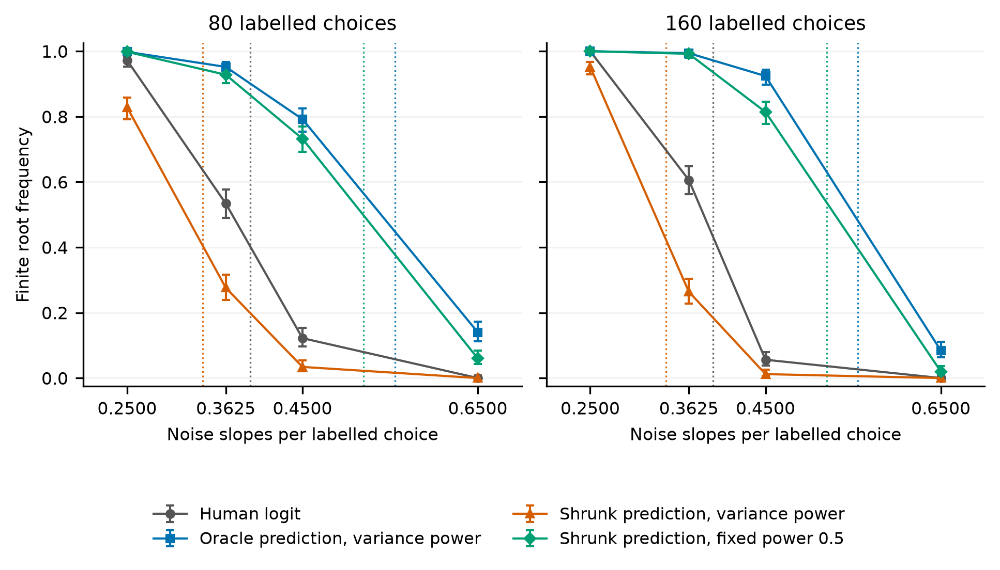

# When prediction assisted logit estimates exist

## Abstract

When human choices are scarce, analysts can correct predictions from auxiliary choice menus with a small labelled sample. This correction can make the unpenalized logit objective unbounded even when ordinary logit on the same human choices has a finite estimate. We give a support test and compute the largest feasible correction weight from the observed menus. Under independent Gaussian attributes, we derive the critical number of utility slopes per labelled choice for binary and multinomial logit. With labels and correction weight fixed, changing the frequencies of the same menus can determine whether a finite estimate exists. The effect persists with true choice probabilities and matching derivatives through any finite order at the true coefficient. Released vaccine choices show it with matched gradients and Hessians at a reference point. A Jeffreys penalty at the conventional human-sample strength leaves the objective unbounded in 19 selected vaccine designs. Near the feasible correction limit, utility gaps determine the growth of held-out log loss. Moving from half to nine tenths of the limit raises that loss in 90 of 93 Swissmetro allocations with a positive limit.

Keywords: discrete choice; multinomial logit; prediction-powered inference; separation; auxiliary samples

## 1 Introduction

Choice analysts can obtain predicted responses for profiles without observed human choices. Prediction-powered inference uses a smaller set of human choices to correct errors in these predictions (Angelopoulos et al., 2023, 2026). Recent work uses language models to support choice modelling and conjoint estimation (Sfeir et al., 2026; Wang et al., 2026; Ye and Yoganarasimhan, 2026). Comparisons of human and model-generated food choices also report differences in utility magnitudes (Califano and Caracciolo, 2026). These applications raise a basic estimation question. Does the corrected objective attain a finite minimum for the choice menus at hand?

Consider a food choice experiment with ten labelled respondents. In 21 of 500 label allocations the unit-weight correction puts the target moment outside the range of fitted choice probabilities. In 18 of those 21 allocations, ordinary multinomial logit on the same human choices has a finite estimate. This failure matters because some optimizers can return a finite coefficient vector even when the objective decreases without bound. We give a finite-design check, explain through two controlled comparisons why local diagnostics miss the failure, and calculate what happens to forecast probabilities as the correction weight approaches its limit.

Classical separation and convex support characterize ordinary likelihood existence (Albert and Anderson, 1984; Geyer, 2009; Correia et al., 2026). Prediction-powered inference provides the corrected loss, fixed-dimensional regular inference and variance-oriented tuning (Angelopoulos et al., 2026). Recent analyses establish conditional logistic risk improvements given a finite pilot and document quasi-separation in prediction-assisted Bradley–Terry estimation (Chen et al., 2026; Vadlamani et al., 2026). We characterize when the corrected choice objective attains a finite optimum and derive the critical parameter-to-label ratio with a finite auxiliary sample ratio. A fixed-design construction identifies what local diagnostics miss. With the same menus and predictor, frequency changes can move the corrected target beyond its attainable range.

We use released food, transport and third-party prediction archives to examine when the distinction affects choice forecasts. The empirical comparisons fix the utility specification and hold out human choices for evaluation. Food and transport splits keep each respondent's tasks together. The third-party prediction archive permits a matched comparison of the fitted objectives. The accompanying Supplementary Methods and Proofs contains the complete derivations, additional simulations and sensitivity analyses. The Reproduction Materials give the corresponding code, public source identifiers and saved results.

## 2 Finite estimation on observed choice menus

Let $x_{ij}$ denote the utility features of available alternative $j$ in menu $i$, and let $A_i$ be its set of available alternatives. For probabilities $r_{ij}$ on that set, use the choice loss

$$\ell_i(\beta,r_i)=\log\sum_{j\in A_i}\exp(x_{ij}^T\beta)-\sum_{j\in A_i}r_{ij}x_{ij}^T\beta. \qquad (1)$$

For a labelled menu, $Y_i$ assigns unit mass to the observed choice. The frozen predictor gives probabilities $g_i$ on both the labelled sample $L$ and the auxiliary sample $U$. Let $L_s(\beta,r)$ average (1) over sample $s$. With $m$ labelled and $N$ auxiliary menus, the corrected criterion is

$$Q_\lambda(\beta)=L_L(\beta,Y)+\lambda\{L_U(\beta,g)-L_L(\beta,g)\},\qquad 0\leq\lambda\leq1. \qquad (2)$$

The prediction terms have equal expectations when the samples share a distribution and the predictor and weight are fixed. The corrected population loss then targets the human choice projection. The empirical support condition below applies to any observed design and does not require independent menus. Sections 3 and 4 specify which results use population or sampling assumptions.

Write $w_i=(1-\lambda)/m$ on $L$ and $w_i=\lambda/N$ on $U$. Let $b_\lambda$ be the labelled human feature moment plus $\lambda$ times the difference between auxiliary and labelled predicted feature moments. The first-order condition matches $b_\lambda$ to the weighted fitted feature moment. The set of attainable moments is

$$\mathcal Z_\lambda=\{\sum_i w_i\sum_{j\in A_i}p_{ij}x_{ij}: p_{ij}\geq0,\ \sum_{j\in A_i}p_{ij}=1\}. \qquad (3)$$

Proposition 1. Suppose the within-menu contrasts of the positively weighted menus span the coefficient space. The corrected objective has a unique finite minimizer exactly when $b_\lambda$ lies in the interior of $\mathcal Z_\lambda$. A boundary target has a finite unattained infimum. An exterior target gives an objective unbounded below.

The support function of (3) makes the check operational. In direction $d$, the recession cost is

$$Q_\lambda^\infty(d)=\sum_i w_i\max_{j\in A_i}x_{ij}^Td-b_\lambda^Td. \qquad (4)$$

A positive cost in every nonzero direction makes the objective coercive. A negative cost certifies divergence. At a boundary target, a feasible probability representation gives a lower bound by the log-partition inequality. Every finite coefficient assigns positive mass to all available alternatives and maps into the interior, so no finite coefficient attains the boundary target. This is the classical exponential-family support argument applied to the corrected moment (Geyer, 2009; Rinaldo et al., 2009).

To implement the check, use masses $q_{ij}=w_ip_{ij}$. A linear program imposes nonnegative masses, menu totals $w_i$, and moment $b_\lambda$. Maximize the common fraction of each menu weight allocated to every available alternative. A positive optimum certifies an interior moment under full contrast rank. A separate program verifies a negative direction when the target is exterior. A numerical zero or uncertain solution is recorded separately from a certified exterior target. At unit weight the curvature comes from auxiliary menus alone, so their contrasts determine rank.

Because $w_i$ and $b_\lambda$ are affine in $\lambda$, a second linear program maximizes feasible weight directly. Its maximum $c$ is an upper bound on weights yielding a finite estimate. Zero is feasible through the human choice masses, even when ordinary logit is separated. When $0<c\leq1$ and the midpoint has a strictly positive representation with full active rank, interpolating this representation with the two endpoint representations certifies all weights strictly between zero and $c$. Test unit weight separately when $c=1$. Supplementary Appendix C gives the programs, numerical qualifications and weight rules used in the applications.

ChatGPT and Codex assisted with writing and revising the Python scripts for the probability-mass programs, the simulations and the checks of empirical results. The reproduction archive records input versions, seeds and package versions. It verifies exact constructions with rational arithmetic and checks empirical classifications using the original menu probabilities and separating directions.

## 3 Population boundaries and the limits of local diagnostics

### 3.1 Binary choices with a finite auxiliary ratio

Let the fitted contrast vector contain an intercept, a standard normal signal $S$, and $q$ independent standard normal noise coordinates. Generate choices with $P(Y=1\mid S)=\sigma(\gamma S)$ for a finite signal coefficient $\gamma$. The noise coordinates are independent of the fixed-dimensional observations determining $S$, the human choice $Y$, a binary proxy $Z$ and a frozen prediction $g$ strictly between zero and one. The prediction may also use other fixed-dimensional information independent of the noise. The labelled and auxiliary samples draw independently from this law. Let $N/m\to\tau>0$ and $q/m\to\kappa$.

Orient the row residuals by $s_L=1-2Y$ and $s_U=2Z-1$, and put $r=|Y-g|$. After multiplication by $m$, the oriented row intervals have limits

$$I_L=[\lambda r,1-\lambda+\lambda r],\qquad I_U=(\lambda/\tau)[-g,1-g]\ \text{if } Z=1, \qquad (5)$$

$$I_U=(\lambda/\tau)[g-1,g]\ \text{if } Z=0.$$

For standard normal $H$, write $B(h,t,I)=E[(H-h)^2-\operatorname{dist}^2(H-h,tI)]$, with this expectation over $H$ alone. Let $h_\eta(S)=\eta_0+\eta_1S$.

Theorem 1. Under the stated model, for fixed $0<\lambda\leq1$ the critical slope-to-label ratio is

$$\kappa_c=\inf_{\eta\in\mathbb R^2}\sup_{t\geq0}\{E B(s_Lh_\eta,t,I_L)+\tau E B(s_Uh_\eta,t,I_U)\}. \qquad (6)$$

Below this ratio the probability of a unique finite minimizer tends to one. Above it the probability of a finite minimizer tends to zero. The equality case is unspecified.

The product of the intervals in (5) encodes exactly the finite-design score equation. On a labelled row, the residual has a strictly positive oriented lower bound. This makes the common scale identifiable in the cone of the product intervals. Condition on the low-dimensional observations. After imposing the intercept and signal constraints, the remaining Gaussian attributes produce an independent random nullspace. The conic kinematic theorem converts the intersection probability into a threshold in the statistical dimension (Amelunxen et al., 2014). Supplementary Appendix A evaluates its limit in (6), including the localization of both optimizations and the active-rank condition. The theorem adds the finite auxiliary ratio and signed residual magnitudes to the ordinary logistic separation question (Candès and Sur, 2020). The labelled row losses can have infimum minus infinity even when the complete corrected objective is convex. The rowwise finite-infimum assumption in Koriyama and Bellec (2025) excludes this setting.

### 3.2 Whole choice menus

With a fixed number $J$ of alternatives, keep all choice probabilities in their joint simplex. Let $E=\{z\in\mathbb R^J:\sum_j z_j=0\}$. Center independent standard normal signal profiles across alternatives to obtain $S\in E$ and generate human choices with probabilities proportional to $\exp(\gamma S_j)$ for finite $\gamma$. Fit $J-1$ alternative constants, the common signal slope and $q$ common noise slopes. Each noise profile column has independent standard normal entries before centering, across menus and alternatives, and is independent of $(S,Y,g)$. Both samples are independent draws. The frozen vector $g\in\Delta_J$ may assign zero mass to some alternatives. Require $E\|g-e_Y\|^2>0$, where $e_Y$ is the observed one-hot choice and $\Delta_J$ is the probability simplex. Use the sample ratios from Section 3.1.

The whole-menu residual sets in $E$ are

$$D_L=(1-\lambda)\Delta_J-e_Y+\lambda g,\qquad D_U=(\lambda/\tau)(\Delta_J-g). \qquad (7)$$

For $a\in E$, $b\in\mathbb R$ and independent standard Gaussian $H$ in $E$, write $h=a+bS$ and $B_J(z,D)=\|z\|^2-\operatorname{dist}^2(z,D)$. The unique finite fit has probability tending to one below the critical ratio

$$\inf_{(a,b)\in E\times\mathbb R}\sup_{t\geq0}\{E B_J(H-h,tD_L)+\tau E B_J(H-h,tD_U)\}. \qquad (8)$$

Above this ratio the probability of a finite fit tends to zero, with equality left unspecified. This is the whole-menu theorem in Supplementary Appendix F. Equation (8) counts common noise slopes per labelled menu. Its projection preserves the zero-sum residuals of each menu. The supplement includes hard predictions, a binary reduction and an extension to a specified class of independent discrete attributes. The applications below use the exact finite-design check, so they do not require Gaussian menus or independent repeated choices.

When one respondent completes several tasks, cluster-robust PPI provides standard errors and variance-based tuning (Broska and Howes, 2026). Supplementary Appendix H shows that within-person correlation in the attributes can shift the binary existence boundary. With two tasks per person and equal sample sizes, increasing correlation from zero to 0.99 lowers the critical ratio from 0.675 to 0.495 slopes per labelled respondent at unit correction. At correction weight 0.90, the ratio falls from 0.754 to 0.572, with positive log partition weights in both samples. These designs have identical task marginals, population Hessians, and fixed-dimensional cluster sandwich covariance. They also have the same exact ordinary-logit existence probability.

### 3.3 Identical scores and different boundaries

Let $\mu(X)$ be the true human probability and let $g_0=E(Y\mid X,Z)$ be a frozen oracle predictor. Put $a_\tau=\tau/(1+\tau)$. For $a_\tau\leq s\leq1$, shrink the prediction to $g_s=\mu+s(g_0-\mu)$ and set $\lambda_s=a_\tau/s$. The product $\lambda_s(g_s-\mu)$ is identical along this path. Each labelled and auxiliary score row at the true coefficient is therefore identical across the correction fits. The population information matrix is also the same under the common sampling law. The existing oracle variance rule selects these powers, so the fixed-dimensional covariance is identical (Supplementary Appendix B).

In the balanced Gaussian model with proxy error 0.1 and $\tau=1$, the half-shrunk predictor at unit weight has critical ratio below 0.46. The unshrunk predictor at half weight has critical ratio above 0.72. At $q/m\to0.47$, the respective finite-fit probabilities tend to zero and one. Both regular covariance matrices equal $17/25$ of the ordinary human covariance. At signal 1.5 the two boundaries are 0.3363 and 0.5554. Figure 1 reports a matched simulation at that signal. With 160 labelled rows and 72 noise slopes, the two observed finite-fit frequencies are 0.012 and 0.924 across the same 500 samples.

Figure 1  Finite-fit frequencies with identical realized truth scores and fixed-dimensional covariance. The labelled and auxiliary samples have the same size. Each setting retains 500 independent Gaussian draws shared by the competing fits. Vertical bars are 95% Wilson binomial intervals. Dotted lines are the theoretical boundaries. Supplementary Appendix B gives the full grid and paired comparisons.

### 3.4 A fixed-weight example with three existence outcomes

The difference can also occur with the same labelled choices, prediction rule, correction weight and auxiliary sample size. Table 1 gives a two-coefficient example with an intercept and a contrast $x$. Set $g(x,z)=1/2+z/4$ and use unit correction. The labelled sample contains eight rows at each of $(x,z)=(0,-1)$, $(0,1)$, $(-1/2,0)$ and $(1/2,0)$. Their positive choice counts are 2, 6, 1 and 7. Each auxiliary sample has eight rows at each of the two $x=0$ informative profiles. Only the other 16 auxiliary contrasts differ across the three designs.

Table 1  Three outcomes from 32 labelled and 32 auxiliary rows at unit weight

| Auxiliary design | Remaining 16 auxiliary contrasts | Positive-slope recession | Outcome |
| --- | --- | --- | --- |
| A | 8 each at −1/2 and 1/2 | 1/32 | Unique finite minimum |
| B | 6 at 0, 4 each at −1/2 and 1/2, 1 each at −1 and 1 | 0 | Unattained finite infimum |
| C | 12 at 0, 2 each at −1 and 1 | −1/32 | Unbounded below |

At the zero reference coefficient, the corrected gradient is $(0,-3/32)^T$ in all three designs. The Hessian is diagonal with entries $1/4$ and $1/32$, and every third derivative is zero. Each auxiliary score row at the reference either comes from one of the same informative profiles or equals zero. The labelled scores agree by construction. Consequently the empirical sandwich and first Newton step also agree. The ordinary human model is finite in all three designs because both outcomes occur at every labelled profile. The finite corrected slope in design A is $2\log 7$.

The recession calculation explains the difference. The three sets of auxiliary contrasts have the same second moment, which determines the Hessian at zero. Their mean magnitudes differ, which changes the positive-slope limit in (4). For any prescribed finite order, one can match further even moments of symmetric rational contrast distributions and retain different absolute moments. The same construction then gives all three global outcomes with matching derivatives through that order at the reference. The moment-matching argument uses classical approximation duality (Cai and Low, 2011). Supplementary Appendix B gives the general result for positive rational weights and verifies 30 constructions through order 33. In the constructed common population, $g$ is a correct conditional probability on its information set. Each of these designs and label configurations has positive probability of being realized.

The same limitation extends to a finite list of preassigned coefficient vectors. Supplementary Appendix B7 gives equal-weight designs with identical diagnostics at those checkpoints, including an example with matching diagnostics after the first Newton update. With a known range and count of paired contrasts, the zero-point Hessian bounds the finite-estimation limit. In Table 1 the compatible limits range from 0.5 to 1 (Appendix B8). At weight 0.5, all three outcomes occur when the labelled and auxiliary samples use the same nine discrete profiles and all derivatives through order five agree (Appendix J).

The common-support construction extends to any prescribed finite order. With correction weight 0.5, three auxiliary frequency designs can share every menu, the same total count and all derivatives through that order while producing the three outcomes in Table 1. Appendix J derives the construction with true choice probabilities and matches derivatives at the true coefficient. It also tests the frequency effect using released vaccine choices. At weight 0.75, we find a pair of opposite outcomes for each of two fixed prediction rules. Within each pair, the same 50 labelled records and 1,199 auxiliary menus are used, and a frequency change preserves the gradient and Hessian at zero. These are deliberately constructed changes within the released menus.

## 4 Consequences for forecasting

### 4.1 Utility gaps near a positive correction limit

For a fixed design, let $c\in(0,1)$ be an upper weight limit with interior fits just below it. Suppose the target at $c$ is in the relative interior of one facet of the moment set. Let $d$ be the unit exposing direction of that facet, and let $\Delta_{ij}=\max_{k\in A_i}x_{ik}^Td-x_{ij}^Td$. Denote the smallest strictly positive fitted-menu utility gap by $\Delta_*$. Assume the active menu weights stay positive near $c$, the contrasts span the coefficient space, and the normal slack vanishes at a positive linear rate as $\lambda$ rises to $c$. The coefficient in the exposing direction then satisfies

$$d^T\widehat\beta_\lambda=\log(1/(c-\lambda))/\Delta_*+O(1). \qquad (9)$$

The orthogonal coefficient approaches the conditional fit on the alternatives tied at the facet. The normal score equates the remaining moment slack to the weighted sum of probabilities on the inferior alternatives, each weighted by its utility gap. The slowest decaying probability has gap $\Delta_*$, giving (9). For each held-out choice, the coefficient of $\log(1/(c-\lambda))$ in its log loss is the chosen alternative's utility gap in direction $d$, divided by $\Delta_*$. A zero gap yields bounded loss. Thus the way a fitted coefficient diverges has a direct implication for the forecasts on a particular evaluation design.

Supplementary Appendix C13 gives the full coefficient expansion, the value and curvature calculations, and the extension to endpoints where several faces bind. In the latter case, successive linear programs select a unique leading direction. The empirical endpoints used below are single facets. The multiple-face verification uses constructed menus.

At unit correction the labelled log partitions lose weight. The limiting direction can then depend on utility gaps from both samples. Supplementary Appendix C17 derives this direction and gives the finite limit when unit correction has multiple finite minimizers.

### 4.2 Released food and transport choices

The RADIANT shortbread experiment has 298 respondents with six complete choice menus each (Chen et al., 2025). We use 100 respondents to train a frozen ridge predictor, 60 to evaluate forecasts and 138 as the pool for labelled and auxiliary allocation. Menus from each person stay together. The fitted multinomial logit has eleven coefficients covering option constants, product attributes and price. At five labelled respondents, 144 of 500 unit-weight targets are exterior, including 40 cases with finite ordinary fits. At ten respondents, those counts are 21 and 18. All 500 unit-weight fits are finite at both twenty and forty respondents. Among the 87 five-person allocations with a positive weight limit below one, the median held-out log loss rises from 1.3075 to 2.2208 when weight increases from half to nine tenths of the limit. In the 356 unit-interior controls at the same budget, the medians are 0.9004 and 0.9264.

We repeat the path analysis on Swissmetro (Bierlaire et al., 2001). A standard four-parameter MNL predictor is trained on 600 of the 1191 eligible respondents. Another 240 respondents supply held-out choices. From the remaining 351, we reveal 2, 5 or 10 respondents' choices and use the others' menus and predictions for correction. Each budget has 96 allocations. The four-parameter target model uses train and car constants and common time and cost coefficients. An eight-parameter version estimates time separately by mode and adds two headway coefficients. Both use the released availability and fare coding.

Table 2  Swissmetro fits with an uncapped positive weight limit

| Fitted specification | Labelled respondents | Positive limits | Median loss at half | Median loss at nine tenths | Paired increases |
| --- | --- | --- | --- | --- | --- |
| Four parameters | 2 | 25 | 1.967 | 3.002 | 24 |
| Four parameters | 5 | 13 | 1.657 | 3.315 | 13 |
| Four parameters | 10 | 3 | 0.994 | 2.439 | 3 |
| Eight parameters | 2 | 20 | 2.160 | 3.704 | 18 |
| Eight parameters | 5 | 24 | 1.970 | 4.635 | 24 |
| Eight parameters | 10 | 8 | 1.389 | 2.922 | 8 |

The 93 positive-limit cases are a subset of 576 allocation-by-model cases. In 59 of the 93, ordinary MNL on the revealed choices is finite. Increasing power from half to nine tenths of each case's own limit raises held-out log loss in 90 of the 93. At the five-person eight-parameter budget, the 64 controls with finite unit-weight fits have median losses of 1.150 and 1.162 at half and nine tenths of unit weight. We also fit direct MNL with the 600 predictor-training respondents and the revealed correction respondents. The direct fit gives lower loss at both planned weights in all 1152 comparisons. This comparison supplies all human choices used for training to the direct fit. It includes 172 cases where the corrected policy uses a prespecified ridge fallback. The results describe overlapping allocations on the released design and the fixed evaluation group.

A nested follow-up adds budgets of 12, 15, 20 and 40 labelled respondents. At 15 labels, 95 of 96 unit-weight fits are finite in each specification. At 20 and 40 labels, every unit-weight fit is finite. Across adjacent budgets, 16 previously finite fits become exterior as respondents move from the auxiliary pool to the labelled sample. At 20 labels, unit-weight correction has mean log loss 0.0799 and 0.1401 above the same-label ridge for the four- and eight-parameter models. Supplementary Appendix C16 reports the results at each budget and a variance-based choice of correction weight.

### 4.3 Matching menus and predictions

An independent archive releases predictions from a language model applied to four RADIANT choice experiments (Alves, 2026). It lets us change menu composition and predicted moments directly with the predictions held in the archive. Use respondent-level evaluation splits and hold the observed correction choices fixed. At 15 labelled respondents, 115 of 120 allocations yield finite fits at unit weight. At five respondents, 268 of 360 do. Two interventions use the same common menu strata. The first reweights auxiliary menus to the labelled frequencies and retains prediction differences within each common menu. It makes no adjustment for a labelled menu missing from the auxiliary sample. The second keeps the original menu frequencies and uses a common predicted feature moment across both roles on each shared menu. The decomposition applies to the recession cost in (4). Supplementary Appendix C and the reproduction archive give all cases and the exact accounting convention.

Table 3  Finite fits using released language model predictions

| Labelled respondents | Allocations | Original unit weight | Matched menu frequencies | Common within-menu predictions |
| --- | --- | --- | --- | --- |
| 15 | 120 | 115 | 114 | 120 |
| 5 | 360 | 268 | 215 | 295 |

At 15 respondents, exact frequency matching leaves all five exterior targets and adds one. Giving the two roles the same predicted moment within shared menus makes all five original exterior targets interior. At five respondents it restores 43 originally exterior fits and makes 16 originally finite fits exterior. In the 15-person comparisons, both interventions have higher mean held-out loss than direct ridge on the same correction labels. With the shared ridge fallback, the mean differences are 0.0640 and 0.0827. The results support checking both the menu frequencies and the predictions within a menu. They use repeated partitions of one released study.

### 4.4 A matched comparison with soft-label choice estimation

Wang et al. (2026) fit choice coefficients to estimated human choice probabilities. We implement their auxiliary-only and pooled second-stage losses on the same public binary choice records used by Lu et al. (2026). We fix the predicted probabilities for every comparison. On the same pooled menus, the all-soft and fully corrected losses share a log partition function. The correction changes only the linear term through the labelled residual feature moment. The losses agree when that moment is zero.

At a budget of 50 human choice records, the pooled all-soft loss has a finite estimate in all 500 allocations with AI-based predictions. Full correction on the same menus is unbounded below in five. Across the 495 common finite fits, full correction raises average log loss by 0.19477 on the same 3405 held-out human choices. At 150 labels, both methods have 500 finite fits and the paired difference is 0.01871. Supplementary Appendix I reports the attribute-only prediction control, the finite-sample identity and the residual limit for each audited case. The archive lacks respondent identifiers. These are within-archive comparisons with a common holdout.

## 5 Discussion

The corrected moment and the active menus determine whether the estimation problem has a finite solution. A favourable variance calculation or a converged local update supplies different information. For known labelled choices and available auxiliary menus, (3) gives a finite-design check. Reporting the active contrast rank, the chosen weight and its distance from any positive limit makes the fitted choice model easier to interpret. When outcomes are scarce, the label budget includes any human choices used to train or prompt the predictor. A direct fit using those choices is an appropriate comparator when they can enter the target likelihood.

The probability boundaries use specified attribute and prediction laws. The repeated-task result covers a balanced binary design with fixed Gaussian within-person correlation. Dependent effect coding, respondent preference heterogeneity and predictors trained on the analysis respondents require separate probability arguments. The observed-design support check applies to fitted criteria with repeated choices. In a blocked experiment, identical menu frequencies and predicted moments make the correction cancel. Equal frequencies alone leave the within-menu moment term. The released analyses illustrate these mechanisms with food and travel choices and with fixed evaluation groups. They establish finite-estimate and forecast comparisons under the recorded designs.

Firth estimation addresses separation in ordinary choice likelihoods (Kessels et al., 2019). When the same log-information penalty is added to the corrected objective, its growth must offset the downward slope of the correction. Appendix K derives the exact strict-coercivity threshold in terms of within-menu contrasts and gives a counterexample at the usual human-sample strength. In all 19 selected exterior vaccine designs, the original directions still certify an unbounded objective at that strength. A finite ordinary model remains a benchmark for these comparisons.

The supplement describes extensions and alternatives, including sample-size-dependent powers, penalized estimates and explicit fallback policies. Each changes a specific part of the fitting problem. Penalized or pooled fits can give meaningful forecasts when the compensated objective fails, provided their targets and human-label costs are reported. The estimated probability on a held-out human choice remains the measure of predictive performance in the applications here.

## Data availability

RADIANT choice records are publicly available from Zenodo (Chen et al., 2025). The independent predictions are archived with Alves's released study. Swissmetro records are distributed with Biogeme. Supplementary Methods and Proofs identifies the additional sources, and Reproduction Materials contains pinned input hashes, data download instructions, the analysis code and derived outputs. The applications reported here use released choices, released predictions and simulated data.

## Declaration of generative AI assistance

During preparation of this work, ChatGPT and Codex were used to assist with literature searches, development and checking of mathematical arguments, programming, numerical analysis, manuscript drafting and editing.

## References

Albert, A., Anderson, J. A. (1984). On the existence of maximum likelihood estimates in logistic regression models. Biometrika 71(1), 1–10. https://doi.org/10.1093/biomet/71.1.1

Alves, J.N. (2026). Estimand-specific authorization of synthetic survey responses: preregistered protocol, code and pilot outputs (Study 2). Software, protocol and outputs deposited 4 October 2026. Zenodo. https://doi.org/10.5281/zenodo.23140919

Amelunxen, D., Lotz, M., McCoy, M.B., Tropp, J.A. (2014). Living on the edge: Phase transitions in convex programs with random data. Information and Inference 3, 224–294. https://doi.org/10.1093/imaiai/iau005

Angelopoulos, A.N., Bates, S., Fannjiang, C., Jordan, M.I., Zrnic, T. (2023). Prediction-powered inference. Science 382, 669–674. Preprint: https://arxiv.org/abs/2301.09633

Angelopoulos, A.N., Duchi, J.C., Zrnic, T. (2026). PPI++: Efficient prediction-powered inference. Annals of Applied Statistics 20(3), 2235–2252. https://doi.org/10.1214/26-AOAS2215

Bierlaire, M., Axhausen, K.W., Abay, G. (2001). The acceptance of modal innovation: The case of Swissmetro. Swiss Transport Research Conference, Monte Verità. https://transp-or.epfl.ch/documents/proceedings/BierAxhaAbay01.pdf

Broska, D., Howes, M. (2026). Cluster-Robust Prediction-Powered Inference. Preprint, arXiv:2610.09601v1. https://arxiv.org/abs/2610.09601v1

Cai, T.T., Low, M.G. (2011). Testing composite hypotheses, Hermite polynomials and optimal estimation of a nonsmooth functional. Annals of Statistics 39(2), 1012–1041. https://doi.org/10.1214/10-AOS849

Califano, G., Caracciolo, F. (2026). Do large language models shop like people? Comparing GPT and human food choices using discrete choice experiments. Food Quality and Preference 142, 105930. https://doi.org/10.1016/j.foodqual.2026.105930

Candès, E.J., Sur, P. (2020). The phase transition for the existence of the maximum likelihood estimate in high-dimensional logistic regression. Annals of Statistics 48, 27–42. https://arxiv.org/abs/1804.09753

Chen, J., Mzek, T., Piras, S. (2025). Dataset of choice experiment surveys assessing consumers' and farmers' preferences for five underutilised crops in different European countries. Version V1. Zenodo. https://doi.org/10.5281/zenodo.15420092

Chen, S., Bai, Y., Zhu, H. (2026). Covariance-Calibrated Prediction-Powered Inference. Preprint, arXiv:2610.21837v2. https://arxiv.org/abs/2610.21837v2

Correia, S., Guimarães, P., Zylkin, T. (2026). Verifying the existence of maximum likelihood estimates for generalized linear models. Econometric Reviews 45(9), 1270–1305. https://doi.org/10.1080/07474938.2026.2673989

Geyer, C.J. (2009). Likelihood inference in exponential families and directions of recession. Electronic Journal of Statistics 3, 259–289. https://www.stat.umn.edu/geyer/gdor/

Kessels, R., Jones, B., Goos, P. (2019). Using Firth's method for model estimation and market segmentation based on choice data. Journal of Choice Modelling 31, 1–21. https://doi.org/10.1016/j.jocm.2018.12.002

Koriyama, T., Bellec, P.C. (2025). Phase transitions for the existence of unregularized M-estimators in single index models. Proceedings of Machine Learning Research 267, 31519–31540. https://proceedings.mlr.press/v267/koriyama25a.html

Lu, C., Wang, M., Zhang, D., Zhang, H. (2026). Generative Augmented Inference. Proceedings of Machine Learning Research 306, 81730–81751. https://proceedings.mlr.press/v306/lu26am.html

Rinaldo, A., Fienberg, S.E., Zhou, Y. (2009). On the geometry of discrete exponential families with application to exponential random graph models. Electronic Journal of Statistics 3, 446–484. https://doi.org/10.1214/08-EJS350

Sfeir, G., Nova, G., Hess, S., van Cranenburgh, S. (2026). Can large language models assist choice modelling? Insights into prompting strategies and current models’ capabilities. Journal of Choice Modelling 60, 100623. https://doi.org/10.1016/j.jocm.2026.100623

Vadlamani, A.T., Chang, J.H., Parthasarathy, S., Paul, S. (2026). Transfer Calibrated Prediction Powered Inference. Preprint, arXiv:2609.34156v1. https://arxiv.org/abs/2609.34156v1

Wang, M., Zhang, D.J., Zhang, H. (2026). Large Language Models for Market Research: A Data-Augmentation Approach. Marketing Science 45(4), 728–751. https://doi.org/10.1287/mksc.2025.0009

Ye, Z., Yoganarasimhan, H. (2026). Rectification Difficulty and Optimal Sample Allocation in LLM-Augmented Surveys. Preprint, arXiv:2604.17267v2. https://arxiv.org/abs/2604.17267v2
